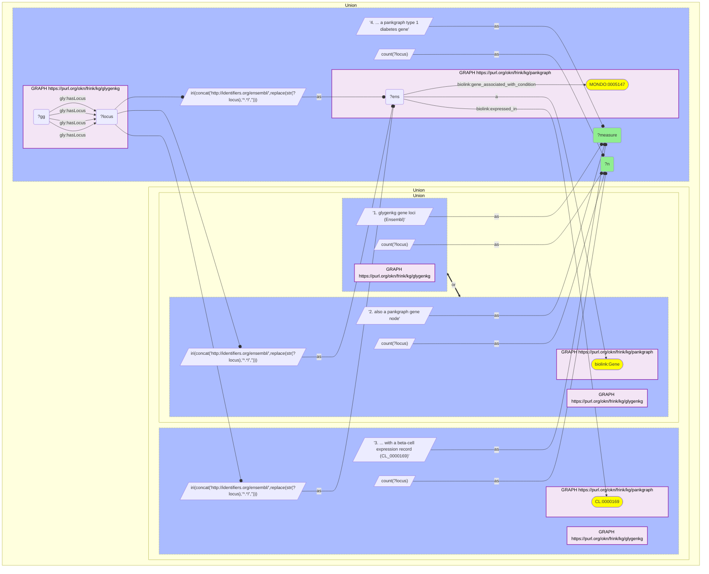

# G33-Q2: glygenkg×pankgraph (Ensembl) — 7,953 of GlyGen's 7,959 gene loci are PanKgraph genes

- **Date:** 2026-10-13
- **Model:** claude-opus-5-5
- **SPARQL endpoint:** https://apps.okn.us/federation/sparql
- **Generated by:** mcp-okn v0.1.0 (build d0aab94)
- **Contents:** 1 query · 1 query diagram

## Knowledge graphs used

- `glygenkg` — <https://purl.org/okn/frink/kg/glygenkg>
- `pankgraph` — <https://purl.org/okn/frink/kg/pankgraph>

## Conversation

👤 **User**

Same crosswalk, coverage angle: how many of glygenkg's Ensembl gene loci are PanKgraph genes, and how many of those are expressed in pancreatic beta cells according to PanKgraph?

---

🧠 **Assistant**

**7,953 of glygenkg's 7,959 Ensembl gene loci (99.9%) are PanKgraph genes; 6,053 have a beta-cell expression record and 73 are PanKgraph type 1 diabetes genes.**

| Measure | Count |
|---|---|
| glygenkg gene loci (Ensembl) | 7,959 |
| also a pankgraph gene node | 7,953 (99.9%) |
| ... with a beta-cell expression record (CL_0000169) | 6,053 (76.1%) |
| ... a pankgraph type 1 diabetes gene | 73 |

**The most complete gene join glygenkg has.** PanKgraph's gene catalogue is genome-wide, so only six glygenkg loci are missing. From PanKgraph's side these 7,953 are a small share of its gene nodes; the join is complete for GlyGen and narrow for PanKgraph.

**What the join gives.** Three quarters of the genes encoding GlyGen glycoproteins (6,053) have a PanKgraph expression record in pancreatic beta cells, which makes "which beta-cell-expressed genes encode glycoproteins" a query over thousands of genes, not a handful. The 73 type 1 diabetes genes are worked in the companion question.

**Join form.** PanKgraph's gene node IS the Ensembl IRI `http://identifiers.org/ensembl/{ENSG}`. Rebuild it from glygenkg's `http://rdf.ebi.ac.uk/resource/ensembl/{ENSG}`. PanKgraph also stores the id as a string literal on `rdfs:seeAlso` (`https://www.ensembl.org/id/{ENSG}`); that route gives the same 7,953 but only when driven from PanKgraph, because a literal built with BIND and matched from the glygenkg side returns 0.

## SPARQL queries executed

#### Query 1

_2026-10-14T02:24:30+00:00 · `glygenkg`, `pankgraph`_

```sparql
PREFIX gly: <https://sparql.glygen.org/ontology/>
PREFIX gco: <http://purl.jp/bio/12/glyco/conjugate#>
PREFIX glycan: <http://purl.jp/bio/12/glyco/glycan#>
PREFIX faldo: <http://www.biohackathon.org/resource/faldo#>
PREFIX up: <http://purl.uniprot.org/core/>
PREFIX skos: <http://www.w3.org/2004/02/skos/core#>
PREFIX rdfs: <http://www.w3.org/2000/01/rdf-schema#>
PREFIX biolink: <https://w3id.org/biolink/vocab/>
SELECT ?measure ?n WHERE {
  { SELECT ("1. glygenkg gene loci (Ensembl)" AS ?measure) (COUNT(DISTINCT ?locus) AS ?n) WHERE { GRAPH <https://purl.org/okn/frink/kg/glygenkg> { ?gg gly:hasLocus ?locus } } }
  UNION
  { SELECT ("2. also a pankgraph gene node" AS ?measure) (COUNT(DISTINCT ?locus) AS ?n) WHERE {
      { SELECT DISTINCT ?locus WHERE { GRAPH <https://purl.org/okn/frink/kg/glygenkg> { ?gg gly:hasLocus ?locus } } }
      BIND(IRI(CONCAT('http://identifiers.org/ensembl/', REPLACE(STR(?locus),'^.*/',''))) AS ?ens)
      GRAPH <https://purl.org/okn/frink/kg/pankgraph> { ?ens a biolink:Gene } } }
  UNION
  { SELECT ("3. ... with a beta-cell expression record (CL_0000169)" AS ?measure) (COUNT(DISTINCT ?locus) AS ?n) WHERE {
      { SELECT DISTINCT ?locus WHERE { GRAPH <https://purl.org/okn/frink/kg/glygenkg> { ?gg gly:hasLocus ?locus } } }
      BIND(IRI(CONCAT('http://identifiers.org/ensembl/', REPLACE(STR(?locus),'^.*/',''))) AS ?ens)
      GRAPH <https://purl.org/okn/frink/kg/pankgraph> { ?ens biolink:expressed_in <http://purl.obolibrary.org/obo/CL_0000169> } } }
  UNION
  { SELECT ("4. ... a pankgraph type 1 diabetes gene" AS ?measure) (COUNT(DISTINCT ?locus) AS ?n) WHERE {
      { SELECT DISTINCT ?locus WHERE { GRAPH <https://purl.org/okn/frink/kg/glygenkg> { ?gg gly:hasLocus ?locus } } }
      BIND(IRI(CONCAT('http://identifiers.org/ensembl/', REPLACE(STR(?locus),'^.*/',''))) AS ?ens)
      GRAPH <https://purl.org/okn/frink/kg/pankgraph> { ?ens biolink:gene_associated_with_condition <http://purl.obolibrary.org/obo/MONDO_0005147> } } }
} ORDER BY ?measure
```



_4 row(s)_

| measure | n |
| --- | --- |
| 1. glygenkg gene loci (Ensembl) | 7959 |
| 2. also a pankgraph gene node | 7953 |
| 3. ... with a beta-cell expression record (CL_0000169) | 6053 |
| 4. ... a pankgraph type 1 diabetes gene | 73 |
