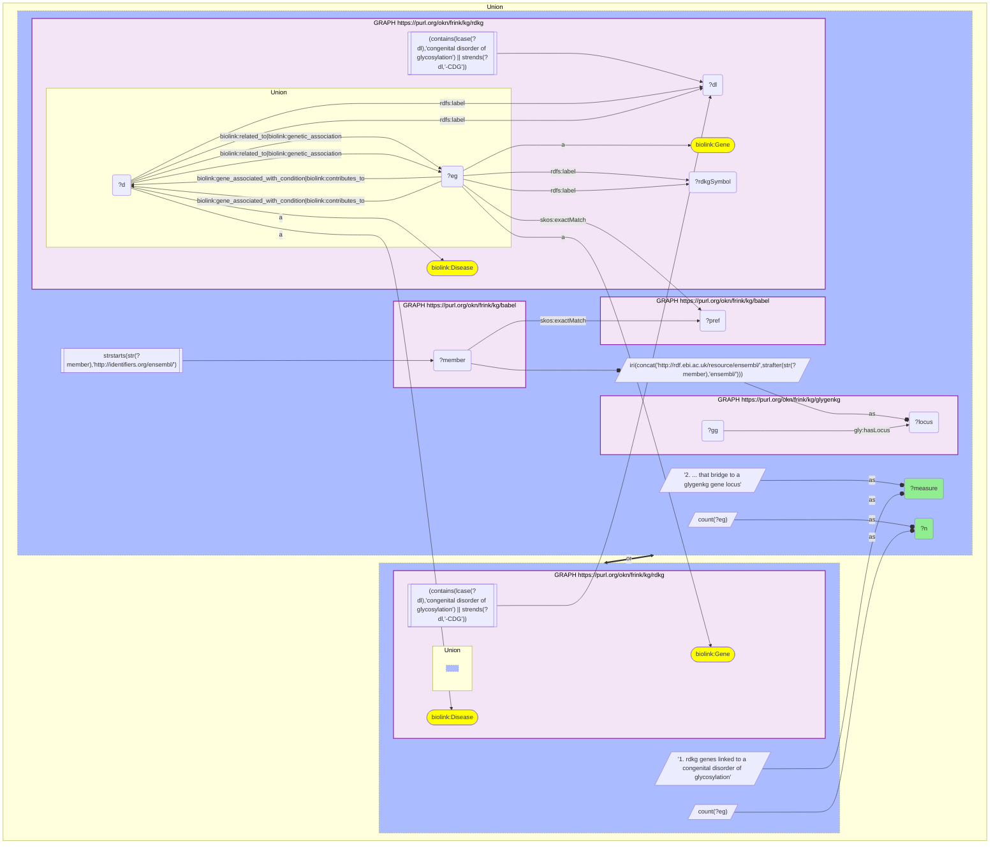

# G34-Q1: rdkg×glygenkg (Entrez→Ensembl via Babel) — the genes behind RDKG's congenital disorders of glycosylation, and whether their own proteins are glycosylated

- **Date:** 2026-10-13
- **Model:** claude-opus-5-5
- **SPARQL endpoint:** https://apps.okn.us/federation/sparql
- **Generated by:** mcp-okn v0.1.0 (build d0aab94)
- **Contents:** 2 queries · 2 query diagrams

## Knowledge graphs used

- `rdkg` — <https://purl.org/okn/frink/kg/rdkg>
- `babel` — <https://purl.org/okn/frink/kg/babel>
- `glygenkg` — <https://purl.org/okn/frink/kg/glygenkg>

## Conversation

👤 **User**

RDKG links genes to the congenital disorders of glycosylation (CDG). Which of those genes encode a protein that GlyGen itself records as glycosylated, at how many residues and with how many glycans?

---

🧠 **Assistant**

**28 of the 41 genes RDKG links to a congenital disorder of glycosylation reach a glygenkg gene locus, and 21 of them encode a protein that GlyGen itself records as glycosylated.**

| Gene | RDKG disorder | Glycosylated residues | Distinct glycans |
|---|---|---|---|
| STT3B | STT3B-congenital disorder of glycosylation | 15 | 45 |
| MAN1B1 | MAN1B1-congenital disorder of glycosylation | 15 | 4 |
| STT3A | STT3A-congenital disorder of glycosylation | 10 | 24 |
| B4GALT1 | B4GALT1-congenital disorder of glycosylation | 10 | 3 |
| MGAT2 | MGAT2-congenital disorder of glycosylation | 4 | 3 |
| ALG8 | ALG8-congenital disorder of glycosylation | 2 | 1 |
| ALG9 | ALG9-congenital disorder of glycosylation | 2 | 1 |
| COG6 | COG6-congenital disorder of glycosylation | 2 | 1 |
| FUT8 | congenital disorder of glycosylation with defective fucosylation | 2 | 1 |
| COG7 | COG7-congenital disorder of glycosylation | 1 | 1 |
| COG5 | COG5-congenital disorder of glycosylation | 1 | 2 |
| PGM1 | PGM1-congenital disorder of glycosylation | 1 | 1 |
| DPM3 | DPM3-congenital disorder of glycosylation | 1 | 1 |
| COG8 | COG8-congenital disorder of glycosylation | 1 | 1 |
| ALG11 | ALG11-congenital disorder of glycosylation | 1 | 0 |
| COG2 | congenital disorder of glycosylation; COG2-CDG | 1 | 1 |
| COG1 | COG1-congenital disorder of glycosylation | 1 | 1 |
| SLC35A2 | SLC35A2-congenital disorder of glycosylation | 1 | 0 |
| SLC35A1 | SLC35A1-congenital disorder of glycosylation; SRD5A3-congenital disorder of glycosylation | 1 | 0 |
| PMM2 | PMM2-congenital disorder of glycosylation; SRD5A3-congenital disorder of glycosylation | 1 | 0 |
| ALG12 | ALG12-congenital disorder of glycosylation | 1 | 0 |

| Step | Count |
|---|---|
| rdkg genes linked to a congenital disorder of glycosylation | 41 |
| ... that bridge to a glygenkg gene locus | 28 |
| ... whose protein has a glycosylation site record (rows above) | 21 |

**The glycosylation machinery is itself glycosylated.** These genes encode the enzymes and transporters that build and attach glycans, and GlyGen records glycans on many of them. The two catalytic subunits of the oligosaccharyltransferase, STT3B and STT3A, lead with 15 and 10 residues and 45 and 24 glycans; the glycosyltransferases and glycosidases MAN1B1, B4GALT1, MGAT2 and FUT8 follow. Most of the rest, including six subunits of the COG complex and four ALG enzymes, have one or two recorded residues.

**The two graphs answer opposite questions about the same gene.** RDKG says what happens when the gene is defective (a disorder of glycosylation). GlyGen says the gene's product is a substrate of the same process. Neither graph states that link; it appears only in the join.

**Limits.** RDKG's gene-disease edges are broad: SLC35A1 and PMM2 are each also attached to the SRD5A3 disorder. Seven bridged genes have no site-level record in this GlyGen release, and 13 of the 41 do not reach a glygenkg locus, either because the protein is outside the release or because the gene has no Ensembl locus there.

**Join form.** RDKG genes are `http://identifiers.org/ncbigene/{id}`; glygenkg loci are Ensembl. Babel resolves the NCBI Gene id to its clique and returns the Ensembl member, which is rewritten to glygenkg's `http://rdf.ebi.ac.uk/resource/ensembl/{ENSG}`.

## SPARQL queries executed

#### Query 1

_2026-10-14T02:24:32+00:00 · `rdkg`, `babel`, `glygenkg`_

```sparql
PREFIX gly: <https://sparql.glygen.org/ontology/>
PREFIX gco: <http://purl.jp/bio/12/glyco/conjugate#>
PREFIX glycan: <http://purl.jp/bio/12/glyco/glycan#>
PREFIX faldo: <http://www.biohackathon.org/resource/faldo#>
PREFIX up: <http://purl.uniprot.org/core/>
PREFIX skos: <http://www.w3.org/2004/02/skos/core#>
PREFIX rdfs: <http://www.w3.org/2000/01/rdf-schema#>
PREFIX biolink: <https://w3id.org/biolink/vocab/>
SELECT ?rdkgSymbol (GROUP_CONCAT(DISTINCT ?dl; SEPARATOR="; ") AS ?rdkgDisorders) ?sites ?glycans WHERE {
  { SELECT DISTINCT ?eg ?locus WHERE {
    { SELECT DISTINCT ?eg ?member WHERE {
      { SELECT DISTINCT ?eg ?pref WHERE {
          { SELECT DISTINCT ?eg WHERE { GRAPH <https://purl.org/okn/frink/kg/rdkg> {
          ?d a biolink:Disease ; rdfs:label ?dl .
          FILTER(CONTAINS(LCASE(?dl),'congenital disorder of glycosylation') || STRENDS(?dl,'-CDG'))
          { ?d biolink:related_to|biolink:genetic_association ?eg } UNION { ?eg biolink:gene_associated_with_condition|biolink:contributes_to ?d }
          ?eg a biolink:Gene ; rdfs:label ?rdkgSymbol } } }
          GRAPH <https://purl.org/okn/frink/kg/babel> { ?eg skos:exactMatch ?pref } } }
      GRAPH <https://purl.org/okn/frink/kg/babel> { ?member skos:exactMatch ?pref } } }
    FILTER(STRSTARTS(STR(?member),'http://identifiers.org/ensembl/'))
    BIND(IRI(CONCAT('http://rdf.ebi.ac.uk/resource/ensembl/', STRAFTER(STR(?member),'ensembl/'))) AS ?locus) } }
  GRAPH <https://purl.org/okn/frink/kg/rdkg> {
          ?d a biolink:Disease ; rdfs:label ?dl .
          FILTER(CONTAINS(LCASE(?dl),'congenital disorder of glycosylation') || STRENDS(?dl,'-CDG'))
          { ?d biolink:related_to|biolink:genetic_association ?eg } UNION { ?eg biolink:gene_associated_with_condition|biolink:contributes_to ?d }
          ?eg a biolink:Gene ; rdfs:label ?rdkgSymbol }
  { SELECT ?locus ?symbol (COUNT(DISTINCT ?position) AS ?sites) (COUNT(DISTINCT ?glyc) AS ?glycans) WHERE {
      GRAPH <https://purl.org/okn/frink/kg/glygenkg> {
        ?protein up:encodedBy ?gene . ?gene gly:hasLocus ?locus ; skos:prefLabel ?symbol .
        BIND(IRI(REPLACE(STR(?protein),'http://purl.uniprot.org/uniprot/','http://purl.obolibrary.org/obo/PR_')) AS ?pr)
        ?rec gly:has_pro_entry ?pr ; gco:glycosylated_at ?site .
        ?site faldo:location ?loc . ?loc faldo:position ?position .
        OPTIONAL { ?site gco:has_saccharide ?glyc }
      } } GROUP BY ?locus ?symbol  }
} GROUP BY ?rdkgSymbol ?sites ?glycans ORDER BY DESC(?sites)
```



```mermaid
graph TD
classDef projected fill:lightgreen;
classDef literal fill:orange;
classDef iri fill:yellow;
  q0v12("?d")
  q0v11("?dl")
  q0v13("?eg")
  q0v18("?gene")
  q0v23("?glyc")
  q0v2("?glycans"):::projected 
  q0v21("?loc")
  q0v10("?locus")
  q0v9("?member")
  q0v22("?position")
  q0v16("?pr")
  q0v14("?pref")
  q0v17("?protein")
  q0v1("?rdkgDisorders"):::projected 
  q0v4("?rdkgSymbol"):::projected 
  q0v19("?rec")
  q0v20("?site")
  q0v3("?sites"):::projected 
  q0v15("?symbol")
  q0f0[["strstarts(str(?member),'http://identifiers.org/ensembl/')"]]
  q0f0 --> q0v9
  subgraph q0graph0["GRAPH https://purl.org/okn/frink/kg/rdkg"]
    style q0graph0 fill:#f3e5f5,stroke:#8e24aa,stroke-width:2px,color:#000;
    q0graph0c2(["biolink:Disease"]):::iri 
    q0graph0c4(["biolink:Gene"]):::iri 
    q0graph0f1[["(contains(lcase(?dl),'congenital disorder of glycosylation') || strends(?dl,'-CDG'))"]]
    q0graph0f1 --> q0v11
    q0v12 --"a"--> q0graph0c2
    q0v12 --"rdfs:label"--> q0v11
    subgraph q0uniongraph00[" Union "]
    style q0uniongraph00 color:#000;
      q0v13 --"biolink:gene_associated_with_condition|biolink:contributes_to"--> q0v12
      q0v12 --"biolink:related_to|biolink:genetic_association"--> q0v13
    end
    q0v13 --"a"--> q0graph0c4
    q0v13 --"rdfs:label"--> q0v4
  end
  subgraph q0graph1["GRAPH https://purl.org/okn/frink/kg/babel"]
    style q0graph1 fill:#f3e5f5,stroke:#8e24aa,stroke-width:2px,color:#000;
    q0v13 --"skos:exactMatch"--> q0v14
  end
  subgraph q0graph2["GRAPH https://purl.org/okn/frink/kg/babel"]
    style q0graph2 fill:#f3e5f5,stroke:#8e24aa,stroke-width:2px,color:#000;
    q0v9 --"skos:exactMatch"--> q0v14
  end
  q0bind0[/"iri(concat('http://rdf.ebi.ac.uk/resource/ensembl/',strafter(str(?member),'ensembl/')))"/]
  q0v9 --o q0bind0
  q0bind0 --as--o q0v10
  subgraph q0graph3["GRAPH https://purl.org/okn/frink/kg/rdkg"]
    style q0graph3 fill:#f3e5f5,stroke:#8e24aa,stroke-width:2px,color:#000;
    q0graph3c2(["biolink:Disease"]):::iri 
    q0graph3c4(["biolink:Gene"]):::iri 
    q0graph3f2[["(contains(lcase(?dl),'congenital disorder of glycosylation') || strends(?dl,'-CDG'))"]]
    q0graph3f2 --> q0v11
    q0v12 --"a"--> q0graph3c2
    q0v12 --"rdfs:label"--> q0v11
    subgraph q0uniongraph31[" Union "]
    style q0uniongraph31 color:#000;
      q0v13 --"biolink:gene_associated_with_condition|biolink:contributes_to"--> q0v12
    subgraph q0uniongraph31r[" "]
      style q0uniongraph31r fill:#abf,stroke-dasharray: 3 3;
      q0v12 --"biolink:related_to|biolink:genetic_association"--> q0v13
    end
    end
    q0v13 --"a"--> q0graph3c4
    q0v13 --"rdfs:label"--> q0v4
  end
  subgraph q0graph4["GRAPH https://purl.org/okn/frink/kg/glygenkg"]
    style q0graph4 fill:#f3e5f5,stroke:#8e24aa,stroke-width:2px,color:#000;
    q0v18 --"skos:prefLabel"--> q0v15
    q0v18 --"gly:hasLocus"--> q0v10
    q0v17 --"up:encodedBy"--> q0v18
    q0graph4bind1[/"iri(replace(str(?protein),'http://purl.uniprot.org/uniprot/','http://purl.obolibrary.org/obo/PR_'))"/]
    q0v17 --o q0graph4bind1
    q0graph4bind1 --as--o q0v16
    q0v19 --"gco:glycosylated_at"--> q0v20
    q0v20 --"faldo:location"--> q0v21
    q0v21 --"faldo:position"--> q0v22
    q0v19 --"gly:has_pro_entry"--> q0v16
    subgraph q0optionalgraph40["(optional)"]
    style q0optionalgraph40 fill:#bbf,stroke-dasharray: 5 5,color:#000;
      q0v20 -."gco:has_saccharide".-> q0v23
    end
  end
  q0bind2[/"count(?position)"/]
  q0bind2 --as--o q0v3
  q0bind3[/"count(?position)"/]
  q0bind3 --as--o q0v1
```

_21 row(s)_

| rdkgSymbol | rdkgDisorders | sites | glycans |
| --- | --- | --- | --- |
| STT3B | STT3B-congenital disorder of glycosylation | 15 | 45 |
| MAN1B1 | MAN1B1-congenital disorder of glycosylation | 15 | 4 |
| STT3A | STT3A-congenital disorder of glycosylation | 10 | 24 |
| B4GALT1 | B4GALT1-congenital disorder of glycosylation | 10 | 3 |
| MGAT2 | MGAT2-congenital disorder of glycosylation | 4 | 3 |
| ALG8 | ALG8-congenital disorder of glycosylation | 2 | 1 |
| ALG9 | ALG9-congenital disorder of glycosylation | 2 | 1 |
| COG6 | COG6-congenital disorder of glycosylation | 2 | 1 |
| FUT8 | congenital disorder of glycosylation with defective fucosylation | 2 | 1 |
| COG7 | COG7-congenital disorder of glycosylation | 1 | 1 |
| COG5 | COG5-congenital disorder of glycosylation | 1 | 2 |
| PGM1 | PGM1-congenital disorder of glycosylation | 1 | 1 |
| DPM3 | DPM3-congenital disorder of glycosylation | 1 | 1 |
| COG8 | COG8-congenital disorder of glycosylation | 1 | 1 |
| ALG11 | ALG11-congenital disorder of glycosylation | 1 | 0 |
| COG2 | congenital disorder of glycosylation; COG2-CDG | 1 | 1 |
| COG1 | COG1-congenital disorder of glycosylation | 1 | 1 |
| SLC35A2 | SLC35A2-congenital disorder of glycosylation | 1 | 0 |
| SLC35A1 | SLC35A1-congenital disorder of glycosylation; SRD5A3-congenital disorder of glycosylation | 1 | 0 |
| PMM2 | PMM2-congenital disorder of glycosylation; SRD5A3-congenital disorder of glycosylation | 1 | 0 |
| ALG12 | ALG12-congenital disorder of glycosylation | 1 | 0 |

#### Query 2

_2026-10-14T02:24:33+00:00 · `rdkg`, `babel`, `glygenkg`_

```sparql
PREFIX gly: <https://sparql.glygen.org/ontology/>
PREFIX gco: <http://purl.jp/bio/12/glyco/conjugate#>
PREFIX glycan: <http://purl.jp/bio/12/glyco/glycan#>
PREFIX faldo: <http://www.biohackathon.org/resource/faldo#>
PREFIX up: <http://purl.uniprot.org/core/>
PREFIX skos: <http://www.w3.org/2004/02/skos/core#>
PREFIX rdfs: <http://www.w3.org/2000/01/rdf-schema#>
PREFIX biolink: <https://w3id.org/biolink/vocab/>
SELECT ?measure ?n WHERE {
  { SELECT ("1. rdkg genes linked to a congenital disorder of glycosylation" AS ?measure) (COUNT(DISTINCT ?eg) AS ?n) WHERE { GRAPH <https://purl.org/okn/frink/kg/rdkg> {
          ?d a biolink:Disease ; rdfs:label ?dl .
          FILTER(CONTAINS(LCASE(?dl),'congenital disorder of glycosylation') || STRENDS(?dl,'-CDG'))
          { ?d biolink:related_to|biolink:genetic_association ?eg } UNION { ?eg biolink:gene_associated_with_condition|biolink:contributes_to ?d }
          ?eg a biolink:Gene ; rdfs:label ?rdkgSymbol } } }
  UNION
  { SELECT ("2. ... that bridge to a glygenkg gene locus" AS ?measure) (COUNT(DISTINCT ?eg) AS ?n) WHERE {
    { SELECT DISTINCT ?eg ?member WHERE {
      { SELECT DISTINCT ?eg ?pref WHERE {
          { SELECT DISTINCT ?eg WHERE { GRAPH <https://purl.org/okn/frink/kg/rdkg> {
          ?d a biolink:Disease ; rdfs:label ?dl .
          FILTER(CONTAINS(LCASE(?dl),'congenital disorder of glycosylation') || STRENDS(?dl,'-CDG'))
          { ?d biolink:related_to|biolink:genetic_association ?eg } UNION { ?eg biolink:gene_associated_with_condition|biolink:contributes_to ?d }
          ?eg a biolink:Gene ; rdfs:label ?rdkgSymbol } } }
          GRAPH <https://purl.org/okn/frink/kg/babel> { ?eg skos:exactMatch ?pref } } }
      GRAPH <https://purl.org/okn/frink/kg/babel> { ?member skos:exactMatch ?pref } } }
    FILTER(STRSTARTS(STR(?member),'http://identifiers.org/ensembl/'))
    BIND(IRI(CONCAT('http://rdf.ebi.ac.uk/resource/ensembl/', STRAFTER(STR(?member),'ensembl/'))) AS ?locus)
    GRAPH <https://purl.org/okn/frink/kg/glygenkg> { ?gg gly:hasLocus ?locus } } }
} ORDER BY ?measure
```



_2 row(s)_

| measure | n |
| --- | --- |
| 1. rdkg genes linked to a congenital disorder of glycosylation | 41 |
| 2. ... that bridge to a glygenkg gene locus | 28 |
