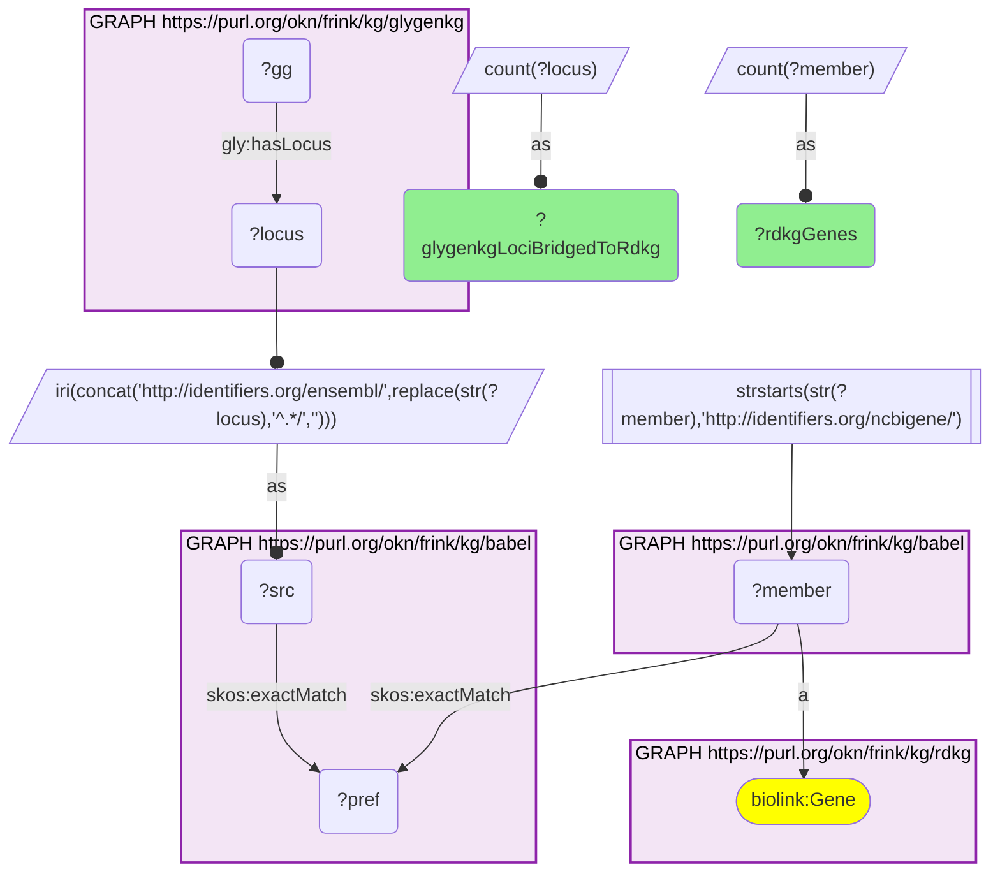
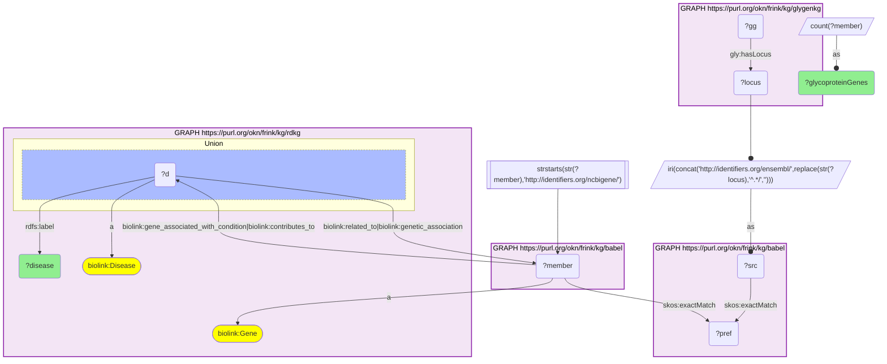

# G34-Q2: rdkg×glygenkg (Entrez→Ensembl via Babel) — 4,327 of GlyGen's gene loci are RDKG disease genes

- **Date:** 2026-10-13
- **Model:** claude-opus-5-5
- **SPARQL endpoint:** https://apps.okn.us/federation/sparql
- **Generated by:** mcp-okn v0.1.0 (build d0aab94)
- **Contents:** 2 queries · 2 query diagrams

## Knowledge graphs used

- `glygenkg` — <https://purl.org/okn/frink/kg/glygenkg>
- `babel` — <https://purl.org/okn/frink/kg/babel>
- `rdkg` — <https://purl.org/okn/frink/kg/rdkg>

## Conversation

👤 **User**

Same crosswalk, coverage angle: how many of glygenkg's gene loci bridge to an RDKG gene, and which rare diseases have the most genes encoding GlyGen glycoproteins?

---

🧠 **Assistant**

**4,327 of glygenkg's 7,959 gene loci (54.4%) bridge to an RDKG gene, one RDKG gene each.**

| Measure | Count |
|---|---|
| glygenkg loci bridged to an rdkg gene | 4,327 |
| distinct rdkg genes reached | 4,327 |

**Rare diseases with the most genes encoding GlyGen glycoproteins:**

| RDKG disease | Glycoprotein genes |
|---|---|
| hereditary breast ovarian cancer syndrome | 589 |
| hereditary breast carcinoma | 548 |
| breast neoplasm | 547 |
| breast cancer | 547 |
| squamous cell carcinoma of the corpus uteri | 547 |
| undifferentiated carcinoma of the corpus uteri | 547 |
| schizophrenia | 440 |
| colorectal cancer | 434 |
| colorectal carcinoma | 367 |
| colorectal neoplasm | 367 |
| familial prostate carcinoma | 360 |
| prostate cancer | 338 |
| prostate carcinoma | 338 |
| hepatocellular carcinoma | 306 |
| liver cancer | 305 |

**Read the ranking as a property of RDKG, not of glycosylation.** The diseases at the top are the ones RDKG attaches the most genes to in general, through its broad `related_to` and `genetic_association` edges: common cancers and schizophrenia, each with hundreds of genes, and near-duplicate entries with identical counts (breast neoplasm, breast cancer and two uterine carcinomas at 547). A disease leading this list has many associated genes; it is not shown to be enriched for glycoproteins. An enrichment claim would need each disease's total gene count as a denominator, which this query does not compute.

**Coverage.** Just over half of glygenkg's loci reach RDKG, which reflects RDKG's scope (genes with a rare-disease link) more than a gap in the bridge: the same Babel hop reaches 7,928 loci in digcfdekg and 7,932 in spoke-genelab.

**Join form.** glygenkg locus to `http://identifiers.org/ensembl/{ENSG}`, through the Babel clique, to the `http://identifiers.org/ncbigene/{id}` member, which is RDKG's gene IRI with no further rewrite. Both Babel hops are staged in nested DISTINCT subqueries with the scheme filter outside them.

## SPARQL queries executed

#### Query 1

_2026-10-14T02:24:33+00:00 · `glygenkg`, `babel`, `rdkg`_

```sparql
PREFIX gly: <https://sparql.glygen.org/ontology/>
PREFIX gco: <http://purl.jp/bio/12/glyco/conjugate#>
PREFIX glycan: <http://purl.jp/bio/12/glyco/glycan#>
PREFIX faldo: <http://www.biohackathon.org/resource/faldo#>
PREFIX up: <http://purl.uniprot.org/core/>
PREFIX skos: <http://www.w3.org/2004/02/skos/core#>
PREFIX rdfs: <http://www.w3.org/2000/01/rdf-schema#>
SELECT (COUNT(DISTINCT ?locus) AS ?glygenkgLociBridgedToRdkg) (COUNT(DISTINCT ?member) AS ?rdkgGenes) WHERE {
  { SELECT DISTINCT ?locus ?member WHERE {
    { SELECT DISTINCT ?locus ?pref WHERE {
        { SELECT DISTINCT ?locus ?src WHERE { GRAPH <https://purl.org/okn/frink/kg/glygenkg> { ?gg gly:hasLocus ?locus }
            BIND(IRI(CONCAT('http://identifiers.org/ensembl/', REPLACE(STR(?locus),'^.*/',''))) AS ?src) } }
        GRAPH <https://purl.org/okn/frink/kg/babel> { ?src skos:exactMatch ?pref } } }
    GRAPH <https://purl.org/okn/frink/kg/babel> { ?member skos:exactMatch ?pref } } }
  FILTER(STRSTARTS(STR(?member),'http://identifiers.org/ncbigene/'))
  GRAPH <https://purl.org/okn/frink/kg/rdkg> { ?member a <https://w3id.org/biolink/vocab/Gene> }
}
```



_1 row(s)_

| glygenkgLociBridgedToRdkg | rdkgGenes |
| --- | --- |
| 4327 | 4327 |

#### Query 2

_2026-10-14T02:24:34+00:00 · `glygenkg`, `babel`, `rdkg`_

```sparql
PREFIX gly: <https://sparql.glygen.org/ontology/>
PREFIX gco: <http://purl.jp/bio/12/glyco/conjugate#>
PREFIX glycan: <http://purl.jp/bio/12/glyco/glycan#>
PREFIX faldo: <http://www.biohackathon.org/resource/faldo#>
PREFIX up: <http://purl.uniprot.org/core/>
PREFIX skos: <http://www.w3.org/2004/02/skos/core#>
PREFIX rdfs: <http://www.w3.org/2000/01/rdf-schema#>
PREFIX biolink: <https://w3id.org/biolink/vocab/>
SELECT ?disease (COUNT(DISTINCT ?member) AS ?glycoproteinGenes) WHERE {
  { SELECT DISTINCT ?locus ?member WHERE {
    { SELECT DISTINCT ?locus ?pref WHERE {
        { SELECT DISTINCT ?locus ?src WHERE { GRAPH <https://purl.org/okn/frink/kg/glygenkg> { ?gg gly:hasLocus ?locus }
            BIND(IRI(CONCAT('http://identifiers.org/ensembl/', REPLACE(STR(?locus),'^.*/',''))) AS ?src) } }
        GRAPH <https://purl.org/okn/frink/kg/babel> { ?src skos:exactMatch ?pref } } }
    GRAPH <https://purl.org/okn/frink/kg/babel> { ?member skos:exactMatch ?pref } } }
  FILTER(STRSTARTS(STR(?member),'http://identifiers.org/ncbigene/'))
  GRAPH <https://purl.org/okn/frink/kg/rdkg> {
    ?member a biolink:Gene .
    { ?d biolink:related_to|biolink:genetic_association ?member } UNION { ?member biolink:gene_associated_with_condition|biolink:contributes_to ?d }
    ?d a biolink:Disease ; rdfs:label ?disease }
} GROUP BY ?disease ORDER BY DESC(?glycoproteinGenes) LIMIT 15
```



_15 row(s)_

| disease | glycoproteinGenes |
| --- | --- |
| hereditary breast ovarian cancer syndrome | 589 |
| hereditary breast carcinoma | 548 |
| breast neoplasm | 547 |
| breast cancer | 547 |
| squamous cell carcinoma of the corpus uteri | 547 |
| undifferentiated carcinoma of the corpus uteri | 547 |
| schizophrenia | 440 |
| colorectal cancer | 434 |
| colorectal carcinoma | 367 |
| colorectal neoplasm | 367 |
| familial prostate carcinoma | 360 |
| prostate cancer | 338 |
| prostate carcinoma | 338 |
| hepatocellular carcinoma | 306 |
| liver cancer | 305 |
