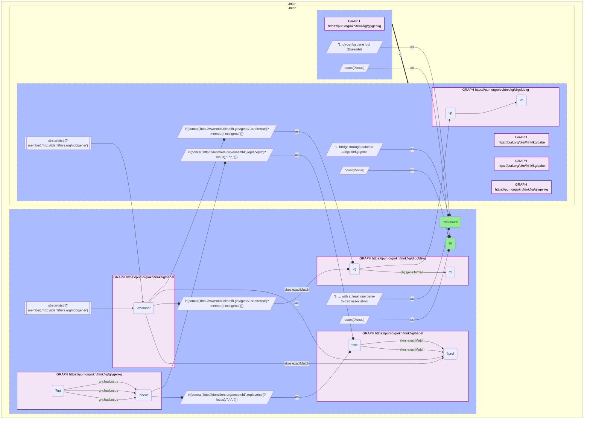

# G35-Q2: digcfdekg×glygenkg (Entrez→Ensembl via Babel) — 7,928 of GlyGen's 7,959 gene loci reach the CFDE gene-trait graph

- **Date:** 2026-10-13
- **Model:** claude-opus-5-5
- **SPARQL endpoint:** https://apps.okn.us/federation/sparql
- **Generated by:** mcp-okn v0.1.0 (build d0aab94)
- **Contents:** 1 query · 1 query diagram

## Knowledge graphs used

- `glygenkg` — <https://purl.org/okn/frink/kg/glygenkg>
- `babel` — <https://purl.org/okn/frink/kg/babel>
- `digcfdekg` — <https://purl.org/okn/frink/kg/digcfdekg>

## Conversation

👤 **User**

Same crosswalk, coverage angle: how many of glygenkg's gene loci bridge to a digcfdekg gene, and how many of those carry at least one gene-to-trait association?

---

🧠 **Assistant**

**7,928 of glygenkg's 7,959 gene loci (99.6%) bridge to a digcfdekg gene, and 7,799 of them (98.0% of all loci) carry at least one gene-to-trait association.**

| Measure | Count |
|---|---|
| glygenkg gene loci (Ensembl) | 7,959 |
| bridge through babel to a digcfdekg gene | 7,928 (99.6%) |
| ... with at least one gene-to-trait association | 7,799 (98.0%) |

**Near-complete, and it carries payload.** Only 31 loci fail to bridge, and 129 of those that bridge have no trait link. Almost every gene encoding a GlyGen glycoprotein can therefore be given trait context from the CFDE gene-trait graph.

**This is the route that supplies disease and trait context for glygenkg.** glygenkg names no disease: its variant records carry only a keyword such as "disease" or "cancer". digcfdekg's gene-to-trait associations, reached through this bridge, supply named traits for 98% of them.

**Join form.** Two rewrites around one bridge: glygenkg's `http://rdf.ebi.ac.uk/resource/ensembl/{ENSG}` to Babel's `http://identifiers.org/ensembl/{ENSG}`; then Babel's `http://identifiers.org/ncbigene/{id}` member to digcfdekg's `http://www.ncbi.nlm.nih.gov/gene/{id}`. Stage both Babel hops in nested DISTINCT subqueries and filter on the target scheme outside them, or the query times out.

## SPARQL queries executed

#### Query 1

_2026-10-14T02:24:35+00:00 · `glygenkg`, `babel`, `digcfdekg`_

```sparql
PREFIX gly: <https://sparql.glygen.org/ontology/>
PREFIX gco: <http://purl.jp/bio/12/glyco/conjugate#>
PREFIX glycan: <http://purl.jp/bio/12/glyco/glycan#>
PREFIX faldo: <http://www.biohackathon.org/resource/faldo#>
PREFIX up: <http://purl.uniprot.org/core/>
PREFIX skos: <http://www.w3.org/2004/02/skos/core#>
PREFIX rdfs: <http://www.w3.org/2000/01/rdf-schema#>
PREFIX dig: <https://purl.org/okn/frink/kg/digcfdekg/schema/>
SELECT ?measure ?n WHERE {
  { SELECT ("1. glygenkg gene loci (Ensembl)" AS ?measure) (COUNT(DISTINCT ?locus) AS ?n) WHERE { GRAPH <https://purl.org/okn/frink/kg/glygenkg> { ?gg gly:hasLocus ?locus } } }
  UNION
  { SELECT ("2. bridge through babel to a digcfdekg gene" AS ?measure) (COUNT(DISTINCT ?locus) AS ?n) WHERE {
      { SELECT DISTINCT ?locus ?member WHERE {
    { SELECT DISTINCT ?locus ?pref WHERE {
        { SELECT DISTINCT ?locus ?src WHERE { GRAPH <https://purl.org/okn/frink/kg/glygenkg> { ?gg gly:hasLocus ?locus }
            BIND(IRI(CONCAT('http://identifiers.org/ensembl/', REPLACE(STR(?locus),'^.*/',''))) AS ?src) } }
        GRAPH <https://purl.org/okn/frink/kg/babel> { ?src skos:exactMatch ?pref } } }
    GRAPH <https://purl.org/okn/frink/kg/babel> { ?member skos:exactMatch ?pref } } }
  FILTER(STRSTARTS(STR(?member),'http://identifiers.org/ncbigene/'))
      BIND(IRI(CONCAT('http://www.ncbi.nlm.nih.gov/gene/', STRAFTER(STR(?member),'ncbigene/'))) AS ?g)
      GRAPH <https://purl.org/okn/frink/kg/digcfdekg> { ?g ?p ?o } } }
  UNION
  { SELECT ("3. ... with at least one gene-to-trait association" AS ?measure) (COUNT(DISTINCT ?locus) AS ?n) WHERE {
      { SELECT DISTINCT ?locus ?member WHERE {
    { SELECT DISTINCT ?locus ?pref WHERE {
        { SELECT DISTINCT ?locus ?src WHERE { GRAPH <https://purl.org/okn/frink/kg/glygenkg> { ?gg gly:hasLocus ?locus }
            BIND(IRI(CONCAT('http://identifiers.org/ensembl/', REPLACE(STR(?locus),'^.*/',''))) AS ?src) } }
        GRAPH <https://purl.org/okn/frink/kg/babel> { ?src skos:exactMatch ?pref } } }
    GRAPH <https://purl.org/okn/frink/kg/babel> { ?member skos:exactMatch ?pref } } }
  FILTER(STRSTARTS(STR(?member),'http://identifiers.org/ncbigene/'))
      BIND(IRI(CONCAT('http://www.ncbi.nlm.nih.gov/gene/', STRAFTER(STR(?member),'ncbigene/'))) AS ?g)
      GRAPH <https://purl.org/okn/frink/kg/digcfdekg> { ?g dig:geneToTrait ?t } } }
} ORDER BY ?measure
```



_3 row(s)_

| measure | n |
| --- | --- |
| 1. glygenkg gene loci (Ensembl) | 7959 |
| 2. bridge through babel to a digcfdekg gene | 7928 |
| 3. ... with at least one gene-to-trait association | 7799 |
