# G36-Q1: spoke-genelab×glygenkg (Entrez→Ensembl via Babel) — mouse orthologs of GlyGen's glycan-richest genes in spaceflight liver

- **Date:** 2026-10-13
- **Model:** claude-opus-5-5
- **SPARQL endpoint:** https://apps.okn.us/federation/sparql
- **Generated by:** mcp-okn v0.1.0 (build d0aab94)
- **Contents:** 1 query · 1 query diagram

## Knowledge graphs used

- `glygenkg` — <https://purl.org/okn/frink/kg/glygenkg>
- `babel` — <https://purl.org/okn/frink/kg/babel>
- `spoke-genelab` — <https://purl.org/okn/frink/kg/spoke-genelab>

## Conversation

👤 **User**

Take the 40 genes whose proteins carry the most distinct glycan structures in GlyGen. Which of their mouse orthologs are differentially expressed in liver in clean spaceflight-versus-ground-control contrasts, and in which direction?

---

🧠 **Assistant**

**Seven of the 40 glycan-richest genes have a mouse ortholog that is differentially expressed in spaceflight liver, each in one of the seven clean liver contrasts: three orthologs up and five down.**

| Human gene | Distinct glycans (GlyGen) | Mouse ortholog | Liver contrasts DE | Direction in flight | log2 fold change |
|---|---|---|---|---|---|
| HP | 287 | Hp | 1 | up | 0.54 |
| LGALS3BP | 216 | Lgals3bp | 1 | up | 0.52 |
| TF | 216 | Trf | 1 | down | -0.61 |
| ANPEP | 197 | Anpep | 1 | up | 0.30 |
| KNG1 | 188 | Kng1 | 1 | down | -0.10 |
| KNG1 | 188 | Kng2 | 1 | down | -0.18 |
| ENPEP | 145 | Enpep | 1 | down | -0.70 |
| CFH | 134 | Cfhr4 | 1 | down | -0.23 |

Eight rows for seven human genes: KNG1 has two mouse orthologs in spoke-genelab, Kng1 and Kng2.

**What the join shows.** Most of the orthologs that respond encode plasma glycoproteins: haptoglobin and galectin-3-binding protein go up, as does the peptidase Anpep; transferrin, both kininogens and a complement factor H-related gene go down, as does the peptidase Enpep. The effects are modest, all below a log2 fold change of 1 in magnitude, and none is replicated: each ortholog is significant in exactly one of the seven contrasts.

**How to read "clean".** The seven assays are the liver transcription-profiling contrasts that `get_valid_contrasts` returns as clean: Space Flight versus Ground Control, with the two arms matched on every covariate and on the tissue material. Positive log2 fold change means higher in flight. Significance is adjusted p < 0.05.

**Limits.** The measurement is mouse messenger RNA; GlyGen's glycans are on the human protein. The join says the gene encoding a heavily glycosylated human protein has a mouse ortholog whose transcript changes in flight. It says nothing about the protein's abundance or its glycoforms in flight. The other 33 of the 40 genes either have no mouse ortholog in spoke-genelab or no significant result in these seven contrasts; the query does not distinguish the two.

**Join form.** glygenkg Ensembl locus, through Babel, to the human NCBI Gene id, rewritten to spoke-genelab's `http://www.ncbi.nlm.nih.gov/gene/{id}`; then spoke-genelab's own `IS_ORTHOLOG_MGiG` edge from the mouse gene, which is the node the expression statements attach to.

## SPARQL queries executed

#### Query 1

_2026-10-14T02:24:36+00:00 · `glygenkg`, `babel`, `spoke-genelab`_

```sparql
PREFIX gly: <https://sparql.glygen.org/ontology/>
PREFIX gco: <http://purl.jp/bio/12/glyco/conjugate#>
PREFIX glycan: <http://purl.jp/bio/12/glyco/glycan#>
PREFIX faldo: <http://www.biohackathon.org/resource/faldo#>
PREFIX up: <http://purl.uniprot.org/core/>
PREFIX skos: <http://www.w3.org/2004/02/skos/core#>
PREFIX rdfs: <http://www.w3.org/2000/01/rdf-schema#>
PREFIX rdf: <http://www.w3.org/1999/02/22-rdf-syntax-ns#>
PREFIX s: <https://purl.org/okn/frink/kg/spoke-genelab/schema/>
SELECT ?symbol ?glycans ?mouseSymbol (COUNT(DISTINCT ?assay) AS ?liverContrastsDE)
       (COUNT(DISTINCT IF(?lfc > 0, ?assay, ?none)) AS ?upInFlight) (COUNT(DISTINCT IF(?lfc < 0, ?assay, ?none)) AS ?downInFlight)
       (MIN(?lfc) AS ?minLog2fc) (MAX(?lfc) AS ?maxLog2fc) WHERE {
  { SELECT DISTINCT ?locus ?symbol ?glycans ?member WHERE {
    { SELECT DISTINCT ?locus ?symbol ?glycans ?pref WHERE {
        { SELECT ?locus ?symbol ?glycans ?src WHERE {
            { SELECT ?locus ?symbol (COUNT(DISTINCT ?position) AS ?sites) (COUNT(DISTINCT ?glyc) AS ?glycans) WHERE {
      GRAPH <https://purl.org/okn/frink/kg/glygenkg> {
        ?protein up:encodedBy ?gene . ?gene gly:hasLocus ?locus ; skos:prefLabel ?symbol .
        BIND(IRI(REPLACE(STR(?protein),'http://purl.uniprot.org/uniprot/','http://purl.obolibrary.org/obo/PR_')) AS ?pr)
        ?rec gly:has_pro_entry ?pr ; gco:glycosylated_at ?site .
        ?site faldo:location ?loc . ?loc faldo:position ?position .
        OPTIONAL { ?site gco:has_saccharide ?glyc }
      } } GROUP BY ?locus ?symbol ORDER BY DESC(?glycans) LIMIT 40 }
            BIND(IRI(CONCAT('http://identifiers.org/ensembl/', REPLACE(STR(?locus),'^.*/',''))) AS ?src) } }
        GRAPH <https://purl.org/okn/frink/kg/babel> { ?src skos:exactMatch ?pref } } }
    GRAPH <https://purl.org/okn/frink/kg/babel> { ?member skos:exactMatch ?pref } } }
  FILTER(STRSTARTS(STR(?member),'http://identifiers.org/ncbigene/'))
  BIND(IRI(CONCAT('http://www.ncbi.nlm.nih.gov/gene/', STRAFTER(STR(?member),'ncbigene/'))) AS ?hg)
  GRAPH <https://purl.org/okn/frink/kg/spoke-genelab> {
    ?mg s:IS_ORTHOLOG_MGiG ?hg ; s:organism "Mus musculus" ; s:symbol ?mouseSymbol .
    ?st rdf:subject ?assay ; rdf:predicate s:MEASURED_DIFFERENTIAL_EXPRESSION_ASmMG ; rdf:object ?mg ;
        s:adj_p_value ?p ; s:log2fc ?lfc .
    FILTER(?p < 0.05) }
  # ?assay = the clean Space-Flight-vs-Ground-Control liver transcription-profiling
  # contrasts returned by get_valid_contrasts() (arms matched on every covariate).
  VALUES ?assay {
    <https://purl.org/okn/frink/kg/spoke-genelab/node/OSD-137-2d49c2d99e55a9e2c2729122a7521106>
    <https://purl.org/okn/frink/kg/spoke-genelab/node/OSD-173-ee429909dcdb03b35f1f4b3841e43535>
    <https://purl.org/okn/frink/kg/spoke-genelab/node/OSD-245-44db6dca1026abb90902ca4f0dff1440>
    <https://purl.org/okn/frink/kg/spoke-genelab/node/OSD-25-e4263b3370f6c7cfbb04a37d79742f3f>
    <https://purl.org/okn/frink/kg/spoke-genelab/node/OSD-47-65754b3ba1b48856d4afd330ef225e46>
    <https://purl.org/okn/frink/kg/spoke-genelab/node/OSD-48-78339eb44e112247d0884d9dd11fbf66>
    <https://purl.org/okn/frink/kg/spoke-genelab/node/OSD-48-e5367f6840912de790e4dce3ac16998c>
  }
} GROUP BY ?symbol ?glycans ?mouseSymbol ORDER BY DESC(?liverContrastsDE) DESC(?glycans)
```

```mermaid
graph TD
classDef projected fill:lightgreen;
classDef literal fill:orange;
classDef iri fill:yellow;
  q0v34("?assay")
  q0v3("?downInFlight"):::projected 
  q0v24("?gene")
  q0v29("?glyc")
  q0v7("?glycans"):::projected 
  q0v18("?hg")
  q0v35("?lfc")
  q0v5("?liverContrastsDE"):::projected 
  q0v27("?loc")
  q0v20("?locus")
  q0v1("?maxLog2fc"):::projected 
  q0v17("?member")
  q0v33("?mg")
  q0v2("?minLog2fc"):::projected 
  q0v6("?mouseSymbol"):::projected 
  q0v31("?p")
  q0v28("?position")
  q0v22("?pr")
  q0v30("?pref")
  q0v23("?protein")
  q0v25("?rec")
  q0v26("?site")
  q0v21("?sites")
  q0v19("?src")
  q0v32("?st")
  q0v8("?symbol"):::projected 
  q0v4("?upInFlight"):::projected 
  q0f0[["strstarts(str(?member),'http://identifiers.org/ncbigene/')"]]
  q0f0 --> q0v17
  subgraph q0graph0["GRAPH https://purl.org/okn/frink/kg/glygenkg"]
    style q0graph0 fill:#f3e5f5,stroke:#8e24aa,stroke-width:2px,color:#000;
    q0v24 --"skos:prefLabel"--> q0v8
    q0v24 --"gly:hasLocus"--> q0v20
    q0v23 --"up:encodedBy"--> q0v24
    q0graph0bind0[/"iri(replace(str(?protein),'http://purl.uniprot.org/uniprot/','http://purl.obolibrary.org/obo/PR_'))"/]
    q0v23 --o q0graph0bind0
    q0graph0bind0 --as--o q0v22
    q0v25 --"gco:glycosylated_at"--> q0v26
    q0v26 --"faldo:location"--> q0v27
    q0v27 --"faldo:position"--> q0v28
    q0v25 --"gly:has_pro_entry"--> q0v22
    subgraph q0optionalgraph00["(optional)"]
    style q0optionalgraph00 fill:#bbf,stroke-dasharray: 5 5,color:#000;
      q0v26 -."gco:has_saccharide".-> q0v29
    end
  end
  q0bind1[/"count(?position)"/]
  q0bind1 --as--o q0v21
  q0bind2[/"count(?glyc)"/]
  q0bind2 --as--o q0v7
  q0bind3[/"iri(concat('http://identifiers.org/ensembl/',replace(str(?locus),'^.*/','')))"/]
  q0v20 --o q0bind3
  q0bind3 --as--o q0v19
  subgraph q0graph1["GRAPH https://purl.org/okn/frink/kg/babel"]
    style q0graph1 fill:#f3e5f5,stroke:#8e24aa,stroke-width:2px,color:#000;
    q0v19 --"skos:exactMatch"--> q0v30
  end
  subgraph q0graph2["GRAPH https://purl.org/okn/frink/kg/babel"]
    style q0graph2 fill:#f3e5f5,stroke:#8e24aa,stroke-width:2px,color:#000;
    q0v17 --"skos:exactMatch"--> q0v30
  end
  q0bind4[/"iri(concat('http://www.ncbi.nlm.nih.gov/gene/',strafter(str(?member),'ncbigene/')))"/]
  q0v17 --o q0bind4
  q0bind4 --as--o q0v18
  subgraph q0graph3["GRAPH https://purl.org/okn/frink/kg/spoke-genelab"]
    style q0graph3 fill:#f3e5f5,stroke:#8e24aa,stroke-width:2px,color:#000;
    q0graph3c5(["Mus musculus"]):::literal 
    q0graph3c2(["s:MEASURED_DIFFERENTIAL_EXPRESSION_ASmMG"]):::iri 
    q0graph3f1[["?p < '0.05^^xsd:decimal'"]]
    q0graph3f1 --> q0v31
    q0v32 --"rdf:predicate"--> q0graph3c2
    q0v32 --"rdf:object"--> q0v33
    q0v33 --"s:organism"--> q0graph3c5
    q0v32 --"rdf:subject"--> q0v34
    q0v32 --"s:adj_p_value"--> q0v31
    q0v32 --"s:log2fc"--> q0v35
    q0v33 --"s:IS_ORTHOLOG_MGiG"--> q0v18
    q0v33 --"s:symbol"--> q0v6
  end
  q0bind5[/"VALUES ?assay"/]
  q0bind5-->q0v34
  q0bind50(["https://purl.org/okn/frink/kg/spoke-genelab/node/OSD-137-2d49c2d99e55a9e2c2729122a7521106"])
  q0bind50 --> q0bind5
  q0bind51(["https://purl.org/okn/frink/kg/spoke-genelab/node/OSD-173-ee429909dcdb03b35f1f4b3841e43535"])
  q0bind51 --> q0bind5
  q0bind52(["https://purl.org/okn/frink/kg/spoke-genelab/node/OSD-245-44db6dca1026abb90902ca4f0dff1440"])
  q0bind52 --> q0bind5
  q0bind5more([+4 more])
  q0bind5more --> q0bind5
  q0bind6[/"count(?position)"/]
  q0bind6 --as--o q0v5
  q0bind7[/"count(?glyc)"/]
  q0bind7 --as--o q0v4
  q0bind8[/"max(?lfc)"/]
  q0bind8 --as--o q0v1
```



_8 row(s)_

| symbol | glycans | mouseSymbol | liverContrastsDE | upInFlight | downInFlight | minLog2fc | maxLog2fc |
| --- | --- | --- | --- | --- | --- | --- | --- |
| HP | 287 | Hp | 1 | 1 | 0 | 0.542524 | 0.542524 |
| LGALS3BP | 216 | Lgals3bp | 1 | 1 | 0 | 0.520631 | 0.520631 |
| TF | 216 | Trf | 1 | 0 | 1 | -0.605993 | -0.605993 |
| ANPEP | 197 | Anpep | 1 | 1 | 0 | 0.298066 | 0.298066 |
| KNG1 | 188 | Kng1 | 1 | 0 | 1 | -0.104192 | -0.104192 |
| KNG1 | 188 | Kng2 | 1 | 0 | 1 | -0.17695 | -0.17695 |
| ENPEP | 145 | Enpep | 1 | 0 | 1 | -0.702316 | -0.702316 |
| CFH | 134 | Cfhr4 | 1 | 0 | 1 | -0.227679 | -0.227679 |
