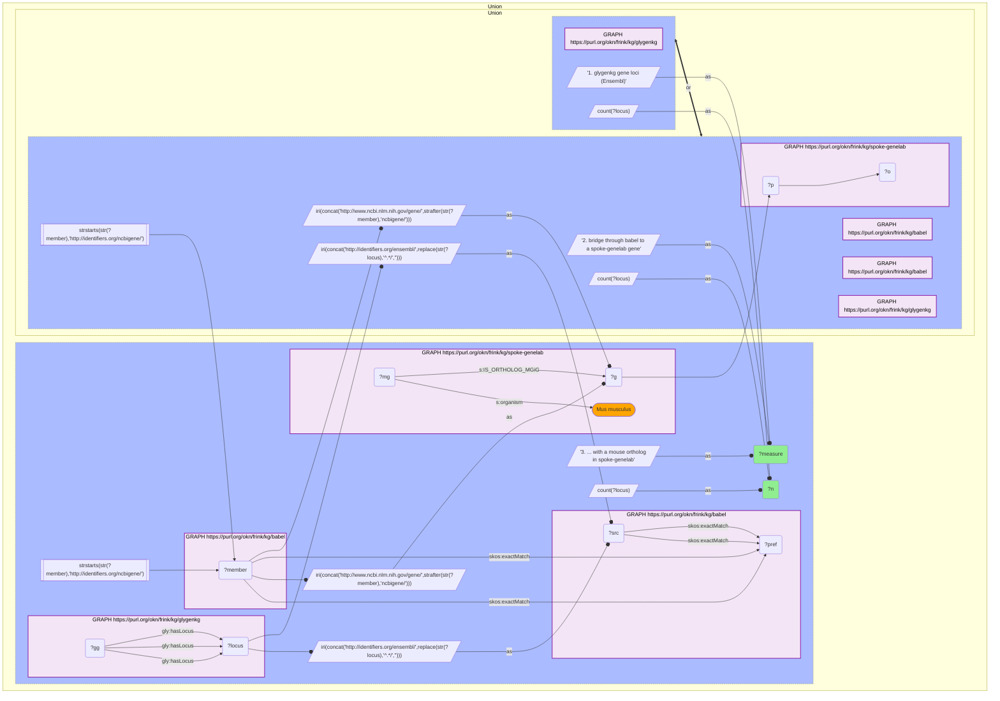

# G36-Q2: spoke-genelab×glygenkg (Entrez→Ensembl via Babel) — 7,932 of GlyGen's 7,959 gene loci reach a GeneLab human gene

- **Date:** 2026-10-13
- **Model:** claude-opus-5-5
- **SPARQL endpoint:** https://apps.okn.us/federation/sparql
- **Generated by:** mcp-okn v0.1.0 (build d0aab94)
- **Contents:** 1 query · 1 query diagram

## Knowledge graphs used

- `glygenkg` — <https://purl.org/okn/frink/kg/glygenkg>
- `babel` — <https://purl.org/okn/frink/kg/babel>
- `spoke-genelab` — <https://purl.org/okn/frink/kg/spoke-genelab>

## Conversation

👤 **User**

Same crosswalk, coverage angle: how many of glygenkg's gene loci bridge to a GeneLab gene, and how many of those have a mouse ortholog GeneLab has measured?

---

🧠 **Assistant**

**7,932 of glygenkg's 7,959 gene loci (99.7%) bridge to a spoke-genelab gene, and 7,750 (97.4%) have a mouse ortholog there.**

| Measure | Count |
|---|---|
| glygenkg gene loci (Ensembl) | 7,959 |
| bridge through babel to a spoke-genelab gene | 7,932 (99.7%) |
| ... with a mouse ortholog in spoke-genelab | 7,750 (97.4%) |

**The ortholog step is the one that matters.** spoke-genelab's rodent expression measurements attach to the mouse gene, not the human one. A glygenkg gene is usable for a rodent spaceflight question when its human gene has a mouse ortholog in the graph, which holds for 7,750 loci. The 182 that bridge without a mouse ortholog can be looked up but not followed into mouse data.

**Three hops, two of them inside other graphs.** glygenkg supplies the Ensembl locus, Babel converts it to an NCBI Gene id, and spoke-genelab's `IS_ORTHOLOG_MGiG` edge moves from human to mouse. Only 27 loci are lost at the Babel step.

**Join form.** glygenkg's `http://rdf.ebi.ac.uk/resource/ensembl/{ENSG}` to Babel's `http://identifiers.org/ensembl/{ENSG}`; Babel's `http://identifiers.org/ncbigene/{id}` member to spoke-genelab's `http://www.ncbi.nlm.nih.gov/gene/{id}`. Stage both Babel hops in nested DISTINCT subqueries with the scheme filter outside.

## SPARQL queries executed

#### Query 1

_2026-10-14T02:24:37+00:00 · `glygenkg`, `babel`, `spoke-genelab`_

```sparql
PREFIX gly: <https://sparql.glygen.org/ontology/>
PREFIX gco: <http://purl.jp/bio/12/glyco/conjugate#>
PREFIX glycan: <http://purl.jp/bio/12/glyco/glycan#>
PREFIX faldo: <http://www.biohackathon.org/resource/faldo#>
PREFIX up: <http://purl.uniprot.org/core/>
PREFIX skos: <http://www.w3.org/2004/02/skos/core#>
PREFIX rdfs: <http://www.w3.org/2000/01/rdf-schema#>
PREFIX s: <https://purl.org/okn/frink/kg/spoke-genelab/schema/>
SELECT ?measure ?n WHERE {
  { SELECT ("1. glygenkg gene loci (Ensembl)" AS ?measure) (COUNT(DISTINCT ?locus) AS ?n) WHERE { GRAPH <https://purl.org/okn/frink/kg/glygenkg> { ?gg gly:hasLocus ?locus } } }
  UNION
  { SELECT ("2. bridge through babel to a spoke-genelab gene" AS ?measure) (COUNT(DISTINCT ?locus) AS ?n) WHERE {
      { SELECT DISTINCT ?locus ?member WHERE {
    { SELECT DISTINCT ?locus ?pref WHERE {
        { SELECT DISTINCT ?locus ?src WHERE { GRAPH <https://purl.org/okn/frink/kg/glygenkg> { ?gg gly:hasLocus ?locus }
            BIND(IRI(CONCAT('http://identifiers.org/ensembl/', REPLACE(STR(?locus),'^.*/',''))) AS ?src) } }
        GRAPH <https://purl.org/okn/frink/kg/babel> { ?src skos:exactMatch ?pref } } }
    GRAPH <https://purl.org/okn/frink/kg/babel> { ?member skos:exactMatch ?pref } } }
  FILTER(STRSTARTS(STR(?member),'http://identifiers.org/ncbigene/'))
      BIND(IRI(CONCAT('http://www.ncbi.nlm.nih.gov/gene/', STRAFTER(STR(?member),'ncbigene/'))) AS ?g)
      GRAPH <https://purl.org/okn/frink/kg/spoke-genelab> { ?g ?p ?o } } }
  UNION
  { SELECT ("3. ... with a mouse ortholog in spoke-genelab" AS ?measure) (COUNT(DISTINCT ?locus) AS ?n) WHERE {
      { SELECT DISTINCT ?locus ?member WHERE {
    { SELECT DISTINCT ?locus ?pref WHERE {
        { SELECT DISTINCT ?locus ?src WHERE { GRAPH <https://purl.org/okn/frink/kg/glygenkg> { ?gg gly:hasLocus ?locus }
            BIND(IRI(CONCAT('http://identifiers.org/ensembl/', REPLACE(STR(?locus),'^.*/',''))) AS ?src) } }
        GRAPH <https://purl.org/okn/frink/kg/babel> { ?src skos:exactMatch ?pref } } }
    GRAPH <https://purl.org/okn/frink/kg/babel> { ?member skos:exactMatch ?pref } } }
  FILTER(STRSTARTS(STR(?member),'http://identifiers.org/ncbigene/'))
      BIND(IRI(CONCAT('http://www.ncbi.nlm.nih.gov/gene/', STRAFTER(STR(?member),'ncbigene/'))) AS ?g)
      GRAPH <https://purl.org/okn/frink/kg/spoke-genelab> { ?mg s:IS_ORTHOLOG_MGiG ?g ; s:organism "Mus musculus" } } }
} ORDER BY ?measure
```



_3 row(s)_

| measure | n |
| --- | --- |
| 1. glygenkg gene loci (Ensembl) | 7959 |
| 2. bridge through babel to a spoke-genelab gene | 7932 |
| 3. ... with a mouse ortholog in spoke-genelab | 7750 |
