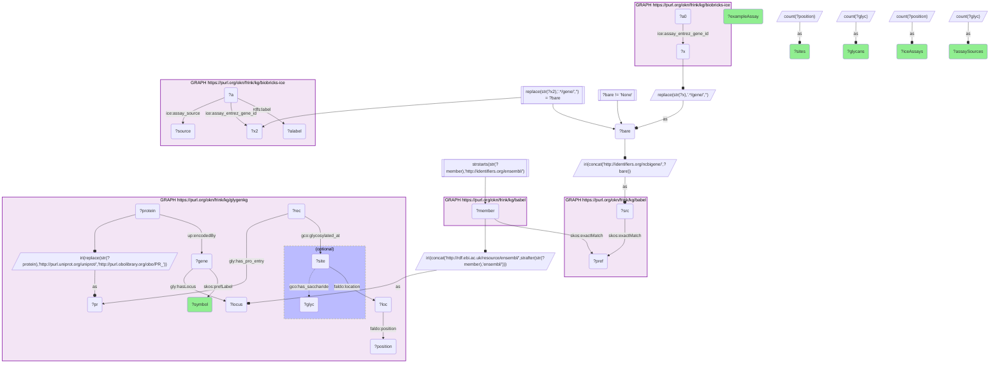

# G37-Q1: biobricks-ice×glygenkg (Entrez→Ensembl via Babel) — ICE's glycan-rich targets are secreted and cell-surface readouts (decorin 196 glycans, TIMP1 129, ICAM1 109); its most-assayed targets, ESR1 and PGR, carry one glycan each

- **Date:** 2026-10-13
- **Model:** claude-opus-5-5
- **SPARQL endpoint:** https://apps.okn.us/federation/sparql
- **Generated by:** mcp-okn v0.1.0 (build 9b39cc6)
- **Contents:** 2 queries · 2 query diagrams

## Knowledge graphs used

- `biobricks-ice` — <https://purl.org/okn/frink/kg/biobricks-ice>
- `babel` — <https://purl.org/okn/frink/kg/babel>
- `glygenkg` — <https://purl.org/okn/frink/kg/glygenkg>

## Conversation

👤 **User**

Which of ICE's assay target genes encode proteins that GlyGen records as glycosylated? Rank them by how many distinct glycans GlyGen records, show which ICE assay providers test them, and compare with the targets ICE assays most often.

---

🧠 **Assistant**

**ICE's assay targets with the most GlyGen glycans are secreted and cell-surface proteins, and they are mostly measured as BioMAP protein readouts. ICE's most-assayed targets are nuclear receptors that GlyGen records with a single glycan.**

| ICE target gene | GlyGen sites | GlyGen glycans | ICE assays | Assay providers |
|---|---|---|---|---|
| DCN (decorin) | 6 | 196 | 2 | Bioseek |
| TIMP1 | 2 | 129 | 6 | Bioseek, LifeTech/Expression Analysis |
| ICAM1 | 11 | 109 | 6 | Bioseek, LifeTech/Expression Analysis |
| INSR | 21 | 73 | 2 | Novascreen |
| PTPRC (CD45) | 32 | 66 | 2 | Novascreen |
| PTPRM | 11 | 50 | 3 | Novascreen, Eurofins |
| MMP1 | 2 | 42 | 10 | Bioseek, LifeTech/Expression Analysis, Novascreen |
| BCHE | 10 | 33 | 3 | Novascreen, Eurofins |
| CSF1R | 7 | 32 | 3 | Novascreen, Eurofins |
| HGF | 5 | 31 | 2 | LifeTech/Expression Analysis |

**Two kinds of assay meet a glycoprotein here.** Bioseek (BioMAP) and LifeTech/Expression Analysis measure the *level* of a secreted or surface protein, or its transcript, in a cell system: decorin, TIMP1, ICAM1, MMP1, HGF and FAS. Novascreen and Eurofins test a chemical against the purified *enzyme or receptor*: the insulin receptor, CD45, PTPRM, butyrylcholinesterase and CSF1R. For the second kind the recombinant protein's glycosylation can differ from the native one, which this join does not resolve.

**The most-assayed targets carry little glycan.** ESR1 has 22 ICE assays across six providers but two GlyGen sites and one glycan; PGR has 18 assays, 11 sites and one glycan; NR3C1 8 assays, 9 sites and two glycans. These are intracellular receptors, and every glycan GlyGen records on them is O-GlcNAc, a single HexNAc on serine or threonine (checked against the glycan labels, which this table does not show), not a secretory-pathway glycan. MMP1 (10 assays, 42 glycans), ICAM1 and TIMP1 (6 assays each, 109 and 129 glycans) are the targets that are both heavily assayed and heavily glycosylated.

**Read "glycans" as GlyGen's count of distinct glycan structures recorded at the protein's sites.** It reflects how intensively the protein's glycans have been characterised as much as how many it carries. A gene needs at least one GlyGen site to appear here; IL6, for example, has two sites but no glycan structure recorded.

**Join form.** ICE's `assay_entrez_gene_id` (an NCBI gene page URL) is reduced to the bare Entrez id, rebuilt as `http://identifiers.org/ncbigene/{id}`, taken through its Babel clique to the `http://identifiers.org/ensembl/{ENSG}` member, and rewritten to glygenkg's locus form `http://rdf.ebi.ac.uk/resource/ensembl/{ENSG}`. Both Babel hops are staged in nested DISTINCT subqueries with the scheme filter outside them.

## SPARQL queries executed

#### Query 1

_2026-10-14T05:01:34+00:00 · `biobricks-ice`, `babel`, `glygenkg`_

```sparql
PREFIX gly: <https://sparql.glygen.org/ontology/>
PREFIX gco: <http://purl.jp/bio/12/glyco/conjugate#>
PREFIX glycan: <http://purl.jp/bio/12/glyco/glycan#>
PREFIX faldo: <http://www.biohackathon.org/resource/faldo#>
PREFIX up: <http://purl.uniprot.org/core/>
PREFIX skos: <http://www.w3.org/2004/02/skos/core#>
PREFIX rdfs: <http://www.w3.org/2000/01/rdf-schema#>
PREFIX ice: <https://ice.ntp.niehs.nih.gov/property/>
# ICE assay target genes that reach a glygenkg gene locus through babel, with GlyGen's
# site and glycan counts for the encoded protein and ICE's assays on that gene.
SELECT ?symbol ?sites ?glycans (COUNT(DISTINCT ?a) AS ?iceAssays)
       (GROUP_CONCAT(DISTINCT ?source; SEPARATOR=", ") AS ?assaySources) (MIN(?alabel) AS ?exampleAssay) WHERE {
  { SELECT DISTINCT ?bare ?locus WHERE {
    { SELECT DISTINCT ?bare ?member WHERE {
      { SELECT DISTINCT ?bare ?pref WHERE {
          { SELECT DISTINCT ?bare ?src WHERE { GRAPH <https://purl.org/okn/frink/kg/biobricks-ice> { ?a0 ice:assay_entrez_gene_id ?x } BIND(REPLACE(STR(?x),'.*/gene/','') AS ?bare) FILTER(?bare != 'None') BIND(IRI(CONCAT('http://identifiers.org/ncbigene/', ?bare)) AS ?src) } }
          GRAPH <https://purl.org/okn/frink/kg/babel> { ?src skos:exactMatch ?pref } } }
      GRAPH <https://purl.org/okn/frink/kg/babel> { ?member skos:exactMatch ?pref } } }
    FILTER(STRSTARTS(STR(?member),'http://identifiers.org/ensembl/'))
    BIND(IRI(CONCAT('http://rdf.ebi.ac.uk/resource/ensembl/', STRAFTER(STR(?member),'ensembl/'))) AS ?locus) } }
  { SELECT ?locus ?symbol (COUNT(DISTINCT ?position) AS ?sites) (COUNT(DISTINCT ?glyc) AS ?glycans) WHERE {
      GRAPH <https://purl.org/okn/frink/kg/glygenkg> {
        ?gene gly:hasLocus ?locus ; skos:prefLabel ?symbol . ?protein up:encodedBy ?gene .
        BIND(IRI(REPLACE(STR(?protein),'http://purl.uniprot.org/uniprot/','http://purl.obolibrary.org/obo/PR_')) AS ?pr)
        ?rec gly:has_pro_entry ?pr ; gco:glycosylated_at ?site .
        ?site faldo:location ?loc . ?loc faldo:position ?position .
        OPTIONAL { ?site gco:has_saccharide ?glyc } } } GROUP BY ?locus ?symbol }
  GRAPH <https://purl.org/okn/frink/kg/biobricks-ice> { ?a ice:assay_entrez_gene_id ?x2 ; rdfs:label ?alabel ; ice:assay_source ?source }
  FILTER(REPLACE(STR(?x2),'.*/gene/','') = ?bare)
} GROUP BY ?symbol ?sites ?glycans ORDER BY DESC(?glycans) DESC(?sites) LIMIT 20
```



_20 row(s) — showing first 3_

| symbol | sites | glycans | iceAssays | assaySources | exampleAssay |
| --- | --- | --- | --- | --- | --- |
| DCN | 6 | 196 | 2 | Bioseek | BSK_MyoF_Decorin_down |
| TIMP1 | 2 | 129 | 6 | Bioseek, LifeTech/Expression Analysis | BSK_hDFCGF_TIMP1_down |
| ICAM1 | 11 | 109 | 6 | Bioseek, LifeTech/Expression Analysis | BSK_3C_ICAM1_down |

#### Query 2

_2026-10-14T05:01:34+00:00 · `biobricks-ice`, `babel`, `glygenkg`_

```sparql
PREFIX gly: <https://sparql.glygen.org/ontology/>
PREFIX gco: <http://purl.jp/bio/12/glyco/conjugate#>
PREFIX glycan: <http://purl.jp/bio/12/glyco/glycan#>
PREFIX faldo: <http://www.biohackathon.org/resource/faldo#>
PREFIX up: <http://purl.uniprot.org/core/>
PREFIX skos: <http://www.w3.org/2004/02/skos/core#>
PREFIX rdfs: <http://www.w3.org/2000/01/rdf-schema#>
PREFIX ice: <https://ice.ntp.niehs.nih.gov/property/>
# ICE assay target genes that reach a glygenkg gene locus through babel, with GlyGen's
# site and glycan counts for the encoded protein and ICE's assays on that gene.
SELECT ?symbol ?sites ?glycans (COUNT(DISTINCT ?a) AS ?iceAssays)
       (GROUP_CONCAT(DISTINCT ?source; SEPARATOR=", ") AS ?assaySources) (MIN(?alabel) AS ?exampleAssay) WHERE {
  { SELECT DISTINCT ?bare ?locus WHERE {
    { SELECT DISTINCT ?bare ?member WHERE {
      { SELECT DISTINCT ?bare ?pref WHERE {
          { SELECT DISTINCT ?bare ?src WHERE { GRAPH <https://purl.org/okn/frink/kg/biobricks-ice> { ?a0 ice:assay_entrez_gene_id ?x } BIND(REPLACE(STR(?x),'.*/gene/','') AS ?bare) FILTER(?bare != 'None') BIND(IRI(CONCAT('http://identifiers.org/ncbigene/', ?bare)) AS ?src) } }
          GRAPH <https://purl.org/okn/frink/kg/babel> { ?src skos:exactMatch ?pref } } }
      GRAPH <https://purl.org/okn/frink/kg/babel> { ?member skos:exactMatch ?pref } } }
    FILTER(STRSTARTS(STR(?member),'http://identifiers.org/ensembl/'))
    BIND(IRI(CONCAT('http://rdf.ebi.ac.uk/resource/ensembl/', STRAFTER(STR(?member),'ensembl/'))) AS ?locus) } }
  { SELECT ?locus ?symbol (COUNT(DISTINCT ?position) AS ?sites) (COUNT(DISTINCT ?glyc) AS ?glycans) WHERE {
      GRAPH <https://purl.org/okn/frink/kg/glygenkg> {
        ?gene gly:hasLocus ?locus ; skos:prefLabel ?symbol . ?protein up:encodedBy ?gene .
        BIND(IRI(REPLACE(STR(?protein),'http://purl.uniprot.org/uniprot/','http://purl.obolibrary.org/obo/PR_')) AS ?pr)
        ?rec gly:has_pro_entry ?pr ; gco:glycosylated_at ?site .
        ?site faldo:location ?loc . ?loc faldo:position ?position .
        OPTIONAL { ?site gco:has_saccharide ?glyc } } } GROUP BY ?locus ?symbol }
  GRAPH <https://purl.org/okn/frink/kg/biobricks-ice> { ?a ice:assay_entrez_gene_id ?x2 ; rdfs:label ?alabel ; ice:assay_source ?source }
  FILTER(REPLACE(STR(?x2),'.*/gene/','') = ?bare)
} GROUP BY ?symbol ?sites ?glycans ORDER BY DESC(?iceAssays) ?symbol LIMIT 15
```


_15 row(s)_

| symbol | sites | glycans | iceAssays | assaySources | exampleAssay |
| --- | --- | --- | --- | --- | --- |
| ESR1 | 2 | 1 | 22 | CCTE Labs, ACEA Biosciences, Attagene, Odyssey Thera, Novascreen, Tox21/NCGC | ACEA_ER_80hr |
| PGR | 11 | 1 | 18 | Tox21/NCGC, Ceetox/OpAns, Novascreen, Attagene, Eurofins | ATG_PR_TRANS2_dn |
| MMP1 | 2 | 42 | 10 | Bioseek, LifeTech/Expression Analysis, Novascreen | BSK_BE3C_MMP1_down |
| NR3C1 | 9 | 2 | 8 | Tox21/NCGC, Novascreen, Attagene, Eurofins | ATG_GR_TRANS_dn |
| PLAUR | 6 | 1 | 8 | Bioseek | BSK_3C_uPAR_down |
| CYP1A1 | 1 | 1 | 7 | LifeTech/Expression Analysis, CellzDirect, Novascreen | CLD_CYP1A1_24hr |
| H2AX | 2 | 1 | 7 | Apredica, Tox21/NCGC | APR_HepG2_P-H2AX_1h_dn |
| CSF1 | 37 | 6 | 6 | Bioseek | BSK_CASM3C_MCSF_down |
| ICAM1 | 11 | 109 | 6 | Bioseek, LifeTech/Expression Analysis | BSK_3C_ICAM1_down |
| IL6 | 2 | 0 | 6 | Bioseek, LifeTech/Expression Analysis | BSK_BT_xIL6_down |
| TIMP1 | 2 | 129 | 6 | Bioseek, LifeTech/Expression Analysis | BSK_hDFCGF_TIMP1_down |
| TUBA1A | 17 | 1 | 6 | Apredica | APR_HepG2_MicrotubuleCSK_1h_dn |
| ABCB1 | 1 | 1 | 5 | CellzDirect, LifeTech/Expression Analysis | CLD_ABCB1_24hr |
| KDR | 7 | 8 | 5 | Bioseek, Novascreen, Eurofins | BSK_4H_VEGFRII_down |
| MMP9 | 5 | 12 | 5 | Eurofins, Bioseek, Novascreen | BSK_KF3CT_MMP9_down |
