# G37-Q2: biobricks-ice×glygenkg — 187 of ICE's 525 assay target genes (36%) reach a GlyGen gene locus and 130 have a mapped glycosylation site; 552 of 1,509 gene-annotated assays sit on bridged genes

- **Date:** 2026-10-13
- **Model:** claude-opus-5-5
- **SPARQL endpoint:** https://apps.okn.us/federation/sparql
- **Generated by:** mcp-okn v0.1.0 (build 9b39cc6)
- **Contents:** 2 queries · 2 query diagrams

## Knowledge graphs used

- `biobricks-ice` — <https://purl.org/okn/frink/kg/biobricks-ice>
- `babel` — <https://purl.org/okn/frink/kg/babel>
- `glygenkg` — <https://purl.org/okn/frink/kg/glygenkg>

## Conversation

👤 **User**

Same crosswalk, coverage angle: how many of ICE's assay target genes reach a glygenkg gene through Babel, how many of those have a mapped glycosylation site, and how does coverage differ by assay provider?

---

🧠 **Assistant**

**187 of ICE's 525 assay target genes (35.6%) reach a glygenkg gene locus through Babel, and 130 of those have at least one mapped glycosylation site. The 187 genes account for 552 of ICE's 1,509 gene-annotated assays (36.6%).**

| Measure | Count |
|---|---|
| ICE assay target genes (Entrez) | 525 |
| reach a glygenkg gene locus | 187 |
| of which have a mapped glycosylation site | 130 |
| ICE gene-annotated assays | 1,509 |
| assays on a bridged gene | 552 |

**By assay provider:**

| Provider | Target genes | Reach glygenkg | With a mapped site | Assays | Assays on bridged genes |
|---|---|---|---|---|---|
| Novascreen | 263 | 82 | 55 | 420 | 146 |
| Eurofins | 143 | 57 | 39 | 148 | 58 |
| Attagene | 130 | 47 | 29 | 340 | 108 |
| LifeTech/Expression Analysis | 94 | 47 | 34 | 188 | 94 |
| Bioseek | 42 | 19 | 18 | 176 | 62 |
| Tox21/NCGC | 38 | 17 | 12 | 82 | 35 |
| CellzDirect | 16 | 7 | 6 | 48 | 21 |

Eight smaller providers, with one to eight target genes each, make up the rest of the result table below.

**Why only about a third.** glygenkg is not a gene catalogue: it holds the roughly 8,100 human genes whose protein GlyGen records as glycosylated, so an ICE target outside that set has no locus to reach. The same ICE gene list reaches 395 genes in PanKgraph (crosswalk C26), which covers genes generally. Provider coverage follows the kind of target. Bioseek's BioMAP readouts are mostly secreted and surface proteins, and 19 of its 42 targets reach glygenkg, 18 of them with a mapped site. Novascreen's enzyme and receptor panel reaches 82 of 263.

**Locus versus site.** 57 of the 187 bridged genes reach a glygenkg locus but have no mapped site. Their GlyGen records carry no residue position, so they count as glycosylated in GlyGen without a site to name.

**Join form.** ICE Entrez id → `http://identifiers.org/ncbigene/{id}` → Babel gene clique → `http://identifiers.org/ensembl/{ENSG}` → glygenkg locus `http://rdf.ebi.ac.uk/resource/ensembl/{ENSG}`. The ICE side is small (525 genes), so the query is driven from it.

## SPARQL queries executed

#### Query 1

_2026-10-14T05:01:35+00:00 · `biobricks-ice`, `babel`, `glygenkg`_

```sparql
PREFIX gly: <https://sparql.glygen.org/ontology/>
PREFIX gco: <http://purl.jp/bio/12/glyco/conjugate#>
PREFIX glycan: <http://purl.jp/bio/12/glyco/glycan#>
PREFIX faldo: <http://www.biohackathon.org/resource/faldo#>
PREFIX up: <http://purl.uniprot.org/core/>
PREFIX skos: <http://www.w3.org/2004/02/skos/core#>
PREFIX rdfs: <http://www.w3.org/2000/01/rdf-schema#>
PREFIX ice: <https://ice.ntp.niehs.nih.gov/property/>
# Coverage over all of ICE: target genes, how many reach a glygenkg locus through
# babel, how many of those have a mapped glycosylation site, and the assays involved.
SELECT (COUNT(DISTINCT ?bare) AS ?iceTargetGenes) (COUNT(DISTINCT ?hit) AS ?reachGlygenLocus)
       (COUNT(DISTINCT ?siteHit) AS ?withMappedSite)
       (COUNT(DISTINCT ?a) AS ?geneAnnotatedAssays) (COUNT(DISTINCT ?aHit) AS ?assaysOnBridgedGenes) WHERE {
  GRAPH <https://purl.org/okn/frink/kg/biobricks-ice> { ?a ice:assay_entrez_gene_id ?x ; ice:assay_source ?source }
  BIND(REPLACE(STR(?x),'.*/gene/','') AS ?bare) FILTER(?bare != 'None')
  OPTIONAL { { SELECT DISTINCT ?bare (1 AS ?inGlygen) WHERE { { SELECT DISTINCT ?bare ?locus WHERE {
    { SELECT DISTINCT ?bare ?member WHERE {
      { SELECT DISTINCT ?bare ?pref WHERE {
          { SELECT DISTINCT ?bare ?src WHERE { GRAPH <https://purl.org/okn/frink/kg/biobricks-ice> { ?a0 ice:assay_entrez_gene_id ?x } BIND(REPLACE(STR(?x),'.*/gene/','') AS ?bare) FILTER(?bare != 'None') BIND(IRI(CONCAT('http://identifiers.org/ncbigene/', ?bare)) AS ?src) } }
          GRAPH <https://purl.org/okn/frink/kg/babel> { ?src skos:exactMatch ?pref } } }
      GRAPH <https://purl.org/okn/frink/kg/babel> { ?member skos:exactMatch ?pref } } }
    FILTER(STRSTARTS(STR(?member),'http://identifiers.org/ensembl/'))
    BIND(IRI(CONCAT('http://rdf.ebi.ac.uk/resource/ensembl/', STRAFTER(STR(?member),'ensembl/'))) AS ?locus) } } GRAPH <https://purl.org/okn/frink/kg/glygenkg> { ?g gly:hasLocus ?locus } } } }
  OPTIONAL { { SELECT DISTINCT ?bare (1 AS ?withSite) WHERE { { SELECT DISTINCT ?bare ?locus WHERE {
    { SELECT DISTINCT ?bare ?member WHERE {
      { SELECT DISTINCT ?bare ?pref WHERE {
          { SELECT DISTINCT ?bare ?src WHERE { GRAPH <https://purl.org/okn/frink/kg/biobricks-ice> { ?a0 ice:assay_entrez_gene_id ?x } BIND(REPLACE(STR(?x),'.*/gene/','') AS ?bare) FILTER(?bare != 'None') BIND(IRI(CONCAT('http://identifiers.org/ncbigene/', ?bare)) AS ?src) } }
          GRAPH <https://purl.org/okn/frink/kg/babel> { ?src skos:exactMatch ?pref } } }
      GRAPH <https://purl.org/okn/frink/kg/babel> { ?member skos:exactMatch ?pref } } }
    FILTER(STRSTARTS(STR(?member),'http://identifiers.org/ensembl/'))
    BIND(IRI(CONCAT('http://rdf.ebi.ac.uk/resource/ensembl/', STRAFTER(STR(?member),'ensembl/'))) AS ?locus) } } { SELECT DISTINCT ?locus WHERE { GRAPH <https://purl.org/okn/frink/kg/glygenkg> {
        ?gene gly:hasLocus ?locus . ?protein up:encodedBy ?gene .
        BIND(IRI(REPLACE(STR(?protein),'http://purl.uniprot.org/uniprot/','http://purl.obolibrary.org/obo/PR_')) AS ?pr)
        ?rec gly:has_pro_entry ?pr ; gco:glycosylated_at ?site } } } } } }
  BIND(IF(BOUND(?inGlygen), ?bare, ?none) AS ?hit) BIND(IF(BOUND(?inGlygen), ?a, ?none) AS ?aHit)
  BIND(IF(BOUND(?withSite), ?bare, ?none) AS ?siteHit)
}
```



```mermaid
graph TD
classDef projected fill:lightgreen;
classDef literal fill:orange;
classDef iri fill:yellow;
  q0v17("?a")
  q0v24("?a0")
  q0v15("?aHit")
  q0v1("?assaysOnBridgedGenes"):::projected 
  q0v11("?bare")
  q0v26("?g")
  q0v29("?gene")
  q0v2("?geneAnnotatedAssays"):::projected 
  q0v18("?hit")
  q0v5("?iceTargetGenes"):::projected 
  q0v16("?inGlygen")
  q0v22("?locus")
  q0v21("?member")
  q0v14("?none")
  q0v27("?pr")
  q0v25("?pref")
  q0v28("?protein")
  q0v4("?reachGlygenLocus"):::projected 
  q0v30("?rec")
  q0v31("?site")
  q0v12("?siteHit")
  q0v20("?source")
  q0v23("?src")
  q0v3("?withMappedSite"):::projected 
  q0v13("?withSite")
  q0v19("?x")
  q0f0[["?bare != 'None'"]]
  q0f0 --> q0v11
  subgraph q0graph0["GRAPH https://purl.org/okn/frink/kg/biobricks-ice"]
    style q0graph0 fill:#f3e5f5,stroke:#8e24aa,stroke-width:2px,color:#000;
    q0v17 --"ice:assay_entrez_gene_id"--> q0v19
    q0v17 --"ice:assay_source"--> q0v20
  end
  q0bind0[/"replace(str(?x),'.*/gene/','')"/]
  q0v19 --o q0bind0
  q0bind0 --as--o q0v11
  subgraph q0optional0["(optional)"]
  style q0optional0 fill:#bbf,stroke-dasharray: 5 5,color:#000;
    q0f1[["strstarts(str(?member),'http://identifiers.org/ensembl/')"]]
    q0f1 --> q0v21
    q0f2[["?bare != 'None'"]]
    q0f2 --> q0v11
    subgraph q0graph1["GRAPH https://purl.org/okn/frink/kg/biobricks-ice"]
      style q0graph1 fill:#f3e5f5,stroke:#8e24aa,stroke-width:2px,color:#000;
      q0v24 --"ice:assay_entrez_gene_id"--> q0v19
    end
    q0bind1[/"replace(str(?x),'.*/gene/','')"/]
    q0v19 --o q0bind1
    q0bind1 --as--o q0v11
    q0bind2[/"iri(concat('http://identifiers.org/ncbigene/',?bare))"/]
    q0v11 --o q0bind2
    q0bind2 --as--o q0v23
    subgraph q0graph2["GRAPH https://purl.org/okn/frink/kg/babel"]
      style q0graph2 fill:#f3e5f5,stroke:#8e24aa,stroke-width:2px,color:#000;
      q0v23 --"skos:exactMatch"--> q0v25
    end
    subgraph q0graph3["GRAPH https://purl.org/okn/frink/kg/babel"]
      style q0graph3 fill:#f3e5f5,stroke:#8e24aa,stroke-width:2px,color:#000;
      q0v21 --"skos:exactMatch"--> q0v25
    end
    q0bind3[/"iri(concat('http://rdf.ebi.ac.uk/resource/ensembl/',strafter(str(?member),'ensembl/')))"/]
    q0v21 --o q0bind3
    q0bind3 --as--o q0v22
    subgraph q0graph4["GRAPH https://purl.org/okn/frink/kg/glygenkg"]
      style q0graph4 fill:#f3e5f5,stroke:#8e24aa,stroke-width:2px,color:#000;
      q0v26 --"gly:hasLocus"--> q0v22
    end
    q0bind4[/"'1^^xsd:integer'"/]
    q0bind4 --as--o q0v16
  end
  subgraph q0optional1["(optional)"]
  style q0optional1 fill:#bbf,stroke-dasharray: 5 5,color:#000;
    q0f3[["strstarts(str(?member),'http://identifiers.org/ensembl/')"]]
    q0f3 --> q0v21
    q0f4[["?bare != 'None'"]]
    q0f4 --> q0v11
    subgraph q0graph5["GRAPH https://purl.org/okn/frink/kg/biobricks-ice"]
      style q0graph5 fill:#f3e5f5,stroke:#8e24aa,stroke-width:2px,color:#000;
      q0v24 --"ice:assay_entrez_gene_id"--> q0v19
    end
    q0bind5[/"replace(str(?x),'.*/gene/','')"/]
    q0v19 --o q0bind5
    q0bind5 --as--o q0v11
    q0bind6[/"iri(concat('http://identifiers.org/ncbigene/',?bare))"/]
    q0v11 --o q0bind6
    q0bind6 --as--o q0v23
    subgraph q0graph6["GRAPH https://purl.org/okn/frink/kg/babel"]
      style q0graph6 fill:#f3e5f5,stroke:#8e24aa,stroke-width:2px,color:#000;
      q0v23 --"skos:exactMatch"--> q0v25
    end
    subgraph q0graph7["GRAPH https://purl.org/okn/frink/kg/babel"]
      style q0graph7 fill:#f3e5f5,stroke:#8e24aa,stroke-width:2px,color:#000;
      q0v21 --"skos:exactMatch"--> q0v25
    end
    q0bind7[/"iri(concat('http://rdf.ebi.ac.uk/resource/ensembl/',strafter(str(?member),'ensembl/')))"/]
    q0v21 --o q0bind7
    q0bind7 --as--o q0v22
    subgraph q0graph8["GRAPH https://purl.org/okn/frink/kg/glygenkg"]
      style q0graph8 fill:#f3e5f5,stroke:#8e24aa,stroke-width:2px,color:#000;
      q0v29 --"gly:hasLocus"--> q0v22
      q0v28 --"up:encodedBy"--> q0v29
      q0graph8bind8[/"iri(replace(str(?protein),'http://purl.uniprot.org/uniprot/','http://purl.obolibrary.org/obo/PR_'))"/]
      q0v28 --o q0graph8bind8
      q0graph8bind8 --as--o q0v27
      q0v30 --"gco:glycosylated_at"--> q0v31
      q0v30 --"gly:has_pro_entry"--> q0v27
    end
    q0bind9[/"'1^^xsd:integer'"/]
    q0bind9 --as--o q0v13
  end
  q0bind10[/"if(bound(?inGlygen),?bare,?none)"/]
  q0v16 --o q0bind10
  q0v11 --o q0bind10
  q0v14 --o q0bind10
  q0bind10 --as--o q0v18
  q0bind11[/"if(bound(?inGlygen),?a,?none)"/]
  q0v16 --o q0bind11
  q0v17 --o q0bind11
  q0v14 --o q0bind11
  q0bind11 --as--o q0v15
  q0bind12[/"if(bound(?withSite),?bare,?none)"/]
  q0v13 --o q0bind12
  q0v11 --o q0bind12
  q0v14 --o q0bind12
  q0bind12 --as--o q0v12
  q0bind13[/"count(?bare)"/]
  q0bind13 --as--o q0v5
  q0bind14[/"count(?hit)"/]
  q0bind14 --as--o q0v4
  q0bind15[/"count(?siteHit)"/]
  q0bind15 --as--o q0v3
  q0bind16[/"count(?a)"/]
  q0bind16 --as--o q0v2
  q0bind17[/"count(?aHit)"/]
  q0bind17 --as--o q0v1
```

_1 row(s)_

| iceTargetGenes | reachGlygenLocus | withMappedSite | geneAnnotatedAssays | assaysOnBridgedGenes |
| --- | --- | --- | --- | --- |
| 525 | 187 | 130 | 1509 | 552 |

#### Query 2

_2026-10-14T05:01:36+00:00 · `biobricks-ice`, `babel`, `glygenkg`_

```sparql
PREFIX gly: <https://sparql.glygen.org/ontology/>
PREFIX gco: <http://purl.jp/bio/12/glyco/conjugate#>
PREFIX glycan: <http://purl.jp/bio/12/glyco/glycan#>
PREFIX faldo: <http://www.biohackathon.org/resource/faldo#>
PREFIX up: <http://purl.uniprot.org/core/>
PREFIX skos: <http://www.w3.org/2004/02/skos/core#>
PREFIX rdfs: <http://www.w3.org/2000/01/rdf-schema#>
PREFIX ice: <https://ice.ntp.niehs.nih.gov/property/>
# The same coverage split by ICE assay source.
SELECT ?source (COUNT(DISTINCT ?bare) AS ?targetGenes) (COUNT(DISTINCT ?hit) AS ?reachGlygenLocus)
       (COUNT(DISTINCT ?siteHit) AS ?withMappedSite)
       (COUNT(DISTINCT ?a) AS ?assays) (COUNT(DISTINCT ?aHit) AS ?assaysOnBridgedGenes) WHERE {
  GRAPH <https://purl.org/okn/frink/kg/biobricks-ice> { ?a ice:assay_entrez_gene_id ?x ; ice:assay_source ?source }
  BIND(REPLACE(STR(?x),'.*/gene/','') AS ?bare) FILTER(?bare != 'None')
  OPTIONAL { { SELECT DISTINCT ?bare (1 AS ?inGlygen) WHERE { { SELECT DISTINCT ?bare ?locus WHERE {
    { SELECT DISTINCT ?bare ?member WHERE {
      { SELECT DISTINCT ?bare ?pref WHERE {
          { SELECT DISTINCT ?bare ?src WHERE { GRAPH <https://purl.org/okn/frink/kg/biobricks-ice> { ?a0 ice:assay_entrez_gene_id ?x } BIND(REPLACE(STR(?x),'.*/gene/','') AS ?bare) FILTER(?bare != 'None') BIND(IRI(CONCAT('http://identifiers.org/ncbigene/', ?bare)) AS ?src) } }
          GRAPH <https://purl.org/okn/frink/kg/babel> { ?src skos:exactMatch ?pref } } }
      GRAPH <https://purl.org/okn/frink/kg/babel> { ?member skos:exactMatch ?pref } } }
    FILTER(STRSTARTS(STR(?member),'http://identifiers.org/ensembl/'))
    BIND(IRI(CONCAT('http://rdf.ebi.ac.uk/resource/ensembl/', STRAFTER(STR(?member),'ensembl/'))) AS ?locus) } } GRAPH <https://purl.org/okn/frink/kg/glygenkg> { ?g gly:hasLocus ?locus } } } }
  OPTIONAL { { SELECT DISTINCT ?bare (1 AS ?withSite) WHERE { { SELECT DISTINCT ?bare ?locus WHERE {
    { SELECT DISTINCT ?bare ?member WHERE {
      { SELECT DISTINCT ?bare ?pref WHERE {
          { SELECT DISTINCT ?bare ?src WHERE { GRAPH <https://purl.org/okn/frink/kg/biobricks-ice> { ?a0 ice:assay_entrez_gene_id ?x } BIND(REPLACE(STR(?x),'.*/gene/','') AS ?bare) FILTER(?bare != 'None') BIND(IRI(CONCAT('http://identifiers.org/ncbigene/', ?bare)) AS ?src) } }
          GRAPH <https://purl.org/okn/frink/kg/babel> { ?src skos:exactMatch ?pref } } }
      GRAPH <https://purl.org/okn/frink/kg/babel> { ?member skos:exactMatch ?pref } } }
    FILTER(STRSTARTS(STR(?member),'http://identifiers.org/ensembl/'))
    BIND(IRI(CONCAT('http://rdf.ebi.ac.uk/resource/ensembl/', STRAFTER(STR(?member),'ensembl/'))) AS ?locus) } } { SELECT DISTINCT ?locus WHERE { GRAPH <https://purl.org/okn/frink/kg/glygenkg> {
        ?gene gly:hasLocus ?locus . ?protein up:encodedBy ?gene .
        BIND(IRI(REPLACE(STR(?protein),'http://purl.uniprot.org/uniprot/','http://purl.obolibrary.org/obo/PR_')) AS ?pr)
        ?rec gly:has_pro_entry ?pr ; gco:glycosylated_at ?site } } } } } }
  BIND(IF(BOUND(?inGlygen), ?bare, ?none) AS ?hit) BIND(IF(BOUND(?inGlygen), ?a, ?none) AS ?aHit)
  BIND(IF(BOUND(?withSite), ?bare, ?none) AS ?siteHit)
} GROUP BY ?source ORDER BY DESC(?targetGenes)
```



```mermaid
graph TD
classDef projected fill:lightgreen;
classDef literal fill:orange;
classDef iri fill:yellow;
  q1v19("?a")
  q1v25("?a0")
  q1v17("?aHit")
  q1v2("?assays"):::projected 
  q1v1("?assaysOnBridgedGenes"):::projected 
  q1v13("?bare")
  q1v27("?g")
  q1v30("?gene")
  q1v20("?hit")
  q1v18("?inGlygen")
  q1v23("?locus")
  q1v22("?member")
  q1v16("?none")
  q1v28("?pr")
  q1v26("?pref")
  q1v29("?protein")
  q1v4("?reachGlygenLocus"):::projected 
  q1v31("?rec")
  q1v32("?site")
  q1v14("?siteHit")
  q1v6("?source"):::projected 
  q1v24("?src")
  q1v5("?targetGenes"):::projected 
  q1v3("?withMappedSite"):::projected 
  q1v15("?withSite")
  q1v21("?x")
  q1f0[["?bare != 'None'"]]
  q1f0 --> q1v13
  subgraph q1graph0["GRAPH https://purl.org/okn/frink/kg/biobricks-ice"]
    style q1graph0 fill:#f3e5f5,stroke:#8e24aa,stroke-width:2px,color:#000;
    q1v19 --"ice:assay_entrez_gene_id"--> q1v21
    q1v19 --"ice:assay_source"--> q1v6
  end
  q1bind0[/"replace(str(?x),'.*/gene/','')"/]
  q1v21 --o q1bind0
  q1bind0 --as--o q1v13
  subgraph q1optional0["(optional)"]
  style q1optional0 fill:#bbf,stroke-dasharray: 5 5,color:#000;
    q1f1[["strstarts(str(?member),'http://identifiers.org/ensembl/')"]]
    q1f1 --> q1v22
    q1f2[["?bare != 'None'"]]
    q1f2 --> q1v13
    subgraph q1graph1["GRAPH https://purl.org/okn/frink/kg/biobricks-ice"]
      style q1graph1 fill:#f3e5f5,stroke:#8e24aa,stroke-width:2px,color:#000;
      q1v25 --"ice:assay_entrez_gene_id"--> q1v21
    end
    q1bind1[/"replace(str(?x),'.*/gene/','')"/]
    q1v21 --o q1bind1
    q1bind1 --as--o q1v13
    q1bind2[/"iri(concat('http://identifiers.org/ncbigene/',?bare))"/]
    q1v13 --o q1bind2
    q1bind2 --as--o q1v24
    subgraph q1graph2["GRAPH https://purl.org/okn/frink/kg/babel"]
      style q1graph2 fill:#f3e5f5,stroke:#8e24aa,stroke-width:2px,color:#000;
      q1v24 --"skos:exactMatch"--> q1v26
    end
    subgraph q1graph3["GRAPH https://purl.org/okn/frink/kg/babel"]
      style q1graph3 fill:#f3e5f5,stroke:#8e24aa,stroke-width:2px,color:#000;
      q1v22 --"skos:exactMatch"--> q1v26
    end
    q1bind3[/"iri(concat('http://rdf.ebi.ac.uk/resource/ensembl/',strafter(str(?member),'ensembl/')))"/]
    q1v22 --o q1bind3
    q1bind3 --as--o q1v23
    subgraph q1graph4["GRAPH https://purl.org/okn/frink/kg/glygenkg"]
      style q1graph4 fill:#f3e5f5,stroke:#8e24aa,stroke-width:2px,color:#000;
      q1v27 --"gly:hasLocus"--> q1v23
    end
    q1bind4[/"'1^^xsd:integer'"/]
    q1bind4 --as--o q1v18
  end
  subgraph q1optional1["(optional)"]
  style q1optional1 fill:#bbf,stroke-dasharray: 5 5,color:#000;
    q1f3[["strstarts(str(?member),'http://identifiers.org/ensembl/')"]]
    q1f3 --> q1v22
    q1f4[["?bare != 'None'"]]
    q1f4 --> q1v13
    subgraph q1graph5["GRAPH https://purl.org/okn/frink/kg/biobricks-ice"]
      style q1graph5 fill:#f3e5f5,stroke:#8e24aa,stroke-width:2px,color:#000;
      q1v25 --"ice:assay_entrez_gene_id"--> q1v21
    end
    q1bind5[/"replace(str(?x),'.*/gene/','')"/]
    q1v21 --o q1bind5
    q1bind5 --as--o q1v13
    q1bind6[/"iri(concat('http://identifiers.org/ncbigene/',?bare))"/]
    q1v13 --o q1bind6
    q1bind6 --as--o q1v24
    subgraph q1graph6["GRAPH https://purl.org/okn/frink/kg/babel"]
      style q1graph6 fill:#f3e5f5,stroke:#8e24aa,stroke-width:2px,color:#000;
      q1v24 --"skos:exactMatch"--> q1v26
    end
    subgraph q1graph7["GRAPH https://purl.org/okn/frink/kg/babel"]
      style q1graph7 fill:#f3e5f5,stroke:#8e24aa,stroke-width:2px,color:#000;
      q1v22 --"skos:exactMatch"--> q1v26
    end
    q1bind7[/"iri(concat('http://rdf.ebi.ac.uk/resource/ensembl/',strafter(str(?member),'ensembl/')))"/]
    q1v22 --o q1bind7
    q1bind7 --as--o q1v23
    subgraph q1graph8["GRAPH https://purl.org/okn/frink/kg/glygenkg"]
      style q1graph8 fill:#f3e5f5,stroke:#8e24aa,stroke-width:2px,color:#000;
      q1v30 --"gly:hasLocus"--> q1v23
      q1v29 --"up:encodedBy"--> q1v30
      q1graph8bind8[/"iri(replace(str(?protein),'http://purl.uniprot.org/uniprot/','http://purl.obolibrary.org/obo/PR_'))"/]
      q1v29 --o q1graph8bind8
      q1graph8bind8 --as--o q1v28
      q1v31 --"gco:glycosylated_at"--> q1v32
      q1v31 --"gly:has_pro_entry"--> q1v28
    end
    q1bind9[/"'1^^xsd:integer'"/]
    q1bind9 --as--o q1v15
  end
  q1bind10[/"if(bound(?inGlygen),?bare,?none)"/]
  q1v18 --o q1bind10
  q1v13 --o q1bind10
  q1v16 --o q1bind10
  q1bind10 --as--o q1v20
  q1bind11[/"if(bound(?inGlygen),?a,?none)"/]
  q1v18 --o q1bind11
  q1v19 --o q1bind11
  q1v16 --o q1bind11
  q1bind11 --as--o q1v17
  q1bind12[/"if(bound(?withSite),?bare,?none)"/]
  q1v15 --o q1bind12
  q1v13 --o q1bind12
  q1v16 --o q1bind12
  q1bind12 --as--o q1v14
  q1bind13[/"count(?bare)"/]
  q1bind13 --as--o q1v5
  q1bind14[/"count(?hit)"/]
  q1bind14 --as--o q1v4
  q1bind15[/"count(?siteHit)"/]
  q1bind15 --as--o q1v3
  q1bind16[/"count(?a)"/]
  q1bind16 --as--o q1v2
  q1bind17[/"count(?aHit)"/]
  q1bind17 --as--o q1v1
```

_15 row(s)_

| source | targetGenes | reachGlygenLocus | withMappedSite | assays | assaysOnBridgedGenes |
| --- | --- | --- | --- | --- | --- |
| Novascreen | 263 | 82 | 55 | 420 | 146 |
| Eurofins | 143 | 57 | 39 | 148 | 58 |
| Attagene | 130 | 47 | 29 | 340 | 108 |
| LifeTech/Expression Analysis | 94 | 47 | 34 | 188 | 94 |
| Bioseek | 42 | 19 | 18 | 176 | 62 |
| Tox21/NCGC | 38 | 17 | 12 | 82 | 35 |
| CellzDirect | 16 | 7 | 6 | 48 | 21 |
| Odyssey Thera | 8 | 1 | 1 | 17 | 4 |
| Apredica | 5 | 2 | 2 | 30 | 12 |
| Ceetox/OpAns | 5 | 1 | 1 | 44 | 8 |
| CCTE Great Lakes Toxicology and Ecology Division | 4 | 0 | 0 | 4 | 0 |
| CCTE Labs | 3 | 1 | 1 | 4 | 2 |
| ACEA Biosciences | 2 | 1 | 1 | 3 | 1 |
| CPHEA Stoker and Laws Labs | 1 | 1 | 1 | 1 | 1 |
| University of Pittsburgh Johnston Lab | 1 | 0 | 0 | 4 | 0 |
