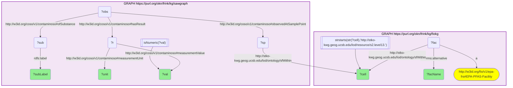

# geo01_q1_fiokg-sawgraph_pfas-facility-colocation

- **Date:** 2026-10-13
- **Model:** claude-opus-5-5
- **SPARQL endpoint:** https://apps.okn.us/federation/sparql
- **Generated by:** mcp-okn v0.1.0 (build f738e02)
- **Contents:** 1 query · 1 query diagram

## Knowledge graphs used

- `fiokg` — <https://purl.org/okn/frink/kg/fiokg>
- `sawgraph` — <https://purl.org/okn/frink/kg/sawgraph>

## Conversation

👤 **User**

Geospatial crosswalk fiokg × sawgraph, shared key = S2 Level-13 grid cell (KWG s2.level13 IRI; verified 2,166 co-occupied cells). Q1: Which EPA PFAS-relevant facilities (fiokg, EPA-PFAS-Facility) sit in the same ~1 km S2 cell as a measured PFAS water detection (sawgraph, Maine), and what PFAS compounds and concentrations were detected in that cell?

---

🧠 **Assistant**

This question genuinely requires the join: fiokg knows which regulated facilities are PFAS-relevant and where they sit (S2 cell), but carries no contaminant measurements; sawgraph knows PFAS sample concentrations and where they were taken, but does not classify nearby facilities. They share only the S2 Level-13 cell, so the answer only exists by joining fiokg EPA-PFAS-Facility ->(sfWithin)-> S2 cell <-(sfWithin)<- sawgraph SamplePoint.

Join mechanics: both graphs place their features in the national S2 grid by `sfWithin` pointing directly at the KWG `s2.level13.{id}` IRI — fiokg its facilities, sawgraph its sample points. Joining on that shared cell IRI and keeping numeric (detect) measurement values gives co-located facility/PFAS pairs. (On the previous sawgraph release the sample point reached the KWG cell through an intermediate `owl:sameAs`; that hop is now reflexive and has been dropped from the query.)

Top results (ordered by concentration, ng/L = NanoGM-PER-L):

| Facility (EPA PFAS-relevant) | PFAS measured | Value (ng/L) |
| --- | --- | --- |
| US NAVY NAVAL AIR STATION BRUNSWICK 2 | Sum of 6 PFAS (PFHpA+PFHxS+PFOA+PFNA+PFOS+PFDA) | 285,378 |
| US NAVY NAVAL AIR STATION BRUNSWICK 2 | Total PFOA and PFOS | 142,700 |
| US NAVY NAVAL AIR STATION BRUNSWICK 2 | Perfluorohexanesulfonic acid (PFHxS) | 138,000 |
| US NAVY NAVAL AIR STATION BRUNSWICK 2 | Perfluorooctanesulfonic acid (PFOS) | 124,000 |
| US NAVY NAVAL AIR STATION BRUNSWICK 2 | Perfluorobutanesulfonic acid (PFBS) | 87,500 |
| US NAVY NAVAL AIR STATION BRUNSWICK 2 | Perfluorohexanesulfonate | 69,700 |

The table collapses label variants: sawgraph records several analytes under two or three spellings (for example `PERFLUOROOCTANE SULFONIC ACID`, `Perfluorooctanesulfonic acid` and a misspelled `PERFLOUROOCTANE…`), each returned as its own row with the same value.

Why these rows answer the question: every row is a single S2 cell that simultaneously contains an EPA-flagged PFAS-relevant facility and a quantified PFAS water detection, returning the facility name, the specific PFAS compound, and the concentration. All fifteen of the highest co-located detections are in one cell, at the former Naval Air Station Brunswick, and they are dominated by PFOS/PFHxS/PFBS — the classic signature of aqueous film-forming foam (AFFF) firefighting foam used at military airfields.

Literature validation (strict, row-level). According to PubMed: Kulkarni et al. 2025, Water Research, a 37-site meta-analysis of military AFFF sites, finds PFOS, PFOA and PFHxS contribute ~99% of groundwater screening-level exceedances at AFFF source zones — matching both the military-airfield source and the compound profile seen here ([DOI](https://doi.org/10.1016/j.watres.2025.124124)). da Silva et al. 2026, ACS Omega, confirms AFFF as the major PFAS groundwater source at military facilities and airfields, detecting PFHxS-class sulfonamides in AFFF-impacted groundwater ([DOI](https://doi.org/10.1021/acsomega.5c08713)). The foundational Hu et al. 2016 study (PMID 27752509) first linked elevated PFAS in U.S. drinking water to proximity to military fire-training areas. The query's top hits (Naval Air Station Brunswick; PFOS/PFHxS/PFBS at 10^4–10^5 ng/L) are exactly the AFFF-impacted military-airfield case these papers describe. **Validated.**

**Literature:** PubMed — Kulkarni 2025 Water Res [10.1016/j.watres.2025.124124](https://doi.org/10.1016/j.watres.2025.124124); da Silva 2026 ACS Omega [10.1021/acsomega.5c08713](https://doi.org/10.1021/acsomega.5c08713); Hu 2016 (PMID 27752509).

*This transcript was regenerated on 2026-10-13. Against sawgraph v0.0.16 the peak values at this site are higher than in the earlier version (which topped out at 104,265 ng/L), and the top fifteen no longer include a second facility.*

## SPARQL queries executed

#### Query 1

_2026-10-13T21:41:08+00:00 · `fiokg`, `sawgraph`_

```sparql
SELECT DISTINCT ?facName ?subLabel ?val ?unit ?cell WHERE {
  GRAPH <https://purl.org/okn/frink/kg/fiokg> {
    ?fac a <http://w3id.org/fio/v1/epa-frs#EPA-PFAS-Facility> ;
         <http://stko-kwg.geog.ucsb.edu/lod/ontology/sfWithin> ?cell ;
         <http://purl.org/dc/terms/alternative> ?facName .
    FILTER(STRSTARTS(STR(?cell),'http://stko-kwg.geog.ucsb.edu/lod/resource/s2.level13.'))
  }
  GRAPH <https://purl.org/okn/frink/kg/sawgraph> {
    ?sp <http://stko-kwg.geog.ucsb.edu/lod/ontology/sfWithin> ?cell .
    ?obs <http://w3id.org/coso/v1/contaminoso#observedAtSamplePoint> ?sp ;
         <http://w3id.org/coso/v1/contaminoso#ofSubstance> ?sub ;
         <http://w3id.org/coso/v1/contaminoso#hasResult> ?r .
    ?r <http://w3id.org/coso/v1/contaminoso#measurementValue> ?val ;
       <http://w3id.org/coso/v1/contaminoso#measurementUnit> ?unit .
    ?sub <http://www.w3.org/2000/01/rdf-schema#label> ?subLabel .
    FILTER(isNumeric(?val))
  }
} ORDER BY DESC(?val) LIMIT 15
```



_15 row(s)_

| facName | subLabel | val | unit | cell |
| --- | --- | --- | --- | --- |
| US NAVY NAVAL AIR STATION BRUNSWICK 2 | SUM OF 6 PFAS (PFHPA + PFHXS + PFOA + PFNA + PFOS + PFDA) | 285378 | http://qudt.org/vocab/unit/NanoGM-PER-L | http://stko-kwg.geog.ucsb.edu/lod/resource/s2.level13.5525220494225178624 |
| US NAVY NAVAL AIR STATION BRUNSWICK 2 | TOTAL PFOA AND PFOS | 142700.0 | http://qudt.org/vocab/unit/NanoGM-PER-L | http://stko-kwg.geog.ucsb.edu/lod/resource/s2.level13.5525220494225178624 |
| US NAVY NAVAL AIR STATION BRUNSWICK 2 | PERFLUOROHEXANE SULFONIC ACID | 138000.0 | http://qudt.org/vocab/unit/NanoGM-PER-L | http://stko-kwg.geog.ucsb.edu/lod/resource/s2.level13.5525220494225178624 |
| US NAVY NAVAL AIR STATION BRUNSWICK 2 | Perfluorohexanesulfonic acid | 138000.0 | http://qudt.org/vocab/unit/NanoGM-PER-L | http://stko-kwg.geog.ucsb.edu/lod/resource/s2.level13.5525220494225178624 |
| US NAVY NAVAL AIR STATION BRUNSWICK 2 | Perfluorooctanesulfonic acid | 124000.0 | http://qudt.org/vocab/unit/NanoGM-PER-L | http://stko-kwg.geog.ucsb.edu/lod/resource/s2.level13.5525220494225178624 |
| US NAVY NAVAL AIR STATION BRUNSWICK 2 | PERFLUOROOCTANE SULFONIC ACID | 124000.0 | http://qudt.org/vocab/unit/NanoGM-PER-L | http://stko-kwg.geog.ucsb.edu/lod/resource/s2.level13.5525220494225178624 |
| US NAVY NAVAL AIR STATION BRUNSWICK 2 | PERFLOUROOCTANE SULFONIC ACID | 124000.0 | http://qudt.org/vocab/unit/NanoGM-PER-L | http://stko-kwg.geog.ucsb.edu/lod/resource/s2.level13.5525220494225178624 |
| US NAVY NAVAL AIR STATION BRUNSWICK 2 | SUM OF 6 PFAS (PFHPA + PFHXS + PFOA + PFNA + PFOS + PFDA) | 108847 | http://qudt.org/vocab/unit/NanoGM-PER-L | http://stko-kwg.geog.ucsb.edu/lod/resource/s2.level13.5525220494225178624 |
| US NAVY NAVAL AIR STATION BRUNSWICK 2 | SUM OF 6 PFAS (PFHPA + PFHXS + PFOA + PFNA + PFOS + PFDA) | 104265 | http://qudt.org/vocab/unit/NanoGM-PER-L | http://stko-kwg.geog.ucsb.edu/lod/resource/s2.level13.5525220494225178624 |
| US NAVY NAVAL AIR STATION BRUNSWICK 2 | SUM OF 5 PFAS (PFHPA + PFHXS + PFOA + PFNA + PFOS) | 104265 | http://qudt.org/vocab/unit/NanoGM-PER-L | http://stko-kwg.geog.ucsb.edu/lod/resource/s2.level13.5525220494225178624 |
| US NAVY NAVAL AIR STATION BRUNSWICK 2 | PERFLUOROBUTANE SULFONIC ACID | 87500.0 | http://qudt.org/vocab/unit/NanoGM-PER-L | http://stko-kwg.geog.ucsb.edu/lod/resource/s2.level13.5525220494225178624 |
| US NAVY NAVAL AIR STATION BRUNSWICK 2 | Perfluorobutanesulfonic acid | 87500.0 | http://qudt.org/vocab/unit/NanoGM-PER-L | http://stko-kwg.geog.ucsb.edu/lod/resource/s2.level13.5525220494225178624 |
| US NAVY NAVAL AIR STATION BRUNSWICK 2 | Perfluorohexanesulfonate | 69700.0 | http://qudt.org/vocab/unit/NanoGM-PER-L | http://stko-kwg.geog.ucsb.edu/lod/resource/s2.level13.5525220494225178624 |
| US NAVY NAVAL AIR STATION BRUNSWICK 2 | PERFLUOROHEXANE SULFONATE | 69700.0 | http://qudt.org/vocab/unit/NanoGM-PER-L | http://stko-kwg.geog.ucsb.edu/lod/resource/s2.level13.5525220494225178624 |
| US NAVY NAVAL AIR STATION BRUNSWICK 2 | TOTAL PFOA AND PFOS | 59400.0 | http://qudt.org/vocab/unit/NanoGM-PER-L | http://stko-kwg.geog.ucsb.edu/lod/resource/s2.level13.5525220494225178624 |
