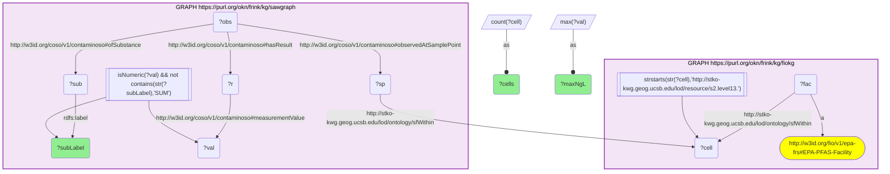

# geo01_q2_fiokg-sawgraph_compound-frequency

- **Date:** 2026-10-13
- **Model:** claude-opus-5-5
- **SPARQL endpoint:** https://apps.okn.us/federation/sparql
- **Generated by:** mcp-okn v0.1.0 (build f738e02)
- **Contents:** 1 query · 1 query diagram

## Knowledge graphs used

- `fiokg` — <https://purl.org/okn/frink/kg/fiokg>
- `sawgraph` — <https://purl.org/okn/frink/kg/sawgraph>

## Conversation

👤 **User**

Geospatial crosswalk fiokg × sawgraph, shared key = S2 Level-13 cell. Q2: Across all S2 cells that contain an EPA PFAS-relevant facility, which individual PFAS compounds are detected most often in co-located water samples, and at what maximum concentration?

---

🧠 **Assistant**

This aggregates the same facility↔measurement join over every co-occupied cell to profile *which* PFAS dominate near regulated PFAS-relevant facilities. It requires both graphs: the EPA-PFAS-Facility flag and cell location come only from fiokg; the per-compound concentrations come only from sawgraph.

Results (per compound: number of distinct co-located cells, max ng/L; SUM/aggregate parameters excluded):

| PFAS compound | Co-located cells | Max (ng/L) |
| --- | --- | --- |
| Perfluorooctanesulfonic acid (PFOS) | 198 | 124,000 |
| Perfluorobutanesulfonic acid (PFBS) | 110 | 87,500 |
| Perfluoropentanoic acid (PFPeA) | 105 | 18,200 |
| Perfluorobutanoic acid (PFBA) | 98 | 12,700 |
| 2H,2H,3H,3H-Perfluorooctanoic acid (5:3 FTCA) | 77 | 140 |
| Perfluorooctanoic acid (PFOA) | 76 | 18,700 |
| 10-H-Perfluorodecanoic acid | 75 | 3,210 |

The table lists each compound once. The raw result repeats several under alternative sawgraph labels (PFOS appears under three, PFOA under three), and it also contains an aggregate `TOTAL PFOA AND PFOS` row (77 cells) that the query's `SUM` filter does not catch.

Why these rows answer the question: each row is a distinct PFAS compound with the count of S2 cells where it co-occurs with an EPA PFAS-relevant facility and its peak concentration there. PFOS leads by a wide margin — detected in 198 cells holding a PFAS-relevant facility, with the highest peak — followed by the short-chain PFBS, PFPeA and PFBA, and then PFOA: the legacy long-chain acids together with their short-chain relatives, the canonical mixture found near PFAS sources.

Literature validation (strict). According to PubMed, Kulkarni et al. 2025 (Water Research) report that at AFFF-impacted sites PFOS, PFOA and PFHxS account for ~99% of groundwater screening-level exceedances, with short-chain PFBA/PFHxA/PFBS also consistently present — matching this compound ranking ([DOI](https://doi.org/10.1016/j.watres.2025.124124)). da Silva et al. 2026 (ACS Omega) likewise detect the PFOS/PFOA/PFHxS suite plus short-chain congeners in AFFF-impacted groundwater ([DOI](https://doi.org/10.1021/acsomega.5c08713)). **Validated.**

**Literature:** PubMed — Kulkarni 2025 Water Res [10.1016/j.watres.2025.124124](https://doi.org/10.1016/j.watres.2025.124124); da Silva 2026 ACS Omega [10.1021/acsomega.5c08713](https://doi.org/10.1021/acsomega.5c08713).

*This transcript was regenerated on 2026-10-13. Counts are higher than in the earlier version (PFBA led then with 85 cells) because sawgraph v0.0.16 holds more sample points.*

## SPARQL queries executed

#### Query 1

_2026-10-13T21:41:08+00:00 · `fiokg`, `sawgraph`_

```sparql
SELECT ?subLabel (COUNT(DISTINCT ?cell) AS ?cells) (MAX(?val) AS ?maxNgL) WHERE {
  GRAPH <https://purl.org/okn/frink/kg/fiokg> {
    ?fac a <http://w3id.org/fio/v1/epa-frs#EPA-PFAS-Facility> ;
         <http://stko-kwg.geog.ucsb.edu/lod/ontology/sfWithin> ?cell .
    FILTER(STRSTARTS(STR(?cell),'http://stko-kwg.geog.ucsb.edu/lod/resource/s2.level13.'))
  }
  GRAPH <https://purl.org/okn/frink/kg/sawgraph> {
    ?sp <http://stko-kwg.geog.ucsb.edu/lod/ontology/sfWithin> ?cell .
    ?obs <http://w3id.org/coso/v1/contaminoso#observedAtSamplePoint> ?sp ;
         <http://w3id.org/coso/v1/contaminoso#ofSubstance> ?sub ;
         <http://w3id.org/coso/v1/contaminoso#hasResult> ?r .
    ?r <http://w3id.org/coso/v1/contaminoso#measurementValue> ?val .
    ?sub <http://www.w3.org/2000/01/rdf-schema#label> ?subLabel .
    FILTER(isNumeric(?val))
    FILTER(!CONTAINS(STR(?subLabel),'SUM'))
  }
} GROUP BY ?subLabel ORDER BY DESC(?cells) LIMIT 12
```



_12 row(s)_

| subLabel | cells | maxNgL |
| --- | --- | --- |
| Perfluorooctanesulfonic acid | 198 | 124000.0 |
| 1-Octanesulfonic acid, 1,1,2,2,3,3,4,4,5,5,6,6,7,7,8,8,8-heptadecafluoro-***retired***use Perfluorooctane sulfonic acid | 113 | 168.0 |
| Perfluorobutanesulfonic acid | 110 | 87500.0 |
| Perfluoropentanoic acid | 105 | 18200.0 |
| Perfluorobutanoic acid | 98 | 12700.0 |
| TOTAL PFOA AND PFOS | 77 | 142700.0 |
| 2H,2H,3H,3H-Perfluorooctanoic acid | 77 | 140.0 |
| PERFLUOROOCTANOIC ACID-LINEAR | 76 | 18700.0 |
| PERFLUOROOCTANOIC ACID | 76 | 18700.0 |
| Perfluorooctanoic acid | 76 | 18700.0 |
| 10-H-Perfluorodecanoic acid | 75 | 3210.0 |
| PERFLUOROOCTANE SULFONIC ACID | 70 | 124000.0 |
