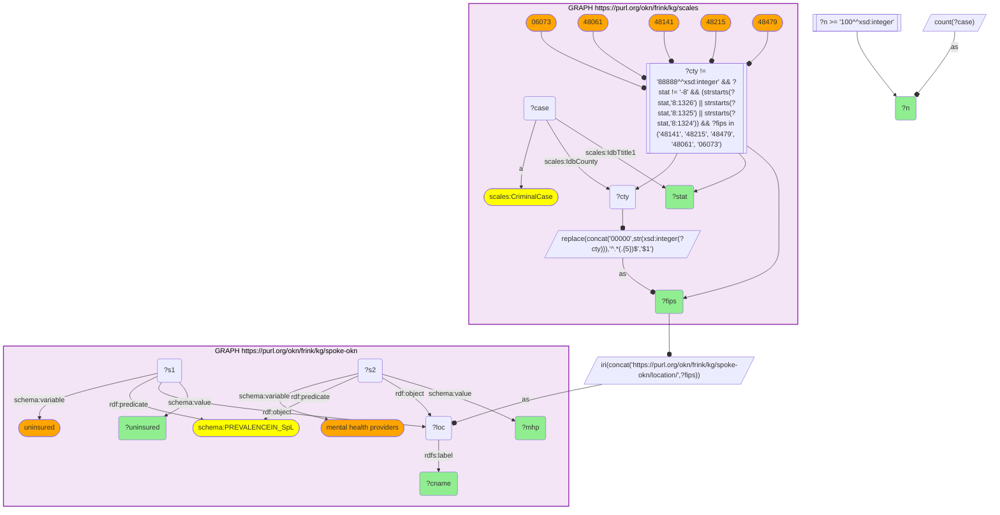

# Named federal immigration charge categories vs county healthcare access (SCALES × spoke-okn)

- **Date:** 2026-10-13
- **Model:** claude-opus-5-5
- **SPARQL endpoint:** https://apps.okn.us/federation/sparql
- **Generated by:** mcp-okn v0.1.0 (build f738e02)
- **Contents:** 1 query · 1 query diagram

## Knowledge graphs used

- `scales` — <https://purl.org/okn/frink/kg/scales>
- `spoke-okn` — <https://purl.org/okn/frink/kg/spoke-okn>

## Conversation

👤 **User**

SCALES records each federal criminal case's U.S.-Code Title-statute charge group (`IdbTtitle1`) and filing county FIPS (`IdbCounty`). Along the southwest border the dominant statutes are immigration offenses — `8:1326` illegal reentry of a removed alien, `8:1325` improper entry, `8:1324` alien smuggling. SPOKE-OKN holds county healthcare-access indicators (uninsured rate, mental-health-provider ratio) as reified `PREVALENCEIN_SpL` statements on `location/{FIPS5}`. Joining on county FIPS: in the border counties carrying the heaviest *immigration* caseload, what is the healthcare-access profile of the resident population?

---

🧠 **Assistant**

The join is required to put a named federal charge category (SCALES) next to health-system access metrics (SPOKE-OKN) for the same county. SCALES tells us *which immigration statute* dominates a county's docket and how many cases; SPOKE-OKN tells us how that county's residents fare on insurance and mental-health-provider supply. Only the shared county FIPS lets the two appear in one row.

**Why the join is required:** each row carries a real SCALES datum (named immigration Title-statute + case count, the county's top immigration charge group) and a real SPOKE-OKN datum (uninsured % and mental-health-provider ratio) for the *same* border county.

| FIPS | County | Top immigration charge (Title-statute) | Cases | Uninsured % | Mental-health prov. ratio |
| --- | --- | --- | --- | --- | --- |
| 48141 | El Paso Co TX | Illegal reentry — 8:1326(a) | 1,836 | 23.0 | 890:1 |
| 48215 | Hidalgo Co TX | Illegal reentry — 8:1326 | 1,006 | 33.1 | 1289:1 |
| 48061 | Cameron Co TX | Illegal reentry — 8:1326 | 720 | 29.9 | 1263:1 |
| 48479 | Webb Co TX | Illegal reentry — 8:1326 | 364 | 31.8 | 2144:1 |
| 06073 | San Diego Co CA | Improper entry — 8:1325 (petty) | 813 | 8.2 | 214:1 |

**Why it answers the question:** the Texas border counties whose dockets are dominated by illegal-reentry prosecutions (8:1326) combine that heavy immigration caseload with severe healthcare-access deficits — 23–33% uninsured and mental-health-provider ratios up to 2,144:1 in Webb Co — whereas San Diego, dominated by petty improper-entry (8:1325) cases, has far better access (8.2% uninsured, 214:1). The named charge category (SCALES) and the access metrics (SPOKE-OKN) co-locate: the immigration-enforcement burden and the care gap fall on the same border populations.
*(Per-county top immigration charge group reported in the table; full result returns all 8:132x groups ≥100 cases per county.)*

## Literature validation

According to PubMed, U.S.–Mexico border populations face compounded, cost-driven barriers to healthcare. Towne et al. (2025, *Healthcare (Basel)*) surveyed a largely Hispanic adult population in a major U.S.–Mexico border area and found lower education, Hispanic ethnicity and lower income strongly associated with being uninsured and with forgoing necessary medical care due to cost — the exact access deficits the SPOKE-OKN uninsured and provider-ratio metrics quantify in the border counties carrying SCALES' heaviest immigration caseload. [PMID:41008426](https://pubmed.ncbi.nlm.nih.gov/41008426/) · [DOI](https://doi.org/10.3390/healthcare13182295)

## SPARQL queries executed

#### Query 1

_2026-10-13T21:13:55+00:00 · `scales`, `spoke-okn`_

```sparql
PREFIX xsd: <http://www.w3.org/2001/XMLSchema#>
PREFIX scales: <http://schemas.scales-okn.org/rdf/scales#>
PREFIX rdf: <http://www.w3.org/1999/02/22-rdf-syntax-ns#>
PREFIX schema: <https://purl.org/okn/frink/kg/spoke-okn/schema/>
PREFIX rdfs: <http://www.w3.org/2000/01/rdf-schema#>
SELECT ?fips ?cname ?stat ?n ?uninsured ?mhp WHERE {
  {
    SELECT ?fips ?stat (COUNT(?case) AS ?n) WHERE {
      GRAPH <https://purl.org/okn/frink/kg/scales> {
        ?case a scales:CriminalCase ; scales:IdbCounty ?cty ; scales:IdbTtitle1 ?stat .
        FILTER(?cty != 88888) FILTER(?stat != "-8")
        FILTER(STRSTARTS(?stat,"8:1326") || STRSTARTS(?stat,"8:1325") || STRSTARTS(?stat,"8:1324"))
        BIND(REPLACE(CONCAT('00000',STR(xsd:integer(?cty))),'^.*(.{5})$','$1') AS ?fips)
        FILTER(?fips IN ("48141","48215","48479","48061","06073"))
      }
    } GROUP BY ?fips ?stat ORDER BY DESC(?n)
  }
  FILTER(?n >= 100)
  BIND(IRI(CONCAT('https://purl.org/okn/frink/kg/spoke-okn/location/',?fips)) AS ?loc)
  GRAPH <https://purl.org/okn/frink/kg/spoke-okn> {
    ?loc rdfs:label ?cname .
    ?s1 rdf:predicate schema:PREVALENCEIN_SpL ; rdf:object ?loc ; schema:variable "uninsured" ; schema:value ?uninsured .
    ?s2 rdf:predicate schema:PREVALENCEIN_SpL ; rdf:object ?loc ; schema:variable "mental health providers" ; schema:value ?mhp .
  }
} ORDER BY ?fips DESC(?n)
```



_14 row(s)_

| fips | cname | stat | n | uninsured | mhp |
| --- | --- | --- | --- | --- | --- |
| 06073 | San Diego County | 8:1325.P | 813 | 8.242600538(3.0) | 214:1(2.0) |
| 06073 | San Diego County | 8:1324.F | 594 | 8.242600538(3.0) | 214:1(2.0) |
| 06073 | San Diego County | 8:1326.F | 491 | 8.242600538(3.0) | 214:1(2.0) |
| 06073 | San Diego County | 8:1326A.F | 289 | 8.242600538(3.0) | 214:1(2.0) |
| 06073 | San Diego County | 8:1326B.F | 134 | 8.242600538(3.0) | 214:1(2.0) |
| 48061 | Cameron County | 8:1326.F | 720 | 29.85276773(4.0) | 1263:1(2.0) |
| 48141 | El Paso County | 8:1326A.F | 1836 | 23.028326765(3.0) | 890:1(1.0) |
| 48141 | El Paso County | 8:1325.P | 194 | 23.028326765(3.0) | 890:1(1.0) |
| 48141 | El Paso County | 8:1324.F | 127 | 23.028326765(3.0) | 890:1(1.0) |
| 48215 | Hidalgo County | 8:1326.F | 1006 | 33.102492153(4.0) | 1289:1(2.0) |
| 48215 | Hidalgo County | 8:1326A.F | 269 | 33.102492153(4.0) | 1289:1(2.0) |
| 48215 | Hidalgo County | 8:1324.F | 178 | 33.102492153(4.0) | 1289:1(2.0) |
| 48479 | Webb County | 8:1326.F | 364 | 31.769389938(4.0) | 2144:1(3.0) |
| 48479 | Webb County | 8:1324.F | 161 | 31.769389938(4.0) | 2144:1(3.0) |
