# Named DREAM-KG mental-health / substance-use services by ZIP, with SPOKE county mental-health context

- **Date:** 2026-10-13
- **Model:** claude-opus-5-5
- **SPARQL endpoint:** https://apps.okn.us/federation/sparql
- **Generated by:** mcp-okn v0.1.0 (build f738e02)
- **Contents:** 1 query · 1 query diagram

## Knowledge graphs used

- `spoke-okn` — <https://purl.org/okn/frink/kg/spoke-okn>
- `dreamkg` — <https://purl.org/okn/frink/kg/dreamkg>

## Conversation

👤 **User**

DreamKG catalogs homelessness / social-service offerings (Los Angeles County and Philadelphia), each tagged with a `schema:postalCode` (bare 5-digit ZIP) and a human-readable service name (program + organization, on `schema:name`), but no information on whether that ZIP is a real PA standard residential ZIP or any local health context. SPOKE-OKN holds U.S. ZIP administrative nodes (`/location/{STATE}-{ZIP}`, `state`, `zipcode_type`) that roll up through their city to a county carrying County-Health-Rankings indicators (`PREVALENCEIN_SpL`, `schema:variable`/`schema:value`). **Crosswalk on ZIP5:** list **named mental-health / substance-use services** from DreamKG in validated PA standard residential ZIPs, each row contextualized by the SPOKE county's mental-health-provider ratio and frequent-mental-distress rate.

---

🧠 **Assistant**

**Why the join is required.** DreamKG names the service and its ZIP but cannot confirm the ZIP is a valid PA standard residential code nor say anything about the surrounding county's mental-health capacity. SPOKE-OKN supplies the ZIP validation (`state = "PA"`, `zipcode_type = "STANDARD"`) and — by following the ZIP node up through its city to its county — the County-Health-Rankings **mental health providers** ratio and **frequent mental distress** rate. Only the join puts a *named* DreamKG service next to the SPOKE health context of the place it sits in.

**Join mechanics.** Shared key = the bare 5-digit ZIP literal. spoke-okn selects `/location/PA-{ZIP}` nodes (`state="PA"`, `zipcode_type="STANDARD"`) and walks `PARTOF_LpL` (ZIP→city→county FIPS); for that county it reads two `PREVALENCEIN_SpL` statements (`variable = "mental health providers"` and `"frequent mental distress"`). In dreamkg the service matches `schema:postalCode` with `schema:category` filtered to `/service_type/Mental` and its name taken from `schema:name`. **Both KGs populate every row:** the named service is the dreamkg entity; the provider ratio and distress rate are real spoke county values.

| ZIP | named service (DREAM-KG) | SPOKE county mental-health providers | SPOKE frequent mental distress % |
| --- | --- | --- | --- |
| 19102 | Behavioral Health Services (Dr. Robin Lowey & Associates LLC) | 313:1 | 16.9 |
| 19102 | Child & Adolescent Services (Springfield Psychological) | 313:1 | 16.9 |
| 19102 | Counseling Services (Springfield Psychological) | 313:1 | 16.9 |
| 19103 | Adult Counseling (Jewish Family and Children's Service of Greater Philadelphia) | 313:1 | 16.9 |
| 19103 | CORE Group (Women Organized Against Rape) | 313:1 | 16.9 |
| 19103 | Counseling Services (Estadt Psychological Services) | 313:1 | 16.9 |
| 19103 | Counseling Services (The Center, LLC) | 313:1 | 16.9 |
| 19103 | Counseling Services (Women Organized Against Rape) | 313:1 | 16.9 |
| 19104 | Addiction Services (University of Pennsylvania Perelman School of Medicine) | 313:1 | 16.9 |
| 19104 | Adolescent Medicine (Children's Hospital of Philadelphia) | 313:1 | 16.9 |
| 19104 | Adolescent Treatment Programming Willpower, Options, Resources and Direction - W.O.R.D (The Consortium, Inc.) | 313:1 | 16.9 |
| 19104 | Adult Behavioral Health Services (Family Practice & Counseling Network) | 313:1 | 16.9 |

**Why it answers the question.** Each row is a concrete, named DreamKG mental-health / substance-use service in a SPOKE-validated PA standard residential ZIP, set against the SPOKE county's mental-health-provider scarcity (e.g. 313 residents per provider in Philadelphia County) and frequent-mental-distress burden (16.9%). This pairs *where help exists* (DreamKG) with *how strained the surrounding county is* (SPOKE) — exactly the service-to-need mapping the question asks for.

The rows shown are the first twelve by ZIP and service name, not a ranking; DreamKG lists many more services in these and other Pennsylvania ZIPs.

## Literature validation

According to PubMed, Poulin et al. (2010, *Psychiatr Serv*) studied a population-based sample of 2,703 chronically homeless persons in Philadelphia and found that 81% of the highest-cost service users carried a serious mental-illness diagnosis, with psychiatric care driving most service costs — establishing the acute, geographically concentrated demand for the mental-health and substance-use services this join maps to validated Philadelphia ZIPs. [PMID:21041347](https://pubmed.ncbi.nlm.nih.gov/21041347/) · [DOI](https://doi.org/10.1176/ps.2010.61.11.1093)

*This transcript was regenerated on 2026-10-13. dreamkg v0.0.5 moved the service's display name from `schema:identifier` (now a numeric id) to `schema:name`, and added Los Angeles County listings; this example stays on Pennsylvania ZIPs, and its rows are the first twelve by ZIP and name.*

## SPARQL queries executed

#### Query 1

_2026-10-13T21:36:56+00:00 · `spoke-okn`, `dreamkg`_

```sparql
SELECT DISTINCT ?zip ?service ?mhProviders ?mentalDistress WHERE {
  GRAPH <https://purl.org/okn/frink/kg/spoke-okn> {
    ?loc <http://www.w3.org/2000/01/rdf-schema#label> ?zip ;
         <https://purl.org/okn/frink/kg/spoke-okn/schema/state> "PA" ;
         <https://purl.org/okn/frink/kg/spoke-okn/schema/zipcode_type> "STANDARD" ;
         <https://purl.org/okn/frink/kg/spoke-okn/schema/PARTOF_LpL> ?city .
    FILTER(REGEX(STR(?loc),'/location/[A-Z]{2}-[0-9]+'))
    ?city <https://purl.org/okn/frink/kg/spoke-okn/schema/PARTOF_LpL> ?county .
    FILTER(REGEX(STR(?county),'/location/[0-9]{5}$'))
    ?s1 <http://www.w3.org/1999/02/22-rdf-syntax-ns#predicate> <https://purl.org/okn/frink/kg/spoke-okn/schema/PREVALENCEIN_SpL> ;
        <http://www.w3.org/1999/02/22-rdf-syntax-ns#object> ?county ;
        <https://purl.org/okn/frink/kg/spoke-okn/schema/variable> "mental health providers" ;
        <https://purl.org/okn/frink/kg/spoke-okn/schema/value> ?mhProviders .
    ?s2 <http://www.w3.org/1999/02/22-rdf-syntax-ns#predicate> <https://purl.org/okn/frink/kg/spoke-okn/schema/PREVALENCEIN_SpL> ;
        <http://www.w3.org/1999/02/22-rdf-syntax-ns#object> ?county ;
        <https://purl.org/okn/frink/kg/spoke-okn/schema/variable> "frequent mental distress" ;
        <https://purl.org/okn/frink/kg/spoke-okn/schema/value> ?mentalDistress .
  }
  GRAPH <https://purl.org/okn/frink/kg/dreamkg> {
    ?svc <http://schema.org/postalCode> ?zip ;
         <http://schema.org/category> ?cat ;
         <http://schema.org/name> ?service .
    FILTER(CONTAINS(STR(?cat),'/service_type/Mental'))
  }
} ORDER BY ?zip ?service LIMIT 12
```

```mermaid
graph TD
classDef projected fill:lightgreen;
classDef literal fill:orange;
classDef iri fill:yellow;
  q0v9("?cat")
  q0v5("?city")
  q0v2("?county")
  q0v1("?loc")
  q0v8("?mentalDistress"):::projected 
  q0v7("?mhProviders"):::projected 
  q0v3("?s1")
  q0v4("?s2")
  q0v11("?service"):::projected 
  q0v10("?svc")
  q0v6("?zip"):::projected 
  subgraph q0graph0["GRAPH https://purl.org/okn/frink/kg/spoke-okn"]
    style q0graph0 fill:#f3e5f5,stroke:#8e24aa,stroke-width:2px,color:#000;
    q0graph0c2(["PA"]):::literal 
    q0graph0c4(["STANDARD"]):::literal 
    q0graph0c7(["frequent mental distress"]):::literal 
    q0graph0c9(["https://purl.org/okn/frink/kg/spoke-okn/schema/PREVALENCEIN_SpL"]):::iri 
    q0graph0c6(["mental health providers"]):::literal 
    q0graph0f0[["regex(str(?loc),'/location/#91;A-Z#93;{2}-#91;0-9#93;+') && regex(str(?county),'/location/#91;0-9#93;{5}$')"]]
    q0graph0f0 --> q0v1
    q0graph0f0 --> q0v2
    q0v1 --"https://purl.org/okn/frink/kg/spoke-okn/schema/state"--> q0graph0c2
    q0v1 --"https://purl.org/okn/frink/kg/spoke-okn/schema/zipcode_type"--> q0graph0c4
    q0v3 --"https://purl.org/okn/frink/kg/spoke-okn/schema/variable"--> q0graph0c6
    q0v4 --"https://purl.org/okn/frink/kg/spoke-okn/schema/variable"--> q0graph0c7
    q0v3 --"rdf:predicate"--> q0graph0c9
    q0v4 --"rdf:predicate"--> q0graph0c9
    q0v3 --"rdf:object"--> q0v2
    q0v4 --"rdf:object"--> q0v2
    q0v1 --"https://purl.org/okn/frink/kg/spoke-okn/schema/PARTOF_LpL"--> q0v5
    q0v5 --"https://purl.org/okn/frink/kg/spoke-okn/schema/PARTOF_LpL"--> q0v2
    q0v1 --"rdfs:label"--> q0v6
    q0v3 --"https://purl.org/okn/frink/kg/spoke-okn/schema/value"--> q0v7
    q0v4 --"https://purl.org/okn/frink/kg/spoke-okn/schema/value"--> q0v8
  end
  subgraph q0graph1["GRAPH https://purl.org/okn/frink/kg/dreamkg"]
    style q0graph1 fill:#f3e5f5,stroke:#8e24aa,stroke-width:2px,color:#000;
    q0graph1f1[["contains(str(?cat),'/service_type/Mental')"]]
    q0graph1f1 --> q0v9
    q0v10 --"http://schema.org/category"--> q0v9
    q0v10 --"http://schema.org/name"--> q0v11
    q0v10 --"http://schema.org/postalCode"--> q0v6
  end
```



_12 row(s)_

| zip | service | mhProviders | mentalDistress |
| --- | --- | --- | --- |
| 19102 | Behavioral Health Services (Dr. Robin Lowey & Associates LLC) | 313:1(1.0) | 16.9 |
| 19102 | Child & Adolescent Services (Springfield Psychological) | 313:1(1.0) | 16.9 |
| 19102 | Counseling Services (Springfield Psychological) | 313:1(1.0) | 16.9 |
| 19103 | Adult Counseling (Jewish Family and Children's Service of Greater Philadelphia) | 313:1(1.0) | 16.9 |
| 19103 | CORE Group (Women Organized Against Rape) | 313:1(1.0) | 16.9 |
| 19103 | Counseling Services (Estadt Psychological Services) | 313:1(1.0) | 16.9 |
| 19103 | Counseling Services (The Center, LLC) | 313:1(1.0) | 16.9 |
| 19103 | Counseling Services (Women Organized Against Rape) | 313:1(1.0) | 16.9 |
| 19104 | Addiction Services (University of Pennsylvania Perelman School of Medicine) | 313:1(1.0) | 16.9 |
| 19104 | Adolescent Medicine (Children's Hospital of Philadelphia) | 313:1(1.0) | 16.9 |
| 19104 | Adolescent Treatment Programming Willpower, Options, Resources and Direction - W.O.R.D (The Consortium, Inc.) | 313:1(1.0) | 16.9 |
| 19104 | Adult Behavioral Health Services (Family Practice & Counseling Network) | 313:1(1.0) | 16.9 |
