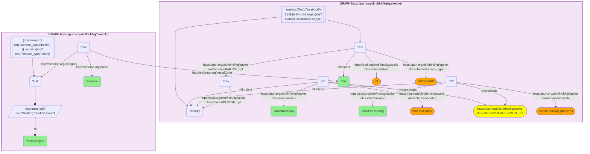

# Named DREAM-KG food / shelter services by ZIP, with SPOKE county food-insecurity & housing context

- **Date:** 2026-10-13
- **Model:** claude-opus-5-5
- **SPARQL endpoint:** https://apps.okn.us/federation/sparql
- **Generated by:** mcp-okn v0.1.0 (build f738e02)
- **Contents:** 1 query · 1 query diagram

## Knowledge graphs used

- `spoke-okn` — <https://purl.org/okn/frink/kg/spoke-okn>
- `dreamkg` — <https://purl.org/okn/frink/kg/dreamkg>

## Conversation

👤 **User**

Beyond mental health, DreamKG tags services as **Food** or **Shelter**, each with a human-readable name (program + organization, on `schema:name`) and a `schema:postalCode`. **Crosswalk on ZIP5:** list **named food and shelter services** from DreamKG in SPOKE-validated PA standard residential ZIPs, each row contextualized by the SPOKE county's **food insecurity** rate and **severe housing problems** rate. Food insecurity and unstable housing are tightly coupled health risks for people experiencing homelessness — which named services sit where the surrounding county need is highest?

---

🧠 **Assistant**

**Why the join is required.** DreamKG holds the named food/shelter services and their ZIPs but cannot confirm a ZIP is a valid PA standard residential code nor describe the local food/housing hardship. SPOKE-OKN supplies the ZIP validation (`state="PA"`, `zipcode_type="STANDARD"`) and, via the ZIP→city→county walk, the County-Health-Rankings **food insecurity** and **severe housing problems** rates for the county. Only the join places a *named* service next to the SPOKE county hardship context.

**Join mechanics.** Shared key = bare 5-digit ZIP literal. spoke-okn selects `/location/PA-{ZIP}` STANDARD nodes, walks `PARTOF_LpL` (ZIP→city→county FIPS), and for that county reads two `PREVALENCEIN_SpL` statements (`variable = "food insecurity"` and `"severe housing problems"`). In dreamkg the service matches `schema:postalCode`, with `schema:category` filtered to `/service_type/Food` or `/service_type/Shelter` and its name from `schema:name`. **Both KGs populate every row:** the named service is the dreamkg entity; the food-insecurity and housing rates are real spoke county values.

| ZIP | named service (DREAM-KG) | type | SPOKE county food insecurity % | SPOKE severe housing problems % |
| --- | --- | --- | --- | --- |
| 17602 | Border Shelter Network and Call Center (Church World Service Inc) | Food | 8.7 | 14.6 |
| 19013 | Community Support Services (Better Living Center) | Food | 9.1 | 15.5 |
| 19023 | Residential Maternity Shelter (Mothers' Home) | Shelter | 9.1 | 15.5 |
| 19079 | Financial Assistance for Military Families (American Red Cross) | Shelter | 9.1 | 15.5 |
| 19079 | Food Cupboard (Neighbor to Neighbor Community Development Corporation Inc) | Food | 9.1 | 15.5 |
| 19102 | Code Blue (Project HOME) | Shelter | 15.8 | 22.7 |
| 19103 | Food Cabinet (Lutheran Church of the Holy Communion) | Food | 15.8 | 22.7 |
| 19104 | Food Cupboard (Second Antioch Baptist Church) | Food | 15.8 | 22.7 |
| 19104 | Food Cupboard (The Church of St. Andrew and St. Monica) | Food | 15.8 | 22.7 |
| 19104 | Food Distribution (Lombard Central Presbyterian Church) | Food | 15.8 | 22.7 |
| 19104 | Jane Addams Place (Lutheran Settlement House) | Shelter | 15.8 | 22.7 |
| 19104 | Men's Shelter (The Veterans Group) | Shelter | 15.8 | 22.7 |

**Why it answers the question.** Each row is a concrete, named DreamKG food or shelter service in a SPOKE-validated PA standard residential ZIP, set against the SPOKE county's food-insecurity and severe-housing-problem rates. The values track county: central-Philadelphia ZIPs (19102–19104) carry the highest food insecurity (15.8%) and housing burden (22.7%), while suburban Delaware-County ZIPs (19013/19023/19079) sit lower (9.1% / 15.5%) — surfacing where these coupled basic-needs services align with the greatest measured hardship.

The rows shown are the first twelve by ZIP and service name, not a ranking; DreamKG lists many more services in these and other Pennsylvania ZIPs.

## Literature validation

According to PubMed, Ra et al. (2021, *J Soc Distress Homeless*) found that unsheltered and unstably housed adults used fewer shelter-based health services and had significantly **higher food insecurity** than sheltered adults — empirically tying together food insecurity, shelter-service access, and health risk in the homeless population, the coupled basic-needs hardship this food + shelter join maps. [PMID:37346936](https://pubmed.ncbi.nlm.nih.gov/37346936/) · [DOI](https://doi.org/10.1080/10530789.2021.1961990)

*This transcript was regenerated on 2026-10-13. dreamkg v0.0.5 moved the service's display name from `schema:identifier` (now a numeric id) to `schema:name`, and added Los Angeles County listings; this example stays on Pennsylvania ZIPs, and its rows are the first twelve by ZIP and name.*

## SPARQL queries executed

#### Query 1

_2026-10-13T21:36:57+00:00 · `spoke-okn`, `dreamkg`_

```sparql
SELECT DISTINCT ?zip ?service ?serviceType ?foodInsecurity ?severeHousing WHERE {
  GRAPH <https://purl.org/okn/frink/kg/spoke-okn> {
    ?loc <http://www.w3.org/2000/01/rdf-schema#label> ?zip ;
         <https://purl.org/okn/frink/kg/spoke-okn/schema/state> "PA" ;
         <https://purl.org/okn/frink/kg/spoke-okn/schema/zipcode_type> "STANDARD" ;
         <https://purl.org/okn/frink/kg/spoke-okn/schema/PARTOF_LpL> ?city .
    FILTER(REGEX(STR(?loc),'/location/[A-Z]{2}-[0-9]+'))
    ?city <https://purl.org/okn/frink/kg/spoke-okn/schema/PARTOF_LpL> ?county .
    FILTER(REGEX(STR(?county),'/location/[0-9]{5}$'))
    ?s1 <http://www.w3.org/1999/02/22-rdf-syntax-ns#predicate> <https://purl.org/okn/frink/kg/spoke-okn/schema/PREVALENCEIN_SpL> ;
        <http://www.w3.org/1999/02/22-rdf-syntax-ns#object> ?county ;
        <https://purl.org/okn/frink/kg/spoke-okn/schema/variable> "food insecurity" ;
        <https://purl.org/okn/frink/kg/spoke-okn/schema/value> ?foodInsecurity .
    ?s2 <http://www.w3.org/1999/02/22-rdf-syntax-ns#predicate> <https://purl.org/okn/frink/kg/spoke-okn/schema/PREVALENCEIN_SpL> ;
        <http://www.w3.org/1999/02/22-rdf-syntax-ns#object> ?county ;
        <https://purl.org/okn/frink/kg/spoke-okn/schema/variable> "severe housing problems" ;
        <https://purl.org/okn/frink/kg/spoke-okn/schema/value> ?severeHousing .
  }
  GRAPH <https://purl.org/okn/frink/kg/dreamkg> {
    ?svc <http://schema.org/postalCode> ?zip ;
         <http://schema.org/category> ?cat ;
         <http://schema.org/name> ?service .
    FILTER(CONTAINS(STR(?cat),'/service_type/Shelter') || CONTAINS(STR(?cat),'/service_type/Food'))
    BIND(IF(CONTAINS(STR(?cat),'Shelter'),'Shelter','Food') AS ?serviceType)
  }
} ORDER BY ?zip ?service LIMIT 12
```



_12 row(s)_

| zip | service | serviceType | foodInsecurity | severeHousing |
| --- | --- | --- | --- | --- |
| 17602 | Border Shelter Network and Call Center (Church World Service Inc) | Food | 8.7 | 14.636444797(4.0) |
| 19013 | Community Support Services (Better Living Center) | Food | 9.1 | 15.538828979(4.0) |
| 19023 | Residential Maternity Shelter (Mothers' Home) | Shelter | 9.1 | 15.538828979(4.0) |
| 19079 | Financial Assistance for Military Families (American Red Cross) | Shelter | 9.1 | 15.538828979(4.0) |
| 19079 | Food Cupboard (Neighbor to Neighbor Community Development Corporation Inc) | Food | 9.1 | 15.538828979(4.0) |
| 19102 | Code Blue (Project HOME) | Shelter | 15.8 | 22.731921475(4.0) |
| 19103 | Food Cabinet (Lutheran Church of the Holy Communion) | Food | 15.8 | 22.731921475(4.0) |
| 19104 | Food Cupboard (Second Antioch Baptist Church) | Food | 15.8 | 22.731921475(4.0) |
| 19104 | Food Cupboard (The Church of St. Andrew and St. Monica) | Food | 15.8 | 22.731921475(4.0) |
| 19104 | Food Distribution (Lombard Central Presbyterian Church) | Food | 15.8 | 22.731921475(4.0) |
| 19104 | Jane Addams Place (Lutheran Settlement House) | Shelter | 15.8 | 22.731921475(4.0) |
| 19104 | Men's Shelter (The Veterans Group) | Shelter | 15.8 | 22.731921475(4.0) |
