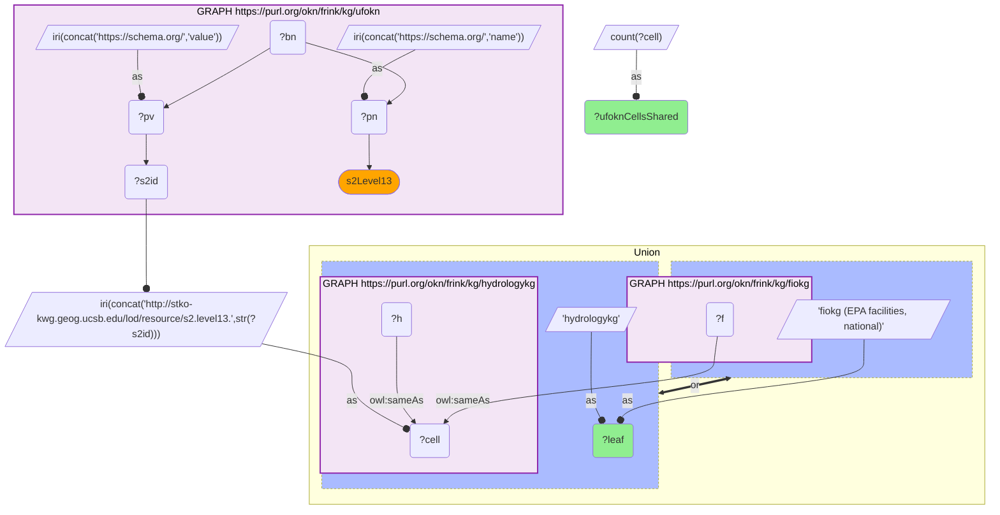
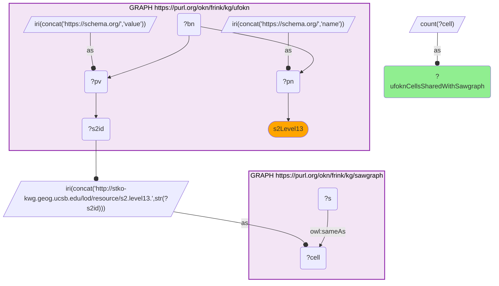
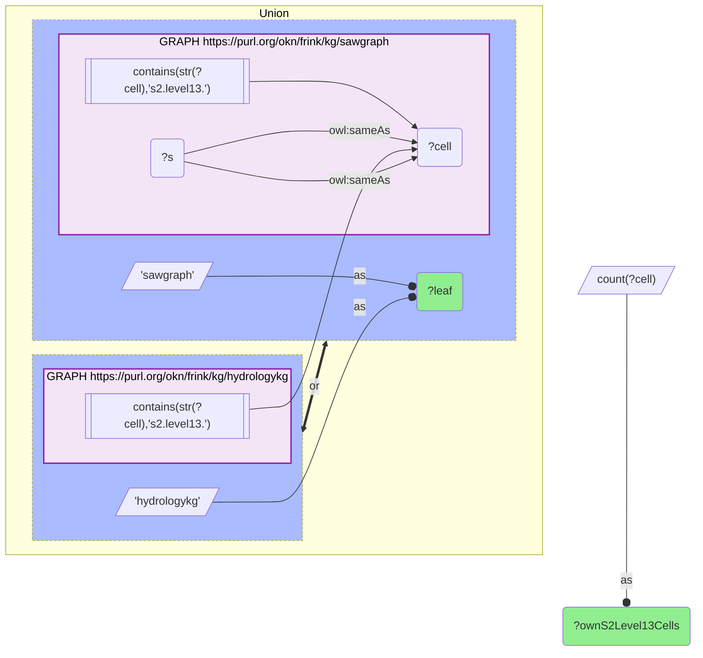
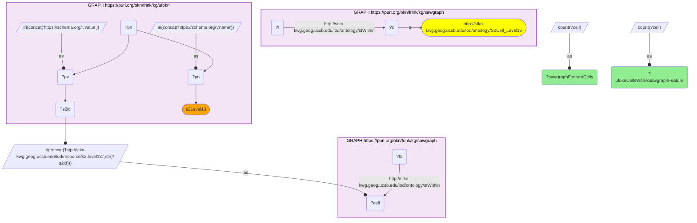

# G25-Q2: Which S2 leaves ufokn actually co-locates with — and why 100% overlap is less informative than 20%

- **Date:** 2026-10-13
- **Model:** claude-opus-5-5
- **SPARQL endpoint:** https://apps.okn.us/federation/sparql
- **Generated by:** mcp-okn v0.1.0 (build f738e02)
- **Contents:** 4 queries · 4 query diagrams

## Knowledge graphs used

- `ufokn` — <https://purl.org/okn/frink/kg/ufokn>
- `fiokg` — <https://purl.org/okn/frink/kg/fiokg>
- `hydrologykg` — <https://purl.org/okn/frink/kg/hydrologykg>
- `sawgraph` — <https://purl.org/okn/frink/kg/sawgraph>

## Conversation

👤 **User**

ufokn is one of several S2 leaves. Does its flood layer co-locate with all of them equally, or only with some — and why? Which leaf-to-leaf joins are actually verifiable?

The earlier run could only sample 5,000 rows. Use the repaired exact form.

---

🧠 **Assistant**

**Now measurable exactly, and the answer is three different things at once.** The 2026-06-19 run sampled a `LIMIT 5000` slice; with the repaired query (bind the HTTPS schema.org predicates, push `DISTINCT` before IRI construction) all 97,087 ufokn flood cells can be tested against each leaf.

| Leaf | ufokn cells shared | Share of ufokn's 97,087 |
|---|---|---|
| hydrologykg | 97,087 | 100% |
| fiokg (EPA facilities, national) | 19,252 | 19.8% |
| sawgraph, on `owl:sameAs` | 97,087 | 100% |
| sawgraph, on cells that hold a sawgraph feature (`sfWithin`) | 0 | 0% |

Three leaves, and the two largest numbers are the least informative. sawgraph gives two opposite answers depending on which predicate is asked, and only one of them means anything.

**fiokg: 19.8% is real co-location.** ufokn's urban flood footprint and the EPA facility registry are independent national datasets, and about one in five flood cells contains a regulated facility. That is a substantive finding about the world.

**sawgraph: 100% on `owl:sameAs`, 0 on real features — and the 0 is the answer.** Asked the way the other leaves are asked, sawgraph now matches every one of ufokn's 97,087 cells. That is new, and it is the same artefact as hydrologykg's: sawgraph v0.0.16 materializes all 7,404,184 KWG Level-13 cells with a reflexive `owl:sameAs`, so the predicate no longer says where sawgraph has data. The cells that actually hold a sawgraph sample point or site are the 4,814 reached by `kwg-ont:sfWithin`, and **none of them is a ufokn flood cell** (Query 4). The two graphs are genuinely disjoint in space — the same conclusion the earlier version of this example reached, when the `owl:sameAs` test still returned 0 because sawgraph then listed only the cells it had data in.

**hydrologykg: 100% is an artefact, not a discovery.** Every single ufokn cell appears in hydrologykg — which sounds like perfect agreement and is nothing of the kind. hydrologykg carries **7,404,649** distinct S2 Level-13 cells on `owl:sameAs`: it is a **national S2 index**, roughly 76× ufokn's entire cell set (and sawgraph, at 7,404,184, has become one too). Any collection of US S2 cells will be almost entirely contained in it. The join succeeds for every row because containment is guaranteed by construction, so it tells you nothing about whether flood risk and hydrology features actually coincide.

**So: which leaf-to-leaf joins are verifiable?** The question conceals a trap. All of these joins *execute*, and a naive reading would rank hydrologykg and sawgraph as perfect partners. The truth inverts that:

- **fiokg is the only informative join** — a partial overlap between independently-scoped datasets, where the 19.8% is a measurement.
- **sawgraph is a verified non-join** — but only when asked on `sfWithin`. Its `owl:sameAs` result is spurious in exactly the way hydrologykg's is, and a recipe written against the previous release now reports total overlap where there is none.
- **hydrologykg is a spurious join** — 100% success carrying no information. Reporting "ufokn co-locates with hydrologykg on 97,087 cells" would be true and misleading.

**The general lesson.** When one side of a spatial join is an index rather than an observation layer, overlap fraction stops being evidence. Before quoting a co-location rate, check the partner's own cardinality: 19,252 out of fiokg's 681,045 cells is selective; 97,087 out of hydrologykg's 7.4M — or sawgraph's — is what containment looks like. And re-check it after a redeploy: sawgraph moved from observation layer to index between two releases without any change to the query that reads it. A high match rate against a large index is the spatial equivalent of joining against a lookup table and calling it agreement.

*This transcript was regenerated on 2026-10-13. The earlier version, on the previous sawgraph release, reported 0 shared cells from the `owl:sameAs` test and 88,007 sawgraph cells; both figures changed when sawgraph began materializing every KWG cell.*

## SPARQL queries executed

#### Query 1

_2026-10-13T21:42:57+00:00 · `ufokn`, `fiokg`, `hydrologykg`_

```sparql
SELECT ?leaf (COUNT(DISTINCT ?cell) AS ?ufoknCellsShared) WHERE {
  { SELECT DISTINCT ?cell WHERE {
      { SELECT DISTINCT ?s2id WHERE {
          GRAPH <https://purl.org/okn/frink/kg/ufokn> {
            BIND(IRI(CONCAT('https://schema.org/','name')) AS ?pn)
            BIND(IRI(CONCAT('https://schema.org/','value')) AS ?pv)
            ?bn ?pn "s2Level13" ; ?pv ?s2id . } } }
      BIND(IRI(CONCAT('http://stko-kwg.geog.ucsb.edu/lod/resource/s2.level13.',STR(?s2id))) AS ?cell) } }
  {
    GRAPH <https://purl.org/okn/frink/kg/fiokg> { ?f <http://www.w3.org/2002/07/owl#sameAs> ?cell . }
    BIND('fiokg (EPA facilities, national)' AS ?leaf)
  } UNION {
    GRAPH <https://purl.org/okn/frink/kg/hydrologykg> { ?h <http://www.w3.org/2002/07/owl#sameAs> ?cell . }
    BIND('hydrologykg' AS ?leaf)
  }
} GROUP BY ?leaf ORDER BY DESC(?ufoknCellsShared)
```



_2 row(s)_

| leaf | ufoknCellsShared |
| --- | --- |
| hydrologykg | 97087 |
| fiokg (EPA facilities, national) | 19252 |

#### Query 2

_2026-10-13T21:42:58+00:00 · `ufokn`, `sawgraph`_

```sparql
SELECT (COUNT(DISTINCT ?cell) AS ?ufoknCellsSharedWithSawgraph) WHERE {
  { SELECT DISTINCT ?cell WHERE {
      { SELECT DISTINCT ?s2id WHERE {
          GRAPH <https://purl.org/okn/frink/kg/ufokn> {
            BIND(IRI(CONCAT('https://schema.org/','name')) AS ?pn)
            BIND(IRI(CONCAT('https://schema.org/','value')) AS ?pv)
            ?bn ?pn "s2Level13" ; ?pv ?s2id . } } }
      BIND(IRI(CONCAT('http://stko-kwg.geog.ucsb.edu/lod/resource/s2.level13.',STR(?s2id))) AS ?cell) } }
  GRAPH <https://purl.org/okn/frink/kg/sawgraph> { ?s <http://www.w3.org/2002/07/owl#sameAs> ?cell . }
}
```



_1 row(s)_

| ufoknCellsSharedWithSawgraph |
| --- |
| 97087 |

#### Query 3

_2026-10-13T21:43:49+00:00 · `hydrologykg`, `sawgraph`_

```sparql
SELECT ?leaf (COUNT(DISTINCT ?cell) AS ?ownS2Level13Cells) WHERE {
  {
    GRAPH <https://purl.org/okn/frink/kg/hydrologykg> { ?s <http://www.w3.org/2002/07/owl#sameAs> ?cell .
      FILTER(CONTAINS(STR(?cell),'s2.level13.')) }
    BIND('hydrologykg' AS ?leaf)
  } UNION {
    GRAPH <https://purl.org/okn/frink/kg/sawgraph> { ?s <http://www.w3.org/2002/07/owl#sameAs> ?cell .
      FILTER(CONTAINS(STR(?cell),'s2.level13.')) }
    BIND('sawgraph' AS ?leaf)
  }
} GROUP BY ?leaf ORDER BY DESC(?ownS2Level13Cells)
```



_2 row(s)_

| leaf | ownS2Level13Cells |
| --- | --- |
| hydrologykg | 7404649 |
| sawgraph | 7404184 |

#### Query 4

_2026-10-13T21:43:50+00:00 · `sawgraph`, `ufokn`_

```sparql
SELECT ?sawgraphFeatureCells ?ufoknCellsWithASawgraphFeature WHERE {
  { SELECT (COUNT(DISTINCT ?c) AS ?sawgraphFeatureCells) WHERE {
      GRAPH <https://purl.org/okn/frink/kg/sawgraph> {
        ?f <http://stko-kwg.geog.ucsb.edu/lod/ontology/sfWithin> ?c .
        ?c a <http://stko-kwg.geog.ucsb.edu/lod/ontology/S2Cell_Level13> . } } }
  { SELECT (COUNT(DISTINCT ?cell) AS ?ufoknCellsWithASawgraphFeature) WHERE {
      { SELECT DISTINCT ?cell WHERE {
          { SELECT DISTINCT ?s2id WHERE {
              GRAPH <https://purl.org/okn/frink/kg/ufokn> {
                BIND(IRI(CONCAT('https://schema.org/','name')) AS ?pn)
                BIND(IRI(CONCAT('https://schema.org/','value')) AS ?pv)
                ?bn ?pn "s2Level13" ; ?pv ?s2id . } } }
          BIND(IRI(CONCAT('http://stko-kwg.geog.ucsb.edu/lod/resource/s2.level13.',STR(?s2id))) AS ?cell) } }
      GRAPH <https://purl.org/okn/frink/kg/sawgraph> { ?f2 <http://stko-kwg.geog.ucsb.edu/lod/ontology/sfWithin> ?cell . } } }
}
```



_1 row(s)_

| sawgraphFeatureCells | ufoknCellsWithASawgraphFeature |
| --- | --- |
| 4814 | 0 |
