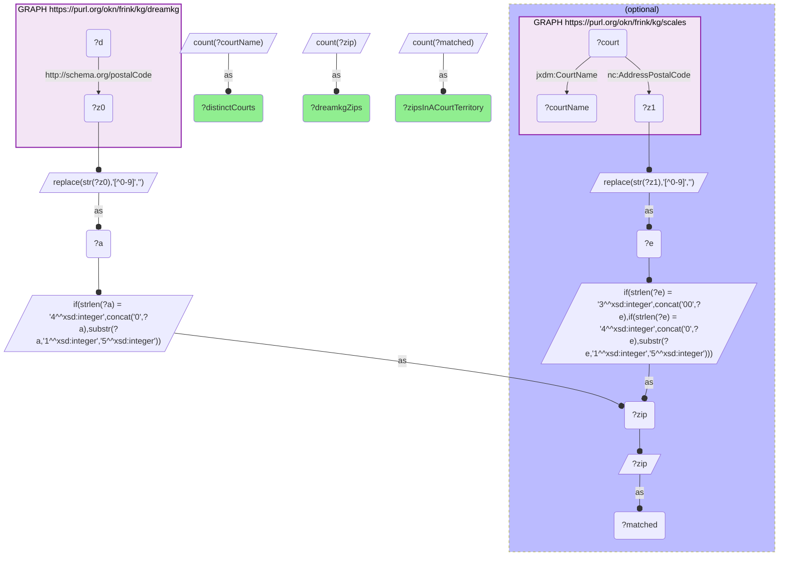
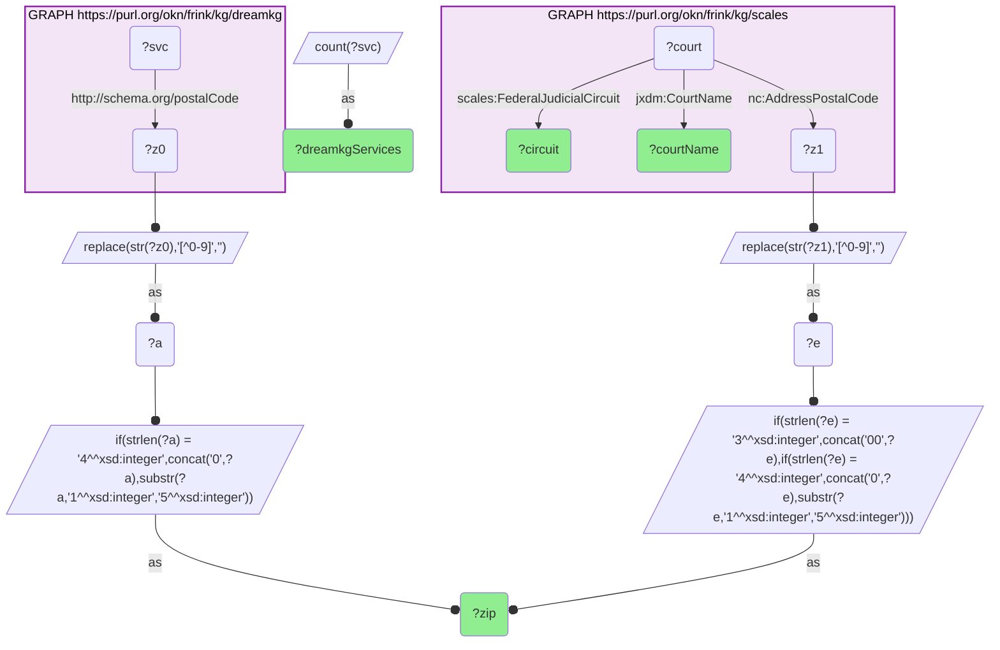
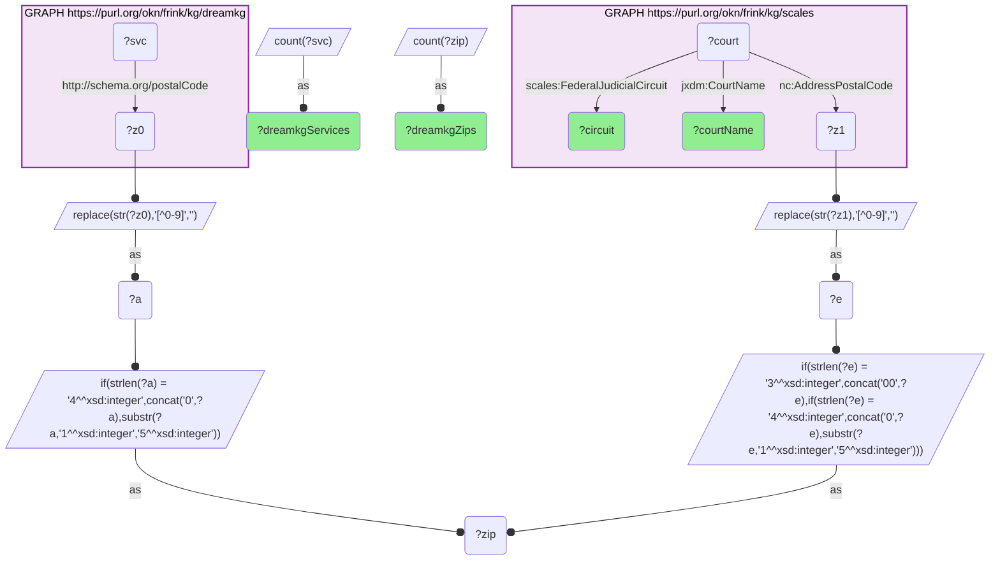

# How many DreamKG social-service ZIPs fall within a SCALES federal-district-court jurisdiction territory?

- **Date:** 2026-10-13
- **Model:** claude-opus-5-5
- **SPARQL endpoint:** https://apps.okn.us/federation/sparql
- **Generated by:** mcp-okn v0.1.0 (build f738e02)
- **Contents:** 3 queries · 3 query diagrams

## Knowledge graphs used

- `dreamkg` — <https://purl.org/okn/frink/kg/dreamkg>
- `scales` — <https://purl.org/okn/frink/kg/scales>

## Conversation

👤 **User**

Crosswalk: `dreamkg` × `scales` on **ZIP5**. dreamkg tags every Philadelphia social-service location with `schema:postalCode` (the plain HTTP schema.org IRI, so a bracketed `<http://schema.org/postalCode>` matches). scales puts `niem-core:AddressPostalCode` on its `jxdm:Court` entities — not as a street address but as the court's ZIP JURISDICTION TERRITORY (100 courts carry ~41k ZIPs), which makes scales a ZIP → federal-district-court resolver. Normalization: strip non-digits and left-pad both sides to 5 digits (scales mixes bare integers with zero-padded strings, and needs a 3-digit pad case), then intersect two DISTINCT sub-SELECTs on a shared ?zip variable.

Research question: how many of dreamkg's distinct social-service ZIPs fall within a scales federal-district-court jurisdiction territory — i.e. how complete is the coverage, and across how many courts is it spread?

Why the join is required: dreamkg holds the ZIPs of shelters, food pantries and mental-health providers in Los Angeles County and Philadelphia but has no concept of a court or a jurisdiction boundary; scales holds the ZIP territories of the federal district courts and their dockets but has no social services. Only intersecting the two ZIP sets can say whether every dreamkg service ZIP is actually resolvable to a federal forum, or whether some sit outside any territory scales enumerates — the coverage test that tells a maintainer how usable this crosswalk is.

---

🧠 **Assistant**

**235 of dreamkg's 235 distinct social-service ZIPs — 100% — fall inside a scales federal-district-court jurisdiction territory, spread across two courts.** The crosswalk is total in coverage and, now that dreamkg spans two metros, no longer degenerate in spread.

### Coverage

| dreamkg distinct ZIPs | ZIPs inside a scales court territory | coverage | distinct courts reached |
| --- | --- | --- | --- |
| 235 | 235 | 100% | 2 |

The test is a LEFT-side-anchored count: every dreamkg ZIP is taken as the base set and OPTIONALly matched against scales' court-territory ZIPs, so any unmatched ZIP would show up as a gap between the first two columns. There is none.

### How the ZIPs divide between the two courts

| scales court | circuit | dreamkg ZIPs | dreamkg service locations |
| --- | --- | --- | --- |
| District Court, C.D. California | Ninth | 190 | 796 |
| District Court, E.D. Pennsylvania | Third | 45 | 222 |

Four fifths of the ZIPs and of the service locations are in the Central District of California.

### The ZIPs carrying the most dreamkg services (top 6)

| ZIP | dreamkg service records | scales court whose territory contains it | circuit |
| --- | --- | --- | --- |
| 90010 | 23 | District Court, C.D. California | Ninth |
| 19104 | 22 | District Court, E.D. Pennsylvania | Third |
| 90013 | 22 | District Court, C.D. California | Ninth |
| 19107 | 18 | District Court, E.D. Pennsylvania | Third |
| 90033 | 18 | District Court, C.D. California | Ninth |
| 90022 | 17 | District Court, C.D. California | Ninth |

**Why it answers the question.** The question is a coverage question, and the answer is a clean 235/235. Because scales enumerates the full ZIP territory of each federal district court rather than a single courthouse address, every one of dreamkg's service ZIPs is resolvable to a federal forum, with no residue. The second column of the coverage test would have exposed any dreamkg ZIP that scales does not cover; the gap is zero. The spread is the other half of the finding: `distinctCourts = 2`. dreamkg's Los Angeles County ZIPs (900xx–917xx) lie in `District Court, C.D. California` (Ninth Circuit) and its Philadelphia ZIPs (191xx) in `District Court, E.D. Pennsylvania` (Third Circuit). For a maintainer the caveat has changed with the data: the court dimension now has cardinality 2 rather than 1, so the join distinguishes the two metros — but it still cannot distinguish anything *within* a metro, because each city sits wholly inside one court's territory.

**Validation.** Validated by construction on the authoritative shared standard (the USPS 5-digit ZIP code) plus the hand-verified crosswalk `J5-zip-dreamkg-scales` — whose `verified_count` of 235 the coverage query reproduces exactly, live, from the two named graphs. The two courts returned are independently corroborated: 28 U.S.C. § 84(c) assigns Los Angeles County to the Central District of California (Ninth Circuit) and 28 U.S.C. § 118(a) assigns Philadelphia County to the Eastern District of Pennsylvania (Third Circuit) — matching scales' own `CourtName` and `FederalJudicialCircuit` literals, neither of which was hard-coded in the query. **Validated.**

*This transcript was regenerated on 2026-10-13. The earlier version described dreamkg's previous release: 53 ZIPs, all Philadelphia, one court.*

## SPARQL queries executed

#### Query 1

_2026-10-13T21:17:47+00:00 · `dreamkg`, `scales`_

```sparql
PREFIX jxdm: <http://release.niem.gov/niem/domains/jxdm/7.2/#>
PREFIX nc: <http://release.niem.gov/niem/niem-core/5.0/#>
SELECT (COUNT(DISTINCT ?zip) AS ?dreamkgZips)
       (COUNT(DISTINCT ?matched) AS ?zipsInACourtTerritory)
       (COUNT(DISTINCT ?courtName) AS ?distinctCourts) WHERE {
  { SELECT DISTINCT ?zip WHERE {
      GRAPH <https://purl.org/okn/frink/kg/dreamkg> { ?d <http://schema.org/postalCode> ?z0 . }
      BIND(REPLACE(STR(?z0),"[^0-9]","") AS ?a)
      BIND(IF(STRLEN(?a)=4, CONCAT("0",?a), SUBSTR(?a,1,5)) AS ?zip) } }
  OPTIONAL {
    { SELECT DISTINCT ?zip ?courtName WHERE {
        GRAPH <https://purl.org/okn/frink/kg/scales> {
          ?court nc:AddressPostalCode ?z1 ; jxdm:CourtName ?courtName . }
        BIND(REPLACE(STR(?z1),"[^0-9]","") AS ?e)
        BIND(IF(STRLEN(?e)=3, CONCAT("00",?e),
             IF(STRLEN(?e)=4, CONCAT("0",?e), SUBSTR(?e,1,5))) AS ?zip) } }
    BIND(?zip AS ?matched)
  }
}
```



_1 row(s)_

| dreamkgZips | zipsInACourtTerritory | distinctCourts |
| --- | --- | --- |
| 235 | 235 | 2 |

#### Query 2

_2026-10-13T21:17:48+00:00 · `dreamkg`, `scales`_

```sparql
PREFIX jxdm: <http://release.niem.gov/niem/domains/jxdm/7.2/#>
PREFIX nc: <http://release.niem.gov/niem/niem-core/5.0/#>
PREFIX scales: <http://schemas.scales-okn.org/rdf/scales#>
SELECT ?zip (COUNT(DISTINCT ?svc) AS ?dreamkgServices) ?courtName ?circuit WHERE {
  { SELECT DISTINCT ?zip ?svc WHERE {
      GRAPH <https://purl.org/okn/frink/kg/dreamkg> { ?svc <http://schema.org/postalCode> ?z0 . }
      BIND(REPLACE(STR(?z0),"[^0-9]","") AS ?a)
      BIND(IF(STRLEN(?a)=4, CONCAT("0",?a), SUBSTR(?a,1,5)) AS ?zip) } }
  { SELECT DISTINCT ?zip ?courtName ?circuit WHERE {
      GRAPH <https://purl.org/okn/frink/kg/scales> {
        ?court nc:AddressPostalCode ?z1 ; jxdm:CourtName ?courtName ; scales:FederalJudicialCircuit ?circuit . }
      BIND(REPLACE(STR(?z1),"[^0-9]","") AS ?e)
      BIND(IF(STRLEN(?e)=3, CONCAT("00",?e),
           IF(STRLEN(?e)=4, CONCAT("0",?e), SUBSTR(?e,1,5))) AS ?zip) } }
} GROUP BY ?zip ?courtName ?circuit ORDER BY DESC(?dreamkgServices) LIMIT 6
```



_6 row(s)_

| zip | dreamkgServices | courtName | circuit |
| --- | --- | --- | --- |
| 90010 | 23 | District Court, C.D. California | Ninth |
| 19104 | 22 | District Court, E.D. Pennsylvania | Third |
| 90013 | 22 | District Court, C.D. California | Ninth |
| 19107 | 18 | District Court, E.D. Pennsylvania | Third |
| 90033 | 18 | District Court, C.D. California | Ninth |
| 90022 | 17 | District Court, C.D. California | Ninth |

#### Query 3

_2026-10-13T21:17:48+00:00 · `dreamkg`, `scales`_

```sparql
PREFIX jxdm: <http://release.niem.gov/niem/domains/jxdm/7.2/#>
PREFIX nc: <http://release.niem.gov/niem/niem-core/5.0/#>
PREFIX scales: <http://schemas.scales-okn.org/rdf/scales#>
SELECT ?courtName ?circuit (COUNT(DISTINCT ?zip) AS ?dreamkgZips) (COUNT(DISTINCT ?svc) AS ?dreamkgServices) WHERE {
  { SELECT DISTINCT ?zip ?svc WHERE {
      GRAPH <https://purl.org/okn/frink/kg/dreamkg> { ?svc <http://schema.org/postalCode> ?z0 . }
      BIND(REPLACE(STR(?z0),"[^0-9]","") AS ?a)
      BIND(IF(STRLEN(?a)=4, CONCAT("0",?a), SUBSTR(?a,1,5)) AS ?zip) } }
  { SELECT DISTINCT ?zip ?courtName ?circuit WHERE {
      GRAPH <https://purl.org/okn/frink/kg/scales> {
        ?court nc:AddressPostalCode ?z1 ; jxdm:CourtName ?courtName ; scales:FederalJudicialCircuit ?circuit . }
      BIND(REPLACE(STR(?z1),"[^0-9]","") AS ?e)
      BIND(IF(STRLEN(?e)=3, CONCAT("00",?e),
           IF(STRLEN(?e)=4, CONCAT("0",?e), SUBSTR(?e,1,5))) AS ?zip) } }
} GROUP BY ?courtName ?circuit ORDER BY DESC(?dreamkgZips)
```



_2 row(s)_

| courtName | circuit | dreamkgZips | dreamkgServices |
| --- | --- | --- | --- |
| District Court, C.D. California | Ninth | 190 | 796 |
| District Court, E.D. Pennsylvania | Third | 45 | 222 |
