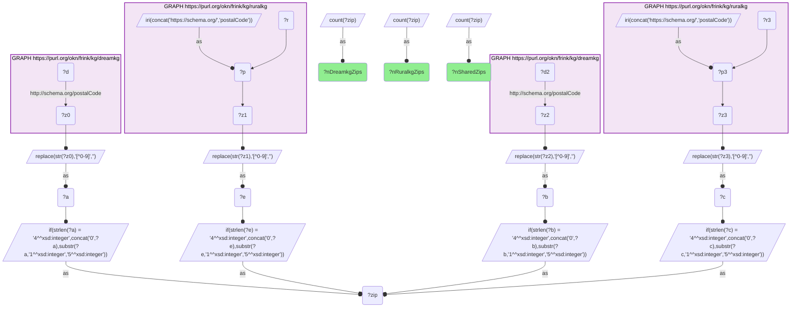
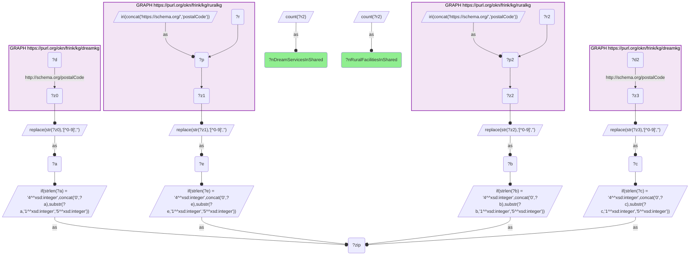

# How many ZIPs are shared between dreamkg's social-service locations and ruralkg's substance-use treatment facilities?

- **Date:** 2026-10-13
- **Model:** claude-opus-5-5
- **SPARQL endpoint:** https://apps.okn.us/federation/sparql
- **Generated by:** mcp-okn v0.1.0 (build f738e02)
- **Contents:** 2 queries · 2 query diagrams

## Knowledge graphs used

- `dreamkg` — <https://purl.org/okn/frink/kg/dreamkg>
- `ruralkg` — <https://purl.org/okn/frink/kg/ruralkg>

## Conversation

👤 **User**

Crosswalk: `dreamkg` × `ruralkg` on **ZIP5**. dreamkg carries the ZIP of each social-service listing (Los Angeles County and Philadelphia) on `schema:postalCode` in the HTTP-scheme form (`<http://schema.org/postalCode>`); ruralkg carries the ZIP of each substance-use `TreatmentProvider` on the HTTPS-scheme form (`<https://schema.org/postalCode>`). Normalize both to a bare 5-digit ZIP (strip non-digits, left-pad a 4-digit value with `0`, truncate ZIP+4 to the first five) and match.

Research question: how many ZIPs are shared between dreamkg's social-service locations and ruralkg's treatment facilities — and how many entities on each side does that overlap actually reach?

Why the join is required: this is the sizing question that has to be answered before any substantive analysis of the pair. dreamkg holds shelter, food, medical-care and counseling listings for Los Angeles County and Philadelphia; ruralkg holds substance-use treatment facilities. Neither graph records the other's provision, and neither carries a shared entity identifier — the ZIP is the only key. The count of shared ZIPs is therefore the exact measure of how much of the recovery pathway (treatment plus the wraparound services that keep someone housed and fed) these two graphs can jointly see, and it tells a maintainer whether the crosswalk is worth building on at all.

---

🧠 **Assistant**

**127 ZIPs are shared.** The normalized ZIP5 key resolves the two graphs against each other cleanly:

| measure | value |
| --- | --- |
| **shared ZIPs (dreamkg ∩ ruralkg)** | **127** |
| ZIPs in dreamkg (social-service listings) | 235 |
| ZIPs in ruralkg (treatment facilities) | 5,420 |

The overlap is asymmetric by design, and the asymmetry is the interesting part. It covers **54% of dreamkg's 235 ZIPs** but only **2.3% of ruralkg's 5,420** — because dreamkg is scoped to two metros (Los Angeles County and Philadelphia) while ruralkg, despite its name, is **not rural-scoped**: its facility list is national, so it includes both cities. The intersection is therefore the Los Angeles and Philadelphia slice of ruralkg's national inventory.

Within those 127 shared ZIPs, the join reaches real entities on both sides:

| measure | value |
| --- | --- |
| dreamkg service listings in the shared ZIPs | 718 |
| ruralkg treatment facilities in the shared ZIPs | 224 |

**Why it answers the question.** The question is a count, and the count is 127 — established by normalizing both sides to a bare 5-digit ZIP and intersecting the two distinct ZIP sets. The two denominators (235 and 5,420) turn that bare number into a usable coverage statement: over half of dreamkg's footprint is reachable from ruralkg, so a co-location analysis across these graphs is well-founded on the dreamkg side; conversely, ruralkg contributes only its two-metro tail, so nothing here can be generalized to ruralkg's national coverage. The entity counts (718 dreamkg services, 224 ruralkg facilities) confirm the shared ZIPs are populated rather than incidental — the crosswalk carries enough payload to support the co-location and access-gap analysis, not merely a key match.

**Coverage caveat.** These are counts of what the two graphs *contain*, not of what exists on the ground. dreamkg is a curated homelessness/social-service catalog for two metros, not a census; ruralkg's facility inventory is SAMHSA-derived. A ZIP outside the 127 is one where the two graphs cannot see each other — it is not evidence that no treatment facility or no social service exists there.

**Validation.** Validated by construction on the authoritative shared standard — the USPS 5-digit ZIP code — plus the hand-verified crosswalk `J6-zip-dreamkg-ruralkg`. The only obstacle is representational: dreamkg stores `postalCode` under the HTTP schema.org namespace and ruralkg under the HTTPS one, so a naive same-predicate join returns nothing; the predicate must be bound scheme-aware on each side, and the ZIP literals normalized (strip non-digits, left-pad 4-digit, truncate ZIP+4), before the sets can be intersected. The result reproduces the crosswalk's recorded `verified_count` of 127 exactly, along with its recorded 235 / 5,420 denominators. **Validated** (shared ZIP5 standard; counts executed live).

*This transcript was regenerated on 2026-10-13. The earlier version described dreamkg's previous release: 30 shared ZIPs out of 53, all in the Philadelphia area.*

## SPARQL queries executed

#### Query 1

_2026-10-13T21:38:54+00:00 · `dreamkg`, `ruralkg`_

```sparql
SELECT ?nSharedZips ?nDreamkgZips ?nRuralkgZips WHERE {
  { SELECT (COUNT(DISTINCT ?zip) AS ?nSharedZips) WHERE {
      { SELECT DISTINCT ?zip WHERE {
          GRAPH <https://purl.org/okn/frink/kg/dreamkg> { ?d <http://schema.org/postalCode> ?z0 . }
          BIND(REPLACE(STR(?z0),"[^0-9]","") AS ?a)
          BIND(IF(STRLEN(?a)=4, CONCAT("0",?a), SUBSTR(?a,1,5)) AS ?zip) } }
      { SELECT DISTINCT ?zip WHERE {
          GRAPH <https://purl.org/okn/frink/kg/ruralkg> {
            BIND(IRI(CONCAT('https://schema.org/','postalCode')) AS ?p)
            ?r ?p ?z1 . }
          BIND(REPLACE(STR(?z1),"[^0-9]","") AS ?e)
          BIND(IF(STRLEN(?e)=4, CONCAT("0",?e), SUBSTR(?e,1,5)) AS ?zip) } } } }
  { SELECT (COUNT(DISTINCT ?zip) AS ?nDreamkgZips) WHERE {
      GRAPH <https://purl.org/okn/frink/kg/dreamkg> { ?d2 <http://schema.org/postalCode> ?z2 . }
      BIND(REPLACE(STR(?z2),"[^0-9]","") AS ?b)
      BIND(IF(STRLEN(?b)=4, CONCAT("0",?b), SUBSTR(?b,1,5)) AS ?zip) } }
  { SELECT (COUNT(DISTINCT ?zip) AS ?nRuralkgZips) WHERE {
      GRAPH <https://purl.org/okn/frink/kg/ruralkg> {
        BIND(IRI(CONCAT('https://schema.org/','postalCode')) AS ?p3)
        ?r3 ?p3 ?z3 . }
      BIND(REPLACE(STR(?z3),"[^0-9]","") AS ?c)
      BIND(IF(STRLEN(?c)=4, CONCAT("0",?c), SUBSTR(?c,1,5)) AS ?zip) } }
}
```



_1 row(s)_

| nSharedZips | nDreamkgZips | nRuralkgZips |
| --- | --- | --- |
| 127 | 235 | 5420 |

#### Query 2

_2026-10-13T21:38:54+00:00 · `dreamkg`, `ruralkg`_

```sparql
SELECT ?nDreamServicesInShared ?nRuralFacilitiesInShared WHERE {
  { SELECT (COUNT(DISTINCT ?d) AS ?nDreamServicesInShared) WHERE {
      GRAPH <https://purl.org/okn/frink/kg/dreamkg> { ?d <http://schema.org/postalCode> ?z0 . }
      BIND(REPLACE(STR(?z0),"[^0-9]","") AS ?a)
      BIND(IF(STRLEN(?a)=4, CONCAT("0",?a), SUBSTR(?a,1,5)) AS ?zip)
      { SELECT DISTINCT ?zip WHERE {
          GRAPH <https://purl.org/okn/frink/kg/ruralkg> {
            BIND(IRI(CONCAT('https://schema.org/','postalCode')) AS ?p)
            ?r ?p ?z1 . }
          BIND(REPLACE(STR(?z1),"[^0-9]","") AS ?e)
          BIND(IF(STRLEN(?e)=4, CONCAT("0",?e), SUBSTR(?e,1,5)) AS ?zip) } } } }
  { SELECT (COUNT(DISTINCT ?r2) AS ?nRuralFacilitiesInShared) WHERE {
      GRAPH <https://purl.org/okn/frink/kg/ruralkg> {
        BIND(IRI(CONCAT('https://schema.org/','postalCode')) AS ?p2)
        ?r2 ?p2 ?z2 . }
      BIND(REPLACE(STR(?z2),"[^0-9]","") AS ?b)
      BIND(IF(STRLEN(?b)=4, CONCAT("0",?b), SUBSTR(?b,1,5)) AS ?zip)
      { SELECT DISTINCT ?zip WHERE {
          GRAPH <https://purl.org/okn/frink/kg/dreamkg> { ?d2 <http://schema.org/postalCode> ?z3 . }
          BIND(REPLACE(STR(?z3),"[^0-9]","") AS ?c)
          BIND(IF(STRLEN(?c)=4, CONCAT("0",?c), SUBSTR(?c,1,5)) AS ?zip) } } } }
}
```



_1 row(s)_

| nDreamServicesInShared | nRuralFacilitiesInShared |
| --- | --- |
| 718 | 224 |
