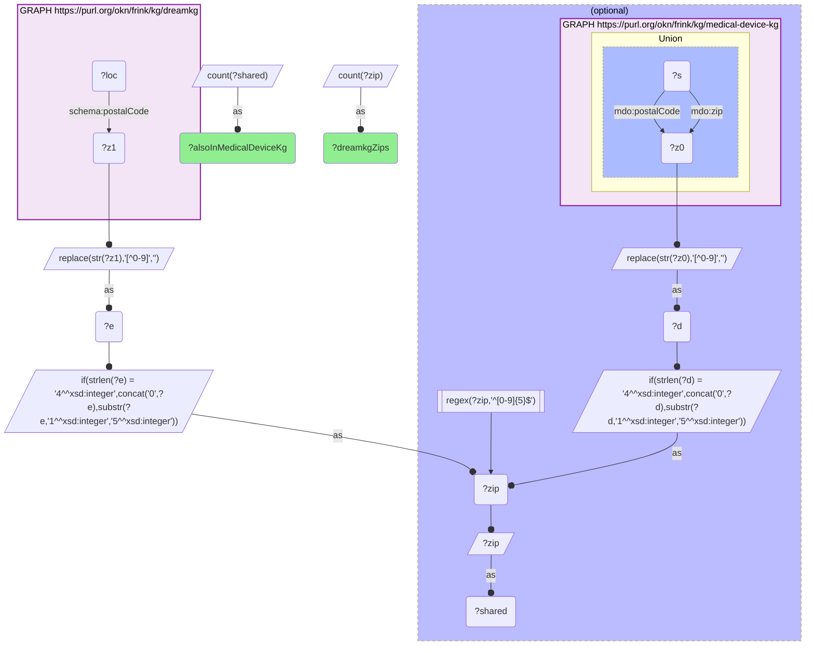

# GEO39-Q2: 231 of DreamKG's 235 service ZIPs also carry a medical-device-kg address

- **Date:** 2026-10-13
- **Model:** claude-opus-5-5
- **SPARQL endpoint:** https://apps.okn.us/federation/sparql
- **Generated by:** mcp-okn v0.1.0 (build f738e02)
- **Contents:** 1 query · 1 query diagram

## Knowledge graphs used

- `dreamkg` — <https://purl.org/okn/frink/kg/dreamkg>
- `medical-device-kg` — <https://purl.org/okn/frink/kg/medical-device-kg>

## Conversation

👤 **User**

Same crosswalk, coverage angle: how many DreamKG social-service ZIPs also carry a medical-device-kg address?

---

🧠 **Assistant**

**231 of DreamKG's 235 ZIPs — 98.3%.** Four postcodes have no device record at all.

The number is small in absolute terms and that is a property of DreamKG, not of the join: DreamKG is metro-scoped (Los Angeles County and Philadelphia), so 235 ZIPs is its entire footprint. What the crosswalk says is that **the FDA's device geography covers almost all of it** — in 231 of 235 neighbourhoods where DreamKG catalogues a social service, there is registered device equipment or a regulated establishment in the same postcode.

| Side | ZIPs | Shared |
|---|---|---|
| DreamKG service locations | 235 | 231 (98.3%) |

**How to use a 231-row crosswalk.** For enumeration and ranking rather than modelling. With a few hundred ZIPs across two cities you can list every one and inspect it, which is what makes the neighbourhood comparison in Q1 tractable: 19104 with 313 device records against 19140 with 85 is a difference you can look at directly.

**The four unmatched ZIPs** are the interesting residue: a DreamKG service catchment with no FDA-registered device presence at all. In metros this dense that is worth a second look — most likely a PO-box or administrative ZIP rather than a real service desert.

*This transcript was regenerated on 2026-10-13. The earlier version described dreamkg's previous release: 50 of 53 ZIPs, all in Philadelphia.*

## SPARQL queries executed

#### Query 1

_2026-10-13T21:38:58+00:00 · `dreamkg`, `medical-device-kg`_

```sparql
PREFIX mdo: <http://medicaldevice.com/ontology/>
PREFIX schema: <http://schema.org/>
SELECT (COUNT(DISTINCT ?zip) AS ?dreamkgZips) (COUNT(DISTINCT ?shared) AS ?alsoInMedicalDeviceKg) WHERE {
  { SELECT DISTINCT ?zip WHERE {
      GRAPH <https://purl.org/okn/frink/kg/dreamkg> { ?loc schema:postalCode ?z1 }
      BIND(REPLACE(STR(?z1),"[^0-9]","") AS ?e)
      BIND(IF(STRLEN(?e)=4, CONCAT("0",?e), SUBSTR(?e,1,5)) AS ?zip) } }
  OPTIONAL {
    { SELECT DISTINCT ?zip WHERE {
        GRAPH <https://purl.org/okn/frink/kg/medical-device-kg> {
          { ?s mdo:zip ?z0 } UNION { ?s mdo:postalCode ?z0 } }
        BIND(REPLACE(STR(?z0),"[^0-9]","") AS ?d)
        BIND(IF(STRLEN(?d)=4, CONCAT("0",?d), SUBSTR(?d,1,5)) AS ?zip)
        FILTER(REGEX(?zip,"^[0-9]{5}$")) } }
    BIND(?zip AS ?shared)
  }
}
```



_1 row(s)_

| dreamkgZips | alsoInMedicalDeviceKg |
| --- | --- |
| 235 | 231 |
