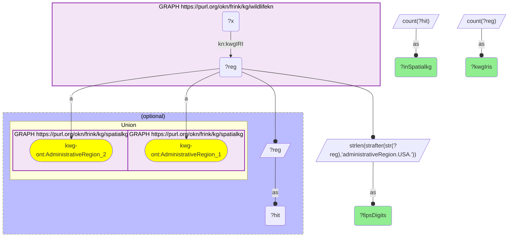
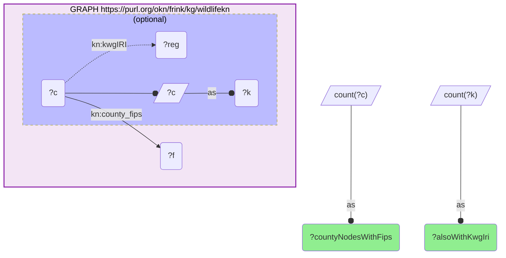
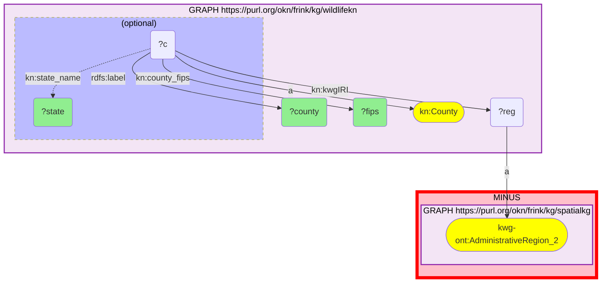

# GEO40-Q2: 2,625 of wildlifekn's 2,644 KnowWhereGraph IRIs are spatialkg nodes — all 50 states, 2,575 of 2,594 counties; the 19 misses are all Alaska

- **Date:** 2026-10-13
- **Model:** claude-opus-5-5
- **SPARQL endpoint:** https://apps.okn.us/federation/sparql
- **Generated by:** mcp-okn v0.1.0 (build f738e02)
- **Contents:** 3 queries · 3 query diagrams

## Knowledge graphs used

- `wildlifekn` — <https://purl.org/okn/frink/kg/wildlifekn>
- `spatialkg` — <https://purl.org/okn/frink/kg/spatialkg>

## Conversation

👤 **User**

Same crosswalk, coverage angle: how many of the KnowWhereGraph IRIs wildlifekn carries are nodes in spatialkg, and which are not?

---

🧠 **Assistant**

**2,625 of the 2,644 KnowWhereGraph IRIs wildlifekn carries are nodes in spatialkg — 99.3%.** They come at two levels, and the two behave differently:

| Level | wildlifekn `kn:kwgIRI` values | Nodes in spatialkg | Coverage |
|---|---|---|---|
| County (5-digit FIPS suffix) | 2,594 | 2,575 | 99.3% |
| State (2-digit FIPS suffix) | 50 | 50 | 100% |

So the join is complete at the state level and misses 19 at the county level.

**The 19 that do not resolve are all in Alaska** — every one of them, from Anchorage (02020) to Yakutat (02282): Bethel, Bristol Bay, the Chugach and Copper River census areas, Fairbanks North Star, Hoonah-Angoon, Juneau, Kenai Peninsula, Ketchikan Gateway, Kodiak Island, Lake and Peninsula, Matanuska-Susitna, Nome, North Slope, Northwest Arctic, Skagway and Wrangell. Alaska has boroughs and census areas rather than counties, and spatialkg does not type them as county-level regions. That is a property of the hub, not a defect in wildlifekn's identifiers: the IRIs are well-formed, the hub simply has no `AdministrativeRegion_2` node behind them.

**Reading the number.** Outside Alaska every county IRI wildlifekn carries resolves, so there is no identifier mismatch to worry about there. For Alaska it is the reverse: wildlifekn has the reference node and the hub cannot receive it, so Alaskan records need the state-level IRI (which does resolve) or a different spatial route.

**The gap that is on wildlifekn's side.** Not every county node has a KWG IRI to offer: 2,817 county nodes carry a FIPS code but only 2,592 of them also carry `kn:kwgIRI`. The rest cannot use this route at all and have to be joined on the FIPS string instead.

This is an identity join — the stored IRI is the hub's own node IRI — so there is no normalization step that could be silently dropping matches.

## SPARQL queries executed

#### Query 1

_2026-10-13T20:43:27+00:00 · `wildlifekn`, `spatialkg`_

```sparql
PREFIX kn: <https://kn-wildlife.crc.nd.edu/kg/>
PREFIX kwg-ont: <http://stko-kwg.geog.ucsb.edu/lod/ontology/>
SELECT ?fipsDigits (COUNT(DISTINCT ?reg) AS ?kwgIris) (COUNT(DISTINCT ?hit) AS ?inSpatialkg) WHERE {
  GRAPH <https://purl.org/okn/frink/kg/wildlifekn> { ?x kn:kwgIRI ?reg . }
  BIND(STRLEN(STRAFTER(STR(?reg),'administrativeRegion.USA.')) AS ?fipsDigits)
  OPTIONAL {
    { GRAPH <https://purl.org/okn/frink/kg/spatialkg> { ?reg a kwg-ont:AdministrativeRegion_2 . } }
    UNION
    { GRAPH <https://purl.org/okn/frink/kg/spatialkg> { ?reg a kwg-ont:AdministrativeRegion_1 . } }
    BIND(?reg AS ?hit)
  }
} GROUP BY ?fipsDigits ORDER BY DESC(?fipsDigits)
```



_2 row(s)_

| fipsDigits | kwgIris | inSpatialkg |
| --- | --- | --- |
| 5 | 2594 | 2575 |
| 2 | 50 | 50 |

#### Query 2

_2026-10-13T20:43:28+00:00 · `wildlifekn`_

```sparql
PREFIX kn: <https://kn-wildlife.crc.nd.edu/kg/>
SELECT (COUNT(DISTINCT ?c) AS ?countyNodesWithFips) (COUNT(DISTINCT ?k) AS ?alsoWithKwgIri) WHERE {
  GRAPH <https://purl.org/okn/frink/kg/wildlifekn> {
    ?c kn:county_fips ?f .
    OPTIONAL { ?c kn:kwgIRI ?reg . BIND(?c AS ?k) }
  }
}
```



_1 row(s)_

| countyNodesWithFips | alsoWithKwgIri |
| --- | --- |
| 2817 | 2592 |

#### Query 3

_2026-10-13T20:43:28+00:00 · `wildlifekn`, `spatialkg`_

```sparql
PREFIX kn: <https://kn-wildlife.crc.nd.edu/kg/>
PREFIX kwg-ont: <http://stko-kwg.geog.ucsb.edu/lod/ontology/>
PREFIX rdfs: <http://www.w3.org/2000/01/rdf-schema#>
SELECT ?fips ?county ?state WHERE {
  GRAPH <https://purl.org/okn/frink/kg/wildlifekn> {
    ?c a kn:County ; kn:kwgIRI ?reg ; kn:county_fips ?fips ; rdfs:label ?county .
    OPTIONAL { ?c kn:state_name ?state }
  }
  MINUS { GRAPH <https://purl.org/okn/frink/kg/spatialkg> { ?reg a kwg-ont:AdministrativeRegion_2 . } }
} ORDER BY ?fips
```



_19 row(s)_

| fips | county | state |
| --- | --- | --- |
| 02020 | Anchorage (Alaska) | Alaska |
| 02050 | Bethel (Alaska) | Alaska |
| 02060 | Bristol Bay (Alaska) | Alaska |
| 02063 | Chugach Census Area (Alaska) |  |
| 02066 | Copper River Census Area (Alaska) |  |
| 02090 | Fairbanks North Star (Alaska) | Alaska |
| 02105 | Hoonah-Angoon (Alaska) | Alaska |
| 02110 | Juneau (Alaska) | Alaska |
| 02122 | Kenai Peninsula (Alaska) | Alaska |
| 02130 | Ketchikan Gateway (Alaska) | Alaska |
| 02150 | Kodiak Island (Alaska) | Alaska |
| 02164 | Lake and Peninsula (Alaska) | Alaska |
| 02170 | Matanuska-Susitna (Alaska) | Alaska |
| 02180 | Nome (Alaska) | Alaska |
| 02185 | North Slope (Alaska) | Alaska |
| 02188 | Northwest Arctic (Alaska) | Alaska |
| 02230 | Skagway (Alaska) | Alaska |
| 02275 | Wrangell (Alaska) | Alaska |
| 02282 | Yakutat (Alaska) | Alaska |
