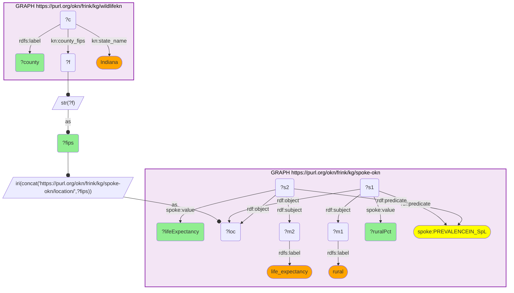

# GEO41-Q1: wildlifekn counties beside spoke-okn county health measures — Indiana's most rural counties and their life expectancy

- **Date:** 2026-10-13
- **Model:** claude-opus-5-5
- **SPARQL endpoint:** https://apps.okn.us/federation/sparql
- **Generated by:** mcp-okn v0.1.0 (build f738e02)
- **Contents:** 1 query · 1 query diagram

## Knowledge graphs used

- `wildlifekn` — <https://purl.org/okn/frink/kg/wildlifekn>
- `spoke-okn` — <https://purl.org/okn/frink/kg/spoke-okn>

## Conversation

👤 **User**

For wildlifekn's county reference nodes in one state (take Indiana), what rural share and life expectancy does spoke-okn report for each county? Show the most rural.

---

🧠 **Assistant**

**wildlifekn's county reference nodes carry the 5-digit FIPS as a plain string, and that string is the suffix of spoke-okn's county node IRI — so each county picks up spoke-okn's county-level measures directly.** For Indiana, the ten most rural counties wildlifekn knows, with spoke-okn's life expectancy beside them:

| FIPS | County | Rural share (%) | Life expectancy (years) |
|---|---|---|---|
| 18115 | Ohio | 100.0 | 79.2 |
| 18147 | Spencer | 100.0 | 78.0 |
| 18155 | Switzerland | 100.0 | 75.8 |
| 18161 | Union | 100.0 | 76.0 |
| 18111 | Newton | 100.0 | 75.9 |
| 18119 | Owen | 100.0 | 75.0 |
| 18025 | Crawford | 100.0 | 74.2 |
| 18087 | LaGrange | 91.6 | 78.5 |
| 18047 | Franklin | 88.9 | 77.4 |
| 18061 | Harrison | 85.8 | 76.9 |

**What this shows.** Seven Indiana counties in wildlifekn are classed entirely rural, and life expectancy across those seven spans five years — 74.2 in Crawford to 79.2 in Ohio County. "Rural" on its own says little about the health of the people living where the wildlife is recorded; the two measures have to be read together, which is what the join makes possible.

**Why these two measures.** They are the spoke-okn county measures most relevant to a wildlife graph: rural share is a proxy for how much habitat a county is likely to hold, and life expectancy is the broadest single health outcome spoke-okn records. spoke-okn holds dozens more on the same county node (social vulnerability, air pollutants found in the county, access to care), reachable by swapping the measure label.

**How the join works, and its limit.** No padding or rewriting is needed — wildlifekn's FIPS values are already zero-padded 5-character strings, so the spoke-okn node IRI is built by concatenation and probed directly. The limit is on the wildlifekn side: County nodes are a reference layer that no Site or Observation points to, so this places wildlifekn's *counties* beside county health data. Attributing individual observations to a county still needs a spatial step from the site's coordinates.

## SPARQL queries executed

#### Query 1

_2026-10-13T20:43:29+00:00 · `wildlifekn`, `spoke-okn`_

```sparql
PREFIX xsd: <http://www.w3.org/2001/XMLSchema#>
PREFIX kn: <https://kn-wildlife.crc.nd.edu/kg/>
PREFIX rdf: <http://www.w3.org/1999/02/22-rdf-syntax-ns#>
PREFIX rdfs: <http://www.w3.org/2000/01/rdf-schema#>
PREFIX spoke: <https://purl.org/okn/frink/kg/spoke-okn/schema/>
SELECT ?fips ?county ?ruralPct ?lifeExpectancy WHERE {
  { SELECT DISTINCT ?fips ?county WHERE {
      GRAPH <https://purl.org/okn/frink/kg/wildlifekn> {
        ?c kn:county_fips ?f ; kn:state_name "Indiana" ; rdfs:label ?county . }
      BIND(STR(?f) AS ?fips) } }
  BIND(IRI(CONCAT('https://purl.org/okn/frink/kg/spoke-okn/location/',?fips)) AS ?loc)
  GRAPH <https://purl.org/okn/frink/kg/spoke-okn> {
    ?s1 rdf:object ?loc ; rdf:predicate spoke:PREVALENCEIN_SpL ; rdf:subject ?m1 ; spoke:value ?ruralPct .
    ?m1 rdfs:label "rural" .
    ?s2 rdf:object ?loc ; rdf:predicate spoke:PREVALENCEIN_SpL ; rdf:subject ?m2 ; spoke:value ?lifeExpectancy .
    ?m2 rdfs:label "life_expectancy" .
  }
} ORDER BY DESC(xsd:double(?ruralPct)) LIMIT 10
```



_10 row(s)_

| fips | county | ruralPct | lifeExpectancy |
| --- | --- | --- | --- |
| 18115 | Ohio (Indiana) | 100.0 | 79.155124717 |
| 18147 | Spencer (Indiana) | 100.0 | 77.987725128 |
| 18155 | Switzerland (Indiana) | 100.0 | 75.810549403 |
| 18161 | Union (Indiana) | 100.0 | 75.990719122 |
| 18111 | Newton (Indiana) | 100.0 | 75.932153735 |
| 18119 | Owen (Indiana) | 100.0 | 74.988546647 |
| 18025 | Crawford (Indiana) | 100.0 | 74.233456819 |
| 18087 | LaGrange (Indiana) | 91.615492351 | 78.48223502 |
| 18047 | Franklin (Indiana) | 88.859531338 | 77.396624173 |
| 18061 | Harrison (Indiana) | 85.84747485 | 76.941486645 |
