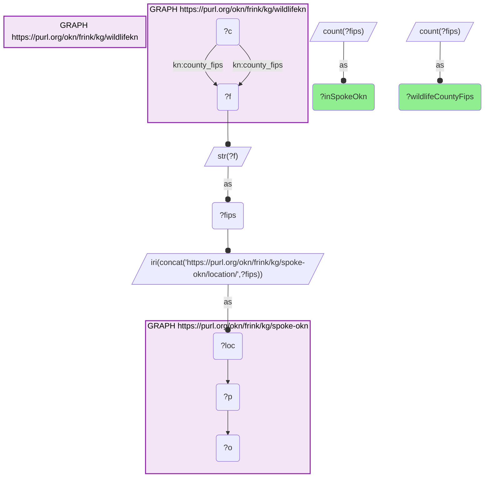
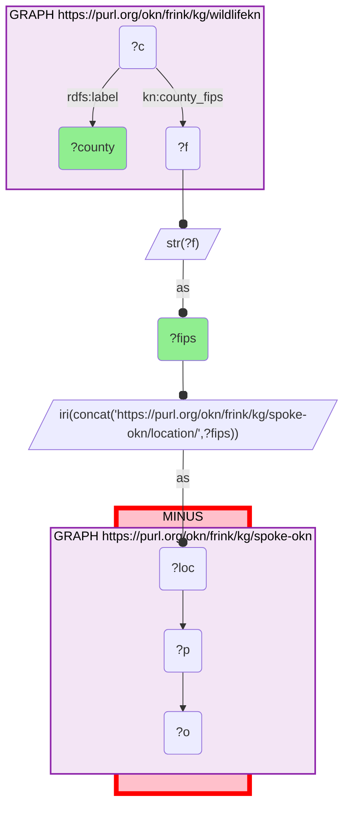

# GEO41-Q2: 2,810 of wildlifekn's 2,821 county FIPS codes resolve to a spoke-okn county node (99.6%); the 11 that do not

- **Date:** 2026-10-13
- **Model:** claude-opus-5-5
- **SPARQL endpoint:** https://apps.okn.us/federation/sparql
- **Generated by:** mcp-okn v0.1.0 (build f738e02)
- **Contents:** 2 queries · 2 query diagrams

## Knowledge graphs used

- `wildlifekn` — <https://purl.org/okn/frink/kg/wildlifekn>
- `spoke-okn` — <https://purl.org/okn/frink/kg/spoke-okn>

## Conversation

👤 **User**

Same crosswalk, coverage angle: how many wildlifekn county FIPS codes resolve to a spoke-okn county node, and which do not?

---

🧠 **Assistant**

**2,810 of wildlifekn's 2,821 county FIPS codes resolve to a spoke-okn county node — 99.6%.** Eleven do not.

| | Count |
|---|---|
| Distinct county FIPS in wildlifekn | 2,821 |
| Resolve to a spoke-okn county node | 2,810 |
| Do not resolve | 11 |

**The eleven that miss:**

| FIPS | County |
|---|---|
| 02063 | Chugach Census Area (Alaska) |
| 02066 | Copper River Census Area (Alaska) |
| 13017 | Ben Hill (Georgia) |
| 35013 | Doña Ana (New Mexico) |
| 37139 | Pasquotank (North Carolina) |
| 46102 | Oglala Lakota County (South Dakota) |
| 47063 | Hamblen (Tennessee) |
| 48329 | Midland (Texas) |
| 51081 | Greensville (Virginia) |
| 51095 | James City (Virginia) |
| 51145 | Powhatan (Virginia) |

**Two different kinds of miss.** Three are codes created by recent boundary changes: the Chugach and Copper River census areas replaced Alaska's Valdez-Cordova in 2019, and 46102 is the code Oglala Lakota County took when it was renamed from Shannon County. A graph built on an older county list will not have them. The other eight are long-standing counties — Midland, Texas and Doña Ana, New Mexico among them — for which spoke-okn simply has no node at that IRI; the query cannot say why, only that the node is absent.

**Compared with the spatial hub.** wildlifekn's other county route, the KnowWhereGraph IRI into spatialkg, misses 19 counties, all of them Alaskan boroughs and census areas. spoke-okn misses fewer and a different set — only two of its eleven are in Alaska — so the two county routes are complementary rather than redundant.

The match is on the bare 5-digit string with no normalization on either side, so none of these is a padding or formatting artifact.

## SPARQL queries executed

#### Query 1

_2026-10-13T20:43:30+00:00 · `wildlifekn`, `spoke-okn`_

```sparql
PREFIX kn: <https://kn-wildlife.crc.nd.edu/kg/>
SELECT ?wildlifeCountyFips ?inSpokeOkn WHERE {
  { SELECT (COUNT(DISTINCT ?f) AS ?wildlifeCountyFips) WHERE {
      GRAPH <https://purl.org/okn/frink/kg/wildlifekn> { ?c kn:county_fips ?f . } } }
  { SELECT (COUNT(DISTINCT ?fips) AS ?inSpokeOkn) WHERE {
      { SELECT DISTINCT ?fips WHERE {
          GRAPH <https://purl.org/okn/frink/kg/wildlifekn> { ?c kn:county_fips ?f . }
          BIND(STR(?f) AS ?fips) } }
      BIND(IRI(CONCAT('https://purl.org/okn/frink/kg/spoke-okn/location/',?fips)) AS ?loc)
      GRAPH <https://purl.org/okn/frink/kg/spoke-okn> { ?loc ?p ?o . } } }
}
```



_1 row(s)_

| wildlifeCountyFips | inSpokeOkn |
| --- | --- |
| 2821 | 2810 |

#### Query 2

_2026-10-13T20:43:31+00:00 · `wildlifekn`, `spoke-okn`_

```sparql
PREFIX kn: <https://kn-wildlife.crc.nd.edu/kg/>
PREFIX rdfs: <http://www.w3.org/2000/01/rdf-schema#>
SELECT ?fips ?county WHERE {
  GRAPH <https://purl.org/okn/frink/kg/wildlifekn> { ?c kn:county_fips ?f ; rdfs:label ?county . }
  BIND(STR(?f) AS ?fips)
  BIND(IRI(CONCAT('https://purl.org/okn/frink/kg/spoke-okn/location/',?fips)) AS ?loc)
  MINUS { GRAPH <https://purl.org/okn/frink/kg/spoke-okn> { ?loc ?p ?o . } }
} ORDER BY ?fips
```



_11 row(s)_

| fips | county |
| --- | --- |
| 02063 | Chugach Census Area (Alaska) |
| 02066 | Copper River Census Area (Alaska) |
| 13017 | Ben Hill (Georgia) |
| 35013 | Doña Ana (New Mexico) |
| 37139 | Pasquotank (North Carolina) |
| 46102 | Oglala Lakota County (South Dakota) |
| 47063 | Hamblen (Tennessee) |
| 48329 | Midland (Texas) |
| 51081 | Greensville (Virginia) |
| 51095 | James City (Virginia) |
| 51145 | Powhatan (Virginia) |
