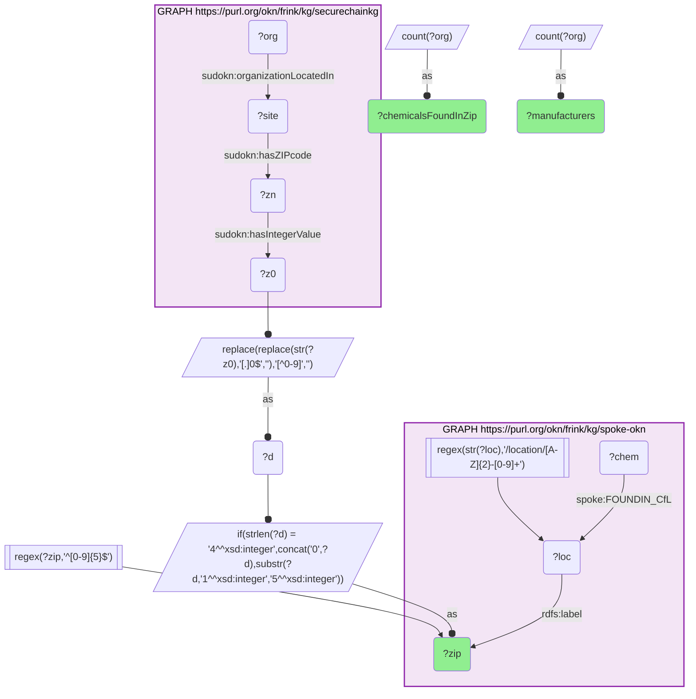

# GEO42-Q1: securechainkg's densest manufacturer ZIPs against spoke-okn's chemical record — all Arizona, and density does not predict burden

- **Date:** 2026-10-13
- **Model:** claude-opus-5-5
- **SPARQL endpoint:** https://apps.okn.us/federation/sparql
- **Generated by:** mcp-okn v0.1.0 (build f738e02)
- **Contents:** 1 query · 1 query diagram

## Knowledge graphs used

- `securechainkg` — <https://purl.org/okn/frink/kg/securechainkg>
- `spoke-okn` — <https://purl.org/okn/frink/kg/spoke-okn>

## Conversation

👤 **User**

In the ZIP codes where securechainkg locates the most manufacturers, how many environmental chemicals does spoke-okn report found?

---

🧠 **Assistant**

**The fifteen ZIP codes where securechainkg locates the most manufacturers are all in Arizona, and spoke-okn reports between 2 and 25 environmental chemicals found in each.**

| ZIP | Manufacturers (securechainkg) | Chemicals found in ZIP (spoke-okn) |
|---|---|---|
| 85040 | 101 | 9 |
| 85281 | 100 | 7 |
| 85260 | 95 | 2 |
| 85009 | 93 | 16 |
| 85282 | 88 | 6 |
| 85027 | 79 | 7 |
| 85043 | 75 | 25 |
| 85034 | 69 | 20 |
| 85233 | 66 | 3 |
| 85705 | 63 | 12 |
| 85226 | 61 | 14 |
| 85713 | 57 | 5 |
| 85210 | 50 | 8 |
| 85225 | 45 | 9 |
| 85283 | 42 | 10 |

**Manufacturer density and chemical burden do not track each other.** 85260 holds 95 manufacturers and 2 reported chemicals; 85043 holds 75 manufacturers and 25. The two ZIPs with the heaviest chemical record, 85043 and 85034 (25 and 20), are mid-table on manufacturer count. So a ZIP's industrial density in securechainkg is not a stand-in for its environmental record in spoke-okn — which is the reason to join them rather than infer one from the other.

**Why everything is in Arizona.** Every ZIP here begins with 85. That reflects where securechainkg's embedded manufacturer block is densest, not the national distribution of manufacturing, and any ZIP-level ranking drawn from it will be an Arizona ranking.

**How the join works.** The ZIP is two hops from the manufacturer — organisation → site (`SUDOKN:organizationLocatedIn`) → postal-code node (`SUDOKN:hasZIPcode`) → value (`SUDOKN:hasIntegerValue`) — and the value needs cleaning before it is a ZIP: most are stored as a float rendering such as `85040.0`, the rest as ZIP+4 or plain five digits. With the trailing `.0` stripped and the first five digits kept, the result matches the label of spoke-okn's ZIP node, where `FOUNDIN_CfL` records the chemicals found in that location.

"Chemicals found" counts distinct chemicals spoke-okn links to the ZIP, not concentrations or exceedances, and says nothing about their source.

## SPARQL queries executed

#### Query 1

_2026-10-13T20:43:32+00:00 · `securechainkg`, `spoke-okn`_

```sparql
PREFIX sudokn: <http://asu.edu/semantics/SUDOKN/>
PREFIX rdfs: <http://www.w3.org/2000/01/rdf-schema#>
PREFIX spoke: <https://purl.org/okn/frink/kg/spoke-okn/schema/>
SELECT ?zip ?manufacturers (COUNT(DISTINCT ?chem) AS ?chemicalsFoundInZip) WHERE {
  { SELECT ?zip (COUNT(DISTINCT ?org) AS ?manufacturers) WHERE {
      GRAPH <https://purl.org/okn/frink/kg/securechainkg> {
        ?org sudokn:organizationLocatedIn ?site .
        ?site sudokn:hasZIPcode ?zn .
        ?zn sudokn:hasIntegerValue ?z0 . }
      BIND(REPLACE(REPLACE(STR(?z0),'[.]0$',''),'[^0-9]','') AS ?d)
      BIND(IF(STRLEN(?d)=4, CONCAT('0',?d), SUBSTR(?d,1,5)) AS ?zip)
      FILTER(REGEX(?zip,'^[0-9]{5}$'))
    } GROUP BY ?zip ORDER BY DESC(?manufacturers) LIMIT 15 }
  GRAPH <https://purl.org/okn/frink/kg/spoke-okn> {
    ?loc rdfs:label ?zip .
    FILTER(REGEX(STR(?loc),'/location/[A-Z]{2}-[0-9]+'))
    ?chem spoke:FOUNDIN_CfL ?loc .
  }
} GROUP BY ?zip ?manufacturers ORDER BY DESC(?manufacturers)
```



_15 row(s)_

| zip | manufacturers | chemicalsFoundInZip |
| --- | --- | --- |
| 85040 | 101 | 9 |
| 85281 | 100 | 7 |
| 85260 | 95 | 2 |
| 85009 | 93 | 16 |
| 85282 | 88 | 6 |
| 85027 | 79 | 7 |
| 85043 | 75 | 25 |
| 85034 | 69 | 20 |
| 85233 | 66 | 3 |
| 85705 | 63 | 12 |
| 85226 | 61 | 14 |
| 85713 | 57 | 5 |
| 85210 | 50 | 8 |
| 85225 | 45 | 9 |
| 85283 | 42 | 10 |
