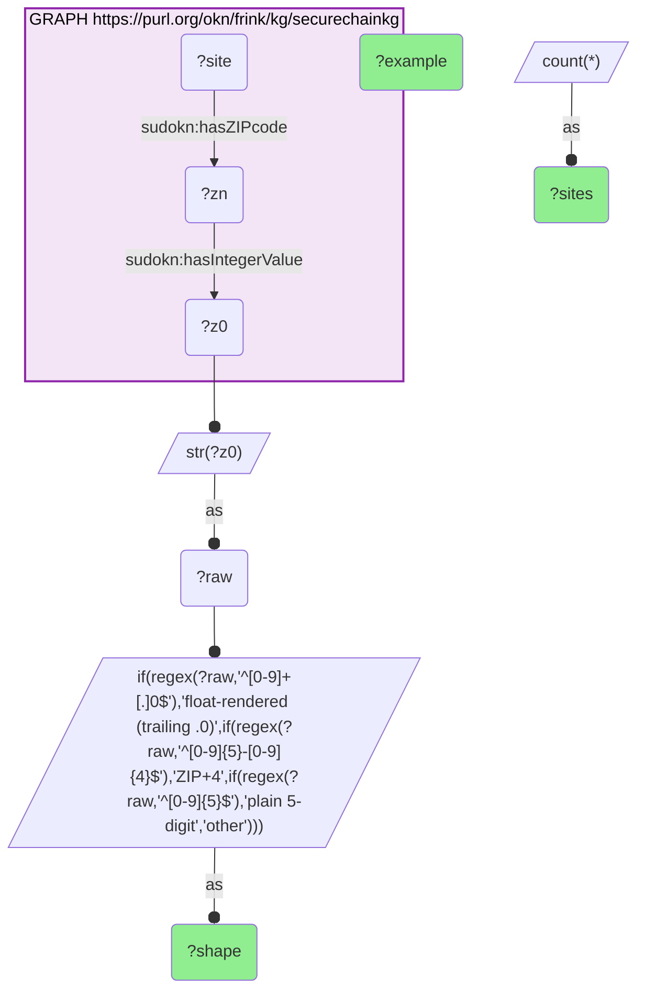
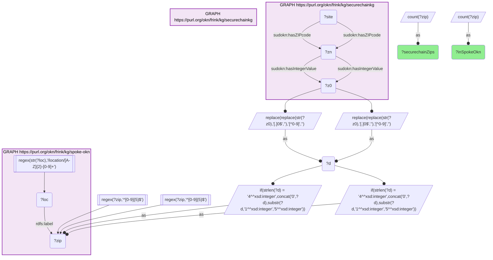

# GEO42-Q2: 4,375 of securechainkg's 4,390 well-formed site ZIPs are spoke-okn ZIP nodes (99.7%) — after cleaning four raw value shapes

- **Date:** 2026-10-13
- **Model:** claude-opus-5-5
- **SPARQL endpoint:** https://apps.okn.us/federation/sparql
- **Generated by:** mcp-okn v0.1.0 (build f738e02)
- **Contents:** 2 queries · 2 query diagrams

## Knowledge graphs used

- `securechainkg` — <https://purl.org/okn/frink/kg/securechainkg>
- `spoke-okn` — <https://purl.org/okn/frink/kg/spoke-okn>

## Conversation

👤 **User**

Same crosswalk, coverage angle: how many securechainkg manufacturer-site ZIP codes are ZIP nodes in spoke-okn, and what shapes do the raw ZIP values take?

---

🧠 **Assistant**

**4,375 of securechainkg's 4,390 well-formed manufacturer-site ZIP codes are ZIP nodes in spoke-okn — 99.7%.**

| | Count |
|---|---|
| Distinct well-formed ZIP5 codes in securechainkg | 4,390 |
| Present as a ZIP node in spoke-okn | 4,375 |
| Not present | 15 |

That figure only exists after the raw values are cleaned, because securechainkg stores the ZIP in four shapes:

| Shape of the stored value | Sites | Example |
|---|---|---|
| Float rendering (trailing `.0`) | 7,894 | `48082.0` |
| ZIP+4 | 2,563 | `85395-8513` |
| Plain 5-digit | 628 | `85027` |
| Other (malformed) | 23 | `1887` |

**Only 628 of 11,108 sites — under 6% — store a ZIP that can be used as-is.** Seventy-one percent carry a trailing `.0`, an artifact of the code having passed through a numeric column, even though the predicate's value is a string. A naive join on the raw value would reach only those 628 sites and the handful of ZIPs they cover.

**Order of cleaning matters.** Strip the trailing `.0` first, then remove non-digits, then keep the first five. Removing non-digits first turns `48082.0` into `480820`, which still yields the right ZIP by luck of truncation — but a four-digit code that lost its leading zero and was stored as, say, `1234.0` would become `12340` instead of `01234`. The 23 malformed values are not all recoverable; anything that does not come out as five digits is dropped rather than guessed at.

**What the 99.7% means.** Coverage is limited by securechainkg's data quality, not by spoke-okn's geography: spoke-okn's ZIP set contains essentially every valid ZIP securechainkg has. This is securechainkg's first geographic key — before it, the graph joined the rest of the federation only on industry codes, product identity and software dependencies.

## SPARQL queries executed

#### Query 1

_2026-10-13T20:43:33+00:00 · `securechainkg`_

```sparql
PREFIX sudokn: <http://asu.edu/semantics/SUDOKN/>
SELECT ?shape (COUNT(*) AS ?sites) (SAMPLE(?raw) AS ?example) WHERE {
  GRAPH <https://purl.org/okn/frink/kg/securechainkg> {
    ?site sudokn:hasZIPcode ?zn . ?zn sudokn:hasIntegerValue ?z0 . }
  BIND(STR(?z0) AS ?raw)
  BIND(IF(REGEX(?raw,'^[0-9]+[.]0$'),'float-rendered (trailing .0)',
       IF(REGEX(?raw,'^[0-9]{5}-[0-9]{4}$'),'ZIP+4',
       IF(REGEX(?raw,'^[0-9]{5}$'),'plain 5-digit','other'))) AS ?shape)
} GROUP BY ?shape ORDER BY DESC(?sites)
```



_4 row(s)_

| shape | sites | example |
| --- | --- | --- |
| float-rendered (trailing .0) | 7894 | 48082.0 |
| ZIP+4 | 2563 | 85395-8513 |
| plain 5-digit | 628 | 85027 |
| other | 23 | 1887 |

#### Query 2

_2026-10-13T20:43:33+00:00 · `securechainkg`, `spoke-okn`_

```sparql
PREFIX sudokn: <http://asu.edu/semantics/SUDOKN/>
PREFIX rdfs: <http://www.w3.org/2000/01/rdf-schema#>
SELECT ?securechainZips ?inSpokeOkn WHERE {
  { SELECT (COUNT(DISTINCT ?zip) AS ?securechainZips) WHERE {
      GRAPH <https://purl.org/okn/frink/kg/securechainkg> {
        ?site sudokn:hasZIPcode ?zn . ?zn sudokn:hasIntegerValue ?z0 . }
      BIND(REPLACE(REPLACE(STR(?z0),'[.]0$',''),'[^0-9]','') AS ?d)
      BIND(IF(STRLEN(?d)=4, CONCAT('0',?d), SUBSTR(?d,1,5)) AS ?zip)
      FILTER(REGEX(?zip,'^[0-9]{5}$')) } }
  { SELECT (COUNT(DISTINCT ?zip) AS ?inSpokeOkn) WHERE {
      { SELECT DISTINCT ?zip WHERE {
          GRAPH <https://purl.org/okn/frink/kg/securechainkg> {
            ?site sudokn:hasZIPcode ?zn . ?zn sudokn:hasIntegerValue ?z0 . }
          BIND(REPLACE(REPLACE(STR(?z0),'[.]0$',''),'[^0-9]','') AS ?d)
          BIND(IF(STRLEN(?d)=4, CONCAT('0',?d), SUBSTR(?d,1,5)) AS ?zip)
          FILTER(REGEX(?zip,'^[0-9]{5}$')) } }
      GRAPH <https://purl.org/okn/frink/kg/spoke-okn> { ?loc rdfs:label ?zip .
          FILTER(REGEX(STR(?loc),'/location/[A-Z]{2}-[0-9]+')) } } }
}
```



_1 row(s)_

| securechainZips | inSpokeOkn |
| --- | --- |
| 4390 | 4375 |
