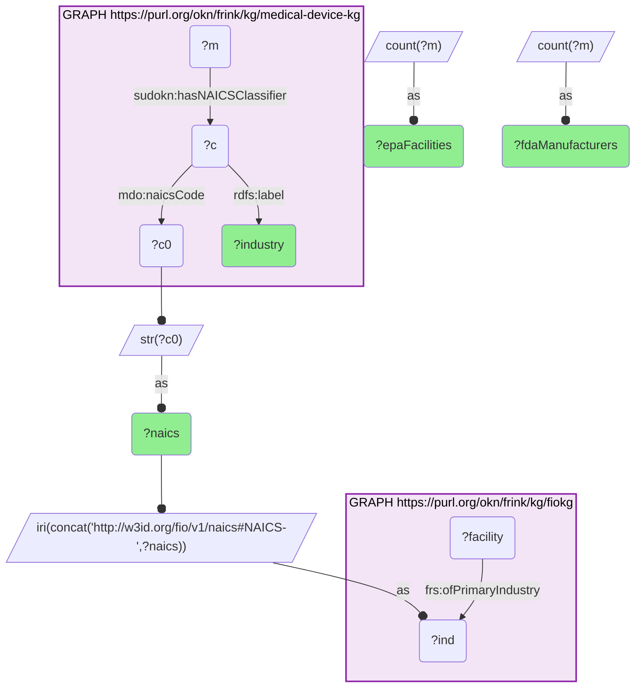

# I08-Q1: the 13 NAICS industries of FDA device manufacturers, with EPA-registered facilities in each (medical-device-kg × fiokg)

- **Date:** 2026-10-13
- **Model:** claude-opus-5-5
- **SPARQL endpoint:** https://apps.okn.us/federation/sparql
- **Generated by:** mcp-okn v0.1.0 (build f738e02)
- **Contents:** 1 query · 1 query diagram

## Knowledge graphs used

- `medical-device-kg` — <https://purl.org/okn/frink/kg/medical-device-kg>
- `fiokg` — <https://purl.org/okn/frink/kg/fiokg>

## Conversation

👤 **User**

For the NAICS industries FDA medical-device manufacturers are classified under, how many EPA-registered facilities does fiokg list in each?

---

🧠 **Assistant**

**All 13 NAICS industries that FDA medical-device manufacturers are classified under also classify EPA-registered facilities in fiokg — but the two graphs weight those industries very differently.**

| NAICS | Industry | FDA manufacturers (medical-device-kg) | EPA facilities (fiokg, primary industry) |
|---|---|---|---|
| 339112 | Surgical and Medical Instrument Manufacturing | 3,903 | 1,671 |
| 339115 | Ophthalmic Goods Manufacturing | 2,467 | 206 |
| 339113 | Surgical Appliance and Supplies Manufacturing | 1,845 | 753 |
| 334510 | Electromedical and Electrotherapeutic Apparatus Manufacturing | 1,724 | 175 |
| 334517 | Irradiation Apparatus Manufacturing | 911 | 108 |
| 325413 | In-Vitro Diagnostic Substance Manufacturing | 800 | 218 |
| 339114 | Dental Equipment and Supplies Manufacturing | 745 | 230 |
| 334519 | Other Measuring and Controlling Device Manufacturing | 698 | 271 |
| 334516 | Analytical Laboratory Instrument Manufacturing | 460 | 309 |
| 339116 | Dental Laboratories | 153 | 238 |
| 325412 | Pharmaceutical Preparation Manufacturing | 102 | 2,113 |
| 325414 | Biological Product (except Diagnostic) Manufacturing | 100 | 489 |
| 332721 | Precision Turned Product Manufacturing | 64 | 928 |

**The rankings invert at the edges.** Pharmaceutical preparation is the largest industry on the EPA side (2,113 facilities) and one of the smallest on the FDA device side (102 manufacturers); ophthalmic goods is the second-largest device industry (2,467) and one of the smallest in fiokg (206). Surgical and medical instruments is the one industry near the top of both lists.

**What the comparison is, and is not.** This is an industry-level join: the shared key is the six-digit NAICS code, not a company. It says how many EPA-regulated facilities operate in each industry device makers belong to — the environmental-regulatory footprint of the sector — and it does not say that any particular FDA manufacturer is one of those facilities. The two counts also measure different things: medical-device-kg counts manufacturers known to FDA, while fiokg counts facilities registered with EPA, here by primary industry only.

**How the join works.** Each graph mints its own identifier for a NAICS class, so the IRIs never match. medical-device-kg holds the bare code as a literal on its classification node; fiokg embeds it at the end of its industry IRI. Rebuilding fiokg's IRI from the code joins them exactly.

## SPARQL queries executed

#### Query 1

_2026-10-13T20:43:39+00:00 · `medical-device-kg`, `fiokg`_

```sparql
PREFIX mdo: <http://medicaldevice.com/ontology/>
PREFIX sudokn: <http://asu.edu/semantics/SUDOKN/>
PREFIX frs: <http://w3id.org/fio/v1/epa-frs#>
PREFIX rdfs: <http://www.w3.org/2000/01/rdf-schema#>
SELECT ?naics ?industry ?fdaManufacturers (COUNT(DISTINCT ?facility) AS ?epaFacilities) WHERE {
  { SELECT ?naics ?industry (COUNT(DISTINCT ?m) AS ?fdaManufacturers) WHERE {
      GRAPH <https://purl.org/okn/frink/kg/medical-device-kg> {
        ?m sudokn:hasNAICSClassifier ?c .
        ?c mdo:naicsCode ?c0 ; rdfs:label ?industry . }
      BIND(STR(?c0) AS ?naics)
    } GROUP BY ?naics ?industry }
  BIND(IRI(CONCAT('http://w3id.org/fio/v1/naics#NAICS-',?naics)) AS ?ind)
  GRAPH <https://purl.org/okn/frink/kg/fiokg> { ?facility frs:ofPrimaryIndustry ?ind . }
} GROUP BY ?naics ?industry ?fdaManufacturers ORDER BY DESC(?fdaManufacturers)
```



_13 row(s)_

| naics | industry | fdaManufacturers | epaFacilities |
| --- | --- | --- | --- |
| 339112 | Surgical and Medical Instrument Manufacturing | 3903 | 1671 |
| 339115 | Ophthalmic Goods Manufacturing | 2467 | 206 |
| 339113 | Surgical Appliance and Supplies Manufacturing | 1845 | 753 |
| 334510 | Electromedical and Electrotherapeutic Apparatus Manufacturing | 1724 | 175 |
| 334517 | Irradiation Apparatus Manufacturing | 911 | 108 |
| 325413 | In-Vitro Diagnostic Substance Manufacturing | 800 | 218 |
| 339114 | Dental Equipment and Supplies Manufacturing | 745 | 230 |
| 334519 | Other Measuring and Controlling Device Manufacturing | 698 | 271 |
| 334516 | Analytical Laboratory Instrument Manufacturing | 460 | 309 |
| 339116 | Dental Laboratories | 153 | 238 |
| 325412 | Pharmaceutical Preparation Manufacturing | 102 | 2113 |
| 325414 | Biological Product (except Diagnostic) Manufacturing | 100 | 489 |
| 332721 | Precision Turned Product Manufacturing | 64 | 928 |
