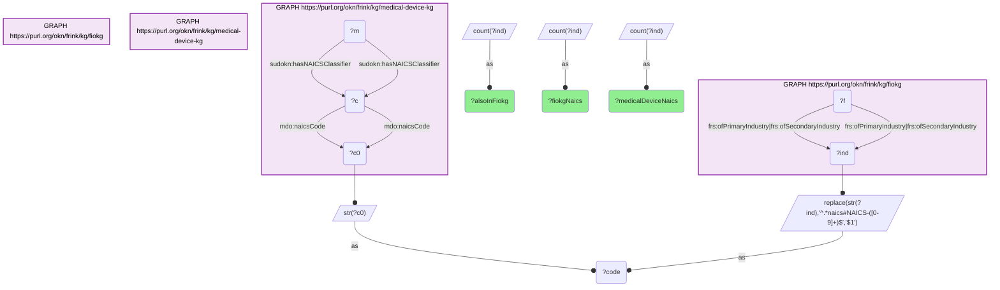

# I08-Q2: all 13 medical-device-kg NAICS codes also classify fiokg facilities — 13 of 13, against fiokg's 3,842

- **Date:** 2026-10-13
- **Model:** claude-opus-5-5
- **SPARQL endpoint:** https://apps.okn.us/federation/sparql
- **Generated by:** mcp-okn v0.1.0 (build f738e02)
- **Contents:** 1 query · 1 query diagram

## Knowledge graphs used

- `medical-device-kg` — <https://purl.org/okn/frink/kg/medical-device-kg>
- `fiokg` — <https://purl.org/okn/frink/kg/fiokg>

## Conversation

👤 **User**

Same crosswalk, coverage angle: how many of the NAICS codes medical-device-kg assigns to its manufacturers also classify facilities in fiokg?

---

🧠 **Assistant**

**All 13 — every NAICS code medical-device-kg assigns to a manufacturer also classifies facilities in fiokg.**

| | Count |
|---|---|
| NAICS codes used by medical-device-kg manufacturers | 13 |
| Of those, also used by fiokg | 13 |
| NAICS codes used anywhere in fiokg | 3,842 |

**Complete on one side, a sliver of the other.** The join covers 100% of medical-device-kg's codes and about a third of one percent of fiokg's 3,842. That asymmetry is the point: medical-device-kg classifies its manufacturers into a deliberately narrow set of device and device-adjacent industries, while fiokg covers the whole regulated economy. The join carves the medical-device sector out of EPA's facility registry — it does not connect the two graphs broadly.

**Why the count is so small, and why that is not a weakness.** Thirteen is the size of medical-device-kg's NAICS vocabulary, not a sign of a thin join. Each code stands for an industry with hundreds to thousands of entities on each side, so the 13 shared codes relate roughly ten thousand classified device manufacturers to several thousand EPA facilities.

**What changed.** Until medical-device-kg's v0.0.4 release there was nothing to join on — the graph carried no NAICS codes at all, and its only route into the industry cluster was matching company names. The code-level join is exact where the name match is approximate, though it answers a coarser question: same industry, rather than same firm.

fiokg's total here counts distinct industry identifiers on either the primary or the secondary industry predicate.

## SPARQL queries executed

#### Query 1

_2026-10-13T20:43:40+00:00 · `medical-device-kg`, `fiokg`_

```sparql
PREFIX mdo: <http://medicaldevice.com/ontology/>
PREFIX sudokn: <http://asu.edu/semantics/SUDOKN/>
PREFIX frs: <http://w3id.org/fio/v1/epa-frs#>
SELECT ?medicalDeviceNaics ?alsoInFiokg ?fiokgNaics WHERE {
  { SELECT (COUNT(DISTINCT ?c0) AS ?medicalDeviceNaics) WHERE {
      GRAPH <https://purl.org/okn/frink/kg/medical-device-kg> { ?m sudokn:hasNAICSClassifier ?c . ?c mdo:naicsCode ?c0 . } } }
  { SELECT (COUNT(DISTINCT ?code) AS ?alsoInFiokg) WHERE {
      { SELECT DISTINCT ?code WHERE { GRAPH <https://purl.org/okn/frink/kg/medical-device-kg> { ?m sudokn:hasNAICSClassifier ?c . ?c mdo:naicsCode ?c0 . } BIND(STR(?c0) AS ?code) } }
      { SELECT DISTINCT ?code WHERE { GRAPH <https://purl.org/okn/frink/kg/fiokg> { ?f frs:ofPrimaryIndustry|frs:ofSecondaryIndustry ?ind . } BIND(REPLACE(STR(?ind),'^.*naics#NAICS-([0-9]+)$','$1') AS ?code) } } } }
  { SELECT (COUNT(DISTINCT ?ind) AS ?fiokgNaics) WHERE {
      GRAPH <https://purl.org/okn/frink/kg/fiokg> { ?f frs:ofPrimaryIndustry|frs:ofSecondaryIndustry ?ind . } } }
}
```



_1 row(s)_

| medicalDeviceNaics | alsoInFiokg | fiokgNaics |
| --- | --- | --- |
| 13 | 13 | 3842 |
