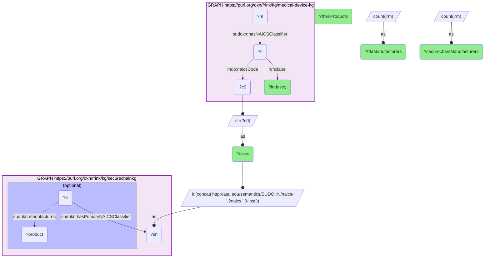
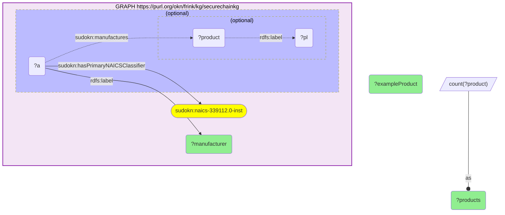

# I09-Q1: hardware manufacturers sharing a NAICS industry with FDA device makers, and what they make (medical-device-kg × securechainkg)

- **Date:** 2026-10-13
- **Model:** claude-opus-5-5
- **SPARQL endpoint:** https://apps.okn.us/federation/sparql
- **Generated by:** mcp-okn v0.1.0 (build f738e02)
- **Contents:** 2 queries · 2 query diagrams

## Knowledge graphs used

- `medical-device-kg` — <https://purl.org/okn/frink/kg/medical-device-kg>
- `securechainkg` — <https://purl.org/okn/frink/kg/securechainkg>

## Conversation

👤 **User**

Which hardware manufacturers in securechainkg share a NAICS industry with FDA medical-device manufacturers, and what products do they make?

---

🧠 **Assistant**

**12 of the 13 medical-device industries have at least one hardware manufacturer in securechainkg — 219 manufacturer classifications in all — and their product lists show what those suppliers actually make.**

| NAICS | Industry | FDA manufacturers | securechainkg manufacturers | Their products |
|---|---|---|---|---|
| 325412 | Pharmaceutical Preparation Manufacturing | 102 | 47 | 409 |
| 339112 | Surgical and Medical Instrument Manufacturing | 3,903 | 39 | 411 |
| 332721 | Precision Turned Product Manufacturing | 64 | 34 | 192 |
| 339113 | Surgical Appliance and Supplies Manufacturing | 1,845 | 22 | 334 |
| 334519 | Other Measuring and Controlling Device Manufacturing | 698 | 16 | 144 |
| 334516 | Analytical Laboratory Instrument Manufacturing | 460 | 15 | 179 |
| 334510 | Electromedical and Electrotherapeutic Apparatus Manufacturing | 1,724 | 14 | 104 |
| 339114 | Dental Equipment and Supplies Manufacturing | 745 | 13 | 161 |
| 325414 | Biological Product (except Diagnostic) Manufacturing | 100 | 10 | 70 |
| 339115 | Ophthalmic Goods Manufacturing | 2,467 | 7 | 90 |
| 339116 | Dental Laboratories | 153 | 1 | 15 |
| 325413 | In-Vitro Diagnostic Substance Manufacturing | 800 | 1 | 7 |

**Inside the core device industry.** For 339112, surgical and medical instruments — the largest FDA industry — the securechainkg manufacturers with the longest product lists are:

| Manufacturer | Products listed | An example |
|---|---|---|
| gracemedical | 58 | Megerian Nitinol SRP |
| Airlife | 40 | Intubation Aids |
| spectrumplastics | 32 | Blood Management Solutions |
| Confluent Medical Technologies | 17 | Polyimide Tubing |
| southwest calibration labs, inc. | 16 | Stretchers |
| eyestucson | 15 | Eyeglasses |
| Vante / Plasticweld Systems | 14 | Eyelets |
| Banner Imaging | 14 | X-Ray |
| n-tech endoscopy | 12 | Replacement Parts |
| Diasol, Inc. | 11 | Alcohol Prep Pads |

**What this adds to the FDA picture.** medical-device-kg knows who is registered with FDA and under which industry; it does not describe what a firm manufactures at the level of components and materials. securechainkg does: nitinol implants, polyimide tubing, intubation aids. The shared NAICS code puts a product-level view of the supply base next to the regulatory roster for the same industry.

**Read the two manufacturer columns as different populations.** The FDA column is national and large; the securechainkg column is a few dozen firms per industry, drawn from that graph's embedded manufacturer directory. The join is at the level of the industry, so it identifies peers and potential suppliers in the same sector — it does not assert that a securechainkg firm is itself FDA-registered. Some classifications are also loose on the securechainkg side, as "Eyeglasses" and "Stretchers" under surgical instruments suggest.

## SPARQL queries executed

#### Query 1

_2026-10-13T20:43:41+00:00 · `medical-device-kg`, `securechainkg`_

```sparql
PREFIX mdo: <http://medicaldevice.com/ontology/>
PREFIX sudokn: <http://asu.edu/semantics/SUDOKN/>
PREFIX rdfs: <http://www.w3.org/2000/01/rdf-schema#>
SELECT ?naics ?industry ?fdaManufacturers (COUNT(DISTINCT ?a) AS ?securechainManufacturers) (COUNT(DISTINCT ?product) AS ?theirProducts) WHERE {
  { SELECT ?naics ?industry (COUNT(DISTINCT ?m) AS ?fdaManufacturers) WHERE {
      GRAPH <https://purl.org/okn/frink/kg/medical-device-kg> {
        ?m sudokn:hasNAICSClassifier ?c .
        ?c mdo:naicsCode ?c0 ; rdfs:label ?industry . }
      BIND(STR(?c0) AS ?naics)
    } GROUP BY ?naics ?industry }
  BIND(IRI(CONCAT('http://asu.edu/semantics/SUDOKN/naics-',?naics,'.0-inst')) AS ?sn)
  GRAPH <https://purl.org/okn/frink/kg/securechainkg> {
    ?a sudokn:hasPrimaryNAICSClassifier ?sn .
    OPTIONAL { ?a sudokn:manufactures ?product }
  }
} GROUP BY ?naics ?industry ?fdaManufacturers ORDER BY DESC(?securechainManufacturers)
```



_12 row(s)_

| naics | industry | fdaManufacturers | securechainManufacturers | theirProducts |
| --- | --- | --- | --- | --- |
| 325412 | Pharmaceutical Preparation Manufacturing | 102 | 47 | 409 |
| 339112 | Surgical and Medical Instrument Manufacturing | 3903 | 39 | 411 |
| 332721 | Precision Turned Product Manufacturing | 64 | 34 | 192 |
| 339113 | Surgical Appliance and Supplies Manufacturing | 1845 | 22 | 334 |
| 334519 | Other Measuring and Controlling Device Manufacturing | 698 | 16 | 144 |
| 334516 | Analytical Laboratory Instrument Manufacturing | 460 | 15 | 179 |
| 334510 | Electromedical and Electrotherapeutic Apparatus Manufacturing | 1724 | 14 | 104 |
| 339114 | Dental Equipment and Supplies Manufacturing | 745 | 13 | 161 |
| 325414 | Biological Product (except Diagnostic) Manufacturing | 100 | 10 | 70 |
| 339115 | Ophthalmic Goods Manufacturing | 2467 | 7 | 90 |
| 339116 | Dental Laboratories | 153 | 1 | 15 |
| 325413 | In-Vitro Diagnostic Substance Manufacturing | 800 | 1 | 7 |

#### Query 2

_2026-10-13T20:43:41+00:00 · `securechainkg`_

```sparql
PREFIX sudokn: <http://asu.edu/semantics/SUDOKN/>
PREFIX rdfs: <http://www.w3.org/2000/01/rdf-schema#>
SELECT ?manufacturer (COUNT(DISTINCT ?product) AS ?products) (SAMPLE(?pl) AS ?exampleProduct) WHERE {
  GRAPH <https://purl.org/okn/frink/kg/securechainkg> {
    ?a sudokn:hasPrimaryNAICSClassifier <http://asu.edu/semantics/SUDOKN/naics-339112.0-inst> ; rdfs:label ?manufacturer .
    OPTIONAL { ?a sudokn:manufactures ?product . OPTIONAL { ?product rdfs:label ?pl } }
  }
} GROUP BY ?manufacturer ORDER BY DESC(?products) LIMIT 10
```



_10 row(s)_

| manufacturer | products | exampleProduct |
| --- | --- | --- |
| gracemedical | 58 | Megerian Nitinol SRP |
| Airlife | 40 | Intubation Aids |
| spectrumplastics | 32 | Blood Management Solutions |
| Confluent Medical Technologies | 17 | Polyimide Tubing |
| southwest calibration labs, inc. | 16 | Stretchers |
| eyestucson | 15 | Eyeglasses |
| Vante / Plasticweld Systems | 14 | Eyelets |
| Banner Imaging | 14 | X-Ray |
| n-tech endoscopy | 12 | Replacement Parts |
| Diasol, Inc. | 11 | Alcohol Prep Pads |
