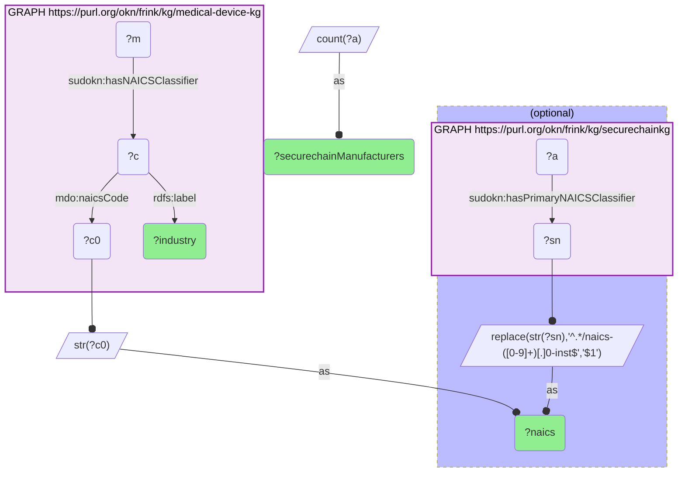

# I09-Q2: 12 of medical-device-kg's 13 NAICS codes have a securechainkg manufacturer — the missing one is irradiation apparatus

- **Date:** 2026-10-13
- **Model:** claude-opus-5-5
- **SPARQL endpoint:** https://apps.okn.us/federation/sparql
- **Generated by:** mcp-okn v0.1.0 (build f738e02)
- **Contents:** 1 query · 1 query diagram

## Knowledge graphs used

- `medical-device-kg` — <https://purl.org/okn/frink/kg/medical-device-kg>
- `securechainkg` — <https://purl.org/okn/frink/kg/securechainkg>

## Conversation

👤 **User**

Same crosswalk, coverage angle: how many NAICS codes are used by both medical-device-kg manufacturers and securechainkg manufacturers, and which is missing?

---

🧠 **Assistant**

**12 of 13. The one medical-device industry with no manufacturer in securechainkg is 334517, Irradiation Apparatus Manufacturing.**

| NAICS | Industry | securechainkg manufacturers |
|---|---|---|
| 334517 | Irradiation Apparatus Manufacturing | 0 |
| 325413 | In-Vitro Diagnostic Substance Manufacturing | 1 |
| 339116 | Dental Laboratories | 1 |
| 339115 | Ophthalmic Goods Manufacturing | 7 |
| 325414 | Biological Product (except Diagnostic) Manufacturing | 10 |
| 339114 | Dental Equipment and Supplies Manufacturing | 13 |
| 334510 | Electromedical and Electrotherapeutic Apparatus Manufacturing | 14 |
| 334516 | Analytical Laboratory Instrument Manufacturing | 15 |
| 334519 | Other Measuring and Controlling Device Manufacturing | 16 |
| 339113 | Surgical Appliance and Supplies Manufacturing | 22 |
| 332721 | Precision Turned Product Manufacturing | 34 |
| 339112 | Surgical and Medical Instrument Manufacturing | 39 |
| 325412 | Pharmaceutical Preparation Manufacturing | 47 |

**The gap is a specific one.** Irradiation apparatus — X-ray, CT and radiation-therapy equipment — is a mid-sized industry on the FDA side, yet securechainkg's manufacturer directory has no firm classified there. It is the one device industry for which this join can say nothing about the hardware supply base.

**Two more are barely covered.** In-vitro diagnostics and dental laboratories each rest on a single securechainkg manufacturer, so anything said about those industries through this join is really a statement about one firm.

**Where coverage is real.** Eight industries have 13 or more securechainkg manufacturers, led by pharmaceutical preparation (47), surgical and medical instruments (39) and precision turned products (34). Those are the industries where an industry-level comparison between FDA's roster and securechainkg's suppliers has enough on both sides to mean something.

**Compared with the other industry partner.** The same 13 codes all match in fiokg, EPA's facility registry, which covers the whole regulated economy. securechainkg is a much smaller manufacturer directory, so 12 of 13 is close to the most it could offer.

The count is by primary NAICS classification in securechainkg.

## SPARQL queries executed

#### Query 1

_2026-10-13T20:43:42+00:00 · `medical-device-kg`, `securechainkg`_

```sparql
PREFIX mdo: <http://medicaldevice.com/ontology/>
PREFIX sudokn: <http://asu.edu/semantics/SUDOKN/>
PREFIX rdfs: <http://www.w3.org/2000/01/rdf-schema#>
SELECT ?naics ?industry (COUNT(DISTINCT ?a) AS ?securechainManufacturers) WHERE {
  { SELECT DISTINCT ?naics ?industry WHERE {
      GRAPH <https://purl.org/okn/frink/kg/medical-device-kg> {
        ?m sudokn:hasNAICSClassifier ?c .
        ?c mdo:naicsCode ?c0 ; rdfs:label ?industry . }
      BIND(STR(?c0) AS ?naics) } }
  OPTIONAL {
    { SELECT ?naics ?a WHERE {
        GRAPH <https://purl.org/okn/frink/kg/securechainkg> { ?a sudokn:hasPrimaryNAICSClassifier ?sn . }
        BIND(REPLACE(STR(?sn),'^.*/naics-([0-9]+)[.]0-inst$','$1') AS ?naics) } }
  }
} GROUP BY ?naics ?industry ORDER BY ?securechainManufacturers ?naics
```



_13 row(s)_

| naics | industry | securechainManufacturers |
| --- | --- | --- |
| 334517 | Irradiation Apparatus Manufacturing | 0 |
| 325413 | In-Vitro Diagnostic Substance Manufacturing | 1 |
| 339116 | Dental Laboratories | 1 |
| 339115 | Ophthalmic Goods Manufacturing | 7 |
| 325414 | Biological Product (except Diagnostic) Manufacturing | 10 |
| 339114 | Dental Equipment and Supplies Manufacturing | 13 |
| 334510 | Electromedical and Electrotherapeutic Apparatus Manufacturing | 14 |
| 334516 | Analytical Laboratory Instrument Manufacturing | 15 |
| 334519 | Other Measuring and Controlling Device Manufacturing | 16 |
| 339113 | Surgical Appliance and Supplies Manufacturing | 22 |
| 332721 | Precision Turned Product Manufacturing | 34 |
| 339112 | Surgical and Medical Instrument Manufacturing | 39 |
| 325412 | Pharmaceutical Preparation Manufacturing | 47 |
