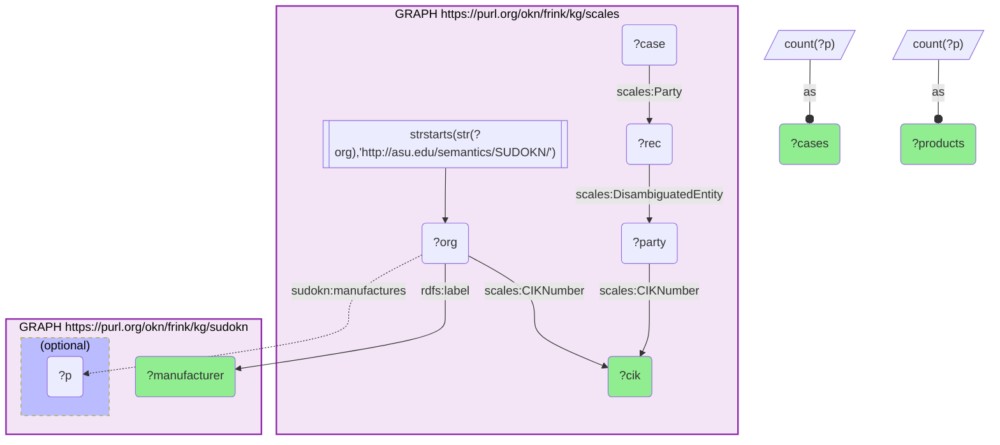
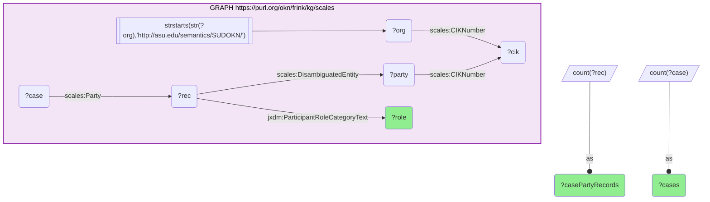

# I10-Q1: SUDOKN manufacturers in federal litigation — Crane Company in 183 cases, and mostly as defendants (scales × sudokn)

- **Date:** 2026-10-13
- **Model:** claude-opus-5-5
- **SPARQL endpoint:** https://apps.okn.us/federation/sparql
- **Generated by:** mcp-okn v0.1.0 (build f738e02)
- **Contents:** 2 queries · 2 query diagrams

## Knowledge graphs used

- `scales` — <https://purl.org/okn/frink/kg/scales>
- `sudokn` — <https://purl.org/okn/frink/kg/sudokn>

## Conversation

👤 **User**

Which SUDOKN manufacturers appear as parties in the most federal court cases, and how many products does SUDOKN list for each?

---

🧠 **Assistant**

**Crane Company stands far ahead: 183 federal cases, more than five times the next manufacturer. The twelve SUDOKN manufacturers that appear in the most cases, with the size of their SUDOKN product list:**

| Manufacturer (SUDOKN) | SEC CIK | Federal cases (scales) | Products listed (SUDOKN) |
|---|---|---|---|
| Crane Company | 1313900 | 183 | 71 |
| ALFA LAVAL INC. | 713064 | 33 | 121 |
| Winnebago Industries | 107687 | 25 | 40 |
| General Dynamics | 40533 | 22 | 168 |
| LKQ Corporation | 1065696 | 21 | 236 |
| Leggett & Platt | 58492 | 19 | 62 |
| Valero Energy Corporation | 21271 | 17 | 75 |
| Micron Technology, Inc. | 723125 | 16 | 309 |
| Tootsie Roll Industries | 98677 | 16 | 268 |
| Precision Castparts Corp. | 79958 | 15 | 64 |
| Avery Dennison | 8818 | 14 | 242 |
| Koch Industries | 923338 | 13 | 84 |

Micron Technology appears twice in the raw result because its SUDOKN node carries two labels ("Micron Technology, Inc." and "Micron Technology"); it is one company and one row here.

**Litigation volume is unrelated to catalogue size.** Crane lists 71 products and leads by a wide margin; Micron lists 309 and has 16 cases. Whatever drives a manufacturer's presence in federal court, it is not how many products SUDOKN records for it.

**In what capacity they appear.** Across all the SUDOKN manufacturers scales identifies, the eight most common roles on their case-party records are:

| Role | Case-party records | Cases |
|---|---|---|
| Cross Defendant | 1,570 | 114 |
| Defendant | 630 | 565 |
| Cross Claimant | 110 | 82 |
| Plaintiff | 65 | 65 |
| Counter Defendant | 46 | 26 |
| Counter Claimant | 37 | 26 |
| Third Party Defendant | 10 | 8 |
| Third Party Plaintiff | 9 | 8 |

These companies are overwhelmingly on the defending side: defendant in 565 cases against plaintiff in 65. The 1,570 cross-defendant records are concentrated in only 114 cases — about fourteen per case — which is the signature of multi-defendant litigation in which co-defendants file claims against one another.

**How the two graphs meet.** scales re-uses SUDOKN's own company IRIs and attaches an SEC Central Index Key to each. That CIK also sits on scales' own party entities, which case-party records point to, and each case points to its party records. So the path is SUDOKN company → CIK → scales party → party record → case, with the SUDOKN side supplying what the company makes.

Coverage is limited to companies with a CIK, that is, firms that file with the SEC; a privately held manufacturer cannot appear here however often it is sued.

## SPARQL queries executed

#### Query 1

_2026-10-13T20:43:43+00:00 · `scales`, `sudokn`_

```sparql
PREFIX scales: <http://schemas.scales-okn.org/rdf/scales#>
PREFIX sudokn: <http://asu.edu/semantics/SUDOKN/>
PREFIX rdfs: <http://www.w3.org/2000/01/rdf-schema#>
SELECT ?manufacturer ?cik ?cases ?products WHERE {
  { SELECT ?org ?cik (COUNT(DISTINCT ?case) AS ?cases) WHERE {
      GRAPH <https://purl.org/okn/frink/kg/scales> {
        ?org scales:CIKNumber ?cik .
        FILTER(STRSTARTS(STR(?org),'http://asu.edu/semantics/SUDOKN/'))
        ?party scales:CIKNumber ?cik .
        ?rec scales:DisambiguatedEntity ?party .
        ?case scales:Party ?rec .
      } } GROUP BY ?org ?cik ORDER BY DESC(?cases) LIMIT 12 }
  { SELECT ?org ?manufacturer (COUNT(DISTINCT ?p) AS ?products) WHERE {
      GRAPH <https://purl.org/okn/frink/kg/sudokn> {
        ?org rdfs:label ?manufacturer .
        OPTIONAL { ?org sudokn:manufactures ?p }
      } } GROUP BY ?org ?manufacturer }
} ORDER BY DESC(?cases)
```



_13 row(s)_

| manufacturer | cik | cases | products |
| --- | --- | --- | --- |
| Crane Company | 1313900 | 183 | 71 |
| ALFA LAVAL INC. | 713064 | 33 | 121 |
| Winnebago Industries | 107687 | 25 | 40 |
| General Dynamics | 40533 | 22 | 168 |
| LKQ Corporation | 1065696 | 21 | 236 |
| Leggett & Platt | 58492 | 19 | 62 |
| Valero Energy Corporation | 21271 | 17 | 75 |
| Micron Technology, Inc. | 723125 | 16 | 309 |
| Micron Technology | 723125 | 16 | 309 |
| Tootsie Roll Industries | 98677 | 16 | 268 |
| Precision Castparts Corp. | 79958 | 15 | 64 |
| Avery Dennison | 8818 | 14 | 242 |
| Koch Industries | 923338 | 13 | 84 |

#### Query 2

_2026-10-13T20:43:43+00:00 · `scales`_

```sparql
PREFIX scales: <http://schemas.scales-okn.org/rdf/scales#>
PREFIX jxdm: <http://release.niem.gov/niem/domains/jxdm/7.2/#>
SELECT ?role (COUNT(DISTINCT ?rec) AS ?casePartyRecords) (COUNT(DISTINCT ?case) AS ?cases) WHERE {
  GRAPH <https://purl.org/okn/frink/kg/scales> {
    ?org scales:CIKNumber ?cik .
    FILTER(STRSTARTS(STR(?org),'http://asu.edu/semantics/SUDOKN/'))
    ?party scales:CIKNumber ?cik .
    ?rec scales:DisambiguatedEntity ?party ; jxdm:ParticipantRoleCategoryText ?role .
    ?case scales:Party ?rec .
  }
} GROUP BY ?role ORDER BY DESC(?casePartyRecords) LIMIT 8
```



_8 row(s)_

| role | casePartyRecords | cases |
| --- | --- | --- |
| Cross Defendant | 1570 | 114 |
| Defendant | 630 | 565 |
| Cross Claimant | 110 | 82 |
| Plaintiff | 65 | 65 |
| Counter Defendant | 46 | 26 |
| Counter Claimant | 37 | 26 |
| Third Party Defendant | 10 | 8 |
| Third Party Plaintiff | 9 | 8 |
