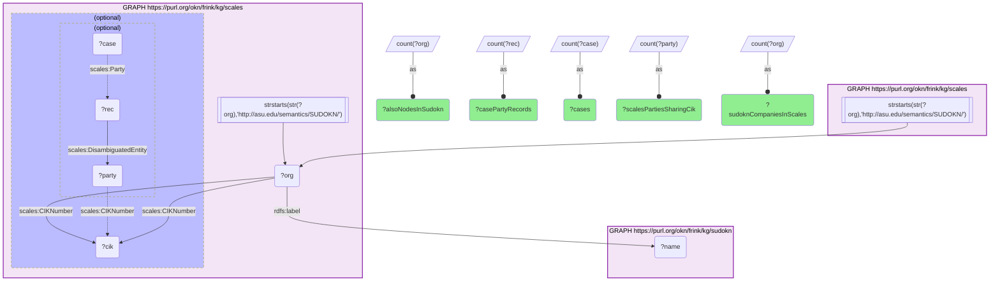

# I10-Q2: scales identifies 100 SUDOKN manufacturers by SEC CIK — 88 parties, 2,503 case-party records, 654 federal cases

- **Date:** 2026-10-13
- **Model:** claude-opus-5-5
- **SPARQL endpoint:** https://apps.okn.us/federation/sparql
- **Generated by:** mcp-okn v0.1.0 (build f738e02)
- **Contents:** 1 query · 1 query diagram

## Knowledge graphs used

- `scales` — <https://purl.org/okn/frink/kg/scales>
- `sudokn` — <https://purl.org/okn/frink/kg/sudokn>

## Conversation

👤 **User**

Same crosswalk, coverage angle: how many SUDOKN manufacturers does scales identify by SEC CIK, and how many case-party records and cases do they account for?

---

🧠 **Assistant**

**scales identifies 100 SUDOKN manufacturers by SEC CIK, and they account for 2,503 case-party records in 654 federal cases.**

| Step | Count |
|---|---|
| SUDOKN company IRIs carrying a CIK in scales | 100 |
| Of those, manufacturer nodes in sudokn | 100 |
| scales party entities sharing one of those CIKs | 88 |
| Case-party records pointing at those parties | 2,503 |
| Distinct federal cases | 654 |

**The join itself is complete.** All 100 company IRIs that scales carries are nodes in sudokn — the IRIs are SUDOKN's own, re-used verbatim, so there is nothing to normalize and nothing lost.

**The fan-out is where the value is.** A hundred companies is a small crosswalk, but each one opens onto litigation: an average of about 25 case-party records and between six and seven cases per company. That average hides heavy concentration — a single manufacturer accounts for 183 of the 654 cases.

**Why 100 companies become 88 parties.** The link inside scales is the CIK, not the IRI: a SUDOKN company node and a scales party entity are connected when they carry the same key. One hundred SUDOKN companies map onto 88 distinct scales parties, so some parties are matched by more than one SUDOKN node — which is what two SUDOKN entries for the same SEC registrant would produce.

**Why 2,503 records are only 654 cases.** A party record is one appearance of a party in a case in a given role. The same company can hold several roles in one case — defendant, cross-defendant, cross-claimant — and each is its own record, so records outnumber cases by almost four to one.

**The ceiling.** One hundred is set by SEC registration and by how many SUDOKN companies the SCALES team annotated, not by how many manufacturers are ever sued. SUDOKN describes tens of thousands of manufacturers; this bridge covers the publicly filing few. It is nonetheless the only route in the federation from a named manufacturer to a court record.

## SPARQL queries executed

#### Query 1

_2026-10-13T20:43:44+00:00 · `scales`, `sudokn`_

```sparql
PREFIX scales: <http://schemas.scales-okn.org/rdf/scales#>
PREFIX rdfs: <http://www.w3.org/2000/01/rdf-schema#>
SELECT ?sudoknCompaniesInScales ?alsoNodesInSudokn ?scalesPartiesSharingCik ?casePartyRecords ?cases WHERE {
  { SELECT (COUNT(DISTINCT ?org) AS ?sudoknCompaniesInScales) (COUNT(DISTINCT ?party) AS ?scalesPartiesSharingCik) (COUNT(DISTINCT ?rec) AS ?casePartyRecords) (COUNT(DISTINCT ?case) AS ?cases) WHERE {
      GRAPH <https://purl.org/okn/frink/kg/scales> {
        ?org scales:CIKNumber ?cik .
        FILTER(STRSTARTS(STR(?org),'http://asu.edu/semantics/SUDOKN/'))
        OPTIONAL { ?party scales:CIKNumber ?cik . FILTER(STRSTARTS(STR(?party),'http://schemas.scales-okn.org/rdf/scales#PartyEntity/'))
                   OPTIONAL { ?rec scales:DisambiguatedEntity ?party . ?case scales:Party ?rec . } }
      } } }
  { SELECT (COUNT(DISTINCT ?org) AS ?alsoNodesInSudokn) WHERE {
      GRAPH <https://purl.org/okn/frink/kg/scales> { ?org scales:CIKNumber ?cik . FILTER(STRSTARTS(STR(?org),'http://asu.edu/semantics/SUDOKN/')) }
      GRAPH <https://purl.org/okn/frink/kg/sudokn> { ?org rdfs:label ?name . } } }
}
```



_1 row(s)_

| sudoknCompaniesInScales | alsoNodesInSudokn | scalesPartiesSharingCik | casePartyRecords | cases |
| --- | --- | --- | --- | --- |
| 100 | 100 | 88 | 2503 | 654 |
