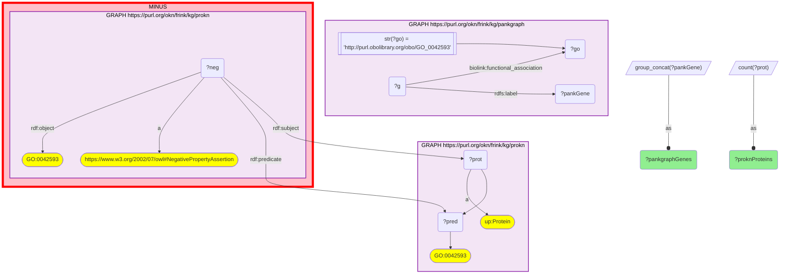

# MF01-Q2: Glucose-homeostasis GO function shared by pankgraph genes and ProKN proteins

- **Date:** 2026-10-16
- **Model:** claude-opus-5-5
- **SPARQL endpoint:** https://apps.okn.us/federation/sparql
- **Generated by:** mcp-okn v0.1.0 (build cada585)
- **Contents:** 1 query · 1 query diagram

## Knowledge graphs used

- `pankgraph` — <https://purl.org/okn/frink/kg/pankgraph>
- `prokn` — <https://purl.org/okn/frink/kg/prokn>

## Conversation

👤 **User**

Crosswalk: pankgraph × prokn on **GO term** (function axis; pankgraph `biolink:functional_association` ↔ ProKN protein GO annotations).

Research question: For the GO process "glucose homeostasis" (GO:0042593), which islet genes (pankgraph) and proteins (ProKN) share the annotation?

Why the join is required: pankgraph holds the gene→function side and ProKN the protein→function side; assembling both for a given metabolic process needs the shared GO term.

---

🧠 **Assistant**

Entities annotated with **glucose homeostasis** (GO:0042593):

- **pankgraph islet/metabolic genes (selected):** GCK, WFS1, TCF7L2, G6PC2, MTNR1B, INS, GCG, GCGR, PPARG, HNF1A, IRS1, STAT3, SLC2A4, AKT1, STK11, PRKAA1/2, LEPR, LEP, POMC, ADIPOR1/2, FFAR1/2, TSC22D4 …
- **ProKN proteins:** 91 distinct proteins carry the same GO annotation.

Why this answers the question: the GO join gathers, under "glucose homeostasis," pankgraph's glucose-regulatory genes and ProKN's proteins. The pankgraph set is the canonical glucose-homeostasis / type-2-diabetes panel — the glucose sensor GCK, the strongest T2D GWAS gene TCF7L2, the β-cell genes G6PC2 / MTNR1B / WFS1, the insulin-signalling node IRS1/AKT1, and the master metabolic regulators PPARG, PRKAA1/2 (AMPK), STK11 (LKB1). Connecting these genes to ProKN's 91 functionally-matched proteins is exactly the value of the GO (function) crosswalk.

Literature validation (PubMed): GCK, TCF7L2, WFS1, MTNR1B, G6PC2 are established glucose-homeostasis / type-2-diabetes genes (the T2D gene set returns 1,626 records, G12-Q1; MODY genes 2,237, G14-Q1).

*This transcript was regenerated on 2026-10-16 to exclude GO NOT annotations. ProKN stores each NOT-qualified GO annotation also as a plain positive triple, and the earlier count of 92 included one: SLC30A8 (Q8IWU4), which GO records as NOT involved in glucose homeostasis. The query now drops negated annotations with a `MINUS` on the negated statement.*

## SPARQL queries executed

#### Query 1

_2026-10-16T17:11:32+00:00 · `pankgraph`, `prokn`_

```sparql
PREFIX rdf: <http://www.w3.org/1999/02/22-rdf-syntax-ns#>
PREFIX biolink: <https://w3id.org/biolink/vocab/>
PREFIX rdfs: <http://www.w3.org/2000/01/rdf-schema#>
PREFIX up: <http://purl.uniprot.org/core/>
SELECT (GROUP_CONCAT(DISTINCT ?pankGene; separator=", ") AS ?pankgraphGenes) (COUNT(DISTINCT ?prot) AS ?proknProteins) WHERE {
  GRAPH <https://purl.org/okn/frink/kg/pankgraph> { ?g biolink:functional_association ?go . FILTER(STR(?go)='http://purl.obolibrary.org/obo/GO_0042593') ?g rdfs:label ?pankGene . }
  GRAPH <https://purl.org/okn/frink/kg/prokn> { ?prot a up:Protein ; ?pred <http://purl.obolibrary.org/obo/GO_0042593> . }
  MINUS {  # drop GO NOT annotations: prokn also stores each one as a plain triple
    GRAPH <https://purl.org/okn/frink/kg/prokn> {
      ?neg rdf:subject ?prot ; rdf:predicate ?pred ; rdf:object <http://purl.obolibrary.org/obo/GO_0042593> ;
           a <https://www.w3.org/2002/07/owl#NegativePropertyAssertion> .
    }
  }
}
```



_1 row(s)_

| pankgraphGenes | proknProteins |
| --- | --- |
| USF1, IRS1, STAT3, TSC22D4, CCDC186, FABP5, SGCB, NEUROD1, PRKAA2, CYP11B1, FGFR4, CRTC2, ADIPOR1, ASPSCR1, MCU, ADCY8, SLC16A1, PFKM, G6PC2, ADRA2A, SIDT2, SESN3, PTPRJ, TCF7L2, STXBP5L, RFX6, BAD, MUSTN1, INS, CEBPA, BGLAP, GCGR, MBD5, SELENOT, SUCNR1, DUSP29, PTCH1, PDK4, ACSM2A, CMKLR2, CSMD1, CAV3, SLC2A4, RPH3AL, BHLHA15, PTPN11, RMI1, LEP, RBM4, FOSL2, IGFBP5, GCG, POMC, TRPV4, WFS1, GCK, CCN4, HIF1A, DHPS, OAS1, SLC8B1, SIRT6, RBP4, NUCKS1, ADGRF5, NGFR, ALOX5, NR1H4, MLXIPL, CRY1, PAX6, ADIPOR2, PDK2, AKT1, LEPR, PARK7, SLC37A4, PRCP, RPS6, IL6, APPL2, HNF1A, MTNR1B, PRKAA1, PPARG, SESN2, CSRP3, FOXA1, STK11, KLF7, CNR1, CRY2, OBP2A, DBH, FFAR2, FFAR1, VGF | 91 |
