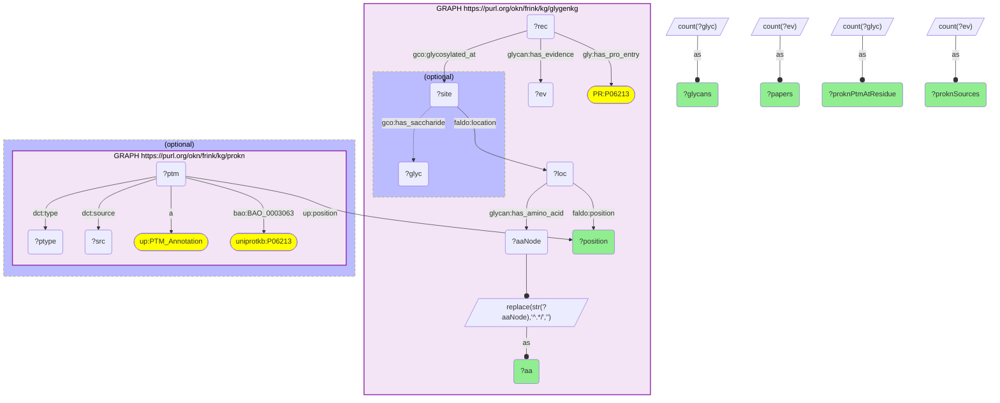
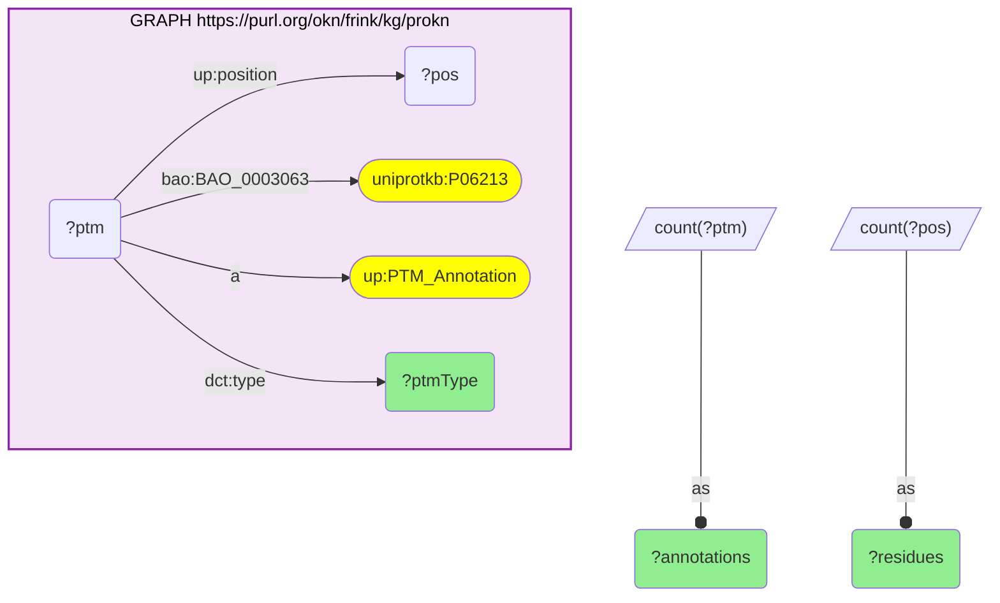

# P09-Q1: glygenkg×prokn — the insulin receptor's 21 GlyGen glycosylation sites, residue by residue, against ProKN's PTM layer

- **Date:** 2026-10-13
- **Model:** claude-opus-5-5
- **SPARQL endpoint:** https://apps.okn.us/federation/sparql
- **Generated by:** mcp-okn v0.1.0 (build d0aab94)
- **Contents:** 2 queries · 2 query diagrams

## Knowledge graphs used

- `glygenkg` — <https://purl.org/okn/frink/kg/glygenkg>
- `prokn` — <https://purl.org/okn/frink/kg/prokn>

## Conversation

👤 **User**

For the insulin receptor (INSR, UniProt P06213), list every glycosylation site GlyGen records, with the number of glycans and papers per site, and say whether ProKN's PTM layer records a modification at the same residue. What else does ProKN know about this protein's modifications?

---

🧠 **Assistant**

**GlyGen records 21 glycosylated residues on the insulin receptor, and ProKN's PTM layer has a matching glycosylation annotation at 17 of them.** The join is on the UniProt accession (P06213) plus the residue number.

| Residue | Amino acid | Glycans (GlyGen) | Papers (GlyGen) | ProKN PTM at the same residue | ProKN sources |
|---|---|---|---|---|---|
| 43 | Asn | 0 | 1 | N-GLYCOSYLATION | glygen, iPTMnet |
| 52 | Asn | 0 | 1 | N-GLYCOSYLATION | glygen, iPTMnet |
| 138 | Asn | 5 | 2 | N-GLYCOSYLATION | glygen, iPTMnet |
| 242 | Asn | 11 | 3 | N-GLYCOSYLATION | glygen, iPTMnet |
| 282 | Asn | 16 | 2 | N-GLYCOSYLATION | glygen, iPTMnet |
| 364 | Asn | 0 | 1 | N-GLYCOSYLATION | glygen, iPTMnet |
| 424 | Asn | 14 | 3 | N-GLYCOSYLATION | glygen, iPTMnet |
| 445 | Asn | 44 | 3 | N-GLYCOSYLATION | glygen, iPTMnet |
| 541 | Asn | 1 | 2 | N-GLYCOSYLATION | glygen, iPTMnet |
| 633 | Asn | 1 | 1 | N-GLYCOSYLATION | glygen, iPTMnet |
| 651 | Asn | 15 | 2 | N-GLYCOSYLATION | glygen, iPTMnet |
| 698 | Asn | 5 | 2 | N-GLYCOSYLATION | glygen, iPTMnet |
| 758 | Ser | 0 | 1 | none | |
| 769 | Asn | 0 | 1 | N-GLYCOSYLATION | glygen, iPTMnet |
| 786 | Thr | 3 | 1 | O-GLYCOSYLATION | glygen, iPTMnet |
| 790 | Thr | 2 | 1 | O-GLYCOSYLATION | glygen, iPTMnet |
| 791 | Ser | 1 | 1 | O-GLYCOSYLATION | glygen, iPTMnet |
| 920 | Asn | 14 | 3 | N-GLYCOSYLATION | glygen, iPTMnet |
| 994 | Ser | 1 | 1 | none | |
| 995 | Ser | 1 | 1 | none | |
| 1003 | Ser | 1 | 1 | none | |

**What each graph contributes.** All 14 asparagine sites and three of the seven serine/threonine sites agree. The four unmatched residues are serines (758, 994, 995, 1003) that GlyGen reports and ProKN does not. GlyGen is the only side with glycan detail: Asn445 carries 44 distinct glycan structures, Asn282 16, Asn651 15, while five sites are known positions with no glycan reported. ProKN names its sources for each annotation, and every matched residue is attributed to both `glygen` and `iPTMnet`.

**What ProKN adds beyond glycosylation** (second query): 42 PTM annotations on this protein, one per residue.

| ProKN modification type | Annotations | Residues |
|---|---|---|
| PHOSPHORYLATION | 21 | 21 |
| N-GLYCOSYLATION | 14 | 14 |
| S-NITROSYLATION | 4 | 4 |
| O-GLYCOSYLATION | 3 | 3 |

So the join turns a glycosylation map into a combined modification map: GlyGen supplies which glycans sit on which residue, ProKN supplies 21 phosphorylation and 4 S-nitrosylation sites on the same sequence.

**Caveat.** GlyGen's residue numbers refer to the isoform named on each glycosylation record. The agreement at 17 residues shows the two graphs number this protein the same way, but that should be checked per protein before comparing positions on another one.

## SPARQL queries executed

#### Query 1

_2026-10-14T02:21:46+00:00 · `glygenkg`, `prokn`_

```sparql
PREFIX gly: <https://sparql.glygen.org/ontology/>
PREFIX gco: <http://purl.jp/bio/12/glyco/conjugate#>
PREFIX glycan: <http://purl.jp/bio/12/glyco/glycan#>
PREFIX faldo: <http://www.biohackathon.org/resource/faldo#>
PREFIX up: <http://purl.uniprot.org/core/>
PREFIX skos: <http://www.w3.org/2004/02/skos/core#>
PREFIX rdfs: <http://www.w3.org/2000/01/rdf-schema#>
PREFIX dct: <http://purl.org/dc/terms/>
PREFIX bao: <http://www.bioassayontology.org/bao#>
# GlyGen's sites for one protein, each matched to a ProKN PTM annotation on the
# same UniProt accession AND the same residue number.
SELECT ?position ?aa ?glycans ?papers
       (GROUP_CONCAT(DISTINCT ?ptype; SEPARATOR="; ") AS ?proknPtmAtResidue)
       (GROUP_CONCAT(DISTINCT ?src; SEPARATOR=", ") AS ?proknSources) WHERE {
  { SELECT ?position ?aa (COUNT(DISTINCT ?glyc) AS ?glycans) (COUNT(DISTINCT ?ev) AS ?papers) WHERE {
      GRAPH <https://purl.org/okn/frink/kg/glygenkg> {
        ?rec gly:has_pro_entry <http://purl.obolibrary.org/obo/PR_P06213> ;
             glycan:has_evidence ?ev ; gco:glycosylated_at ?site .
        ?site faldo:location ?loc . ?loc faldo:position ?position ; glycan:has_amino_acid ?aaNode .
        BIND(REPLACE(STR(?aaNode),'^.*/','') AS ?aa)
        OPTIONAL { ?site gco:has_saccharide ?glyc }
      } } GROUP BY ?position ?aa }
  OPTIONAL { GRAPH <https://purl.org/okn/frink/kg/prokn> {
      ?ptm a up:PTM_Annotation ; bao:BAO_0003063 <http://purl.uniprot.org/uniprot/P06213> ;
           up:position ?position ; dct:type ?ptype ; dct:source ?src . } }
} GROUP BY ?position ?aa ?glycans ?papers ORDER BY ?position
```



_21 row(s)_

| position | aa | glycans | papers | proknPtmAtResidue | proknSources |
| --- | --- | --- | --- | --- | --- |
| 43 | Asn | 0 | 1 | N-GLYCOSYLATION | glygen, iPTMnet |
| 52 | Asn | 0 | 1 | N-GLYCOSYLATION | iPTMnet, glygen |
| 138 | Asn | 5 | 2 | N-GLYCOSYLATION | iPTMnet, glygen |
| 242 | Asn | 11 | 3 | N-GLYCOSYLATION | iPTMnet, glygen |
| 282 | Asn | 16 | 2 | N-GLYCOSYLATION | iPTMnet, glygen |
| 364 | Asn | 0 | 1 | N-GLYCOSYLATION | glygen, iPTMnet |
| 424 | Asn | 14 | 3 | N-GLYCOSYLATION | iPTMnet, glygen |
| 445 | Asn | 44 | 3 | N-GLYCOSYLATION | glygen, iPTMnet |
| 541 | Asn | 1 | 2 | N-GLYCOSYLATION | iPTMnet, glygen |
| 633 | Asn | 1 | 1 | N-GLYCOSYLATION | iPTMnet, glygen |
| 651 | Asn | 15 | 2 | N-GLYCOSYLATION | glygen, iPTMnet |
| 698 | Asn | 5 | 2 | N-GLYCOSYLATION | glygen, iPTMnet |
| 758 | Ser | 0 | 1 |  |  |
| 769 | Asn | 0 | 1 | N-GLYCOSYLATION | iPTMnet, glygen |
| 786 | Thr | 3 | 1 | O-GLYCOSYLATION | glygen, iPTMnet |
| 790 | Thr | 2 | 1 | O-GLYCOSYLATION | glygen, iPTMnet |
| 791 | Ser | 1 | 1 | O-GLYCOSYLATION | glygen, iPTMnet |
| 920 | Asn | 14 | 3 | N-GLYCOSYLATION | iPTMnet, glygen |
| 994 | Ser | 1 | 1 |  |  |
| 995 | Ser | 1 | 1 |  |  |
| 1003 | Ser | 1 | 1 |  |  |

#### Query 2

_2026-10-14T02:21:46+00:00 · `prokn`_

```sparql
PREFIX up: <http://purl.uniprot.org/core/>
PREFIX dct: <http://purl.org/dc/terms/>
PREFIX bao: <http://www.bioassayontology.org/bao#>
# Everything ProKN's PTM layer holds for the same protein, by modification type.
SELECT ?ptmType (COUNT(DISTINCT ?ptm) AS ?annotations) (COUNT(DISTINCT ?pos) AS ?residues) WHERE {
  GRAPH <https://purl.org/okn/frink/kg/prokn> {
    ?ptm a up:PTM_Annotation ; bao:BAO_0003063 <http://purl.uniprot.org/uniprot/P06213> ;
         dct:type ?ptmType ; up:position ?pos . }
} GROUP BY ?ptmType ORDER BY DESC(?annotations)
```



_4 row(s)_

| ptmType | annotations | residues |
| --- | --- | --- |
| PHOSPHORYLATION | 21 | 21 |
| N-GLYCOSYLATION | 14 | 14 |
| S-NITROSYLATION | 4 | 4 |
| O-GLYCOSYLATION | 3 | 3 |
