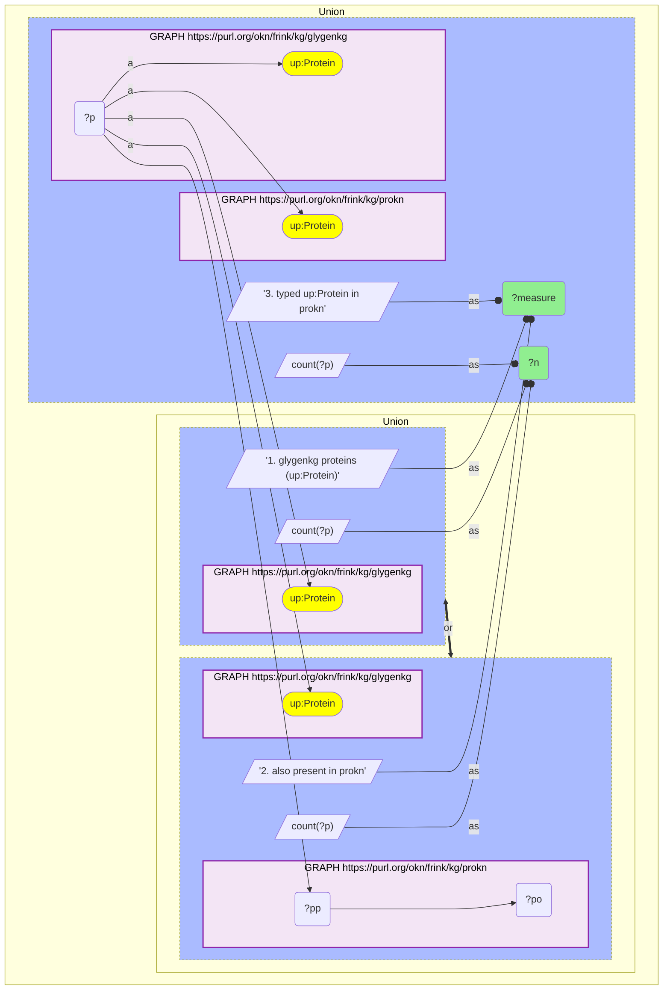
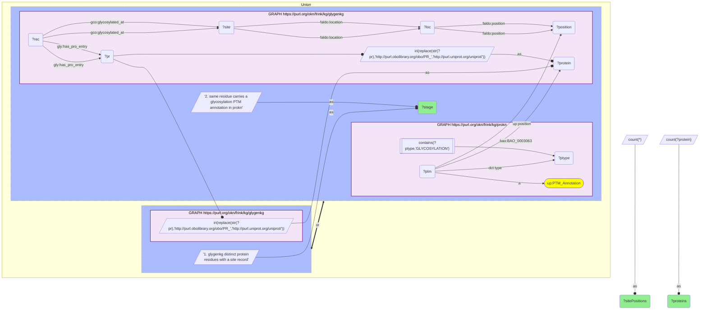
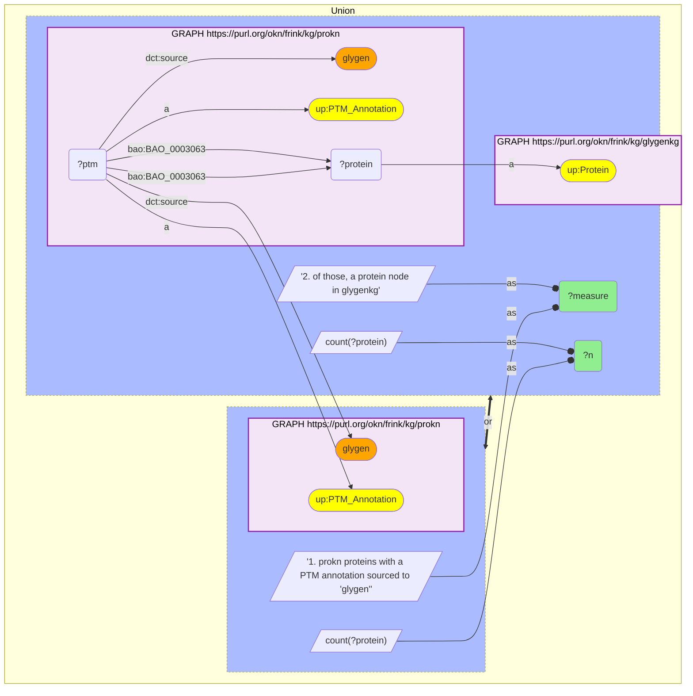

# P09-Q2: glygenkg×prokn — 8,077 of 8,112 proteins shared; 17,440 of 22,392 site positions match a ProKN glycosylation annotation

- **Date:** 2026-10-13
- **Model:** claude-opus-5-5
- **SPARQL endpoint:** https://apps.okn.us/federation/sparql
- **Generated by:** mcp-okn v0.1.0 (build d0aab94)
- **Contents:** 3 queries · 3 query diagrams

## Knowledge graphs used

- `glygenkg` — <https://purl.org/okn/frink/kg/glygenkg>
- `prokn` — <https://purl.org/okn/frink/kg/prokn>

## Conversation

👤 **User**

Same crosswalk, coverage angle: how many glygenkg proteins have a ProKN record, and how far does the agreement go at the level of individual glycosylated residues?

---

🧠 **Assistant**

**8,077 of glygenkg's 8,112 proteins (99.6%) have a ProKN record, and 17,440 of its 22,392 glycosylated residues (77.9%) carry a glycosylation annotation at the same residue in ProKN.**

| Level | Measure | Count |
|---|---|---|
| Protein | glygenkg proteins (`up:Protein`) | 8,112 |
| Protein | also present in prokn | 8,077 |
| Protein | typed `up:Protein` in prokn | 8,077 |
| Residue | glygenkg distinct protein residues with a site record | 22,392 on 5,024 proteins |
| Residue | same residue carries a glycosylation PTM annotation in prokn | 17,440 on 4,056 proteins |
| Reverse | prokn proteins with a PTM annotation sourced to `glygen` | 8,264 |
| Reverse | of those, a protein node in glygenkg | 4,048 |

**Protein level.** The join is nearly lossless as a lookup: both graphs mint the same `http://purl.uniprot.org/uniprot/{accession}` IRI, and only 35 glygenkg proteins have no ProKN record.

**Residue level.** Only 5,024 of the 8,112 glygenkg proteins have a site-level record at all; the rest are known to be glycosylated without a reported position. Of the 22,392 residues that are recorded, 17,440 agree with a ProKN glycosylation annotation on the same accession and residue number, and 4,952 (22.1%) do not.

**The two graphs are overlapping samples of GlyGen, not one a subset of the other.** ProKN attributes PTM annotations to GlyGen for 8,264 proteins, but only 4,048 of those are protein nodes in glygenkg. The federated glygenkg holds 8,112 human proteins, so it is a partial GlyGen release: ProKN carries GlyGen-sourced sites for 4,216 proteins that glygenkg does not contain, and glygenkg carries 4,952 residues that ProKN does not annotate. For site questions, query both and union them.

**Caveat on the residue match.** GlyGen positions are numbered on the isoform named by each record, and the match here is on the accession and residue number only. A residue that differs between isoforms would count as a mismatch, so 77.9% is a lower bound on true agreement.

## SPARQL queries executed

#### Query 1

_2026-10-14T02:21:54+00:00 · `glygenkg`, `prokn`_

```sparql
PREFIX up: <http://purl.uniprot.org/core/>
SELECT ?measure ?n WHERE {
  { SELECT ("1. glygenkg proteins (up:Protein)" AS ?measure) (COUNT(DISTINCT ?p) AS ?n) WHERE {
      GRAPH <https://purl.org/okn/frink/kg/glygenkg> { ?p a up:Protein } } }
  UNION
  { SELECT ("2. also present in prokn" AS ?measure) (COUNT(DISTINCT ?p) AS ?n) WHERE {
      GRAPH <https://purl.org/okn/frink/kg/glygenkg> { ?p a up:Protein }
      GRAPH <https://purl.org/okn/frink/kg/prokn> { ?p ?pp ?po } } }
  UNION
  { SELECT ("3. typed up:Protein in prokn" AS ?measure) (COUNT(DISTINCT ?p) AS ?n) WHERE {
      GRAPH <https://purl.org/okn/frink/kg/glygenkg> { ?p a up:Protein }
      GRAPH <https://purl.org/okn/frink/kg/prokn> { ?p a up:Protein } } }
} ORDER BY ?measure
```



_3 row(s)_

| measure | n |
| --- | --- |
| 1. glygenkg proteins (up:Protein) | 8112 |
| 2. also present in prokn | 8077 |
| 3. typed up:Protein in prokn | 8077 |

#### Query 2

_2026-10-14T02:21:55+00:00 · `glygenkg`, `prokn`_

```sparql
PREFIX gly: <https://sparql.glygen.org/ontology/>
PREFIX gco: <http://purl.jp/bio/12/glyco/conjugate#>
PREFIX glycan: <http://purl.jp/bio/12/glyco/glycan#>
PREFIX faldo: <http://www.biohackathon.org/resource/faldo#>
PREFIX up: <http://purl.uniprot.org/core/>
PREFIX skos: <http://www.w3.org/2004/02/skos/core#>
PREFIX rdfs: <http://www.w3.org/2000/01/rdf-schema#>
PREFIX dct: <http://purl.org/dc/terms/>
PREFIX bao: <http://www.bioassayontology.org/bao#>
# Site-level agreement: a glygenkg (protein, residue number) pair counts as matched
# when prokn holds a glycosylation PTM annotation on the same accession and residue.
SELECT ?stage (COUNT(*) AS ?sitePositions) (COUNT(DISTINCT ?protein) AS ?proteins) WHERE {
  {
    { SELECT DISTINCT ?protein ?position WHERE {
        GRAPH <https://purl.org/okn/frink/kg/glygenkg> {
          ?rec gly:has_pro_entry ?pr ; gco:glycosylated_at ?site .
          ?site faldo:location ?loc . ?loc faldo:position ?position .
          BIND(IRI(REPLACE(STR(?pr),'http://purl.obolibrary.org/obo/PR_','http://purl.uniprot.org/uniprot/')) AS ?protein)
        } } }
    BIND('1. glygenkg distinct protein residues with a site record' AS ?stage)
  } UNION {
    { SELECT DISTINCT ?protein ?position WHERE {
        { SELECT DISTINCT ?protein ?position WHERE {
          GRAPH <https://purl.org/okn/frink/kg/glygenkg> {
            ?rec gly:has_pro_entry ?pr ; gco:glycosylated_at ?site .
            ?site faldo:location ?loc . ?loc faldo:position ?position .
            BIND(IRI(REPLACE(STR(?pr),'http://purl.obolibrary.org/obo/PR_','http://purl.uniprot.org/uniprot/')) AS ?protein)
          } } }
        GRAPH <https://purl.org/okn/frink/kg/prokn> {
          ?ptm a up:PTM_Annotation ; bao:BAO_0003063 ?protein ; up:position ?position ; dct:type ?ptype .
          FILTER(CONTAINS(?ptype,'GLYCOSYLATION')) } } }
    BIND('2. same residue carries a glycosylation PTM annotation in prokn' AS ?stage)
  }
} GROUP BY ?stage ORDER BY ?stage
```



_2 row(s)_

| stage | sitePositions | proteins |
| --- | --- | --- |
| 1. glygenkg distinct protein residues with a site record | 22392 | 5024 |
| 2. same residue carries a glycosylation PTM annotation in prokn | 17440 | 4056 |

#### Query 3

_2026-10-14T02:21:55+00:00 · `prokn`, `glygenkg`_

```sparql
PREFIX up: <http://purl.uniprot.org/core/>
PREFIX dct: <http://purl.org/dc/terms/>
PREFIX bao: <http://www.bioassayontology.org/bao#>
# The reverse direction: proteins for which prokn cites GlyGen as a PTM source.
SELECT ?measure ?n WHERE {
  { SELECT ("1. prokn proteins with a PTM annotation sourced to 'glygen'" AS ?measure) (COUNT(DISTINCT ?protein) AS ?n) WHERE {
      GRAPH <https://purl.org/okn/frink/kg/prokn> { ?ptm a up:PTM_Annotation ; bao:BAO_0003063 ?protein ; dct:source "glygen" } } }
  UNION
  { SELECT ("2. of those, a protein node in glygenkg" AS ?measure) (COUNT(DISTINCT ?protein) AS ?n) WHERE {
      GRAPH <https://purl.org/okn/frink/kg/prokn> { ?ptm a up:PTM_Annotation ; bao:BAO_0003063 ?protein ; dct:source "glygen" }
      GRAPH <https://purl.org/okn/frink/kg/glygenkg> { ?protein a up:Protein } } }
} ORDER BY ?measure
```



_2 row(s)_

| measure | n |
| --- | --- |
| 1. prokn proteins with a PTM annotation sourced to 'glygen' | 8264 |
| 2. of those, a protein node in glygenkg | 4048 |
