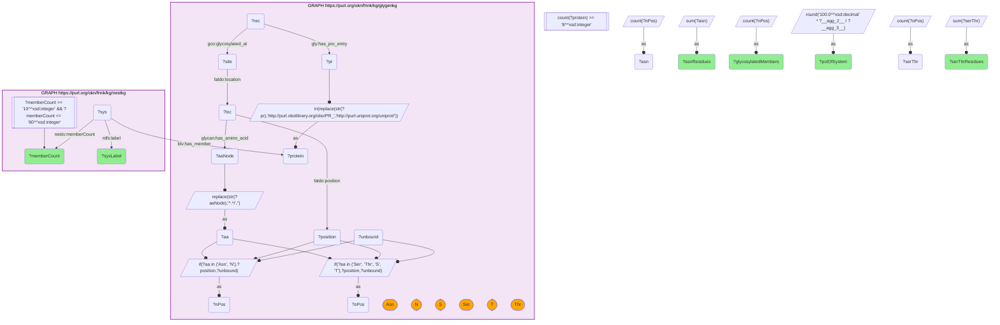

# P10-Q1: glygenkg×nestkg — which NeST protein systems are most glycosylated

- **Date:** 2026-10-13
- **Model:** claude-opus-5-5
- **SPARQL endpoint:** https://apps.okn.us/federation/sparql
- **Generated by:** mcp-okn v0.1.0 (build d0aab94)
- **Contents:** 1 query · 1 query diagram

## Knowledge graphs used

- `glygenkg` — <https://purl.org/okn/frink/kg/glygenkg>
- `nestkg` — <https://purl.org/okn/frink/kg/nestkg>

## Conversation

👤 **User**

Which NeST cancer protein systems (10 to 60 members) have the largest share of members with a glycosylation site record in GlyGen, and how many distinct glycosylated residues do those members carry?

---

🧠 **Assistant**

**The most glycosylated NeST systems fall into two groups that the residue type separates cleanly: assemblies glycosylated on both asparagine and serine/threonine, which by name are extracellular, and complexes glycosylated almost only on serine/threonine, which by name are nuclear.**

| NeST system | Members | With a GlyGen site | % of system | Asn residues | Ser/Thr residues |
|---|---|---|---|---|---|
| Basement membrane glycoproteins | 11 | 10 | 91 | 40 | 113 |
| Prp19 complex | 11 | 10 | 91 | 0 | 34 |
| Fibrinolysis | 12 | 10 | 83 | 41 | 48 |
| Fibrillar collagens | 12 | 10 | 83 | 29 | 62 |
| Rho GTPases acitvating ROCKs | 11 | 9 | 82 | 9 | 20 |
| ECM constituent | 13 | 10 | 77 | 32 | 116 |
| Complement activation alternative pathway | 16 | 12 | 75 | 51 | 30 |
| NEST:178 | 12 | 9 | 75 | 0 | 38 |
| PML body | 22 | 16 | 73 | 2 | 129 |
| Collagen related ECM components | 55 | 38 | 69 | 191 | 206 |
| CBP and p300 binds NF-kB complex | 13 | 9 | 69 | 1 | 78 |
| EGF/beta-catenin signaling | 17 | 11 | 65 | 27 | 30 |
| BAF (SWI/SNF) complex | 20 | 13 | 65 | 1 | 90 |
| U12-type spliceosomal complex | 20 | 13 | 65 | 0 | 44 |
| Spliceosomal tri-snRNP subcomplex | 16 | 10 | 63 | 0 | 41 |

(System names are NeST's own labels, reproduced as stored, including the spelling "acitvating".)

**Reading the split.** Asparagine residues are N-linked sites; serine and threonine residues are O-linked sites. The extracellular systems (basement membrane glycoproteins, fibrinolysis, fibrillar collagens, complement, the collagen-related ECM group with 191 Asn residues) carry both kinds. Seven systems have 0 to 2 asparagine residues and 34 to 129 serine/threonine residues: the Prp19 complex, the two spliceosomal complexes, the PML body, the BAF complex, the CBP/p300 complex and the unnamed NEST:178. The six that are named are nuclear assemblies. glygenkg's O-linked records include intracellular O-GlcNAc modification, which is the likely source of that second group, although the query does not test the glycan type directly.

**Why it matters for using the join.** "Glycosylated" in GlyGen does not mean "secreted or membrane protein". A ranking by share of glycosylated members puts a spliceosome next to a basement membrane. Split by residue, or by the glycan label, before interpreting a glycosylation-rich system.

**Scope.** Systems of 10 to 60 members with at least 8 glycosylated members; a member counts when GlyGen has at least one site-level record for it. NeST publishes membership only for systems under its size cutoff, so proteins in larger systems are not seen here.

## SPARQL queries executed

#### Query 1

_2026-10-14T02:21:56+00:00 · `glygenkg`, `nestkg`_

```sparql
PREFIX gly: <https://sparql.glygen.org/ontology/>
PREFIX gco: <http://purl.jp/bio/12/glyco/conjugate#>
PREFIX glycan: <http://purl.jp/bio/12/glyco/glycan#>
PREFIX faldo: <http://www.biohackathon.org/resource/faldo#>
PREFIX up: <http://purl.uniprot.org/core/>
PREFIX skos: <http://www.w3.org/2004/02/skos/core#>
PREFIX rdfs: <http://www.w3.org/2000/01/rdf-schema#>
PREFIX blv: <https://w3id.org/biolink/vocab/>
PREFIX nestv: <https://www.ndexbio.org/vocab/>
# Per protein: distinct glycosylated residues, split by the modified amino acid
# (Asn = N-linked; Ser/Thr = O-linked, which includes intracellular O-GlcNAc).
SELECT ?sysLabel ?memberCount (COUNT(DISTINCT ?protein) AS ?glycosylatedMembers)
       (ROUND(100.0*COUNT(DISTINCT ?protein)/?memberCount) AS ?pctOfSystem)
       (SUM(?asn) AS ?asnResidues) (SUM(?serThr) AS ?serThrResidues) WHERE {
  { SELECT ?protein (COUNT(DISTINCT ?nPos) AS ?asn) (COUNT(DISTINCT ?oPos) AS ?serThr) WHERE {
      GRAPH <https://purl.org/okn/frink/kg/glygenkg> {
        ?rec gly:has_pro_entry ?pr ; gco:glycosylated_at ?site .
        ?site faldo:location ?loc . ?loc faldo:position ?position ; glycan:has_amino_acid ?aaNode .
        BIND(REPLACE(STR(?aaNode),'^.*/','') AS ?aa)
        BIND(IF(?aa IN ('Asn','N'), ?position, ?unbound) AS ?nPos)
        BIND(IF(?aa IN ('Ser','Thr','S','T'), ?position, ?unbound) AS ?oPos)
        BIND(IRI(REPLACE(STR(?pr),'http://purl.obolibrary.org/obo/PR_','http://purl.uniprot.org/uniprot/')) AS ?protein)
      } } GROUP BY ?protein }
  GRAPH <https://purl.org/okn/frink/kg/nestkg> {
    ?sys blv:has_member ?protein ; rdfs:label ?sysLabel ; nestv:memberCount ?memberCount .
    FILTER(?memberCount >= 10 && ?memberCount <= 60)
  }
} GROUP BY ?sysLabel ?memberCount HAVING(COUNT(DISTINCT ?protein) >= 8)
ORDER BY DESC(?pctOfSystem) DESC(?asnResidues) LIMIT 15
```



_15 row(s)_

| sysLabel | memberCount | glycosylatedMembers | pctOfSystem | asnResidues | serThrResidues |
| --- | --- | --- | --- | --- | --- |
| Basement membrane glycoproteins | 11 | 10 | 91.0 | 40 | 113 |
| Prp19 complex | 11 | 10 | 91.0 | 0 | 34 |
| Fibrinolysis | 12 | 10 | 83.0 | 41 | 48 |
| Fibrillar collagens | 12 | 10 | 83.0 | 29 | 62 |
| Rho GTPases acitvating ROCKs | 11 | 9 | 82.0 | 9 | 20 |
| ECM constituent | 13 | 10 | 77.0 | 32 | 116 |
| Complement activation alternative pathway | 16 | 12 | 75.0 | 51 | 30 |
| NEST:178 | 12 | 9 | 75.0 | 0 | 38 |
| PML body | 22 | 16 | 73.0 | 2 | 129 |
| Collagen related ECM components | 55 | 38 | 69.0 | 191 | 206 |
| CBP and p300 binds NF-kB complex | 13 | 9 | 69.0 | 1 | 78 |
| EGF/beta-catenin signaling | 17 | 11 | 65.0 | 27 | 30 |
| BAF (SWI/SNF) complex | 20 | 13 | 65.0 | 1 | 90 |
| U12-type spliceosomal complex | 20 | 13 | 65.0 | 0 | 44 |
| Spliceosomal tri-snRNP subcomplex | 16 | 10 | 63.0 | 0 | 41 |
