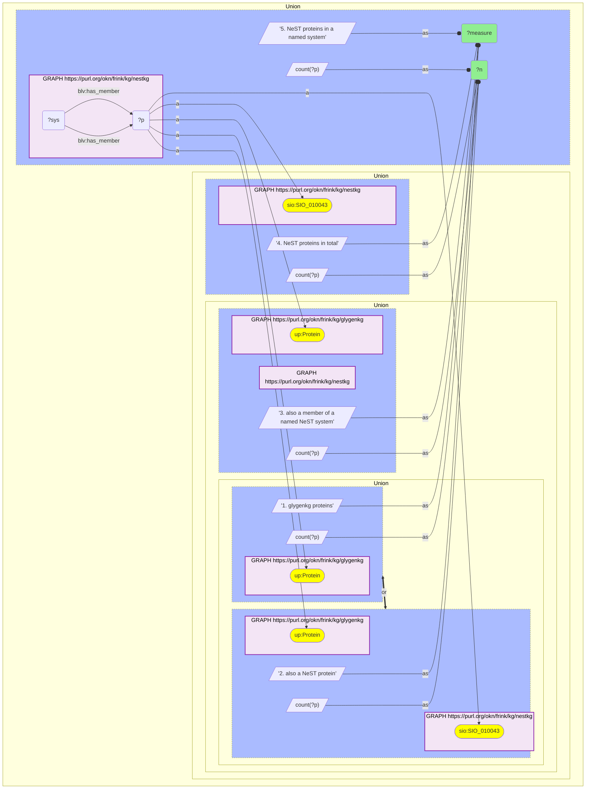

# P10-Q2: glygenkg×nestkg — 7,576 of 8,112 GlyGen proteins are NeST proteins; 2,842 sit in a named system

- **Date:** 2026-10-13
- **Model:** claude-opus-5-5
- **SPARQL endpoint:** https://apps.okn.us/federation/sparql
- **Generated by:** mcp-okn v0.1.0 (build d0aab94)
- **Contents:** 1 query · 1 query diagram

## Knowledge graphs used

- `glygenkg` — <https://purl.org/okn/frink/kg/glygenkg>
- `nestkg` — <https://purl.org/okn/frink/kg/nestkg>

## Conversation

👤 **User**

Same crosswalk, coverage angle: how many glygenkg proteins are NeST proteins, and how many of them belong to a named NeST system?

---

🧠 **Assistant**

**7,576 of glygenkg's 8,112 proteins (93.4%) are NeST proteins, but only 2,842 (35.0%) are members of a named NeST system.**

| Measure | Count |
|---|---|
| glygenkg proteins | 8,112 |
| also a NeST protein | 7,576 (93.4%) |
| also a member of a named NeST system | 2,842 (35.0%) |
| NeST proteins in total | 16,767 |
| NeST proteins in a named system | 5,334 |

**Two numbers for two questions.** As a lookup the join is close to complete: both graphs use the same `http://purl.uniprot.org/uniprot/{accession}` IRI, and 536 glygenkg proteins have no NeST entry. The 2,842 figure is the one that governs a systems question, such as "which assemblies are most glycosylated", because system membership is published for only 5,334 of NeST's 16,767 proteins.

**From the NeST side.** GlyGen proteins are 45.2% of all NeST proteins (7,576 of 16,767) and 53.3% of the proteins in a named system (2,842 of 5,334). More than half of the proteins NeST places in a named cancer protein system have glycosylation data in this GlyGen release.

**Always state the denominator.** 93.4% is taken over glygenkg, 45.2% over NeST; the same 7,576 proteins support both.

## SPARQL queries executed

#### Query 1

_2026-10-14T02:21:56+00:00 · `glygenkg`, `nestkg`_

```sparql
PREFIX up: <http://purl.uniprot.org/core/>
PREFIX sio: <http://semanticscience.org/resource/>
PREFIX blv: <https://w3id.org/biolink/vocab/>
SELECT ?measure ?n WHERE {
  { SELECT ("1. glygenkg proteins" AS ?measure) (COUNT(DISTINCT ?p) AS ?n) WHERE { GRAPH <https://purl.org/okn/frink/kg/glygenkg> { ?p a up:Protein } } }
  UNION
  { SELECT ("2. also a NeST protein" AS ?measure) (COUNT(DISTINCT ?p) AS ?n) WHERE { GRAPH <https://purl.org/okn/frink/kg/glygenkg> { ?p a up:Protein } GRAPH <https://purl.org/okn/frink/kg/nestkg> { ?p a sio:SIO_010043 } } }
  UNION
  { SELECT ("3. also a member of a named NeST system" AS ?measure) (COUNT(DISTINCT ?p) AS ?n) WHERE { GRAPH <https://purl.org/okn/frink/kg/glygenkg> { ?p a up:Protein } GRAPH <https://purl.org/okn/frink/kg/nestkg> { ?sys blv:has_member ?p } } }
  UNION
  { SELECT ("4. NeST proteins in total" AS ?measure) (COUNT(DISTINCT ?p) AS ?n) WHERE { GRAPH <https://purl.org/okn/frink/kg/nestkg> { ?p a sio:SIO_010043 } } }
  UNION
  { SELECT ("5. NeST proteins in a named system" AS ?measure) (COUNT(DISTINCT ?p) AS ?n) WHERE { GRAPH <https://purl.org/okn/frink/kg/nestkg> { ?sys blv:has_member ?p } } }
} ORDER BY ?measure
```



_5 row(s)_

| measure | n |
| --- | --- |
| 1. glygenkg proteins | 8112 |
| 2. also a NeST protein | 7576 |
| 3. also a member of a named NeST system | 2842 |
| 4. NeST proteins in total | 16767 |
| 5. NeST proteins in a named system | 5334 |
