# P11-Q1: glygenkg×ncipidkg — the best-evidenced NCI-PID interactions in which both partners are glycosylated

- **Date:** 2026-10-13
- **Model:** claude-opus-5-5
- **SPARQL endpoint:** https://apps.okn.us/federation/sparql
- **Generated by:** mcp-okn v0.1.0 (build d0aab94)
- **Contents:** 1 query · 1 query diagram

## Knowledge graphs used

- `ncipidkg` — <https://purl.org/okn/frink/kg/ncipidkg>
- `ubergraph` — <https://purl.org/okn/frink/kg/ubergraph>
- `glygenkg` — <https://purl.org/okn/frink/kg/glygenkg>

## Conversation

👤 **User**

Which well-evidenced NCI-PID signalling interactions (evidence count of 20 or more) connect two proteins that both carry at least five glycosylated residues in GlyGen?

---

🧠 **Assistant**

**Ten NCI-PID statements qualify, and they describe four protein pairs: INSR with IRS1, NOTCH2 with NOTCH1, JUNB with JUND, and HSPA8 with CDKN1B.**

| Protein A | Sites A | Relation | Protein B | Sites B | Max evidence |
|---|---|---|---|---|---|
| INSR | 21 | directly regulates | IRS1 | 6 | 317 |
| IRS1 | 6 | molecularly interacts with | INSR | 21 | 250 |
| IRS1 | 6 | directly regulates | INSR | 21 | 82 |
| INSR | 21 | directly positively regulates | IRS1 | 6 | 53 |
| NOTCH2 | 12 | molecularly interacts with | NOTCH1 | 19 | 52 |
| IRS1 | 6 | directly negatively regulates | INSR | 21 | 43 |
| IRS1 | 6 | directly positively regulates | INSR | 21 | 42 |
| JUNB | 22 | molecularly interacts with | JUND | 5 | 36 |
| INSR | 21 | directly negatively regulates | IRS1 | 6 | 24 |
| HSPA8 | 6 | molecularly interacts with | CDKN1B | 5 | 22 |

"Sites" is the number of distinct glycosylated residues GlyGen records for the protein. Relation names are the Relation Ontology labels of ncipidkg's predicates, read from ubergraph.

**What the join shows.** The best-evidenced case is insulin signalling: the insulin receptor (21 glycosylated residues) and its substrate IRS1 (6) are linked by seven statements in both directions, the strongest with an evidence count of 317. The two Notch receptors, 19 and 12 residues, are the only pair where both partners are heavily glycosylated cell-surface receptors.

**The other two pairs are a reminder of what GlyGen counts.** JUNB, JUND, HSPA8 and CDKN1B are intracellular proteins; their GlyGen sites are serine/threonine modifications of the O-GlcNAc kind, not secretory-pathway glycans. A threshold on site count alone mixes the two.

**Why the list is short.** The match uses ncipidkg's interaction participants directly, so both partners must be participant nodes whose own UniProt IRI is a glygenkg protein with at least five recorded residues. Many NCI-PID proteins reach glygenkg only through ncipidkg's `owl:sameAs` alias accessions (see the coverage question), and those are not followed here. Ten statements is a lower bound.

## SPARQL queries executed

#### Query 1

_2026-10-14T02:21:58+00:00 · `ncipidkg`, `ubergraph`, `glygenkg`_

```sparql
PREFIX gly: <https://sparql.glygen.org/ontology/>
PREFIX gco: <http://purl.jp/bio/12/glyco/conjugate#>
PREFIX glycan: <http://purl.jp/bio/12/glyco/glycan#>
PREFIX faldo: <http://www.biohackathon.org/resource/faldo#>
PREFIX up: <http://purl.uniprot.org/core/>
PREFIX skos: <http://www.w3.org/2004/02/skos/core#>
PREFIX rdfs: <http://www.w3.org/2000/01/rdf-schema#>
PREFIX rdf: <http://www.w3.org/1999/02/22-rdf-syntax-ns#>
PREFIX ncipid: <https://www.ndexbio.org/vocab/ncipid/>
SELECT ?symbolA ?sitesA ?relation ?symbolB ?sitesB (MAX(?evidence) AS ?maxEvidence) WHERE {
  GRAPH <https://purl.org/okn/frink/kg/ncipidkg> {
    ?st rdf:subject ?a ; rdf:predicate ?rel ; rdf:object ?b ; ncipid:evidenceCount ?evidence .
    FILTER(?evidence >= 20)
    ?a rdfs:label ?symbolA . ?b rdfs:label ?symbolB .
  }
  GRAPH <https://purl.org/okn/frink/kg/ubergraph> { ?rel rdfs:label ?relation }
  { SELECT ?a (COUNT(DISTINCT ?position) AS ?sitesA) (COUNT(DISTINCT ?glycA) AS ?glycansA) WHERE {
      GRAPH <https://purl.org/okn/frink/kg/glygenkg> {
        ?rec gly:has_pro_entry ?pr ; gco:glycosylated_at ?site .
        ?site faldo:location ?loc . ?loc faldo:position ?position .
        OPTIONAL { ?site gco:has_saccharide ?glycA }
        BIND(IRI(REPLACE(STR(?pr),'http://purl.obolibrary.org/obo/PR_','http://purl.uniprot.org/uniprot/')) AS ?a)
      } } GROUP BY ?a  }
  { SELECT ?b (COUNT(DISTINCT ?position) AS ?sitesB) (COUNT(DISTINCT ?glycB) AS ?glycansB) WHERE {
      GRAPH <https://purl.org/okn/frink/kg/glygenkg> {
        ?rec gly:has_pro_entry ?pr ; gco:glycosylated_at ?site .
        ?site faldo:location ?loc . ?loc faldo:position ?position .
        OPTIONAL { ?site gco:has_saccharide ?glycB }
        BIND(IRI(REPLACE(STR(?pr),'http://purl.obolibrary.org/obo/PR_','http://purl.uniprot.org/uniprot/')) AS ?b)
      } } GROUP BY ?b  }
  FILTER(?sitesA >= 5 && ?sitesB >= 5 && ?a != ?b)
} GROUP BY ?symbolA ?sitesA ?relation ?symbolB ?sitesB ORDER BY DESC(?maxEvidence) LIMIT 20
```

```mermaid
graph TD
classDef projected fill:lightgreen;
classDef literal fill:orange;
classDef iri fill:yellow;
  q0v13("?a")
  q0v14("?b")
  q0v15("?evidence")
  q0v24("?glycA")
  q0v26("?glycB")
  q0v18("?glycansA")
  q0v25("?glycansB")
  q0v22("?loc")
  q0v1("?maxEvidence"):::projected 
  q0v23("?position")
  q0v19("?pr")
  q0v20("?rec")
  q0v17("?rel")
  q0v4("?relation"):::projected 
  q0v21("?site")
  q0v5("?sitesA"):::projected 
  q0v2("?sitesB"):::projected 
  q0v16("?st")
  q0v6("?symbolA"):::projected 
  q0v3("?symbolB"):::projected 
  q0f0[["?sitesA >= '5^^xsd:integer' && ?sitesB >= '5^^xsd:integer' && ?a != ?b"]]
  q0f0 --> q0v5
  q0f0 --> q0v2
  q0f0 --> q0v13
  q0f0 --> q0v14
  subgraph q0graph0["GRAPH https://purl.org/okn/frink/kg/ncipidkg"]
    style q0graph0 fill:#f3e5f5,stroke:#8e24aa,stroke-width:2px,color:#000;
    q0graph0f1[["?evidence >= '20^^xsd:integer'"]]
    q0graph0f1 --> q0v15
    q0v16 --"rdf:object"--> q0v14
    q0v16 --"rdf:subject"--> q0v13
    q0v16 --"rdf:predicate"--> q0v17
    q0v16 --"ncipid:evidenceCount"--> q0v15
    q0v13 --"rdfs:label"--> q0v6
    q0v14 --"rdfs:label"--> q0v3
  end
  subgraph q0graph1["GRAPH https://purl.org/okn/frink/kg/ubergraph"]
    style q0graph1 fill:#f3e5f5,stroke:#8e24aa,stroke-width:2px,color:#000;
    q0v17 --"rdfs:label"--> q0v4
  end
  subgraph q0graph2["GRAPH https://purl.org/okn/frink/kg/glygenkg"]
    style q0graph2 fill:#f3e5f5,stroke:#8e24aa,stroke-width:2px,color:#000;
    q0v20 --"gco:glycosylated_at"--> q0v21
    q0v21 --"faldo:location"--> q0v22
    q0v22 --"faldo:position"--> q0v23
    q0v20 --"gly:has_pro_entry"--> q0v19
    subgraph q0optionalgraph20["(optional)"]
    style q0optionalgraph20 fill:#bbf,stroke-dasharray: 5 5,color:#000;
      q0v21 -."gco:has_saccharide".-> q0v24
    end
    q0graph2bind0[/"iri(replace(str(?pr),'http://purl.obolibrary.org/obo/PR_','http://purl.uniprot.org/uniprot/'))"/]
    q0v19 --o q0graph2bind0
    q0graph2bind0 --as--o q0v13
  end
  q0bind1[/"count(?position)"/]
  q0bind1 --as--o q0v5
  subgraph q0graph3["GRAPH https://purl.org/okn/frink/kg/glygenkg"]
    style q0graph3 fill:#f3e5f5,stroke:#8e24aa,stroke-width:2px,color:#000;
    q0v20 --"gco:glycosylated_at"--> q0v21
    q0v21 --"faldo:location"--> q0v22
    q0v22 --"faldo:position"--> q0v23
    q0v20 --"gly:has_pro_entry"--> q0v19
    subgraph q0optionalgraph31["(optional)"]
    style q0optionalgraph31 fill:#bbf,stroke-dasharray: 5 5,color:#000;
      q0v21 -."gco:has_saccharide".-> q0v26
    end
    q0graph3bind2[/"iri(replace(str(?pr),'http://purl.obolibrary.org/obo/PR_','http://purl.uniprot.org/uniprot/'))"/]
    q0v19 --o q0graph3bind2
    q0graph3bind2 --as--o q0v14
  end
  q0bind3[/"count(?position)"/]
  q0bind3 --as--o q0v2
  q0bind4[/"count(?position)"/]
  q0bind4 --as--o q0v1
```



_10 row(s)_

| symbolA | sitesA | relation | symbolB | sitesB | maxEvidence |
| --- | --- | --- | --- | --- | --- |
| INSR | 21 | directly regulates | IRS1 | 6 | 317 |
| IRS1 | 6 | molecularly interacts with | INSR | 21 | 250 |
| IRS1 | 6 | directly regulates | INSR | 21 | 82 |
| INSR | 21 | directly positively regulates | IRS1 | 6 | 53 |
| NOTCH2 | 12 | molecularly interacts with | NOTCH1 | 19 | 52 |
| IRS1 | 6 | directly negatively regulates | INSR | 21 | 43 |
| IRS1 | 6 | directly positively regulates | INSR | 21 | 42 |
| JUNB | 22 | molecularly interacts with | JUND | 5 | 36 |
| INSR | 21 | directly negatively regulates | IRS1 | 6 | 24 |
| HSPA8 | 6 | molecularly interacts with | CDKN1B | 5 | 22 |
