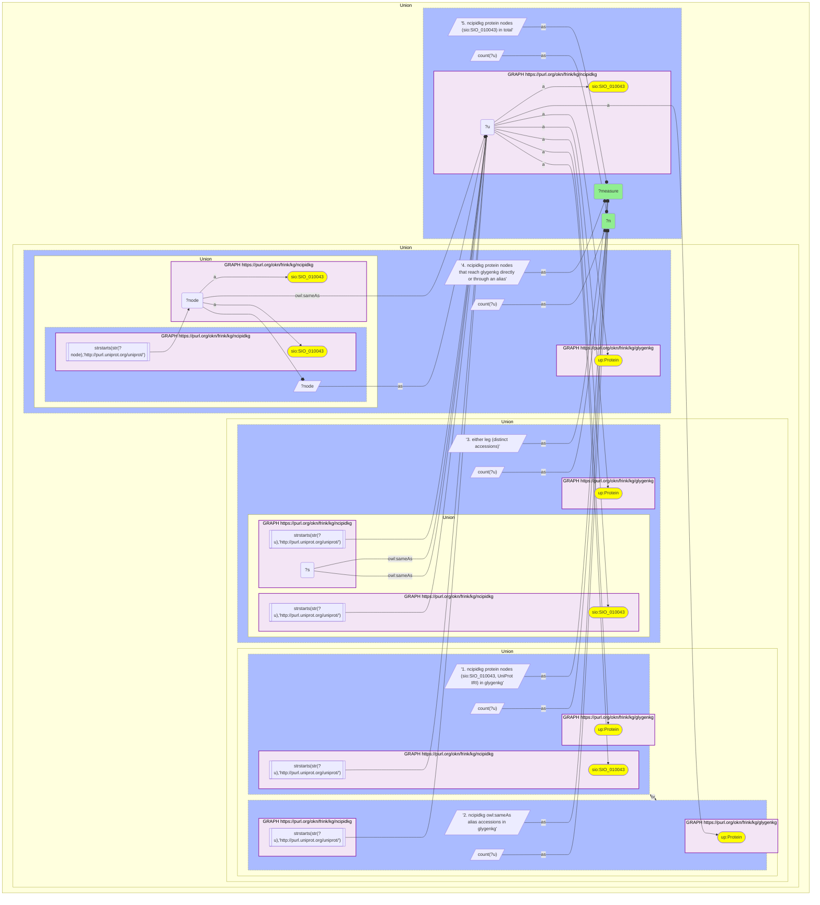

# P11-Q2: glygenkg×ncipidkg — 1,348 shared UniProt accessions, 299 of them NCI-PID's own protein nodes

- **Date:** 2026-10-13
- **Model:** claude-opus-5-5
- **SPARQL endpoint:** https://apps.okn.us/federation/sparql
- **Generated by:** mcp-okn v0.1.0 (build d0aab94)
- **Contents:** 1 query · 1 query diagram

## Knowledge graphs used

- `ncipidkg` — <https://purl.org/okn/frink/kg/ncipidkg>
- `glygenkg` — <https://purl.org/okn/frink/kg/glygenkg>

## Conversation

👤 **User**

Same crosswalk, coverage angle: how many UniProt accessions do glygenkg and ncipidkg share, and how does that split between ncipidkg's own protein nodes and its owl:sameAs alias accessions?

---

🧠 **Assistant**

**The two graphs share 1,348 UniProt accessions. Only 299 of those are ncipidkg's own protein nodes; 1,062 are alias accessions on `owl:sameAs`.**

| Measure | Count |
|---|---|
| ncipidkg protein nodes (`sio:SIO_010043`, UniProt IRI) in glygenkg | 299 |
| ncipidkg `owl:sameAs` alias accessions in glygenkg | 1,062 |
| either leg, distinct accessions | 1,348 |
| ncipidkg protein nodes that reach glygenkg directly or through an alias | 1,362 |
| ncipidkg protein nodes in total | 2,536 |

**Two legs that barely overlap.** 299 + 1,062 = 1,361, and the union is 1,348, so only 13 accessions are reached by both legs. Using the node-IRI leg alone would report 299 and miss 78% of the shared accessions.

**Which number answers which question.**

- *How many identifiers do the graphs share?* 1,348. This is what the crosswalk's verified count measures.
- *How many NCI-PID proteins have GlyGen data?* 1,362 of 2,536 protein nodes (53.7%). Here the ncipidkg node is the entity and the alias is only the route: a node counts when its own IRI, or one of its `owl:sameAs` aliases, is a glygenkg protein.

**Practical rule.** For a question about NCI-PID interaction participants, keep the participant node as the thing you report and use the alias as a join key (`?protein owl:sameAs? ?key`). Reporting the alias accession instead substitutes a secondary accession for the protein and can list one protein several times.

## SPARQL queries executed

#### Query 1

_2026-10-14T02:21:58+00:00 · `ncipidkg`, `glygenkg`_

```sparql
PREFIX up: <http://purl.uniprot.org/core/>
PREFIX sio: <http://semanticscience.org/resource/>
PREFIX owl: <http://www.w3.org/2002/07/owl#>
SELECT ?measure ?n WHERE {
  { SELECT ("1. ncipidkg protein nodes (sio:SIO_010043, UniProt IRI) in glygenkg" AS ?measure) (COUNT(DISTINCT ?u) AS ?n) WHERE {
      GRAPH <https://purl.org/okn/frink/kg/ncipidkg> { ?u a sio:SIO_010043 . FILTER(STRSTARTS(STR(?u),'http://purl.uniprot.org/uniprot/')) }
      GRAPH <https://purl.org/okn/frink/kg/glygenkg> { ?u a up:Protein } } }
  UNION
  { SELECT ("2. ncipidkg owl:sameAs alias accessions in glygenkg" AS ?measure) (COUNT(DISTINCT ?u) AS ?n) WHERE {
      GRAPH <https://purl.org/okn/frink/kg/ncipidkg> { ?s owl:sameAs ?u . FILTER(STRSTARTS(STR(?u),'http://purl.uniprot.org/uniprot/')) }
      GRAPH <https://purl.org/okn/frink/kg/glygenkg> { ?u a up:Protein } } }
  UNION
  { SELECT ("3. either leg (distinct accessions)" AS ?measure) (COUNT(DISTINCT ?u) AS ?n) WHERE {
      { GRAPH <https://purl.org/okn/frink/kg/ncipidkg> { ?u a sio:SIO_010043 . FILTER(STRSTARTS(STR(?u),'http://purl.uniprot.org/uniprot/')) } }
      UNION
      { GRAPH <https://purl.org/okn/frink/kg/ncipidkg> { ?s owl:sameAs ?u . FILTER(STRSTARTS(STR(?u),'http://purl.uniprot.org/uniprot/')) } }
      GRAPH <https://purl.org/okn/frink/kg/glygenkg> { ?u a up:Protein } } }
  UNION
  { SELECT ("4. ncipidkg protein nodes that reach glygenkg directly or through an alias" AS ?measure) (COUNT(DISTINCT ?node) AS ?n) WHERE {
      { GRAPH <https://purl.org/okn/frink/kg/ncipidkg> { ?node a sio:SIO_010043 . FILTER(STRSTARTS(STR(?node),'http://purl.uniprot.org/uniprot/')) } BIND(?node AS ?u) }
      UNION
      { GRAPH <https://purl.org/okn/frink/kg/ncipidkg> { ?node owl:sameAs ?u . ?node a sio:SIO_010043 } }
      GRAPH <https://purl.org/okn/frink/kg/glygenkg> { ?u a up:Protein } } }
  UNION
  { SELECT ("5. ncipidkg protein nodes (sio:SIO_010043) in total" AS ?measure) (COUNT(DISTINCT ?u) AS ?n) WHERE {
      GRAPH <https://purl.org/okn/frink/kg/ncipidkg> { ?u a sio:SIO_010043 } } }
} ORDER BY ?measure
```



_5 row(s)_

| measure | n |
| --- | --- |
| 1. ncipidkg protein nodes (sio:SIO_010043, UniProt IRI) in glygenkg | 299 |
| 2. ncipidkg owl:sameAs alias accessions in glygenkg | 1062 |
| 3. either leg (distinct accessions) | 1348 |
| 4. ncipidkg protein nodes that reach glygenkg directly or through an alias | 1362 |
| 5. ncipidkg protein nodes (sio:SIO_010043) in total | 2536 |
