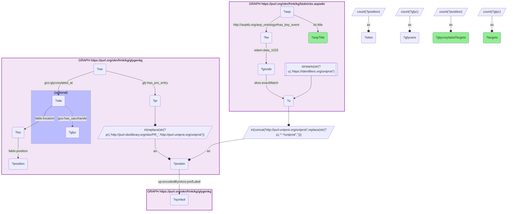

# P12-Q1: glygenkg×biobricks-aopwiki — the adverse outcome pathways whose key-event targets are most often glycoproteins

- **Date:** 2026-10-13
- **Model:** claude-opus-5-5
- **SPARQL endpoint:** https://apps.okn.us/federation/sparql
- **Generated by:** mcp-okn v0.1.0 (build d0aab94)
- **Contents:** 1 query · 1 query diagram

## Knowledge graphs used

- `biobricks-aopwiki` — <https://purl.org/okn/frink/kg/biobricks-aopwiki>
- `glygenkg` — <https://purl.org/okn/frink/kg/glygenkg>

## Conversation

👤 **User**

Which adverse outcome pathways in AOP-Wiki have the most key-event target proteins that carry a glycosylation site record in GlyGen, and which targets are they?

---

🧠 **Assistant**

**The AOPs with the most glycosylated key-event targets are infection and inflammation pathways: a TLR9 pathway leads with 45, and five of the top ten are ACE2-binding pathways, four of them naming SARS-CoV-2.**

| Adverse outcome pathway | Glycosylated targets | Examples from the returned list |
|---|---|---|
| Dysregulated prolonged Toll Like Receptor 9 (TLR9) activation leading to Multi Organ Failure involving Acute Respiratory Distress Syndrome (ARDS) | 45 | IL6, TLR2, TLR4, CSF2, ALB, IL5, TNFRSF10A, ITGAM |
| Binding of SARS-CoV-2 to ACE2 receptor leading to acute respiratory distress associated mortality | 39 | AGT, TLR4, NRP1, NRP2, TLR2, IL6, CSF2, CTSL |
| Binding of SARS-CoV-2 to ACE2 leads to hyperinflammation (via cell death) | 34 | NRP1, NRP2, TNFRSF10A, CSF2, AGT, TLR4, TNFRSF1A, IL6 |
| Interference with thyroid serum binding protein transthyretin and subsequent adverse human neurodevelopmental toxicity | 29 | CP, ALB, TTR, NFASC, SLC3A2, UGT1A1 |
| Binding to ACE2 leading to thrombosis and disseminated intravascular coagulation | 27 | TF, NRP1, SERPING1, PLG, AGT, THBD |
| DNA damage and mutations leading to Metastatic Breast Cancer | 26 | AGT, EGF, IL6, FGFR1, HGF, EPHB2 |
| Binding of electrophilic chemicals to SH(thiol)-group of proteins and /or to seleno-proteins involved in protection against oxidative stress during brain development leads to impairment of learning and memory | 23 | TLR4, TLR2, IL6, BDNF, FASLG, GDNF, LRP1 |
| Binding of SARS-CoV-2 to ACE2 leads to viral infection proliferation | 22 | AGT, AMH, NRP1, NRP2, CTSL |
| Binding of SARS-CoV-2 to ACE2 in enterocytes leads to intestinal barrier disruption | 21 | AGT, NRP1, NRP2, CTSL, ACE2 |
| Stimulation of TLR7/8 in dendric cells leading to Psoriatic skin disease | 21 | IFNG, CSF2, FCGR3B, FCGR3A, CD83, CD40LG, TLR7, CD163 |

AOP titles are AOP-Wiki's own, reproduced as stored. The full target list for each row is in the result table below.

**What the join adds.** AOP-Wiki names the proteins a key event acts on; GlyGen says which of them are glycosylated. The pathways that rise to the top are ones built on cell-surface receptors, cytokines and plasma proteins (Toll-like receptors, neuropilins, ACE2, interleukins, coagulation and complement factors), the classes of protein that pass through the secretory pathway.

**Read the target lists with one caution.** A target counts when GlyGen has any site-level record for it, and GlyGen's records include serine/threonine modification of intracellular proteins. That is why names such as H2AX, RPS2, RPS3, PSMD2, NFKB1 and STAT2 appear among the targets: they are glycosylated in GlyGen's sense without being secreted or membrane glycoproteins. Filter on the residue (Asn) or the glycan label to keep only N-linked targets.

**Scope.** Targets are AOP-Wiki gene/protein nodes carrying a UniProt `skos:exactMatch`, attached to a key event of the AOP. The count is distinct proteins per AOP, so a protein shared by several key events counts once.

## SPARQL queries executed

#### Query 1

_2026-10-14T02:21:59+00:00 · `biobricks-aopwiki`, `glygenkg`_

```sparql
PREFIX gly: <https://sparql.glygen.org/ontology/>
PREFIX gco: <http://purl.jp/bio/12/glyco/conjugate#>
PREFIX glycan: <http://purl.jp/bio/12/glyco/glycan#>
PREFIX faldo: <http://www.biohackathon.org/resource/faldo#>
PREFIX up: <http://purl.uniprot.org/core/>
PREFIX skos: <http://www.w3.org/2004/02/skos/core#>
PREFIX rdfs: <http://www.w3.org/2000/01/rdf-schema#>
PREFIX dc: <http://purl.org/dc/elements/1.1/>
SELECT ?aopTitle (COUNT(DISTINCT ?protein) AS ?glycosylatedTargets)
       (GROUP_CONCAT(DISTINCT ?symbol; SEPARATOR=", ") AS ?targets) WHERE {
  GRAPH <https://purl.org/okn/frink/kg/biobricks-aopwiki> {
    ?gnode skos:exactMatch ?u . FILTER(STRSTARTS(STR(?u),'https://identifiers.org/uniprot/'))
    ?ke <http://edamontology.org/data_1025> ?gnode .
    ?aop <http://aopkb.org/aop_ontology#has_key_event> ?ke ; dc:title ?aopTitle .
  }
  BIND(IRI(CONCAT('http://purl.uniprot.org/uniprot/',REPLACE(STR(?u),'^.*/uniprot/',''))) AS ?protein)
  { SELECT ?protein (COUNT(DISTINCT ?position) AS ?sites) (COUNT(DISTINCT ?glyc) AS ?glycans) WHERE {
      GRAPH <https://purl.org/okn/frink/kg/glygenkg> {
        ?rec gly:has_pro_entry ?pr ; gco:glycosylated_at ?site .
        ?site faldo:location ?loc . ?loc faldo:position ?position .
        OPTIONAL { ?site gco:has_saccharide ?glyc }
        BIND(IRI(REPLACE(STR(?pr),'http://purl.obolibrary.org/obo/PR_','http://purl.uniprot.org/uniprot/')) AS ?protein)
      } } GROUP BY ?protein  }
  GRAPH <https://purl.org/okn/frink/kg/glygenkg> { ?protein up:encodedBy/skos:prefLabel ?symbol }
} GROUP BY ?aopTitle ORDER BY DESC(?glycosylatedTargets) LIMIT 10
```



_10 row(s)_

| aopTitle | glycosylatedTargets | targets |
| --- | --- | --- |
| Dysregulated prolonged Toll Like Receptor 9 (TLR9) activation leading to Multi Organ Failure involving Acute Respiratory Distress Syndrome (ARDS) | 45 | IL6, TLR2, JTB, CSF2, NBAS, ALB, CAT, IL5, AIFM1, TLR4, PSMD3, RIGI, TNFRSF10A, H2AX, PRTN3, RPS3, PPIB, ITGAM, TNFRSF1A, JUND, CTSG, IL3, HMGB1, HSPD1, CLU, NFKB1, IL2, FOSB, NAGLU, CAMP, MMRN1, DMTN, ADM, STAT3, TNFSF10, ELK3, FASLG, RELN, TLR7, PDP1, HPS4, BBS9, IL17A, TIPARP, TRAM1 |
| Binding of SARS-CoV-2 to ACE2 receptor leading to acute respiratory distress associated mortality | 39 | RIGI, AGT, TLR4, IL5, NRP1, TLR2, IL6, CSF2, NRP2, HSPD1, JUND, IL3, PPIB, HMGB1, CTSL, RPS2, STAT2, ADM, PSMD2, ELK3, SLC3A1, FOSB, SOAT1, IL2, KPNA2, MAVS, ATP6V0A2, TLR7, ACE2, TRAM1, PSMD1, IL17A, SEMA3A, G3BP1, BBS9, TANK, ATP6V0A1, MMRN1, PIKFYVE |
| Binding of SARS-CoV-2 to ACE2 leads to hyperinflammation (via cell death) | 34 | RIGI, NRP1, NRP2, TNFRSF10A, CSF2, AGT, TLR4, IL5, PPIB, JUND, TNFRSF1A, IL3, IL6, CTSL, RPS2, STAT2, FOSB, PSMD2, TNFSF10, SOAT1, SLC3A1, MMRN1, KPNA2, IL2, G3BP1, ACE2, PIKFYVE, ATP6V0A1, ATP6V0A2, SEMA3A, TANK, PSMD1, IL17A, MAVS |
| Interference with thyroid serum binding protein transthyretin and subsequent adverse human neurodevelopmental toxicity  | 29 | NPPA, CP, ALB, CA1, CYP1A1, TTR, LAT, NFASC, SLC3A2, UGT1A1, PPIB, SYN1, UGT1A6, PRTN3, SLC35A2, EMD, UTRN, SLCO1A2, PTGIR, DST, SNAP25, PRCP, SLCO1C1, TANC2, SLC39A7, SRL, SLCO4A1, SLCO1B1, SLCO1B3 |
| Binding to ACE2 leading to thrombosis and disseminated intravascular coagulation | 27 | TF, NRP1, SERPING1, RIGI, PLG, AGT, NRP2, PPIB, CTSL, RPS2, NFKB1, THBD, KPNA2, SLC3A1, SOAT1, PSMD2, RELN, STAT2, G3BP1, ATP6V0A1, ATP6V0A2, SEMA3A, PSMD1, ACE2, TANK, MAVS, PIKFYVE |
|  DNA damage and mutations leading to Metastatic Breast Cancer | 26 | AGT, EGF, IL6, SNAI1, MYC, DDX5, XRCC5, PPIB, FGFR1, XRCC1, VIM, DES, HGF, SOS1, RHOB, PRKDC, EPHB2, MMRN1, FEN1, H3C13, SIRT5, SIRT3, PTGDR, KIAA1549L, TWIST1, SIRT7 |
| Binding of electrophilic chemicals to SH(thiol)-group of proteins and /or to seleno-proteins involved in protection against oxidative stress during brain development leads to impairment of learning and memory | 23 | CAT, NR3C1, CA1, JTB, NPPA, TLR4, GLS, AIFM1, TLR2, IL6, BDNF, H2AX, GFAP, SLC1A3, FASLG, GDNF, LRP1, SLC1A2, IL2, IL17A, NDOR1, TIPARP, SLC1A5 |
| Binding of SARS-CoV-2 to ACE2 leads to viral infection proliferation | 22 | RIGI, AGT, AMH, NRP2, NRP1, PPIB, CTSL, RPS2, PSMD2, SLC3A1, STAT2, SOAT1, KPNA2, PIKFYVE, ATP6V0A2, PSMD1, ACE2, TANK, G3BP1, ATP6V0A1, MAVS, SEMA3A |
| Binding of SARS-CoV-2 to ACE2 in enterocytes leads to intestinal barrier disruption | 21 | AGT, NRP1, NRP2, RIGI, CTSL, PPIB, RPS2, STAT2, KPNA2, PSMD2, SOAT1, SLC3A1, ACE2, ATP6V0A1, G3BP1, TANK, PIKFYVE, SEMA3A, ATP6V0A2, PSMD1, MAVS |
| Stimulation of TLR7/8 in dendric cells leading to Psoriatic skin disease | 21 | IFNG, CSF2, LANCL1, FCGR3B, IL6, FCGR3A, RPS2, CD83, STAT3, PSMD2, CD40LG, CAMP, MFAP1, TLR7, IRAK4, CD163, IL23R, IL20, HPS4, IRF7, IL17A |
