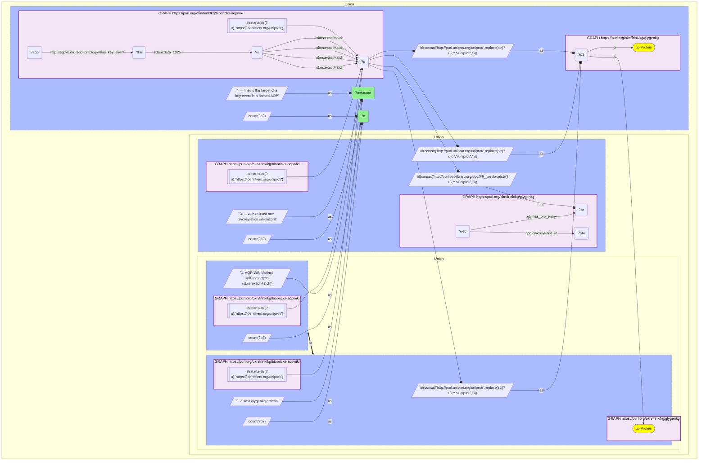

# P12-Q2: glygenkg×biobricks-aopwiki — 756 of AOP-Wiki's 7,437 UniProt targets are GlyGen proteins

- **Date:** 2026-10-13
- **Model:** claude-opus-5-5
- **SPARQL endpoint:** https://apps.okn.us/federation/sparql
- **Generated by:** mcp-okn v0.1.0 (build d0aab94)
- **Contents:** 1 query · 1 query diagram

## Knowledge graphs used

- `biobricks-aopwiki` — <https://purl.org/okn/frink/kg/biobricks-aopwiki>
- `glygenkg` — <https://purl.org/okn/frink/kg/glygenkg>

## Conversation

👤 **User**

Same crosswalk, coverage angle: how many of AOP-Wiki's UniProt-identified targets are glygenkg proteins, and how many of those have a glycosylation site record?

---

🧠 **Assistant**

**756 of AOP-Wiki's 7,437 UniProt-identified targets (10.2%) are glygenkg proteins; 557 of them have a site-level glycosylation record, and 456 are attached to a key event of a named AOP.**

| Measure | Count |
|---|---|
| AOP-Wiki distinct UniProt targets (`skos:exactMatch`) | 7,437 |
| also a glygenkg protein | 756 (10.2%) |
| ... with at least one glycosylation site record | 557 |
| ... that is the target of a key event in a named AOP | 456 |

**Reading the hit rate.** glygenkg is human only (a single taxon, NCBITaxon 9606) and a partial GlyGen release of 8,112 proteins, so a low share of AOP-Wiki's 7,437 accessions is expected; the species mix of AOP-Wiki's accessions was not measured here, so it cannot be said how much of the gap is non-human protein. From the glygenkg side the same 756 proteins are 9.3% of its 8,112. The join is narrow in both directions, so quote the denominator with any percentage.

**The two filters are independent.** 557 of the 756 shared proteins have a recorded residue; the other 199 are glycoproteins for which this release reports no position. Separately, 456 of the 756 are wired to a key event that belongs to an AOP, which is the set an AOP-level question can use; the remaining 300 are cross-referenced in AOP-Wiki but not reachable from a pathway.

**Join form.** AOP-Wiki writes `https://identifiers.org/uniprot/{accession}`; glygenkg writes `http://purl.uniprot.org/uniprot/{accession}`. The accession is extracted and the glygenkg IRI rebuilt. A direct join on the IRI returns nothing.

## SPARQL queries executed

#### Query 1

_2026-10-14T02:22:00+00:00 · `biobricks-aopwiki`, `glygenkg`_

```sparql
PREFIX gly: <https://sparql.glygen.org/ontology/>
PREFIX gco: <http://purl.jp/bio/12/glyco/conjugate#>
PREFIX glycan: <http://purl.jp/bio/12/glyco/glycan#>
PREFIX faldo: <http://www.biohackathon.org/resource/faldo#>
PREFIX up: <http://purl.uniprot.org/core/>
PREFIX skos: <http://www.w3.org/2004/02/skos/core#>
PREFIX rdfs: <http://www.w3.org/2000/01/rdf-schema#>
SELECT ?measure ?n WHERE {
  { SELECT ("1. AOP-Wiki distinct UniProt targets (skos:exactMatch)" AS ?measure) (COUNT(DISTINCT ?u) AS ?n) WHERE {
      GRAPH <https://purl.org/okn/frink/kg/biobricks-aopwiki> { ?y skos:exactMatch ?u . FILTER(STRSTARTS(STR(?u),'https://identifiers.org/uniprot/')) } } }
  UNION
  { SELECT ("2. also a glygenkg protein" AS ?measure) (COUNT(DISTINCT ?p2) AS ?n) WHERE {
      GRAPH <https://purl.org/okn/frink/kg/biobricks-aopwiki> { ?y skos:exactMatch ?u . FILTER(STRSTARTS(STR(?u),'https://identifiers.org/uniprot/')) }
      BIND(IRI(CONCAT('http://purl.uniprot.org/uniprot/',REPLACE(STR(?u),'^.*/uniprot/',''))) AS ?p2)
      GRAPH <https://purl.org/okn/frink/kg/glygenkg> { ?p2 a up:Protein } } }
  UNION
  { SELECT ("3. ... with at least one glycosylation site record" AS ?measure) (COUNT(DISTINCT ?p2) AS ?n) WHERE {
      GRAPH <https://purl.org/okn/frink/kg/biobricks-aopwiki> { ?y skos:exactMatch ?u . FILTER(STRSTARTS(STR(?u),'https://identifiers.org/uniprot/')) }
      BIND(IRI(CONCAT('http://purl.obolibrary.org/obo/PR_',REPLACE(STR(?u),'^.*/uniprot/',''))) AS ?pr)
      BIND(IRI(CONCAT('http://purl.uniprot.org/uniprot/',REPLACE(STR(?u),'^.*/uniprot/',''))) AS ?p2)
      GRAPH <https://purl.org/okn/frink/kg/glygenkg> { ?rec gly:has_pro_entry ?pr ; gco:glycosylated_at ?site } } }
  UNION
  { SELECT ("4. ... that is the target of a key event in a named AOP" AS ?measure) (COUNT(DISTINCT ?p2) AS ?n) WHERE {
      GRAPH <https://purl.org/okn/frink/kg/biobricks-aopwiki> { ?y skos:exactMatch ?u . FILTER(STRSTARTS(STR(?u),'https://identifiers.org/uniprot/'))
        ?ke <http://edamontology.org/data_1025> ?y . ?aop <http://aopkb.org/aop_ontology#has_key_event> ?ke }
      BIND(IRI(CONCAT('http://purl.uniprot.org/uniprot/',REPLACE(STR(?u),'^.*/uniprot/',''))) AS ?p2)
      GRAPH <https://purl.org/okn/frink/kg/glygenkg> { ?p2 a up:Protein } } }
} ORDER BY ?measure
```



_4 row(s)_

| measure | n |
| --- | --- |
| 1. AOP-Wiki distinct UniProt targets (skos:exactMatch) | 7437 |
| 2. also a glygenkg protein | 756 |
| 3. ... with at least one glycosylation site record | 557 |
| 4. ... that is the target of a key event in a named AOP | 456 |
