# P13-Q1: glygenkg×biomarkerkg — clinical protein biomarkers ranked by how many distinct glycans GlyGen reports on them

- **Date:** 2026-10-13
- **Model:** claude-opus-5-5
- **SPARQL endpoint:** https://apps.okn.us/federation/sparql
- **Generated by:** mcp-okn v0.1.0 (build d0aab94)
- **Contents:** 1 query · 1 query diagram

## Knowledge graphs used

- `biomarkerkg` — <https://purl.org/okn/frink/kg/biomarkerkg>
- `glygenkg` — <https://purl.org/okn/frink/kg/glygenkg>
- `ubergraph` — <https://purl.org/okn/frink/kg/ubergraph>

## Conversation

👤 **User**

Which protein biomarkers in BiomarkerKG carry the most distinct glycan structures in GlyGen, at how many sites, and what conditions are they biomarkers for?

---

🧠 **Assistant**

**Haptoglobin, lactotransferrin and prostate-specific antigen lead: they carry 287, 246 and 192 distinct glycan structures in GlyGen.**

| Biomarker gene | Glycosylated residues | Distinct glycans | Biomarker for (BiomarkerKG) |
|---|---|---|---|
| HP | 7 | 287 | lung cancer |
| LTF | 4 | 246 | thyroid cancer |
| KLK3 | 2 | 192 | prostate cancer |
| ACE2 | 18 | 180 | COVID-19; lung cancer |
| GGT1 | 7 | 135 | breast cancer; uterine cancer |
| NID2 | 32 | 113 | esophageal cancer |
| ICAM1 | 11 | 109 | lung cancer |
| SERPINC1 | 6 | 107 | COVID-19; brain cancer |
| SLC3A2 | 5 | 96 | gastric cancer |
| MME | 6 | 94 | uterine cancer |
| SELENOP | 7 | 53 | COVID-19 |
| PTPRM | 11 | 50 | malignant pancreatic neoplasm |
| AOC3 | 10 | 44 | breast cancer |
| BCHE | 10 | 33 | colorectal cancer; diabetes mellitus; COVID-19 |
| HGF | 5 | 31 | diabetes mellitus |
| C5 | 4 | 27 | COVID-19; head and neck cancer |
| PLG | 15 | 26 | ovarian cancer |
| CD40LG | 1 | 23 | lung cancer; malignant pancreatic neoplasm |
| ANGPT2 | 4 | 22 | COVID-19 |
| CHL1 | 13 | 21 | thyroid cancer |

**Glycan diversity and site count are different things.** KLK3 (prostate-specific antigen) has 192 distinct glycans on only 2 residues, and LTF 246 on 4, while NID2 spreads 113 glycans over 32 residues. A protein with few sites can still be highly heterogeneous at each one.

**What the join is for.** BiomarkerKG records that a protein is measured as a biomarker for a condition; it says nothing about the protein's glycoforms. GlyGen supplies which residues are glycosylated and how many structures have been observed there. Together they give a shortlist of biomarkers whose measured form is a mixture of many glycoforms, which is where a glycoform-specific assay could differ from a total-protein assay. That last step is an inference from the two graphs, not something either states.

**Limits.** GlyGen here records glycans observed on the protein in general, not in the disease named by BiomarkerKG, and the graph holds no glycan structure beyond a composition label. The disease column lists every condition BiomarkerKG ties to the protein through its biomarker records.

## SPARQL queries executed

#### Query 1

_2026-10-14T02:22:01+00:00 · `biomarkerkg`, `glygenkg`, `ubergraph`_

```sparql
PREFIX gly: <https://sparql.glygen.org/ontology/>
PREFIX gco: <http://purl.jp/bio/12/glyco/conjugate#>
PREFIX glycan: <http://purl.jp/bio/12/glyco/glycan#>
PREFIX faldo: <http://www.biohackathon.org/resource/faldo#>
PREFIX up: <http://purl.uniprot.org/core/>
PREFIX skos: <http://www.w3.org/2004/02/skos/core#>
PREFIX rdfs: <http://www.w3.org/2000/01/rdf-schema#>
PREFIX obo: <http://purl.obolibrary.org/obo/>
SELECT ?symbol ?sites ?glycans (GROUP_CONCAT(DISTINCT ?diseaseLabel; SEPARATOR="; ") AS ?biomarkerFor) WHERE {
  GRAPH <https://purl.org/okn/frink/kg/biomarkerkg> {
    VALUES ?bp { obo:OBCI_1000009 obo:OBCI_1000015 obo:OBCI_1000016 obo:OBCI_1000017 }
    ?b ?bp ?protein .
    FILTER(STRSTARTS(STR(?protein),'http://purl.uniprot.org/uniprot/'))
    VALUES ?dp { obo:OBCI_1000002 obo:OBCI_1000006 obo:OBCI_1000008 }
    ?b ?dp ?disease .
    FILTER(STRSTARTS(STR(?disease),'http://purl.obolibrary.org/obo/MONDO_'))
  }
  { SELECT ?protein (COUNT(DISTINCT ?position) AS ?sites) (COUNT(DISTINCT ?glyc) AS ?glycans) WHERE {
      GRAPH <https://purl.org/okn/frink/kg/glygenkg> {
        ?rec gly:has_pro_entry ?pr ; gco:glycosylated_at ?site .
        ?site faldo:location ?loc . ?loc faldo:position ?position .
        OPTIONAL { ?site gco:has_saccharide ?glyc }
        BIND(IRI(REPLACE(STR(?pr),'http://purl.obolibrary.org/obo/PR_','http://purl.uniprot.org/uniprot/')) AS ?protein)
      } } GROUP BY ?protein  }
  GRAPH <https://purl.org/okn/frink/kg/glygenkg> { ?protein up:encodedBy/skos:prefLabel ?symbol }
  GRAPH <https://purl.org/okn/frink/kg/ubergraph> { ?disease rdfs:label ?diseaseLabel }
} GROUP BY ?symbol ?sites ?glycans ORDER BY DESC(?glycans) DESC(?sites) LIMIT 20
```

```mermaid
graph TD
classDef projected fill:lightgreen;
classDef literal fill:orange;
classDef iri fill:yellow;
  q0v12("?b")
  q0v1("?biomarkerFor"):::projected 
  q0v11("?bp")
  q0v10("?disease")
  q0v20("?diseaseLabel")
  q0v13("?dp")
  q0v19("?glyc")
  q0v2("?glycans"):::projected 
  q0v17("?loc")
  q0v18("?position")
  q0v14("?pr")
  q0v9("?protein")
  q0v15("?rec")
  q0v16("?site")
  q0v3("?sites"):::projected 
  q0v4("?symbol"):::projected 
  subgraph q0graph0["GRAPH https://purl.org/okn/frink/kg/biomarkerkg"]
    style q0graph0 fill:#f3e5f5,stroke:#8e24aa,stroke-width:2px,color:#000;
    q0graph0f0[["strstarts(str(?protein),'http://purl.uniprot.org/uniprot/') && strstarts(str(?disease),'http://purl.obolibrary.org/obo/MONDO_')"]]
    q0graph0f0 --> q0v9
    q0graph0f0 --> q0v10
    q0graph0bind0[/"VALUES ?bp"/]
    q0graph0bind0-->q0v11
    q0graph0bind00(["obo:OBCI_1000009"])
    q0graph0bind00 --> q0graph0bind0
    q0graph0bind01(["obo:OBCI_1000015"])
    q0graph0bind01 --> q0graph0bind0
    q0graph0bind02(["obo:OBCI_1000016"])
    q0graph0bind02 --> q0graph0bind0
    q0graph0bind03(["obo:OBCI_1000017"])
    q0graph0bind03 --> q0graph0bind0
    q0v12 -->q0v11--> q0v9
    q0graph0bind1[/"VALUES ?dp"/]
    q0graph0bind1-->q0v13
    q0graph0bind10(["obo:OBCI_1000002"])
    q0graph0bind10 --> q0graph0bind1
    q0graph0bind11(["obo:OBCI_1000006"])
    q0graph0bind11 --> q0graph0bind1
    q0graph0bind12(["obo:OBCI_1000008"])
    q0graph0bind12 --> q0graph0bind1
    q0v12 -->q0v13--> q0v10
  end
  subgraph q0graph1["GRAPH https://purl.org/okn/frink/kg/glygenkg"]
    style q0graph1 fill:#f3e5f5,stroke:#8e24aa,stroke-width:2px,color:#000;
    q0v15 --"gco:glycosylated_at"--> q0v16
    q0v16 --"faldo:location"--> q0v17
    q0v17 --"faldo:position"--> q0v18
    q0v15 --"gly:has_pro_entry"--> q0v14
    subgraph q0optionalgraph10["(optional)"]
    style q0optionalgraph10 fill:#bbf,stroke-dasharray: 5 5,color:#000;
      q0v16 -."gco:has_saccharide".-> q0v19
    end
    q0graph1bind2[/"iri(replace(str(?pr),'http://purl.obolibrary.org/obo/PR_','http://purl.uniprot.org/uniprot/'))"/]
    q0v14 --o q0graph1bind2
    q0graph1bind2 --as--o q0v9
  end
  q0bind3[/"count(?position)"/]
  q0bind3 --as--o q0v3
  subgraph q0graph2["GRAPH https://purl.org/okn/frink/kg/glygenkg"]
    style q0graph2 fill:#f3e5f5,stroke:#8e24aa,stroke-width:2px,color:#000;
    q0v9 --"up:encodedBy/skos:prefLabel"--> q0v4
  end
  subgraph q0graph3["GRAPH https://purl.org/okn/frink/kg/ubergraph"]
    style q0graph3 fill:#f3e5f5,stroke:#8e24aa,stroke-width:2px,color:#000;
    q0v10 --"rdfs:label"--> q0v20
  end
  q0bind4[/"count(?position)"/]
  q0bind4 --as--o q0v1
```



_20 row(s)_

| symbol | sites | glycans | biomarkerFor |
| --- | --- | --- | --- |
| HP | 7 | 287 | lung cancer |
| LTF | 4 | 246 | thyroid cancer |
| KLK3 | 2 | 192 | prostate cancer |
| ACE2 | 18 | 180 | COVID-19; lung cancer |
| GGT1 | 7 | 135 | breast cancer; uterine cancer |
| NID2 | 32 | 113 | esophageal cancer |
| ICAM1 | 11 | 109 | lung cancer |
| SERPINC1 | 6 | 107 | COVID-19; brain cancer |
| SLC3A2 | 5 | 96 | gastric cancer |
| MME | 6 | 94 | uterine cancer |
| SELENOP | 7 | 53 | COVID-19 |
| PTPRM | 11 | 50 | malignant pancreatic neoplasm |
| AOC3 | 10 | 44 | breast cancer |
| BCHE | 10 | 33 | colorectal cancer; diabetes mellitus; COVID-19 |
| HGF | 5 | 31 | diabetes mellitus |
| C5 | 4 | 27 | COVID-19; head and neck cancer |
| PLG | 15 | 26 | ovarian cancer |
| CD40LG | 1 | 23 | lung cancer; malignant pancreatic neoplasm |
| ANGPT2 | 4 | 22 | COVID-19 |
| CHL1 | 13 | 21 | thyroid cancer |
