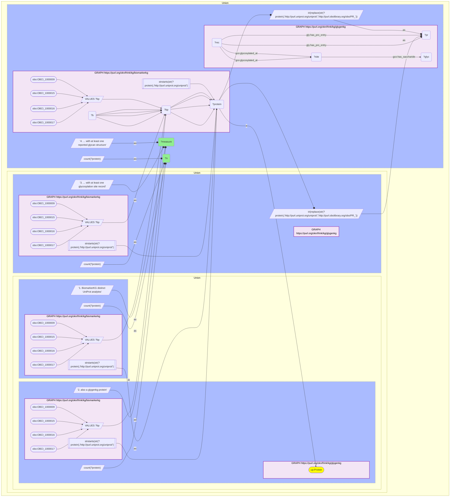

# P13-Q2: glygenkg×biomarkerkg — 123 of BiomarkerKG's 245 UniProt analytes are GlyGen proteins

- **Date:** 2026-10-13
- **Model:** claude-opus-5-5
- **SPARQL endpoint:** https://apps.okn.us/federation/sparql
- **Generated by:** mcp-okn v0.1.0 (build d0aab94)
- **Contents:** 1 query · 1 query diagram

## Knowledge graphs used

- `biomarkerkg` — <https://purl.org/okn/frink/kg/biomarkerkg>
- `glygenkg` — <https://purl.org/okn/frink/kg/glygenkg>

## Conversation

👤 **User**

Same crosswalk, coverage angle: how many of BiomarkerKG's UniProt protein analytes are glygenkg proteins, and how many of those have a site-level glycosylation record or a reported glycan?

---

🧠 **Assistant**

**123 of BiomarkerKG's 245 UniProt protein analytes (50.2%) are glygenkg proteins; 103 have a site-level record and 98 have at least one reported glycan structure.**

| Measure | Count |
|---|---|
| BiomarkerKG distinct UniProt analytes | 245 |
| also a glygenkg protein | 123 (50.2%) |
| ... with at least one glycosylation site record | 103 |
| ... with at least one reported glycan structure | 98 |

**Half of the protein biomarkers have glycosylation data.** Both graphs write the UniProt IRI in the same `http://purl.uniprot.org/uniprot/{accession}` form, so the join needs no rewrite. From the other side these 123 are 1.5% of glygenkg's 8,112 proteins: a deep, narrow join that is substantial for BiomarkerKG and marginal for GlyGen.

**Three levels of detail.** 123 analytes are known glycoproteins in this release; 103 of them have a recorded residue; 98 have a glycan attached to a residue. The 20 without a position and the further 5 with a position but no glycan can be named as glycoproteins and nothing more.

**The other 122 analytes** are absent from glygenkg. That is not evidence that they are unglycosylated: the federated graph is a partial GlyGen release (8,112 human proteins), and a protein can be missing because it is outside the release.

**Which predicate set.** The analyte set is the union of BiomarkerKG's four biomarker-to-entity predicates (`OBCI_1000009`, `_1000015`, `_1000016`, `_1000017`), filtered to UniProt IRIs. Restricting to `OBCI_1000009` alone gives a smaller set (110 shared proteins).

## SPARQL queries executed

#### Query 1

_2026-10-14T02:22:03+00:00 · `biomarkerkg`, `glygenkg`_

```sparql
PREFIX gly: <https://sparql.glygen.org/ontology/>
PREFIX gco: <http://purl.jp/bio/12/glyco/conjugate#>
PREFIX glycan: <http://purl.jp/bio/12/glyco/glycan#>
PREFIX faldo: <http://www.biohackathon.org/resource/faldo#>
PREFIX up: <http://purl.uniprot.org/core/>
PREFIX skos: <http://www.w3.org/2004/02/skos/core#>
PREFIX rdfs: <http://www.w3.org/2000/01/rdf-schema#>
PREFIX obo: <http://purl.obolibrary.org/obo/>
SELECT ?measure ?n WHERE {
  { SELECT ("1. BiomarkerKG distinct UniProt analytes" AS ?measure) (COUNT(DISTINCT ?protein) AS ?n) WHERE {
      GRAPH <https://purl.org/okn/frink/kg/biomarkerkg> { VALUES ?bp { obo:OBCI_1000009 obo:OBCI_1000015 obo:OBCI_1000016 obo:OBCI_1000017 }
    ?b ?bp ?protein .
    FILTER(STRSTARTS(STR(?protein),'http://purl.uniprot.org/uniprot/')) } } }
  UNION
  { SELECT ("2. also a glygenkg protein" AS ?measure) (COUNT(DISTINCT ?protein) AS ?n) WHERE {
      GRAPH <https://purl.org/okn/frink/kg/biomarkerkg> { VALUES ?bp { obo:OBCI_1000009 obo:OBCI_1000015 obo:OBCI_1000016 obo:OBCI_1000017 }
    ?b ?bp ?protein .
    FILTER(STRSTARTS(STR(?protein),'http://purl.uniprot.org/uniprot/')) }
      GRAPH <https://purl.org/okn/frink/kg/glygenkg> { ?protein a up:Protein } } }
  UNION
  { SELECT ("3. ... with at least one glycosylation site record" AS ?measure) (COUNT(DISTINCT ?protein) AS ?n) WHERE {
      GRAPH <https://purl.org/okn/frink/kg/biomarkerkg> { VALUES ?bp { obo:OBCI_1000009 obo:OBCI_1000015 obo:OBCI_1000016 obo:OBCI_1000017 }
    ?b ?bp ?protein .
    FILTER(STRSTARTS(STR(?protein),'http://purl.uniprot.org/uniprot/')) }
      BIND(IRI(REPLACE(STR(?protein),'http://purl.uniprot.org/uniprot/','http://purl.obolibrary.org/obo/PR_')) AS ?pr)
      GRAPH <https://purl.org/okn/frink/kg/glygenkg> { ?rec gly:has_pro_entry ?pr ; gco:glycosylated_at ?site } } }
  UNION
  { SELECT ("4. ... with at least one reported glycan structure" AS ?measure) (COUNT(DISTINCT ?protein) AS ?n) WHERE {
      GRAPH <https://purl.org/okn/frink/kg/biomarkerkg> { VALUES ?bp { obo:OBCI_1000009 obo:OBCI_1000015 obo:OBCI_1000016 obo:OBCI_1000017 }
    ?b ?bp ?protein .
    FILTER(STRSTARTS(STR(?protein),'http://purl.uniprot.org/uniprot/')) }
      BIND(IRI(REPLACE(STR(?protein),'http://purl.uniprot.org/uniprot/','http://purl.obolibrary.org/obo/PR_')) AS ?pr)
      GRAPH <https://purl.org/okn/frink/kg/glygenkg> { ?rec gly:has_pro_entry ?pr ; gco:glycosylated_at ?site . ?site gco:has_saccharide ?glyc } } }
} ORDER BY ?measure
```



_4 row(s)_

| measure | n |
| --- | --- |
| 1. BiomarkerKG distinct UniProt analytes | 245 |
| 2. also a glygenkg protein | 123 |
| 3. ... with at least one glycosylation site record | 103 |
| 4. ... with at least one reported glycan structure | 98 |
