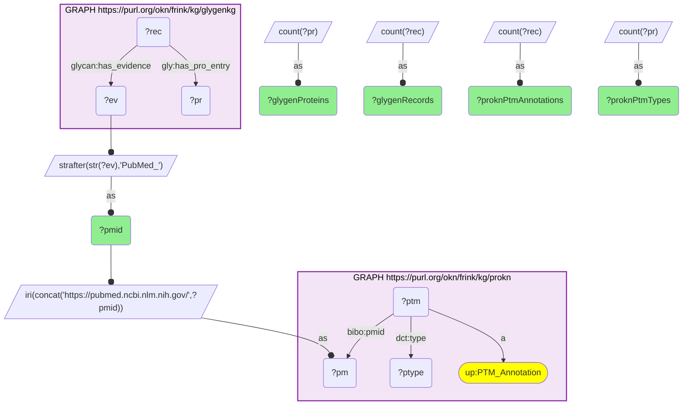
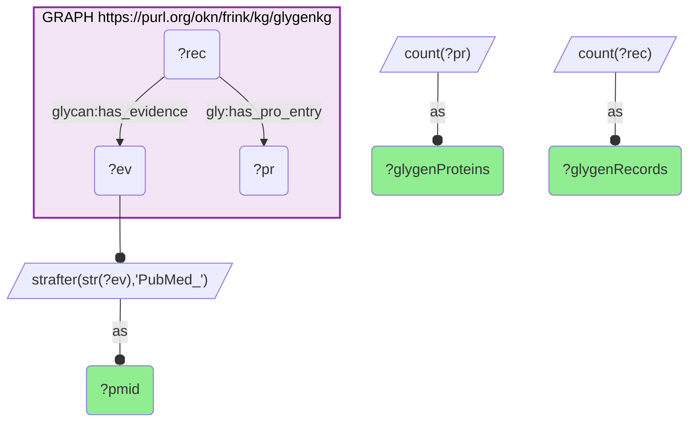

# PUB03-Q1: glygenkg×prokn (PubMed) — GlyGen's largest source papers and what ProKN's PTM layer attributes to the same publications

- **Date:** 2026-10-13
- **Model:** claude-opus-5-5
- **SPARQL endpoint:** https://apps.okn.us/federation/sparql
- **Generated by:** mcp-okn v0.1.0 (build d0aab94)
- **Contents:** 2 queries · 2 query diagrams

## Knowledge graphs used

- `glygenkg` — <https://purl.org/okn/frink/kg/glygenkg>
- `prokn` — <https://purl.org/okn/frink/kg/prokn>

## Conversation

👤 **User**

Take the papers that support the most glycosylation records in GlyGen. For each, how many records and proteins does GlyGen attribute to it, and how many PTM annotations of which types does ProKN attribute to the same PubMed ID?

---

🧠 **Assistant**

**Twelve of GlyGen's fifteen largest source papers are also cited by ProKN's PTM layer, with the same modification class in each case; three are not in ProKN at all, including the largest.**

| PubMed ID | GlyGen records | GlyGen proteins | ProKN PTM annotations | ProKN PTM type |
|---|---|---|---|---|
| 37074911 | 29,122 | 928 | not cited in ProKN | |
| 29741879 | 6,748 | 588 | 488 | N-GLYCOSYLATION |
| 29391424 | 2,158 | 181 | 374 | N-GLYCOSYLATION |
| 23584533 | 1,924 | 461 | 1,805 | O-GLYCOSYLATION |
| 30459171 | 1,675 | 442 | 1,519 | O-GLYCOSYLATION |
| 35138101 | 1,633 | 188 | 2 | O-GLYCOSYLATION |
| 34725712 | 1,548 | 746 | 4 | O-GLYCOSYLATION |
| 30379171 | 1,366 | 883 | 1,162 | O-GLYCOSYLATION |
| 24190977 | 1,364 | 670 | 1,438 | N-GLYCOSYLATION |
| 35132862 | 1,155 | 93 | 13 | O-GLYCOSYLATION |
| 29351928 | 1,133 | 419 | 1,084 | O-GLYCOSYLATION |
| 32125861 | 1,100 | 70 | 12 | N-GLYCOSYLATION |
| 39534244 | 1,047 | 276 | not cited in ProKN | |
| 29671580 | 956 | 160 | 351 | N-GLYCOSYLATION |
| 38253038 | 956 | 509 | not cited in ProKN | |

The first query joins on the PubMed ID and so returns only the twelve shared papers; the second lists all fifteen without the join, which is how the three absent ones are identified.

**The counts measure different things, so they are not expected to match.** A GlyGen record is one glycosylation observation: one protein, one site, one glycan. A ProKN PTM annotation is one modified residue. PMID 29741879 is 6,748 GlyGen records against 488 ProKN annotations because GlyGen keeps each glycan on each site as its own record, while ProKN keeps the site once. Where ProKN has more annotations than GlyGen has records (24190977: 1,438 against 1,364), ProKN holds sites from that paper for proteins outside the federated GlyGen release.

**Coverage is uneven by paper.** Four shared papers are represented in ProKN by only 2 to 13 annotations against more than a thousand GlyGen records each (35138101, 34725712, 35132862, 32125861), and the three unshared papers include the single largest source, PMID 37074911, with 29,122 records on 928 proteins. A paper being cited on both sides does not mean both sides hold the same sites from it.

**What the join is good for.** It ties a GlyGen observation and a ProKN annotation to the same publication, so a site reported in one graph can be checked against the other at the level of its evidence, not only its residue number.

## SPARQL queries executed

#### Query 1

_2026-10-14T02:22:03+00:00 · `glygenkg`, `prokn`_

```sparql
PREFIX gly: <https://sparql.glygen.org/ontology/>
PREFIX gco: <http://purl.jp/bio/12/glyco/conjugate#>
PREFIX glycan: <http://purl.jp/bio/12/glyco/glycan#>
PREFIX faldo: <http://www.biohackathon.org/resource/faldo#>
PREFIX up: <http://purl.uniprot.org/core/>
PREFIX skos: <http://www.w3.org/2004/02/skos/core#>
PREFIX rdfs: <http://www.w3.org/2000/01/rdf-schema#>
PREFIX dct: <http://purl.org/dc/terms/>
PREFIX bibo: <http://purl.org/ontology/bibo/>
SELECT ?pmid ?glygenRecords ?glygenProteins (COUNT(DISTINCT ?ptm) AS ?proknPtmAnnotations)
       (GROUP_CONCAT(DISTINCT ?ptype; SEPARATOR=", ") AS ?proknPtmTypes) WHERE {
  { SELECT ?ev (COUNT(DISTINCT ?rec) AS ?glygenRecords) (COUNT(DISTINCT ?pr) AS ?glygenProteins) WHERE {
      GRAPH <https://purl.org/okn/frink/kg/glygenkg> { ?rec glycan:has_evidence ?ev ; gly:has_pro_entry ?pr } }
    GROUP BY ?ev ORDER BY DESC(?glygenRecords) LIMIT 15 }
  BIND(STRAFTER(STR(?ev),'PubMed_') AS ?pmid)
  BIND(IRI(CONCAT('https://pubmed.ncbi.nlm.nih.gov/', ?pmid)) AS ?pm)
  GRAPH <https://purl.org/okn/frink/kg/prokn> { ?ptm a up:PTM_Annotation ; bibo:pmid ?pm ; dct:type ?ptype }
} GROUP BY ?pmid ?glygenRecords ?glygenProteins ORDER BY DESC(?glygenRecords)
```



_12 row(s)_

| pmid | glygenRecords | glygenProteins | proknPtmAnnotations | proknPtmTypes |
| --- | --- | --- | --- | --- |
| 29741879 | 6748 | 588 | 488 | N-GLYCOSYLATION |
| 29391424 | 2158 | 181 | 374 | N-GLYCOSYLATION |
| 23584533 | 1924 | 461 | 1805 | O-GLYCOSYLATION |
| 30459171 | 1675 | 442 | 1519 | O-GLYCOSYLATION |
| 35138101 | 1633 | 188 | 2 | O-GLYCOSYLATION |
| 34725712 | 1548 | 746 | 4 | O-GLYCOSYLATION |
| 30379171 | 1366 | 883 | 1162 | O-GLYCOSYLATION |
| 24190977 | 1364 | 670 | 1438 | N-GLYCOSYLATION |
| 35132862 | 1155 | 93 | 13 | O-GLYCOSYLATION |
| 29351928 | 1133 | 419 | 1084 | O-GLYCOSYLATION |
| 32125861 | 1100 | 70 | 12 | N-GLYCOSYLATION |
| 29671580 | 956 | 160 | 351 | N-GLYCOSYLATION |

#### Query 2

_2026-10-14T02:22:03+00:00 · `glygenkg`_

```sparql
PREFIX gly: <https://sparql.glygen.org/ontology/>
PREFIX gco: <http://purl.jp/bio/12/glyco/conjugate#>
PREFIX glycan: <http://purl.jp/bio/12/glyco/glycan#>
PREFIX faldo: <http://www.biohackathon.org/resource/faldo#>
PREFIX up: <http://purl.uniprot.org/core/>
PREFIX skos: <http://www.w3.org/2004/02/skos/core#>
PREFIX rdfs: <http://www.w3.org/2000/01/rdf-schema#>
# The same 15 papers without the prokn join, to show which ones prokn does not cite.
SELECT (STRAFTER(STR(?ev),'PubMed_') AS ?pmid) ?glygenRecords ?glygenProteins WHERE {
  { SELECT ?ev (COUNT(DISTINCT ?rec) AS ?glygenRecords) (COUNT(DISTINCT ?pr) AS ?glygenProteins) WHERE {
      GRAPH <https://purl.org/okn/frink/kg/glygenkg> { ?rec glycan:has_evidence ?ev ; gly:has_pro_entry ?pr } }
    GROUP BY ?ev ORDER BY DESC(?glygenRecords) LIMIT 15 }
} ORDER BY DESC(?glygenRecords)
```



_15 row(s)_

| pmid | glygenRecords | glygenProteins |
| --- | --- | --- |
| 37074911 | 29122 | 928 |
| 29741879 | 6748 | 588 |
| 29391424 | 2158 | 181 |
| 23584533 | 1924 | 461 |
| 30459171 | 1675 | 442 |
| 35138101 | 1633 | 188 |
| 34725712 | 1548 | 746 |
| 30379171 | 1366 | 883 |
| 24190977 | 1364 | 670 |
| 35132862 | 1155 | 93 |
| 29351928 | 1133 | 419 |
| 32125861 | 1100 | 70 |
| 39534244 | 1047 | 276 |
| 29671580 | 956 | 160 |
| 38253038 | 956 | 509 |
