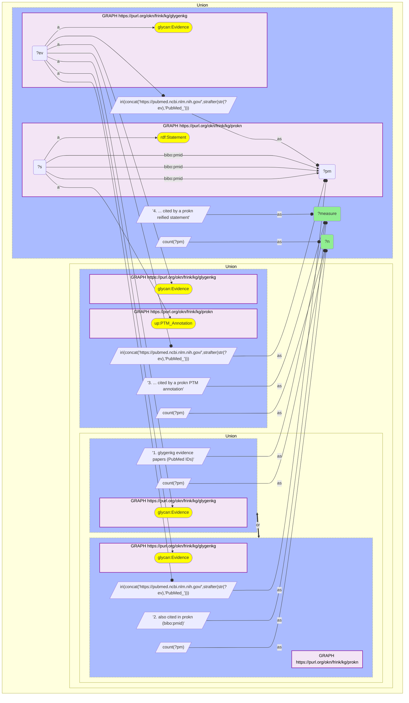
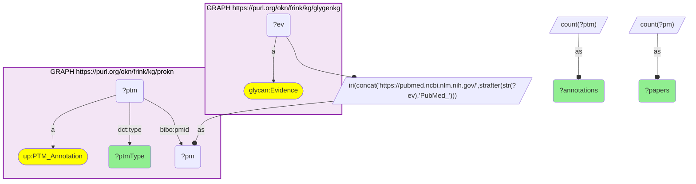

# PUB03-Q2: glygenkg×prokn (PubMed) — 752 of GlyGen's 1,516 papers are cited in ProKN, almost all by PTM annotations

- **Date:** 2026-10-13
- **Model:** claude-opus-5-5
- **SPARQL endpoint:** https://apps.okn.us/federation/sparql
- **Generated by:** mcp-okn v0.1.0 (build d0aab94)
- **Contents:** 2 queries · 2 query diagrams

## Knowledge graphs used

- `glygenkg` — <https://purl.org/okn/frink/kg/glygenkg>
- `prokn` — <https://purl.org/okn/frink/kg/prokn>

## Conversation

👤 **User**

Same crosswalk, coverage angle: how many of the papers GlyGen cites as glycosylation evidence are also cited in ProKN, by what kinds of ProKN record, and for which modification types?

---

🧠 **Assistant**

**752 of the 1,516 papers GlyGen cites (49.6%) are also cited in ProKN: 728 by a PTM annotation and 129 by a reified statement.**

| Measure | Count |
|---|---|
| glygenkg evidence papers (PubMed IDs) | 1,516 |
| also cited in prokn (`bibo:pmid`) | 752 (49.6%) |
| ... cited by a prokn PTM annotation | 728 |
| ... cited by a prokn reified statement | 129 |

728 + 129 exceeds 752 because 105 papers are cited by both kinds of record.

**What ProKN attributes to the shared papers, by modification type:**

| ProKN modification type | Annotations | Papers |
|---|---|---|
| PHOSPHORYLATION | 74,580 | 84 |
| O-GLYCOSYLATION | 18,280 | 230 |
| N-GLYCOSYLATION | 6,574 | 446 |
| ACETYLATION | 972 | 4 |
| HYDROXYLATION | 100 | 5 |
| METHYLATION | 73 | 2 |
| C-GLYCOSYLATION | 39 | 8 |
| DEAMIDATION | 14 | 2 |
| AMINO_ACID_RESIDUE_CONVERSION | 13 | 11 |
| CARBOXYLATION | 9 | 1 |
| O-AMP-SERINE | 3 | 1 |
| O-SULFONATION | 2 | 1 |
| 4' | 1 | 1 |
| S-GLYCOSYLATION | 1 | 1 |
| UBIQUITINATION | 1 | 1 |

(The type "4'" is a value as stored in ProKN; it looks like a truncated label.)

**Glycosylation is what most shared papers are about; phosphorylation is most of the annotations.** N-glycosylation annotations come from 446 of the shared papers and O-glycosylation from 230. Phosphorylation comes from only 84 papers but accounts for 74,580 annotations, about three quarters of the total: a small number of large proteomics papers that GlyGen cites for glycosylation are cited by ProKN for phosphorylation sites.

**Join form.** The PubMed ID is not a literal on either side. glygenkg embeds it in the evidence IRI (`http://glygen.org/evidence/PubMed_{PMID}`), and ProKN stores it as the IRI `https://pubmed.ncbi.nlm.nih.gov/{PMID}` on `bibo:pmid`. Extract the number from one and rebuild the other.

**What is not shared.** 764 GlyGen papers have no ProKN citation. ProKN cites 35,986 distinct PubMed IDs in all, so the 752 shared papers are 2.1% of its literature.

## SPARQL queries executed

#### Query 1

_2026-10-14T02:22:04+00:00 · `glygenkg`, `prokn`_

```sparql
PREFIX gly: <https://sparql.glygen.org/ontology/>
PREFIX gco: <http://purl.jp/bio/12/glyco/conjugate#>
PREFIX glycan: <http://purl.jp/bio/12/glyco/glycan#>
PREFIX faldo: <http://www.biohackathon.org/resource/faldo#>
PREFIX up: <http://purl.uniprot.org/core/>
PREFIX skos: <http://www.w3.org/2004/02/skos/core#>
PREFIX rdfs: <http://www.w3.org/2000/01/rdf-schema#>
PREFIX bibo: <http://purl.org/ontology/bibo/>
SELECT ?measure ?n WHERE {
  { SELECT ("1. glygenkg evidence papers (PubMed IDs)" AS ?measure) (COUNT(DISTINCT ?ev) AS ?n) WHERE {
      GRAPH <https://purl.org/okn/frink/kg/glygenkg> { ?ev a glycan:Evidence } } }
  UNION
  { SELECT ("2. also cited in prokn (bibo:pmid)" AS ?measure) (COUNT(DISTINCT ?pm) AS ?n) WHERE {
      { SELECT DISTINCT ?ev WHERE { GRAPH <https://purl.org/okn/frink/kg/glygenkg> { ?ev a glycan:Evidence } } }
      BIND(IRI(CONCAT('https://pubmed.ncbi.nlm.nih.gov/', STRAFTER(STR(?ev),'PubMed_'))) AS ?pm)
      GRAPH <https://purl.org/okn/frink/kg/prokn> { ?s bibo:pmid ?pm } } }
  UNION
  { SELECT ("3. ... cited by a prokn PTM annotation" AS ?measure) (COUNT(DISTINCT ?pm) AS ?n) WHERE {
      { SELECT DISTINCT ?ev WHERE { GRAPH <https://purl.org/okn/frink/kg/glygenkg> { ?ev a glycan:Evidence } } }
      BIND(IRI(CONCAT('https://pubmed.ncbi.nlm.nih.gov/', STRAFTER(STR(?ev),'PubMed_'))) AS ?pm)
      GRAPH <https://purl.org/okn/frink/kg/prokn> { ?s bibo:pmid ?pm ; a up:PTM_Annotation } } }
  UNION
  { SELECT ("4. ... cited by a prokn reified statement" AS ?measure) (COUNT(DISTINCT ?pm) AS ?n) WHERE {
      { SELECT DISTINCT ?ev WHERE { GRAPH <https://purl.org/okn/frink/kg/glygenkg> { ?ev a glycan:Evidence } } }
      BIND(IRI(CONCAT('https://pubmed.ncbi.nlm.nih.gov/', STRAFTER(STR(?ev),'PubMed_'))) AS ?pm)
      GRAPH <https://purl.org/okn/frink/kg/prokn> { ?s bibo:pmid ?pm ; a <http://www.w3.org/1999/02/22-rdf-syntax-ns#Statement> } } }
} ORDER BY ?measure
```



_4 row(s)_

| measure | n |
| --- | --- |
| 1. glygenkg evidence papers (PubMed IDs) | 1516 |
| 2. also cited in prokn (bibo:pmid) | 752 |
| 3. ... cited by a prokn PTM annotation | 728 |
| 4. ... cited by a prokn reified statement | 129 |

#### Query 2

_2026-10-14T02:22:04+00:00 · `glygenkg`, `prokn`_

```sparql
PREFIX gly: <https://sparql.glygen.org/ontology/>
PREFIX gco: <http://purl.jp/bio/12/glyco/conjugate#>
PREFIX glycan: <http://purl.jp/bio/12/glyco/glycan#>
PREFIX faldo: <http://www.biohackathon.org/resource/faldo#>
PREFIX up: <http://purl.uniprot.org/core/>
PREFIX skos: <http://www.w3.org/2004/02/skos/core#>
PREFIX rdfs: <http://www.w3.org/2000/01/rdf-schema#>
PREFIX dct: <http://purl.org/dc/terms/>
PREFIX bibo: <http://purl.org/ontology/bibo/>
# What prokn attributes to the shared papers, by modification type.
SELECT ?ptmType (COUNT(DISTINCT ?ptm) AS ?annotations) (COUNT(DISTINCT ?pm) AS ?papers) WHERE {
  { SELECT DISTINCT ?ev WHERE { GRAPH <https://purl.org/okn/frink/kg/glygenkg> { ?ev a glycan:Evidence } } }
  BIND(IRI(CONCAT('https://pubmed.ncbi.nlm.nih.gov/', STRAFTER(STR(?ev),'PubMed_'))) AS ?pm)
  GRAPH <https://purl.org/okn/frink/kg/prokn> { ?ptm a up:PTM_Annotation ; bibo:pmid ?pm ; dct:type ?ptmType }
} GROUP BY ?ptmType ORDER BY DESC(?annotations)
```



_15 row(s)_

| ptmType | annotations | papers |
| --- | --- | --- |
| PHOSPHORYLATION | 74580 | 84 |
| O-GLYCOSYLATION | 18280 | 230 |
| N-GLYCOSYLATION | 6574 | 446 |
| ACETYLATION | 972 | 4 |
| HYDROXYLATION | 100 | 5 |
| METHYLATION | 73 | 2 |
| C-GLYCOSYLATION | 39 | 8 |
| DEAMIDATION | 14 | 2 |
| AMINO_ACID_RESIDUE_CONVERSION | 13 | 11 |
| CARBOXYLATION | 9 | 1 |
| O-AMP-SERINE | 3 | 1 |
| O-SULFONATION | 2 | 1 |
| 4' | 1 | 1 |
| S-GLYCOSYLATION | 1 | 1 |
| UBIQUITINATION | 1 | 1 |
