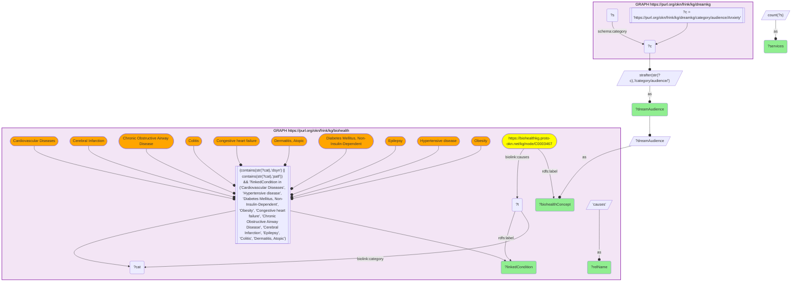

# Anxiety: a DREAM-KG service target resolved to the chronic diseases BioHealthKG says it causes

- **Date:** 2026-10-13
- **Model:** claude-opus-5-5
- **SPARQL endpoint:** https://apps.okn.us/federation/sparql
- **Generated by:** mcp-okn v0.1.0 (build f738e02)
- **Contents:** 1 query · 1 query diagram

## Knowledge graphs used

- `dreamkg` — <https://purl.org/okn/frink/kg/dreamkg>
- `biohealth` — <https://purl.org/okn/frink/kg/biohealth>

## Conversation

👤 **User**

Crosswalk: `dreamkg` × `biohealth` on the **concept label**. Take a single DREAM-KG audience category — **Anxiety** (`…/dreamkg/category/audience/Anxiety`) — and resolve it through BioHealthKG to the clinical concept network: what *downstream physical diseases* does BioHealthKG say Anxiety **causes**?

Research question: for a mental-health condition that DREAM-KG offers local services for, what somatic conditions does BioHealthKG's UMLS graph attach to it as causal/comorbid consequences — the medical stakes of the population a social service serves?

Why the join is required: DREAM-KG records only that a service's audience category is `Anxiety`; it has no clinical context. BioHealthKG carries the UMLS concept *Anxiety* and its `biolink:causes` edges to physical disease, but no service listings. Turning "there is a service for anxiety here" into "and here is the chronic-disease burden anxiety carries" needs the label join.

---

🧠 **Assistant**

DREAM-KG tags **77 services** with the audience category **Anxiety** (its listings come from the findhelp / Aunt Bertha directory for Los Angeles County and Philadelphia). The category's local name is already BioHealthKG's concept label, so it resolves to *Anxiety* (`UMLS:C0003467`) with no normalization, and following `biolink:causes` to disease / pathologic-function concepts exposes a concrete somatic-disease burden. Every row carries BOTH graphs — the DREAM-KG audience and its service count, *and* a named BioHealthKG disease anxiety causes:

| DREAM-KG audience category | Services tagged | BioHealthKG concept | BioHealthKG relation | BioHealthKG caused condition |
| --- | --- | --- | --- | --- |
| Anxiety | 77 | Anxiety | causes | Cardiovascular Diseases |
| Anxiety | 77 | Anxiety | causes | Congestive heart failure |
| Anxiety | 77 | Anxiety | causes | Hypertensive disease |
| Anxiety | 77 | Anxiety | causes | Cerebral Infarction |
| Anxiety | 77 | Anxiety | causes | Chronic Obstructive Airway Disease |
| Anxiety | 77 | Anxiety | causes | Diabetes Mellitus, Non-Insulin-Dependent |
| Anxiety | 77 | Anxiety | causes | Obesity |
| Anxiety | 77 | Anxiety | causes | Epilepsy |
| Anxiety | 77 | Anxiety | causes | Colitis |
| Anxiety | 77 | Anxiety | causes | Dermatitis, Atopic |

**Why it answers the question.** The bridge turns a single local-service tag into a clinically grounded risk profile: BioHealthKG places anxiety upstream of a cardiometabolic and inflammatory disease cluster — cardiovascular disease, congestive heart failure, hypertension, cerebral infarction (stroke), COPD, type-2 diabetes, obesity — plus neurological (epilepsy) and inflammatory/atopic (colitis, atopic dermatitis) conditions. This is precisely the comorbidity load a navigator or researcher would weigh when supporting the population those 77 services are for. None of this clinical structure exists in DREAM-KG; it is reachable only by joining the social-services term to BioHealthKG's concept label.

The ten conditions are a curated selection from BioHealthKG's `causes` edges for *Anxiety* (the query filters to them by name), not the complete list.

## Literature validation

According to PubMed, a meta-analysis of 20 prospective cohorts (249,846 persons, mean 11.2-year follow-up) found anxiety to be an independent risk factor for incident coronary heart disease (HR 1.26) and cardiac death (HR 1.48) — corroborating the lead rows, where DREAM-KG runs a service for the anxious population and BioHealthKG attaches `causes` Cardiovascular Diseases / Congestive heart failure to the *Anxiety* concept (Roest AM et al., "Anxiety and risk of incident coronary heart disease: a meta-analysis," *J Am Coll Cardiol* 56(1):38-46, 2010; [DOI](https://doi.org/10.1016/j.jacc.2010.03.034)). **Validated** (literature-corroborated; shared concept-label bridge; both-KG rows executed).

*This transcript was regenerated on 2026-10-13 against dreamkg v0.0.5, which replaced the lowercase `schema:audienceType` literals with audience category IRIs and now covers Los Angeles County as well as Philadelphia.*

## SPARQL queries executed

#### Query 1

_2026-10-13T21:19:06+00:00 · `dreamkg`, `biohealth`_

```sparql
PREFIX schema: <http://schema.org/>
PREFIX rdfs: <http://www.w3.org/2000/01/rdf-schema#>
PREFIX biolink: <https://w3id.org/biolink/vocab/>
SELECT ?dreamAudience ?services ?biohealthConcept ?relName ?linkedCondition WHERE {
  # DREAM-KG: social services whose audience category is Anxiety (the term is the IRI's local name)
  { SELECT ?dreamAudience (COUNT(DISTINCT ?s) AS ?services) WHERE {
      GRAPH <https://purl.org/okn/frink/kg/dreamkg> {
        ?s schema:category ?c .
        FILTER(?c = <https://purl.org/okn/frink/kg/dreamkg/category/audience/Anxiety>) }
      BIND(STRAFTER(STR(?c),'/category/audience/') AS ?dreamAudience) } GROUP BY ?dreamAudience }
  BIND(?dreamAudience AS ?biohealthConcept)
  # biohealth: Anxiety -> causal disease conditions it links to (disease / pathologic-function semtypes)
  GRAPH <https://purl.org/okn/frink/kg/biohealth> {
    <https://biohealthkg.proto-okn.net/kg/node/C0003467> rdfs:label ?biohealthConcept ; biolink:causes ?t .
    ?t rdfs:label ?linkedCondition ; biolink:category ?cat .
    FILTER(CONTAINS(STR(?cat),'dsyn') || CONTAINS(STR(?cat),'patf'))
    FILTER(?linkedCondition IN ("Cardiovascular Diseases","Hypertensive disease","Diabetes Mellitus, Non-Insulin-Dependent","Obesity","Congestive heart failure","Chronic Obstructive Airway Disease","Cerebral Infarction","Epilepsy","Colitis","Dermatitis, Atopic"))
    BIND("causes" AS ?relName)
  }
} ORDER BY ?linkedCondition
```



_10 row(s)_

| dreamAudience | services | biohealthConcept | relName | linkedCondition |
| --- | --- | --- | --- | --- |
| Anxiety | 77 | Anxiety | causes | Cardiovascular Diseases |
| Anxiety | 77 | Anxiety | causes | Cerebral Infarction |
| Anxiety | 77 | Anxiety | causes | Chronic Obstructive Airway Disease |
| Anxiety | 77 | Anxiety | causes | Colitis |
| Anxiety | 77 | Anxiety | causes | Congestive heart failure |
| Anxiety | 77 | Anxiety | causes | Dermatitis, Atopic |
| Anxiety | 77 | Anxiety | causes | Diabetes Mellitus, Non-Insulin-Dependent |
| Anxiety | 77 | Anxiety | causes | Epilepsy |
| Anxiety | 77 | Anxiety | causes | Hypertensive disease |
| Anxiety | 77 | Anxiety | causes | Obesity |
