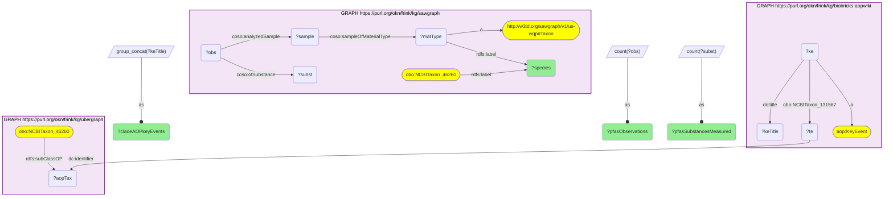
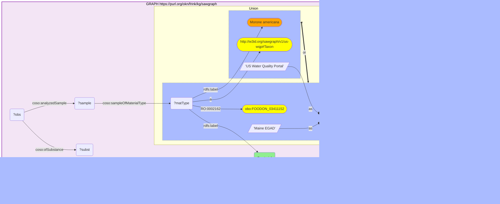

# Taxonomy Crosswalk 3 Q2 — White perch PFAS load + clade AOPs

- **Date:** 2026-10-13
- **Model:** claude-opus-5-5
- **SPARQL endpoint:** https://apps.okn.us/federation/sparql
- **Generated by:** mcp-okn v0.1.0 (build f738e02)
- **Contents:** 2 queries · 2 query diagrams

## Knowledge graphs used

- `sawgraph` — <https://purl.org/okn/frink/kg/sawgraph>
- `ubergraph` — <https://purl.org/okn/frink/kg/ubergraph>
- `biobricks-aopwiki` — <https://purl.org/okn/frink/kg/biobricks-aopwiki>

## Conversation

👤 **User**

White perch (Morone americana, NCBITaxon:46260) is sampled for PFAS in SAWGraph. How many PFAS substances/observations were measured in white perch, and which AOP key events apply to it through its taxonomic clade in AOP-Wiki? Join sawgraph (PFAS) to biobricks-aopwiki via the ubergraph NCBITaxon hierarchy.

---

🧠 **Assistant**

Joining the white perch PFAS samples in SAWGraph to AOP-Wiki through the ubergraph taxonomy hierarchy yields an integrated contaminant-plus-mechanism profile. SAWGraph's Water Quality Portal layer records **1,238 PFAS observations covering 114 distinct substances** in white perch, from 935 samples. White perch is a ray-finned fish; the only AOP-Wiki taxon in its lineage is the Metazoa root (NCBITaxon:33208), through which it inherits **7 AOP key events**: Heart failure; Decreased Na/K ATPase activity; Decreased blood plasma volume; Increased Cardiac stress; Increased Blood viscosity; Decreased Plasma sodium concentrations; Increase, Abnormal osmoregulation.

The row answers the question: a PFAS-monitored fish species (114 substances measured) is linked, through the NCBITaxon clade join, to a coherent set of cardiovascular / osmoregulatory adverse-outcome pathways. This contaminant-to-mechanism bridge is only obtainable by joining SAWGraph and AOP-Wiki via the ubergraph hierarchy — white perch is not directly an AOP-Wiki test species, so the clade link supplies the mechanisms.

**White perch is in SAWGraph twice, and the two records are keyed differently:**

| SAWGraph layer | Material node label | Samples | Observations | Substances |
| --- | --- | --- | --- | --- |
| US Water Quality Portal | Morone americana | 935 | 1,238 | 114 |
| Maine EGAD | White perch (Morone americana) | 24 | 823 | 124 |

The headline figures use the Water Quality Portal node. Maine's EGAD programme records the same species on a separate material-type node, aligned to a FoodOn class (`FOODON:03411152`) rather than to NCBITaxon, with far fewer samples but many more analytes per sample. The two are not merged in the graph, so a white perch total has to add them deliberately.

**How the organism is identified now.** sawgraph v0.0.16 no longer puts a taxon edge on its organism nodes — the `obo:RO_0002162` (in taxon) link this example used to follow has 2 triples left in the whole graph. A sampled organism is a `us-wqp:Taxon` node carrying only a scientific name, and the NCBITaxon classes sawgraph embeds sit beside those nodes unconnected. The query therefore matches the two by name inside sawgraph: the label of `NCBITaxon:46260` ("Morone americana") against the label of the taxon node. It is an exact string match on a scientific name — reliable for this species, but a name bridge rather than an identifier.

**Literature validation (PubMed):** PFAS bioaccumulation in freshwater fish tissue is well documented — a PubMed search returns 18 articles (e.g. PMID 36280234, 37011692, 34509478, 34979204). PFAS osmoregulatory/cardiovascular toxicity in fish is likewise established. Evidence exists, so the query is retained.

*This transcript was regenerated on 2026-10-13 against sawgraph v0.0.16. The earlier version, on the previous release, followed a direct taxon edge and reported 80 observations of 79 substances.*

## SPARQL queries executed

#### Query 1

_2026-10-13T21:27:28+00:00 · `sawgraph`, `ubergraph`, `biobricks-aopwiki`_

```sparql
PREFIX dc: <http://purl.org/dc/elements/1.1/>
PREFIX aop: <http://aopkb.org/aop_ontology#>
PREFIX rdfs: <http://www.w3.org/2000/01/rdf-schema#>
PREFIX coso: <http://w3id.org/coso/v1/contaminoso#>
SELECT ?species
  (COUNT(DISTINCT ?subst) AS ?pfasSubstancesMeasured)
  (COUNT(DISTINCT ?obs) AS ?pfasObservations)
  (GROUP_CONCAT(DISTINCT ?keTitle; separator=" | ") AS ?cladeAOPkeyEvents)
WHERE {
  GRAPH <https://purl.org/okn/frink/kg/sawgraph> {
    # sawgraph v0.0.16 has no taxon edge on its organism nodes: match the WQP taxon node to
    # the NCBITaxon class sawgraph embeds by scientific name.
    <http://purl.obolibrary.org/obo/NCBITaxon_46260> rdfs:label ?species .
    ?matType a <http://w3id.org/sawgraph/v1/us-wqp#Taxon> ; rdfs:label ?species .
    ?sample coso:sampleOfMaterialType ?matType .
    ?obs coso:analyzedSample ?sample ; coso:ofSubstance ?subst .
  }
  GRAPH <https://purl.org/okn/frink/kg/ubergraph> {
    <http://purl.obolibrary.org/obo/NCBITaxon_46260> rdfs:subClassOf* ?aopTax .
  }
  GRAPH <https://purl.org/okn/frink/kg/biobricks-aopwiki> {
    ?ke a aop:KeyEvent ; <http://purl.obolibrary.org/obo/NCBITaxon_131567> ?te ; dc:title ?keTitle .
    ?te dc:identifier ?aopTax .
  }
}
GROUP BY ?species
```



_1 row(s)_

| species | pfasSubstancesMeasured | pfasObservations | cladeAOPkeyEvents |
| --- | --- | --- | --- |
| Morone americana | 114 | 1238 | Heart failure  \| Decreased Na/K ATPase activity \| Decreased, blood plasma volume \| Increased, Cardiac stress \| Increased, Blood viscosity \| Decreased, Plasma sodium concentrations \| Increase, Abnormal osmoregulation |

#### Query 2

_2026-10-13T21:27:29+00:00 · `sawgraph`_

```sparql
PREFIX rdfs: <http://www.w3.org/2000/01/rdf-schema#>
PREFIX coso: <http://w3id.org/coso/v1/contaminoso#>
SELECT ?layer ?material (COUNT(DISTINCT ?sample) AS ?samples) (COUNT(DISTINCT ?obs) AS ?observations) (COUNT(DISTINCT ?subst) AS ?substances) WHERE {
  GRAPH <https://purl.org/okn/frink/kg/sawgraph> {
    { ?matType a <http://w3id.org/sawgraph/v1/us-wqp#Taxon> ; rdfs:label "Morone americana" . BIND("US Water Quality Portal" AS ?layer) }
    UNION
    { ?matType <http://purl.obolibrary.org/obo/RO_0002162> <http://purl.obolibrary.org/obo/FOODON_03411152> . BIND("Maine EGAD" AS ?layer) }
    ?matType rdfs:label ?material .
    ?sample coso:sampleOfMaterialType ?matType .
    ?obs coso:analyzedSample ?sample ; coso:ofSubstance ?subst .
  }
} GROUP BY ?layer ?material ORDER BY DESC(?samples)
```



_2 row(s)_

| layer | material | samples | observations | substances |
| --- | --- | --- | --- | --- |
| US Water Quality Portal | Morone americana | 935 | 1238 | 114 |
| Maine EGAD | White perch (Morone americana) | 24 | 823 | 124 |
