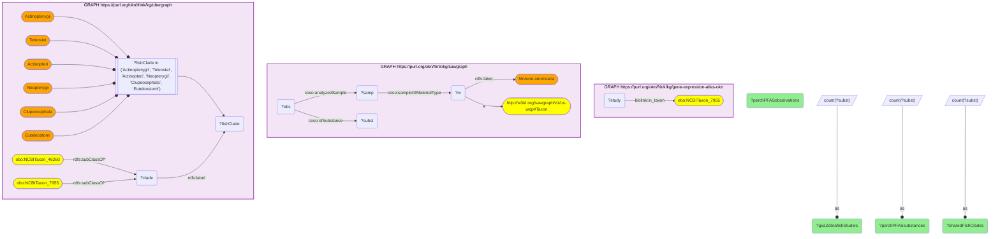

# Taxonomy Crosswalk 6 Q1 — GXA zebrafish × SAWGraph white perch (shared fish clade)

- **Date:** 2026-10-13
- **Model:** claude-opus-5-5
- **SPARQL endpoint:** https://apps.okn.us/federation/sparql
- **Generated by:** mcp-okn v0.1.0 (build f738e02)
- **Contents:** 1 query · 1 query diagram

## Knowledge graphs used

- `gene-expression-atlas-okn` — <https://purl.org/okn/frink/kg/gene-expression-atlas-okn>
- `sawgraph` — <https://purl.org/okn/frink/kg/sawgraph>
- `ubergraph` — <https://purl.org/okn/frink/kg/ubergraph>

## Conversation

👤 **User**

The Gene Expression Atlas and SAWGraph share no exact NCBITaxon, but they overlap by clade. Zebrafish (GXA expression model) and white perch (SAWGraph PFAS-monitored fish) are both ray-finned fishes. How much GXA expression data exists for zebrafish, how much PFAS data for white perch, and which taxonomic clades do they share? Join gene-expression-atlas-okn and sawgraph through the ubergraph NCBITaxon hierarchy.

---

🧠 **Assistant**

Because GXA and SAWGraph have **zero exact-id taxon overlap**, the only way to relate them is through the ubergraph taxonomy hierarchy. Zebrafish (*Danio rerio*, NCBITaxon:7955) and white perch (*Morone americana*, NCBITaxon:46260) are both ray-finned fishes and share **6 clades**: Euteleostomi, Actinopteri, Clupeocephala, Teleostei, Neopterygii and Actinopterygii. Across that shared lineage, GXA holds **27 zebrafish gene-expression studies** and SAWGraph holds **1,238 PFAS observations covering 114 distinct substances** in white perch.

The row answers the question: a researcher monitoring PFAS in wild white perch (SAWGraph) can pull mechanistic transcriptomic data from the related laboratory model zebrafish (GXA) because the two species meet at the Actinopterygii/Teleostei clade. This relation is only obtainable through the ubergraph NCBITaxon hierarchy — there is no exact-id link.

**How white perch is found in SAWGraph now.** sawgraph v0.0.16 no longer puts a taxon on its organism nodes, so the query matches the Water Quality Portal organism labelled "Morone americana" by name; the NCBITaxon id for the clade walk is supplied in the query. The counts are for that node. Maine's EGAD programme records the same species on a separate material node with further observations that are not included here.

**What kind of link this is.** It is a lineage analogy, not a crosswalk in the catalog's sense. Measured with SAWGraph's organisms read properly (86 of them), the Expression Atlas and SAWGraph share no taxon and neither has a taxon nested under the other's, so the pair has been retired from the taxon hub. The earlier clade overlap between them existed only because SAWGraph's embedded taxonomy contains inferred ancestor classes. What remains is what this example shows with two fixed species: they sit under common ancestors in ubergraph, which justifies read-across between them and nothing stronger.

**Literature validation (PubMed):** zebrafish is a widely used laboratory model for PFAS toxicity — a PubMed search returns 48 articles (e.g. PMID 33751946, 37850740, 41441298, 35121495). Read-across from zebrafish to wild teleost fish is an established ecotoxicology approach. Evidence exists, so the query is retained.

*This transcript was regenerated on 2026-10-13. Regenerated against sawgraph v0.0.16: the earlier version followed a taxon edge that no longer exists and reported 80 observations of 79 substances.*

## SPARQL queries executed

#### Query 1

_2026-10-13T22:04:42+00:00 · `gene-expression-atlas-okn`, `sawgraph`, `ubergraph`_

```sparql
PREFIX biolink: <https://w3id.org/biolink/vocab/>
PREFIX rdfs: <http://www.w3.org/2000/01/rdf-schema#>
PREFIX coso: <http://w3id.org/coso/v1/contaminoso#>
SELECT ?gxaZebrafishStudies ?perchPFASsubstances ?perchPFASobservations
  (GROUP_CONCAT(DISTINCT ?fishClade; separator=", ") AS ?sharedFishClades)
WHERE {
  { SELECT (COUNT(DISTINCT ?study) AS ?gxaZebrafishStudies) WHERE {
      GRAPH <https://purl.org/okn/frink/kg/gene-expression-atlas-okn> {
        ?study biolink:in_taxon <http://purl.obolibrary.org/obo/NCBITaxon_7955> } } }
  { SELECT (COUNT(DISTINCT ?subst) AS ?perchPFASsubstances) (COUNT(DISTINCT ?obs) AS ?perchPFASobservations) WHERE {
      GRAPH <https://purl.org/okn/frink/kg/sawgraph> {
        # sawgraph v0.0.16 identifies the organism by scientific name only (no taxon edge)
        ?m a <http://w3id.org/sawgraph/v1/us-wqp#Taxon> ; rdfs:label "Morone americana" .
        ?samp coso:sampleOfMaterialType ?m . ?obs coso:analyzedSample ?samp ; coso:ofSubstance ?subst } } }
  GRAPH <https://purl.org/okn/frink/kg/ubergraph> {
    <http://purl.obolibrary.org/obo/NCBITaxon_7955> rdfs:subClassOf* ?clade .
    <http://purl.obolibrary.org/obo/NCBITaxon_46260> rdfs:subClassOf* ?clade .
    ?clade rdfs:label ?fishClade .
    FILTER(?fishClade IN ('Actinopterygii','Teleostei','Actinopteri','Neopterygii','Clupeocephala','Euteleostomi'))
  }
}
GROUP BY ?gxaZebrafishStudies ?perchPFASsubstances ?perchPFASobservations
```



_1 row(s)_

| gxaZebrafishStudies | perchPFASsubstances | perchPFASobservations | sharedFishClades |
| --- | --- | --- | --- |
| 27 | 114 | 1238 | Euteleostomi, Actinopteri, Clupeocephala, Teleostei, Neopterygii, Actinopterygii |
