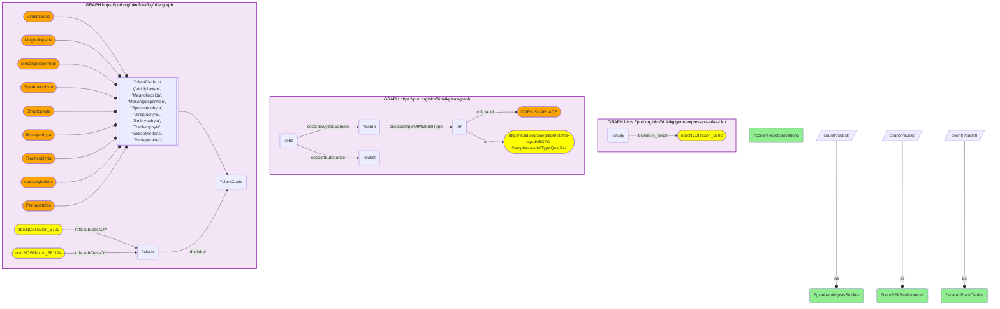

# Taxonomy Crosswalk 6 Q2 — GXA Arabidopsis × SAWGraph corn snaplage (shared plant clade)

- **Date:** 2026-10-13
- **Model:** claude-opus-5-5
- **SPARQL endpoint:** https://apps.okn.us/federation/sparql
- **Generated by:** mcp-okn v0.1.0 (build f738e02)
- **Contents:** 1 query · 1 query diagram

## Knowledge graphs used

- `gene-expression-atlas-okn` — <https://purl.org/okn/frink/kg/gene-expression-atlas-okn>
- `sawgraph` — <https://purl.org/okn/frink/kg/sawgraph>
- `ubergraph` — <https://purl.org/okn/frink/kg/ubergraph>

## Conversation

👤 **User**

Same clade-bridge idea on the plant side: Arabidopsis (GXA model plant) and corn/maize (SAWGraph PFAS-monitored crop). How much GXA expression data for Arabidopsis, how much PFAS data for corn, and which plant clades do they share? Join gene-expression-atlas-okn and sawgraph via the ubergraph NCBITaxon hierarchy.

---

🧠 **Assistant**

The plant-side clade relation mirrors the fish case. *Arabidopsis thaliana* (NCBITaxon:3702) and maize (*Zea mays* subsp. *mays*, NCBITaxon:381124) share **7 flowering-plant clades**: Mesangiospermae, Embryophyta, Viridiplantae, Magnoliopsida, Streptophyta, Tracheophyta and Spermatophyta. Across that shared lineage, GXA holds **638 Arabidopsis gene-expression studies**, while SAWGraph holds **224 PFAS observations covering 56 distinct substances** in corn snaplage.

The row answers the question: a maize crop monitored for PFAS in SAWGraph and Arabidopsis, the reference plant transcriptomic model in GXA, meet at the angiosperm/Viridiplantae clade, so the rich Arabidopsis expression resource can inform mechanistic study of PFAS uptake in the monitored crop. Like the fish case, this is only reachable through the ubergraph hierarchy because GXA and SAWGraph share no exact taxon.

**How the crop is found in SAWGraph now, and how firmly.** sawgraph v0.0.16 records this crop only as the Maine sample material "CORN SNAPLAGE" (ensiled ears of maize, fed to cattle); the edge that tied the material to the maize taxon on the previous release is gone. The query therefore selects the material by its label, and the statement that it is *Zea mays* is a reading of that name, not something the graph asserts. The maize NCBITaxon class still exists inside SAWGraph's embedded taxonomy, but nothing connects a sample to it.

**What kind of link this is.** It is a lineage analogy, not a crosswalk in the catalog's sense. Measured with SAWGraph's organisms read properly (86 of them), the Expression Atlas and SAWGraph share no taxon and neither has a taxon nested under the other's, so the pair has been retired from the taxon hub. The earlier clade overlap between them existed only because SAWGraph's embedded taxonomy contains inferred ancestor classes. What remains is what this example shows with two fixed species: they sit under common ancestors in ubergraph, which justifies read-across between them and nothing stronger.

**Literature validation (PubMed):** PFAS uptake and accumulation in agricultural crops/plants is documented — a PubMed search returns 16 articles (e.g. PMID 32717507, 35460639, 42240289, 38555786). Evidence exists, so the query is retained.

*This transcript was regenerated on 2026-10-13. Regenerated against sawgraph v0.0.16: the earlier version followed a taxon edge that no longer exists and reported 1,561 observations of 81 substances for corn; the material now reachable holds 224 observations of 56 substances.*

## SPARQL queries executed

#### Query 1

_2026-10-13T22:04:43+00:00 · `gene-expression-atlas-okn`, `sawgraph`, `ubergraph`_

```sparql
PREFIX biolink: <https://w3id.org/biolink/vocab/>
PREFIX rdfs: <http://www.w3.org/2000/01/rdf-schema#>
PREFIX coso: <http://w3id.org/coso/v1/contaminoso#>
SELECT ?gxaArabidopsisStudies ?cornPFASsubstances ?cornPFASobservations
  (GROUP_CONCAT(DISTINCT ?plantClade; separator=", ") AS ?sharedPlantClades)
WHERE {
  { SELECT (COUNT(DISTINCT ?study) AS ?gxaArabidopsisStudies) WHERE {
      GRAPH <https://purl.org/okn/frink/kg/gene-expression-atlas-okn> {
        ?study biolink:in_taxon <http://purl.obolibrary.org/obo/NCBITaxon_3702> } } }
  { SELECT (COUNT(DISTINCT ?subst) AS ?cornPFASsubstances) (COUNT(DISTINCT ?obs) AS ?cornPFASobservations) WHERE {
      GRAPH <https://purl.org/okn/frink/kg/sawgraph> {
        # sawgraph v0.0.16 records the maize crop only as a named sample material (no taxon edge)
        ?m a <http://w3id.org/sawgraph/v1/me-egad#EGAD-SampleMaterialTypeQualifier> ; rdfs:label "CORN SNAPLAGE" .
        ?samp coso:sampleOfMaterialType ?m . ?obs coso:analyzedSample ?samp ; coso:ofSubstance ?subst } } }
  GRAPH <https://purl.org/okn/frink/kg/ubergraph> {
    <http://purl.obolibrary.org/obo/NCBITaxon_3702> rdfs:subClassOf* ?clade .
    <http://purl.obolibrary.org/obo/NCBITaxon_381124> rdfs:subClassOf* ?clade .
    ?clade rdfs:label ?plantClade .
    FILTER(?plantClade IN ('Viridiplantae','Magnoliopsida','Mesangiospermae','Spermatophyta','Streptophyta','Embryophyta','Tracheophyta','eudicotyledons','Pentapetalae'))
  }
}
GROUP BY ?gxaArabidopsisStudies ?cornPFASsubstances ?cornPFASobservations
```



_1 row(s)_

| gxaArabidopsisStudies | cornPFASsubstances | cornPFASobservations | sharedPlantClades |
| --- | --- | --- | --- |
| 638 | 56 | 224 | Mesangiospermae, Embryophyta, Viridiplantae, Magnoliopsida, Streptophyta, Tracheophyta, Spermatophyta |
