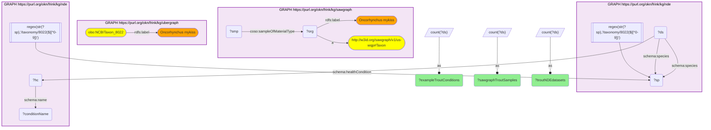

# Taxonomy Crosswalk 8 Q2 — Rainbow trout One Health (PFAS taxonomy + NDE disease)

- **Date:** 2026-10-13
- **Model:** claude-opus-5-5
- **SPARQL endpoint:** https://apps.okn.us/federation/sparql
- **Generated by:** mcp-okn v0.1.0 (build f738e02)
- **Contents:** 1 query · 1 query diagram

## Knowledge graphs used

- `sawgraph` — <https://purl.org/okn/frink/kg/sawgraph>
- `ubergraph` — <https://purl.org/okn/frink/kg/ubergraph>
- `nde` — <https://purl.org/okn/frink/kg/nde>

## Conversation

👤 **User**

Rainbow trout (Oncorhynchus mykiss, NCBITaxon:8022) is a key aquaculture fish that bioaccumulates PFAS. Confirm it sits in SAWGraph's PFAS fish taxonomy and report how many NDE disease datasets and which conditions involve it. Join sawgraph and nde on NCBITaxon:8022.

---

🧠 **Assistant**

Joining on rainbow trout confirms the One Health bridge: SAWGraph holds **33 rainbow-trout samples**, and the same species is the subject of **201 NIAID NDE datasets**. Example health conditions recorded for trout datasets include **arbovirus infection** and **bacterial infectious disease** (alongside many comparative-genomics / disease-model annotations such as anemia, atrial fibrillation, Alzheimer disease and aromatase deficiency).

The row answers the question: a single PFAS-bioaccumulating aquaculture species is simultaneously in SAWGraph's contaminant-monitoring scope and in NDE's infectious/immune-disease datasets — exactly the organism where PFAS exposure data and infection/immune data can be jointly analyzed. The result requires relating the two KGs through the taxon.

**How the two sides meet now.** In sawgraph v0.0.16 a sampled organism is a node carrying only its scientific name, so the SAWGraph side matches the organism labelled "Oncorhynchus mykiss" and counts its samples; ubergraph confirms that name is NCBITaxon:8022, which is the id NDE uses. The earlier version of this example only checked that the NCBITaxon class existed inside SAWGraph, which showed the species was in the vocabulary but not that anything had been sampled.

The condition list is the first twelve alphabetically, not a ranking by dataset count.

**Literature validation (PubMed):** PFAS bioaccumulation in salmonid/trout tissue is well documented (freshwater-fish PFAS literature, e.g. PMID 36280234, 37011692), and PFAS immunotoxicity (e.g. PMID 36814257, 38712868) supports overlaying contamination on the trout infectious-disease datasets. Evidence exists, so the query is retained.

*This transcript was regenerated on 2026-10-13. Regenerated against sawgraph v0.0.16; the NDE figures are unchanged, and the SAWGraph side now reports the sample count.*

## SPARQL queries executed

#### Query 1

_2026-10-13T21:56:32+00:00 · `sawgraph`, `ubergraph`, `nde`_

```sparql
PREFIX schema: <http://schema.org/>
PREFIX rdfs: <http://www.w3.org/2000/01/rdf-schema#>
PREFIX coso: <http://w3id.org/coso/v1/contaminoso#>
SELECT ?sawgraphTroutSamples ?troutNDEdatasets (GROUP_CONCAT(DISTINCT ?conditionName; separator="; ") AS ?exampleTroutConditions)
WHERE {
  # sawgraph v0.0.16 identifies a sampled organism by scientific name only
  { SELECT (COUNT(DISTINCT ?smp) AS ?sawgraphTroutSamples) WHERE {
      GRAPH <https://purl.org/okn/frink/kg/sawgraph> {
        ?org a <http://w3id.org/sawgraph/v1/us-wqp#Taxon> ; rdfs:label "Oncorhynchus mykiss" .
        ?smp coso:sampleOfMaterialType ?org . } } }
  { SELECT (COUNT(DISTINCT ?ds) AS ?troutNDEdatasets) WHERE {
      GRAPH <https://purl.org/okn/frink/kg/ubergraph> { <http://purl.obolibrary.org/obo/NCBITaxon_8022> rdfs:label "Oncorhynchus mykiss" }
      GRAPH <https://purl.org/okn/frink/kg/nde> { ?ds schema:species ?sp . FILTER(REGEX(STR(?sp),'/taxonomy/8022($|[^0-9])')) } } }
  {
    SELECT DISTINCT ?conditionName WHERE {
      GRAPH <https://purl.org/okn/frink/kg/nde> {
        ?ds schema:species ?sp . FILTER(REGEX(STR(?sp),'/taxonomy/8022($|[^0-9])'))
        ?ds schema:healthCondition ?hc . ?hc schema:name ?conditionName
      }
    } ORDER BY ?conditionName LIMIT 12
  }
}
GROUP BY ?sawgraphTroutSamples ?troutNDEdatasets
```



_1 row(s)_

| sawgraphTroutSamples | troutNDEdatasets | exampleTroutConditions |
| --- | --- | --- |
| 33 | 201 | Abnormality of neuronal migration; adjustment disorder; Alzheimer disease; anemia; Anophthalmia; arbovirus infection; aromatase deficiency; atrial fibrillation; Atrophy; attenuated familial adenomatous polyposis; autosomal recessive spondylocostal dysostosis; bacterial infectious disease |
