# Spaceflight zebrafish lineage joined to the PFAS panel SAWGraph measured in white perch

- **Date:** 2026-10-13
- **Model:** claude-opus-5-5
- **SPARQL endpoint:** https://apps.okn.us/federation/sparql
- **Generated by:** mcp-okn v0.1.0 (build f738e02)
- **Contents:** 1 query · 1 query diagram

## Knowledge graphs used

- `spoke-genelab` — <https://purl.org/okn/frink/kg/spoke-genelab>
- `ubergraph` — <https://purl.org/okn/frink/kg/ubergraph>
- `sawgraph` — <https://purl.org/okn/frink/kg/sawgraph>

## Conversation

👤 **User**

NASA's spaceflight fish model is the zebrafish (*Danio rerio*); SAWGraph monitors a fish of the same ray-finned lineage (white perch, *Morone americana*). Which **specific PFAS chemicals** has SAWGraph measured in that lineage-sharing fish — the real environmental contaminant panel a spaceflight zebrafish toxicology study could anchor to?

---

🧠 **Assistant**

spoke-genelab supplies the spaceflight organism (zebrafish) but no contaminant data; SAWGraph supplies the monitored organism + PFAS panel but no spaceflight context; only the ubergraph Actinopterygii clade links them. Each row therefore contains both a GeneLab organism and a SAWGraph organism + PFAS chemical.

**Spaceflight contrast:** n/a — organism-level (clade) join; no differential values read.

**The twelve PFAS chemicals SAWGraph has measured most often in white perch** — each row shows GeneLab + sawgraph data:

| GeneLab spaceflight organism | Shared clade (ubergraph) | SAWGraph organism | PFAS chemical (sawgraph) | Measurements |
|---|---|---|---|---|
| *Danio rerio* | Actinopterygii | *Morone americana* | 2H,2H,3H,3H-Perfluorooctanoic acid | 50 |
| *Danio rerio* | Actinopterygii | *Morone americana* | Perfluorobutanesulfonic acid | 27 |
| *Danio rerio* | Actinopterygii | *Morone americana* | Perfluorobutanoic acid | 27 |
| *Danio rerio* | Actinopterygii | *Morone americana* | Perfluorooctanesulfonic acid | 27 |
| *Danio rerio* | Actinopterygii | *Morone americana* | Perfluoropentanoic acid | 27 |
| *Danio rerio* | Actinopterygii | *Morone americana* | Perfluorooctanesulfonamide | 26 |
| *Danio rerio* | Actinopterygii | *Morone americana* | Perfluorodecanesulfonic acid | 24 |
| *Danio rerio* | Actinopterygii | *Morone americana* | 11-Chloroperfluoro-3-oxaundecanesulfonic acid | 23 |
| *Danio rerio* | Actinopterygii | *Morone americana* | 2-(N-Ethylperfluorooctanesulfonamido)acetic acid | 23 |
| *Danio rerio* | Actinopterygii | *Morone americana* | 3:3 Fluorotelomer carboxylic acid | 23 |
| *Danio rerio* | Actinopterygii | *Morone americana* | 4:2 Fluorotelomer sulfonic acid | 23 |
| *Danio rerio* | Actinopterygii | *Morone americana* | 6:2 Fluorotelomer sulfonic acid | 23 |

**Why it answers the question:** every row pairs the GeneLab spaceflight organism (*Danio rerio*) with the SAWGraph-monitored organism (*Morone americana*) and a real named PFAS chemical measured in it, linked only through the shared Actinopterygii clade — the concrete contaminant panel a spaceflight zebrafish study could anchor to. The panel mixes legacy perfluoroalkyl acids (PFOS, PFBS, PFBA, PFPeA), precursors (perfluorooctanesulfonamide, N-EtFOSAA), fluorotelomer acids and sulfonates, and a chlorinated ether replacement.

The measurement counts are analyses performed, not detections: they say how often each chemical was looked for in white perch, not how often it was found.

**How the organism is identified now.** sawgraph v0.0.16 no longer puts a taxon edge on its organism nodes — the `obo:RO_0002162` (in taxon) link the earlier version of this example followed has 2 triples left in the whole graph. A sampled organism is a `us-wqp:Taxon` node carrying only a scientific name, and the NCBITaxon classes sawgraph embeds sit beside those nodes unconnected. The query therefore matches the two by name inside sawgraph: the label of `NCBITaxon:46260` ("Morone americana") against the label of the taxon node. It is an exact string match on a scientific name — reliable for this species, but a name bridge rather than an identifier.

## Literature validation

Rericha et al., 2023, *Toxicological Sciences* — review establishing the zebrafish as a primary in-vivo model for PFAS toxicokinetics and toxicity, validating use of the spaceflight zebrafish model to interpret PFAS exposure in lineage-related wild fish. [PMID:37220906](https://pubmed.ncbi.nlm.nih.gov/37220906/) · [DOI](https://doi.org/10.1093/toxsci/kfad051)

*This transcript was regenerated on 2026-10-13 against sawgraph v0.0.16. The earlier version listed the panel alphabetically without counts and was built on the taxon edge the graph no longer carries.*

## SPARQL queries executed

#### Query 1

_2026-10-13T21:27:29+00:00 · `spoke-genelab`, `ubergraph`, `sawgraph`_

```sparql
PREFIX rdfs: <http://www.w3.org/2000/01/rdf-schema#>
PREFIX coso: <http://w3id.org/coso/v1/contaminoso#>
PREFIX gls: <https://purl.org/okn/frink/kg/spoke-genelab/schema/>
# GeneLab spaceflight zebrafish + SAWGraph white perch + PFAS, joined via the shared Actinopterygii clade.
SELECT ?geneLabOrganism ?sharedClade ?sawOrganism ?pfasChemical (COUNT(DISTINCT ?obs) AS ?measurements) WHERE {
  # GeneLab spaceflight zebrafish (Danio rerio, NCBITaxon_7955)
  { SELECT DISTINCT ?geneLabOrganism WHERE {
      GRAPH <https://purl.org/okn/frink/kg/spoke-genelab> {
        ?g gls:taxonomy <http://purl.obolibrary.org/obo/NCBITaxon_7955> ; gls:organism ?geneLabOrganism . } } }
  BIND("Actinopterygii (ray-finned fishes)" AS ?sharedClade)
  # zebrafish and white perch (Morone americana, NCBITaxon_46260) both descend from Actinopterygii (7898)
  GRAPH <https://purl.org/okn/frink/kg/ubergraph> {
    <http://purl.obolibrary.org/obo/NCBITaxon_7955> rdfs:subClassOf* <http://purl.obolibrary.org/obo/NCBITaxon_7898> .
    <http://purl.obolibrary.org/obo/NCBITaxon_46260> rdfs:subClassOf* <http://purl.obolibrary.org/obo/NCBITaxon_7898> .
  }
  # the PFAS chemicals SAWGraph measured in that fish. sawgraph v0.0.16 has no taxon edge on its
  # organism nodes, so the WQP taxon node is matched to the embedded NCBITaxon class by scientific name.
  GRAPH <https://purl.org/okn/frink/kg/sawgraph> {
    <http://purl.obolibrary.org/obo/NCBITaxon_46260> rdfs:label ?sawOrganism .
    ?mat a <http://w3id.org/sawgraph/v1/us-wqp#Taxon> ; rdfs:label ?sawOrganism .
    ?samp coso:sampleOfMaterialType ?mat . ?obs coso:analyzedSample ?samp ; coso:ofSubstance ?subst .
    ?subst rdfs:label ?pfasChemical . FILTER(STRSTARTS(STR(?subst),'http://w3id.org/DSSTox/'))
  }
} GROUP BY ?geneLabOrganism ?sharedClade ?sawOrganism ?pfasChemical ORDER BY DESC(?measurements) ?pfasChemical LIMIT 12
```

```mermaid
graph TD
classDef projected fill:lightgreen;
classDef literal fill:orange;
classDef iri fill:yellow;
  q0v11("?g")
  q0v5("?geneLabOrganism"):::projected 
  q0v13("?mat")
  q0v1("?measurements"):::projected 
  q0v15("?obs")
  q0v2("?pfasChemical"):::projected 
  q0v14("?samp")
  q0v3("?sawOrganism"):::projected 
  q0v4("?sharedClade"):::projected 
  q0v12("?subst")
  subgraph q0graph0["GRAPH https://purl.org/okn/frink/kg/spoke-genelab"]
    style q0graph0 fill:#f3e5f5,stroke:#8e24aa,stroke-width:2px,color:#000;
    q0graph0c2(["obo:NCBITaxon_7955"]):::iri 
    q0v11 --"gls:taxonomy"--> q0graph0c2
    q0v11 --"gls:organism"--> q0v5
  end
  q0bind0[/"'Actinopterygii (ray-finned fishes)'"/]
  q0bind0 --as--o q0v4
  subgraph q0graph1["GRAPH https://purl.org/okn/frink/kg/ubergraph"]
    style q0graph1 fill:#f3e5f5,stroke:#8e24aa,stroke-width:2px,color:#000;
    q0graph1c1(["obo:NCBITaxon_46260"]):::iri 
    q0graph1c2(["obo:NCBITaxon_7898"]):::iri 
    q0graph1c3(["obo:NCBITaxon_7955"]):::iri 
    q0graph1c1 --"rdfs:subClassOf*"--> q0graph1c2
    q0graph1c3 --"rdfs:subClassOf*"--> q0graph1c2
  end
  subgraph q0graph2["GRAPH https://purl.org/okn/frink/kg/sawgraph"]
    style q0graph2 fill:#f3e5f5,stroke:#8e24aa,stroke-width:2px,color:#000;
    q0graph2c4(["obo:NCBITaxon_46260"]):::iri 
    q0graph2c2(["http://w3id.org/sawgraph/v1/us-wqp#Taxon"]):::iri 
    q0graph2f0[["strstarts(str(?subst),'http://w3id.org/DSSTox/')"]]
    q0graph2f0 --> q0v12
    q0v13 --"a"--> q0graph2c2
    q0v13 --"rdfs:label"--> q0v3
    q0graph2c4 --"rdfs:label"--> q0v3
    q0v14 --"coso:sampleOfMaterialType"--> q0v13
    q0v15 --"coso:analyzedSample"--> q0v14
    q0v15 --"coso:ofSubstance"--> q0v12
    q0v12 --"rdfs:label"--> q0v2
  end
  q0bind1[/"count(?obs)"/]
  q0bind1 --as--o q0v1
```



_12 row(s)_

| geneLabOrganism | sharedClade | sawOrganism | pfasChemical | measurements |
| --- | --- | --- | --- | --- |
| Danio rerio | Actinopterygii (ray-finned fishes) | Morone americana | 2H,2H,3H,3H-Perfluorooctanoic acid | 50 |
| Danio rerio | Actinopterygii (ray-finned fishes) | Morone americana | Perfluorobutanesulfonic acid | 27 |
| Danio rerio | Actinopterygii (ray-finned fishes) | Morone americana | Perfluorobutanoic acid | 27 |
| Danio rerio | Actinopterygii (ray-finned fishes) | Morone americana | Perfluorooctanesulfonic acid | 27 |
| Danio rerio | Actinopterygii (ray-finned fishes) | Morone americana | Perfluoropentanoic acid | 27 |
| Danio rerio | Actinopterygii (ray-finned fishes) | Morone americana | Perfluorooctanesulfonamide | 26 |
| Danio rerio | Actinopterygii (ray-finned fishes) | Morone americana | Perfluorodecanesulfonic acid | 24 |
| Danio rerio | Actinopterygii (ray-finned fishes) | Morone americana | 11-Chloroperfluoro-3-oxaundecanesulfonic acid | 23 |
| Danio rerio | Actinopterygii (ray-finned fishes) | Morone americana | 2-(N-Ethylperfluorooctanesulfonamido)acetic acid | 23 |
| Danio rerio | Actinopterygii (ray-finned fishes) | Morone americana | 3:3 Fluorotelomer carboxylic acid | 23 |
| Danio rerio | Actinopterygii (ray-finned fishes) | Morone americana | 4:2 Fluorotelomer sulfonic acid | 23 |
| Danio rerio | Actinopterygii (ray-finned fishes) | Morone americana | 6:2 Fluorotelomer sulfonic acid | 23 |
