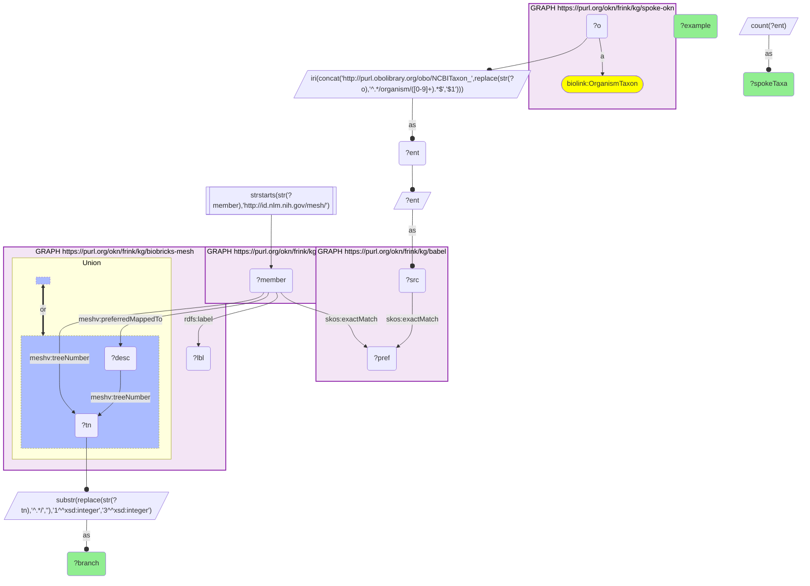

# T21-Q1: biobricks-mesh×spoke-okn (NCBITaxon via Babel) — 4,003 SPOKE-OKN taxa fall in MeSH's Bacteria branch (B03) and 2 in Archaea (B02)

- **Date:** 2026-10-13
- **Model:** claude-opus-5-5
- **SPARQL endpoint:** https://apps.okn.us/federation/sparql
- **Generated by:** mcp-okn v0.1.0 (build 3195263)
- **Contents:** 1 query · 1 query diagram

## Knowledge graphs used

- `spoke-okn` — <https://purl.org/okn/frink/kg/spoke-okn>
- `babel` — <https://purl.org/okn/frink/kg/babel>
- `biobricks-mesh` — <https://purl.org/okn/frink/kg/biobricks-mesh>

## Conversation

👤 **User**

Through Babel, which MeSH organism branches do SPOKE-OKN's taxa fall under?

---

🧠 **Assistant**

**Through babel, SPOKE-OKN's taxa land almost entirely in MeSH's Bacteria branch (B03, 4,003 taxa); two fall under Archaea (B02).**

| MeSH branch | SPOKE-OKN taxa | Example |
|---|---|---|
| B03 (Bacteria) | 4,003 | Staphylococcus auricularis |
| B02 (Archaea) | 2 | Sulfolobus acidocaldarius |

**Why bacteria.** SPOKE-OKN's organism nodes are genome records (`{taxid}.{n}`), and the taxa they resolve to in MeSH are bacterial. MeSH records many species as supplementary organism records that map to a genus or family descriptor; those are placed here by the branch of that descriptor.

**What it adds.** MeSH gives each taxon its literature-indexing terms and tree position, so SPOKE-OKN's organism data (for example drug responses of bacterial strains) can be grouped the way PubMed groups organisms.

**Join form.** SPOKE-OKN organism node `…/organism/{taxid}.{n}` → `http://purl.obolibrary.org/obo/NCBITaxon_{taxid}` → babel clique → `http://id.nlm.nih.gov/mesh/{id}` member, which is the biobricks-mesh record. Tree branch from `meshv:treeNumber` (via `meshv:preferredMappedTo` for supplementary records).

## SPARQL queries executed

#### Query 1

_2026-10-14T06:53:15+00:00 · `spoke-okn`, `babel`, `biobricks-mesh`_

```sparql
PREFIX biolink: <https://w3id.org/biolink/vocab/>
PREFIX rdfs: <http://www.w3.org/2000/01/rdf-schema#>
PREFIX skos: <http://www.w3.org/2004/02/skos/core#>
PREFIX up: <http://purl.uniprot.org/core/>
PREFIX obo: <http://purl.obolibrary.org/obo/>
PREFIX oa: <http://www.w3.org/ns/oa#>
PREFIX coso: <http://w3id.org/coso/v1/contaminoso#>
PREFIX sockg: <https://idir.uta.edu/sockg-ontology#>
PREFIX aop: <http://aopkb.org/aop_ontology#>
PREFIX dc: <http://purl.org/dc/elements/1.1/>
PREFIX meshv: <http://id.nlm.nih.gov/mesh/vocab#>
PREFIX spoke: <https://purl.org/okn/frink/kg/spoke-okn/schema/>
# SPOKE-OKN taxa (NCBITaxon, rebuilt from its organism node ids) mapped to MeSH organism
# records through babel, grouped by the top MeSH organism branch of the record's descriptor
# (a supplementary organism record is placed by the descriptor it maps to).
SELECT ?branch (COUNT(DISTINCT ?ent) AS ?spokeTaxa) (SAMPLE(?lbl) AS ?example) WHERE {
  { SELECT DISTINCT ?ent ?member WHERE {
    { SELECT DISTINCT ?ent ?pref WHERE {
        { SELECT DISTINCT ?ent ?src WHERE { GRAPH <https://purl.org/okn/frink/kg/spoke-okn> { ?o a <https://w3id.org/biolink/vocab/OrganismTaxon> } BIND(IRI(CONCAT('http://purl.obolibrary.org/obo/NCBITaxon_', REPLACE(STR(?o),'^.*/organism/([0-9]+).*$','$1'))) AS ?ent) BIND(?ent AS ?src) } }
        GRAPH <https://purl.org/okn/frink/kg/babel> { ?src <http://www.w3.org/2004/02/skos/core#exactMatch> ?pref } } }
    GRAPH <https://purl.org/okn/frink/kg/babel> { ?member <http://www.w3.org/2004/02/skos/core#exactMatch> ?pref } } }
  FILTER(STRSTARTS(STR(?member),'http://id.nlm.nih.gov/mesh/'))
  GRAPH <https://purl.org/okn/frink/kg/biobricks-mesh> { ?member rdfs:label ?lbl .
    { ?member meshv:treeNumber ?tn } UNION { ?member meshv:preferredMappedTo ?desc . ?desc meshv:treeNumber ?tn } }
  BIND(SUBSTR(REPLACE(STR(?tn),'^.*/',''),1,3) AS ?branch)
} GROUP BY ?branch ORDER BY DESC(?spokeTaxa)
```



_2 row(s)_

| branch | spokeTaxa | example |
| --- | --- | --- |
| B03 | 4003 | Staphylococcus auricularis |
| B02 | 2 | Sulfolobus acidocaldarius |
