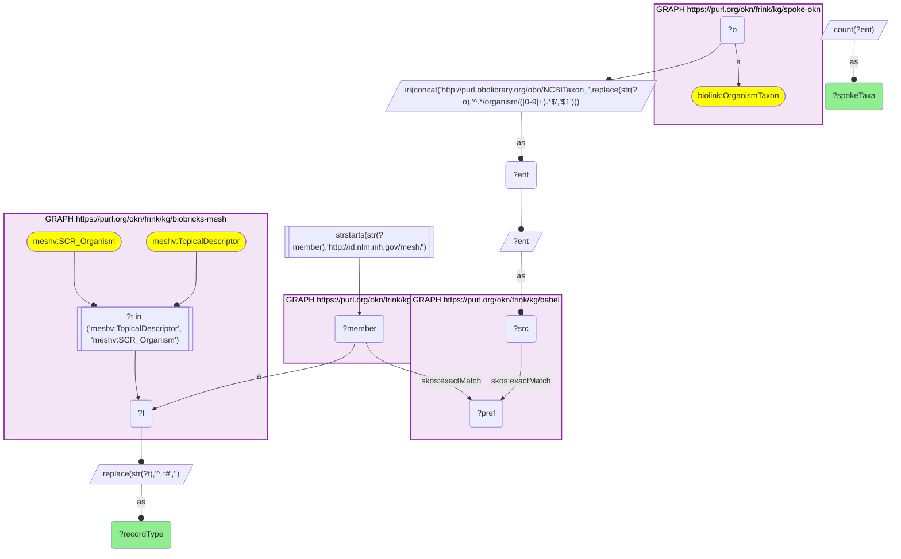
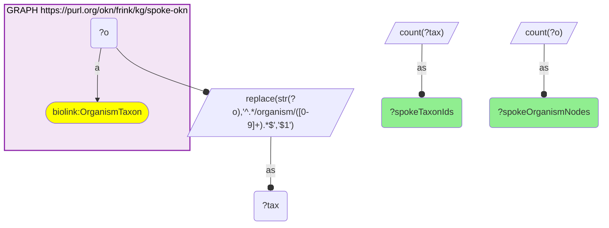

# T21-Q2: biobricks-mesh×spoke-okn — 4,078 of SPOKE-OKN's 34,570 NCBITaxon ids have a MeSH organism record, 3,745 of them a supplementary organism record

- **Date:** 2026-10-13
- **Model:** claude-opus-5-5
- **SPARQL endpoint:** https://apps.okn.us/federation/sparql
- **Generated by:** mcp-okn v0.1.0 (build 3195263)
- **Contents:** 2 queries · 2 query diagrams

## Knowledge graphs used

- `spoke-okn` — <https://purl.org/okn/frink/kg/spoke-okn>
- `babel` — <https://purl.org/okn/frink/kg/babel>
- `biobricks-mesh` — <https://purl.org/okn/frink/kg/biobricks-mesh>

## Conversation

👤 **User**

Same crosswalk, coverage angle: how many of SPOKE-OKN's taxa have a MeSH organism record, and of which kind?

---

🧠 **Assistant**

**4,078 of SPOKE-OKN's 34,570 NCBI taxon ids have a MeSH organism record: 3,745 through a supplementary organism record and 333 through a main descriptor.**

| Measure | Count |
|---|---|
| SPOKE-OKN organism nodes | 321,442 |
| distinct NCBI taxon ids in them | 34,570 |
| with a MeSH record, supplementary (SCR_Organism) | 3,745 |
| with a MeSH record, descriptor | 333 |

**Organism nodes versus taxa.** SPOKE-OKN has one node per genome (`organism/{taxid}.{n}`), so its 321,442 nodes collapse to 34,570 taxa. The crosswalk counts taxa.

**A new route for MeSH.** Until now biobricks-mesh joined other graphs only on chemicals and on spoke-okn's disease MeSH ids; babel's NCBITaxon–MeSH cliques add organisms.

**Join form.** NCBITaxon id rebuilt from the organism node → babel → MeSH member.

## SPARQL queries executed

#### Query 1

_2026-10-14T06:53:15+00:00 · `spoke-okn`, `babel`, `biobricks-mesh`_

```sparql
PREFIX biolink: <https://w3id.org/biolink/vocab/>
PREFIX rdfs: <http://www.w3.org/2000/01/rdf-schema#>
PREFIX skos: <http://www.w3.org/2004/02/skos/core#>
PREFIX up: <http://purl.uniprot.org/core/>
PREFIX obo: <http://purl.obolibrary.org/obo/>
PREFIX oa: <http://www.w3.org/ns/oa#>
PREFIX coso: <http://w3id.org/coso/v1/contaminoso#>
PREFIX sockg: <https://idir.uta.edu/sockg-ontology#>
PREFIX aop: <http://aopkb.org/aop_ontology#>
PREFIX dc: <http://purl.org/dc/elements/1.1/>
PREFIX meshv: <http://id.nlm.nih.gov/mesh/vocab#>
PREFIX spoke: <https://purl.org/okn/frink/kg/spoke-okn/schema/>
SELECT ?recordType (COUNT(DISTINCT ?ent) AS ?spokeTaxa) WHERE {
  { SELECT DISTINCT ?ent ?member WHERE {
    { SELECT DISTINCT ?ent ?pref WHERE {
        { SELECT DISTINCT ?ent ?src WHERE { GRAPH <https://purl.org/okn/frink/kg/spoke-okn> { ?o a <https://w3id.org/biolink/vocab/OrganismTaxon> } BIND(IRI(CONCAT('http://purl.obolibrary.org/obo/NCBITaxon_', REPLACE(STR(?o),'^.*/organism/([0-9]+).*$','$1'))) AS ?ent) BIND(?ent AS ?src) } }
        GRAPH <https://purl.org/okn/frink/kg/babel> { ?src <http://www.w3.org/2004/02/skos/core#exactMatch> ?pref } } }
    GRAPH <https://purl.org/okn/frink/kg/babel> { ?member <http://www.w3.org/2004/02/skos/core#exactMatch> ?pref } } }
  FILTER(STRSTARTS(STR(?member),'http://id.nlm.nih.gov/mesh/'))
  GRAPH <https://purl.org/okn/frink/kg/biobricks-mesh> { ?member a ?t FILTER(?t IN (meshv:TopicalDescriptor, meshv:SCR_Organism)) }
  BIND(REPLACE(STR(?t),'^.*#','') AS ?recordType)
} GROUP BY ?recordType
```



_2 row(s)_

| recordType | spokeTaxa |
| --- | --- |
| SCR_Organism | 3745 |
| TopicalDescriptor | 333 |

#### Query 2

_2026-10-14T06:53:15+00:00 · `spoke-okn`_

```sparql
PREFIX biolink: <https://w3id.org/biolink/vocab/>
PREFIX rdfs: <http://www.w3.org/2000/01/rdf-schema#>
PREFIX skos: <http://www.w3.org/2004/02/skos/core#>
PREFIX up: <http://purl.uniprot.org/core/>
PREFIX obo: <http://purl.obolibrary.org/obo/>
PREFIX oa: <http://www.w3.org/ns/oa#>
PREFIX coso: <http://w3id.org/coso/v1/contaminoso#>
PREFIX sockg: <https://idir.uta.edu/sockg-ontology#>
PREFIX aop: <http://aopkb.org/aop_ontology#>
PREFIX dc: <http://purl.org/dc/elements/1.1/>
PREFIX meshv: <http://id.nlm.nih.gov/mesh/vocab#>
PREFIX spoke: <https://purl.org/okn/frink/kg/spoke-okn/schema/>
SELECT (COUNT(DISTINCT ?tax) AS ?spokeTaxonIds) (COUNT(DISTINCT ?o) AS ?spokeOrganismNodes) WHERE {
  GRAPH <https://purl.org/okn/frink/kg/spoke-okn> { ?o a <https://w3id.org/biolink/vocab/OrganismTaxon> }
  BIND(REPLACE(STR(?o),'^.*/organism/([0-9]+).*$','$1') AS ?tax)
}
```



_1 row(s)_

| spokeTaxonIds | spokeOrganismNodes |
| --- | --- |
| 34570 | 321442 |
